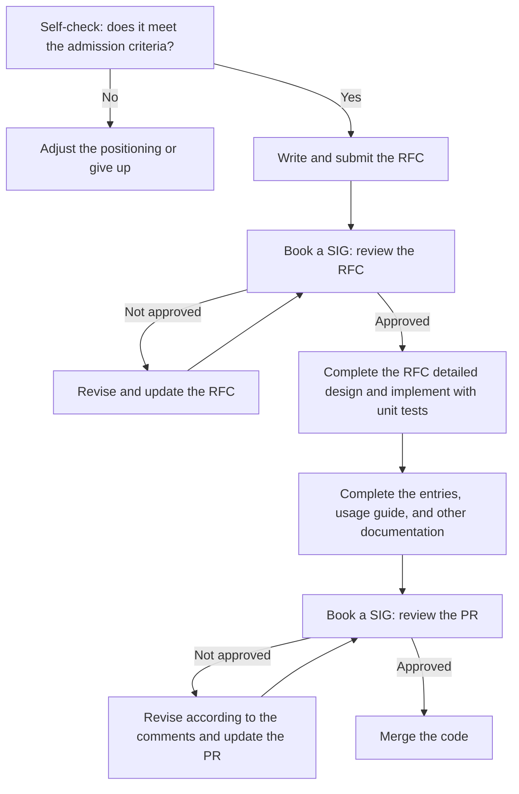

# Algorithm Contribution Guide

This document specifies the process, acceptance criteria, and deliverables for merging quantization, compression, and analysis algorithms into the msModelSlim **V1 framework**. The overall path is: complete the admission self-check and write an RFC, pass the SIG design review, then complete the detailed design plus the implementation and unit tests, complete the documentation, submit a PR, and finally merge after the SIG code review.

> **Core principle**: Do not chase a sheer number of algorithms. A merged algorithm must have a verifiable advantage over existing solutions in **at least one well-defined scenario** (one or more of accuracy, performance, resources, ease of use, or coverage gap). Duplicate implementations without a scenario advantage are generally not merged.

For the general PR and CI conventions, see [Contributing to MindStudio ModelSlim](contributing_guide.md).

## 1. Scope

This guide is intended for developers and algorithm engineers who plan to contribute algorithm components to the msModelSlim V1 framework. It specifies that contributed algorithms must complete the design review and code review at SIG meetings and be merged into the trunk after the code implementation, tests, and documentation are delivered.

**Applicable categories**:

| Category | Description | Example Directory |
| --- | --- | --- |
| Outlier suppression | Reshaping the activation or weight distribution before quantization | `processor/anti_outlier/`, `processor/quarot/` |
| Structural quantization | Weight quantization, activation quantization, KV Cache, Flash Attention (FA), and so on | `processor/quant/` |
| Model compression | Algorithms such as sparsification that reduce the parameter count or storage footprint | `processor/sparse/` |
| Sensitive layer analysis | Providing sensitivity metrics for fallback, mixed precision, and compression | `processor/analysis/` |

**Not applicable scenarios**:

- Incremental algorithms for the V0 framework -- migrate them first or reimplement them in V1;
- Changes only to configuration, best-practice YAML, or documentation errata -- submit a regular PR;
- Pure model adaptation (no new algorithm) -- follow the model integration guide;
- Small fixes or local enhancements of existing algorithms -- a regular Issue or PR is acceptable, but the scenario benefit must still be stated.

## 2. Process Relationship and Prerequisites

**Prerequisites**:

- You have read [Contributing to MindStudio ModelSlim](contributing_guide.md) and are able to submit Issues and PRs and sign the CLA;
- You have checked [Quantization Algorithm Overview](../knowledge_base/quantization_algorithms/README.md) and confirmed how the capability to contribute relates to existing algorithms;
- You have selected at least one set of models for the comparison experiments, together with the evaluation or calibration data: the models and data must be publicly available, or already referenced in this repository's documentation or in `lab_practice`; reviewers and other contributors must be able to reproduce the results with the same configuration without private weights or undisclosed datasets;
- The local development environment can run the project unit tests and pre-commit (see [Coding Standards](development_guide/coding_standards.md) and the [Developer Testing Guide](development_guide/testing_guide.md)).

**Follow-up operations**:

- After merging: accuracy and performance benefits can be registered for community outreach; the algorithm entry and the usage guide are maintained according to the documentation standards;
- If the RFC is not approved or the scenario advantage cannot be demonstrated: add scenarios and experiments and resubmit, or incubate the work as a lab plugin or in an external repository before proposing again.

## 3. Inputs and Deliverables

The admission self-check must be completed before this process starts; after it ends, an RFC Issue that has passed the design review and a mergeable algorithm PR must be delivered.

| Type | Name | Source or Save Location | Format or Constraint | Acceptance Method |
| --- | --- | --- | --- | --- |
| Input | Scenario and comparison experiment material | Written into the RFC Issue; attached to the later PR description when necessary | Includes the target object, the comparison baseline, the advantage dimensions, and the conclusion; at least one set of publicly reproducible models and datasets, plus the baseline configuration, this algorithm's configuration, the metric table, and the reproduction steps | The scenario advantage can be judged; others can reproduce the key conclusions by following the steps |
| Input | Overall design material | Written into the RFC Issue | Includes the end-to-end algorithm flow, the cross-model generalization approach, the user entry point, and the main configuration boundaries | It can be judged whether the design is feasible and can generalize to different models |
| Deliverable | Algorithm proposal Issue | A repository Issue with the label `rfc` | Suggested title: `[RFC][Algorithm] <algorithm name>: <one-sentence scenario advantage>`; when creating the Issue, select the **Request for comments (RFC)** template (which automatically carries the `rfc` label) | Passed the SIG design review |
| Deliverable | Algorithm merge PR | A PR targeting the target branch | Links the RFC; includes the implementation, unit tests, entries and usage guide, and overview updates; includes practice configurations when needed | Passed the SIG code review, with all merge labels present (`ascend-cla/yes`, `ci-pipeline-passed`, `lgtm`, `approved`) |

## 4. Process Overview

There are two official SIG gates: the **RFC design review** and the **PR code review**. The admission self-check is completed by the contributor before proposing and is not a separate meeting. The SIG meeting must not be skipped and merged directly. The main path is as follows:



## 5. Procedure

### Step 1: Self-Check Whether the Admission Criteria Are Met

**Goal**: Confirm that the algorithm to contribute has a mergeable scenario advantage and the basic conditions for open-source landing.

**Operation**: Complete the self-check against the following points. Before submitting, provide the **scenario definition** and the **comparison conclusion**; the scenario must contain at least:

1. **Target object**: The model family or structure type (such as an LLM Decoder, MLA, or diffusion UNet), the quantization mode (such as W4A8, W4A4 MXFP, or C8), or the business constraint (long sequences, limited memory, very little calibration data, and so on);
2. **Comparison baseline**: the recommended algorithm or combination already available in the framework with the same positioning (see  [Quantization Algorithm Overview](../knowledge_base/quantization_algorithms/README.md));
3. **Advantage dimensions** (at least one that is quantifiable or reproducible), with the dataset scope and the corresponding metrics (including the baseline and this algorithm); the models and data must be publicly reproducible:

   | Dimension | Acceptable Form of Advantage (Example) |
   | --- | --- |
   | Accuracy | Under the same quantization mode, the end-to-end metric is better than the baseline, or the bar is met for the first time on a structure where the baseline is not applicable |
   | Performance | With acceptable accuracy, the quantization time, inference throughput or latency, or the memory footprint is clearly better |
   | Coverage | Fills a gap in the framework (new quantization mode, new subgraph type, new analysis granularity, and so on) |
   | Resources and usability | At similar accuracy, the calibration data volume, compute, or tuning cost is significantly reduced |

   > **Accuracy evaluation requirement:** When claiming an accuracy advantage, the evaluation set must be a benchmark commonly used by the community; using only an overly simple, overly small, or self-built sampled set as the sole evidence is **not recommended**. Common references: GPQA Diamond, AIME26, DeepSWE, MMMU Pro; VBench can be used for multimodal generation. Select the set that matches the target object and the task, and state the evaluation set name and metrics in the self-check conclusion.

4. **Open-source landing**: whether the license and dependencies can land on the open-source path.

**Not regarded as a scenario advantage**:

- Highly overlapping with an existing algorithm in principle, with only the implementation or parameter names changed;
- Slightly better only on a single random seed, an undisclosed dataset, or a non-reproducible script;
- The accuracy comparison relies only on an overly simple/non-mainstream evaluation set, or no result on a community-common benchmark is given;
- Only the paper conclusion is given, without a configuration and comparison experiment that can run in this repository;
- The advantage depends on an unopened operator or a private runtime, with no explanation of how to land it on the open-source path.

**Output**: the admission self-check conclusion (including the scenario definition, dataset scope, and metric summary); if it is not met, adjust the positioning, extend an existing algorithm instead, or give up the proposal.

### Step 2: Write and Submit the RFC

**Goal**: submit the algorithm proposal with the repository Issue **Request for comments (RFC)** template for the **initial design review** at SIG. The initial submission **must** include chapter 1 Overview, chapter 2 Use Case Analysis, and **3.1 Overall Design**; the remaining template content can be completed after the initial review passes.

**Operation**:

1. Create a repository Issue and select **Request for comments (RFC)** in the template list (which automatically carries the `rfc` label); suggested title: `[RFC][Algorithm] <algorithm name>: <one-sentence scenario advantage>`.
2. **Required for the initial submission** (write the overall design, without implementation-level details):

   | RFC Body Chapter | Content to Specify |
   | --- | --- |
   | 1. Overview | Introduction, motivation, goals and non-goals (boundaries); embed the scenario and advantage summary from step 1 |
   | 2. Use Case Analysis | Applicable / not applicable scenarios; functional points and key metrics; comparison experiment summary (models, baseline, metrics, reproduction points); usage restrictions and constraints |
   | 3.1 Overall Design | Describe three things from the algorithm perspective: (1) **algorithm flow** (which steps are performed, which inputs are depended on, which results are produced, and how it cooperates with the preceding and following algorithms); (2) **tunable parameters** (which key knobs exist, their meaning, the recommended defaults, and the value ranges); (3) **model-side information requirements** (which structural or distribution information the algorithm needs the model to provide, and how it generalizes across model families). Text or a flowchart may be used |

   The comparison experiment is recommended to go into "2. Use Case Analysis" (charts may be attached); at least preliminary results should be given before the initial review:

   ```text
   Scenario: <model> + <quantization mode> + <constraint>
   Baseline: <existing solution and key parameters>
   This algorithm: <entry point and key parameters>
   Environment: software version, hardware, calibration data
   Evaluation set: <such as GPQA Diamond / DeepSWE / MMMU Pro / VBench ...>
   Metrics: accuracy / resources / inference (fill in according to the claimed advantage)
   Conclusion: the advantage is in <dimension>; not applicable to <scenario>
   ```

   3.1 Overall Design is recommended to be written according to the following outline (a flowchart may be attached):

   ```text
   Algorithm flow:
       Input: <floating-point weights / activations; whether calibration samples are needed and their form>
       Steps: <step 1 -> ... -> step N> (such as collecting statistics, computing smoothing coefficients, writing back weights)
       Output: <the processed weights or structure; the impact on subsequent quantization / compression steps>
       Relationship with the preceding and following algorithms: <what it usually follows and precedes>
   Tunable parameters:
       Key parameters: <name; meaning; recommended default; reasonable value range>
       Tuning advice: <which to tune first, and the approximate impact on accuracy / performance>
   Model-side information requirements:
       Required from the model: <such as the weights and activations of which layers / substructures, special connection relationships; write "no model-specific requirement" if none>
       Cross-model generalization: <how the same approach covers different model families or structure variants; what the boundaries are>
   ```

3. **Can be completed after the initial review**: apart from the required content above, all remaining chapters of the template can be written after the initial review passes.

**Output**: an algorithm proposal Issue with the `rfc` label and complete chapters 1-2 and 3.1.

**Pass condition**: chapters 1-2 and 3.1 are sufficient to support the initial SIG design review, and the process can move to step 3.

### Step 3: Book a SIG Meeting to Review the RFC

**Goal**: Book and complete the SIG design review of the RFC; after the initial review passes, complete the remaining RFC content and proceed to implementation once coding readiness is confirmed.

**Input**: the RFC Issue submitted in step 2 (with complete chapters 1-2 and 3.1).

**Operation**:

1. **How to book**: Comment on the RFC Issue to request a meeting slot (stating that an "algorithm RFC design review" is desired), and @ the [repository management and maintenance members](https://gitcode.com/Ascend/msmodelslim/member) (you can also refer to the `OWNERS` file in the repository root); mark the Issue as reviewable (such as Ready for SIG / Reviewing). For general technical exchange, you can also use the community channels in the repository README (WeChat groups, the Ascend forum, and so on); the SIG regular meeting slot is subject to the arrangement the maintainers state in the Issue.
2. **Material to prepare for the initial review**:
   - RFC chapters 1-2 and the 3.1 overall design;
   - The comparison experiment summary (reproducible models, data, baseline, and metrics);
3. **Focus of the initial SIG review**:
   - Whether the scenario advantage holds, and whether the comparison is fair and reproducible;
   - Whether the overall design is feasible: whether the end-to-end flow is clear, and whether the cross-model generalization and adaptation boundaries are reasonable;
   - Whether it duplicates the construction of existing capabilities, and whether it can be merged or extended;
   - Whether the new model-side information requirement / adaptation interface is necessary and minimized.
4. Revise the required chapters according to the meeting comments; **after the initial review passes**, complete the remaining template content and run another confirmation round if necessary. If the experiment scenarios given are insufficient, the review may require additional verification scenarios. Complex changes are expected to go through multiple review rounds.

**Output**: the SIG design review conclusion.

**Pass condition**: SIG confirms that the scenario advantage holds and the overall design is feasible.

### Step 4: Complete the RFC Detailed Design, the Code Implementation, and the Unit Tests

**Goal**: After the initial design review passes, complete the RFC detailed design first and then implement according to the design; maintain quality with unit tests during development, and the line coverage of the code related to this change should exceed 80%.

**Input**: the RFC that passed the design review.

**Operation**:

1. **Complete the remaining RFC chapters (detailed design)**: Write all the content agreed to be completed after the initial review passes (such as 3.2-3.5, test design, risks, prior art, open issues, and appendix), and refine the overall design to a codeable level: main module responsibilities, configuration fields and constraints, calibration / runtime requirements, relationship with the preceding and following algorithms, and the test plan. The details should still avoid implementation noise irrelevant to the review; the criterion is "a developer can start working according to the RFC".

2. **Code implementation**: The landing point follows the RFC and may involve algorithm components, application flows, domain or model adaptation, and so on. Follow [Coding Standards](development_guide/coding_standards.md) and pre-commit; do not introduce large dependencies unrelated to the scenario. The following uses **Processor integration** as an example to describe the integration process (see `msmodelslim/processor/anti_outlier/smooth_quant/`); other landing points can follow the RFC and the existing repository conventions by analogy.

   > **RFC -> Processor code landing point:**
   >
   > | RFC Content | Landing Point in Code |
   > | --- | --- |
   > | **Algorithm end-to-end flow** | Processor preprocessing / processing / postprocessing (`preprocess` / `process` / `postprocess`) |
   > | **Tunable parameters** | Config and YAML (`spec.process[].type` and fields) |
   > | **Model generalization mechanism** | Interface / ModelAdapter as needed |

   Recommended directory:

   ```text
   msmodelslim/processor/<category>/<algo_name>/
   ├── __init__.py          # Exports Config and Processor
   ├── processor.py         # The Config and Processor body and registration
   ├── interface.py         # [Optional] Model adaptation interface; define it when model-specific structures are used, otherwise omit it
   └── ...
   ```

   - **Algorithm configuration code (corresponding to the tunable parameters)**: define the Config in `processor.py`, inheriting from `AutoProcessorConfig`; declare the globally unique entry name with `type: Literal["your_type"]` (lowercase with underscores), consistent with `spec.process[].type` in the YAML. For each user-tunable field, state the default value and `description` with a Pydantic `Field`; constrain the value range, normalization, and so on with validators (such as `AfterValidator`), and an invalid configuration must fail at load time. Prefer reusing existing patterns such as `include` / `exclude` for the scope; state the mutual exclusion or dependency with other algorithms in the RFC and the field description.
   - **Register the Processor and integrate it into the session**: Inherit from or compose `AutoSessionProcessor` (or an existing base class of the same kind); register it with `@QABCRegistry.register(dispatch_key=YourConfig, abc_class=AutoSessionProcessor)`. Override as needed and keep consistent with the RFC: `is_data_free()`, `need_kv_cache()`, `support_distributed()`, and so on. Export the Config and Processor in the package `__init__.py` so that they are discoverable at configuration load time.
   - **Core logic organization** : Extract the numerical/transformation logic that is decoupled from the session into independently callable functions or methods, and let the Processor collect statistics, organize the context, and call them; this makes it easy for unit tests to cover formulas and boundaries. Multiple implementations or versions can be dispatched through a registry to avoid stacking branches inside the Processor.
   - **Processor preprocessing/postprocessing (corresponding to the algorithm end-to-end flow)**: Land the RFC flow in the session lifecycle -- the common hooks are `preprocess` / `process` / `postprocess`. When calibration data is needed, complete "attach statistics -> run the calibration data -> rewrite the structure or write back the parameters with the statistics"; when `is_data_free()` is true, the data-dependent path can be skipped. Specify the statistical object, the scope, and the skip or warning policy when there is no statistic or no hit; keep compatible with the data and structure assumptions of the preceding and following `spec.process` steps.
   - **Model adaptation interface (corresponding to the model generalization mechanism)**: If the algorithm needs model-specific structures or information, define the information requirement stated in the RFC as an Interface, implement it with a ModelAdapter, and provide at least one reference adaptation; when the interface is not implemented, there should be a diagnosable fallback or an explicit failure. It can be omitted when no model-specific information is needed.

3. **Unit tests (in step with the implementation)**: Add tests as you develop rather than all at once after the implementation is finished. The path corresponds to the source directory (example: `msmodelslim/processor/.../xxx.py` -> `test/cases/processor/.../test_xxx.py`); other modules follow the existing `test/cases/` convention. At least cover the Config validation, the core computation and boundaries, the critical paths of the Processor under mocks or small-scale fake data, and typical failure branches; algorithms that need calibration can use mocks or fake data so that CI does not depend on large model weights. Execute according to [Developer Testing Guide](development_guide/testing_guide.md) and confirm that the line coverage of the code related to this change exceeds 80%.

**Output**: the RFC with a complete detailed design; mergeable code consistent with the RFC; passing unit tests (coverage met).

**Pass condition**: The RFC detailed design can support the implementation and review; the related local unit tests pass, and the line coverage of the code related to this change exceeds 80%.

### Step 5: Complete the Entries, Usage Guide, and Other Documentation

**Goal**: Enable readers to select the algorithm from the overview and get started according to the guide.

**Input**: the user entry point, configuration fields, and applicable boundaries stabilized in step 4.

**Operation**: Complete the documentation according to the following deliverables:

| Deliverable | Requirement |
| --- | --- |
| Terminology entry | Applicable and not applicable scenarios are clearly stated; follow [Terminology Entry Template](development_guide/docs_standards/01_term_glossary_template.md) |
| Usage guide | Recommended starting configuration and tuning priority, avoiding a bare list of fields; follow [Process Guide Template](development_guide/docs_standards/02_process_guide_template.md) |
| Algorithm overview registration | Update the corresponding table and selection advice in [Quantization Algorithm Overview](../knowledge_base/quantization_algorithms/README.md) |
| Best practice | At least one reproducible configuration in `lab_practice/` (if applicable) |

Recommended documentation directory:

```text
docs/en/knowledge_base/quantization_algorithms/<algo_name>/
├── term_<name>.md
└── usage_<name>.md
```

**Output**: the entry, the usage guide, and the overview update; plus practice configurations as needed.

### Step 6: Book a SIG Meeting to Review the PR

**Goal**: Submit the PR, book and complete the SIG code review, and merge into the trunk once all labels are present.

**Input**: the output of steps 3-5; the RFC Issue link.

**Operation**:

1. **Submit the PR**:
   - Suggested title: `[Feature][Algorithm] <algorithm name>: <one-sentence scenario>`;
   - The PR must be linked to the RFC Issue; fill in the description according to the repository [PR template](../../../.gitcode/PULL_REQUEST_TEMPLATE.md), in full detail;
   - One PR focuses on one algorithm (or one tightly coupled set of changes);
   - Complete pre-commit and the unit test description according to [Contributing to MindStudio ModelSlim](contributing_guide.md), and comment `compile` to trigger CI.
2. **How to book the SIG code review**: comment on the PR to request a meeting slot (stating that an "algorithm merge code review" is desired), and @ the [repository management and maintenance members](https://gitcode.com/Ascend/msmodelslim/member); attach the PR and RFC links, and confirm that CI has passed or state the remaining items. The SIG regular meeting slot is subject to the arrangement the maintainers state in the PR.
3. **Material to prepare**:
   - **Complete RFC**: the chapters that could be left open during the initial review are all completed by now (including the detailed design and so on); attach the RFC Issue link;
   - **PR**: includes the code implementation, unit tests, and documentation (entry, usage guide, overview registration, and so on), with complete delivery; attach the PR link and describe the CI / unit test and coverage status;
   - **Self-verification report**: describe how the algorithm is used after being integrated into the framework, the accuracy and other key metric results, and whether they are consistent with the RFC / comparison experiment expectations; state the known remaining issues and risks as well.
4. **Focus of the SIG PR review**:
   - Whether the implementation is consistent with the approved RFC (including the detailed design), and whether there is any unreviewed interface or behavior drift;
   - Whether the verification after integration into the framework is sufficient (the critical paths run through, and it can be reasonably combined with the existing flow or other algorithms);
   - Whether the key data and conclusions in the RFC / comparison experiments can be reproduced with the public configuration;
   - Whether the code and unit test quality and coverage meet the bar, and whether the critical paths are maintainable;
   - Whether the documentation is complete (entry, usage guide, overview registration);
   - Whether the framework fit and the interface remain minimized;
   - Whether the merge labels and CI gates are satisfied.
5. After CI passes, a Reviewer comments `/lgtm` and a Committer comments `/approved`; merge once `ascend-cla/yes`, `ci-pipeline-passed`, `lgtm`, and `approved` are all collected.
6. After merging, the accuracy and performance benefits can be registered for community outreach.

**Output**: the algorithm capability merged into the trunk and the related documentation.

**Pass condition**: The SIG code review passes, and all four merge labels are present; the scenario advantage and the minimum acceptance threshold are both met.

**Exception handling**: If the review does not pass, revise the code, tests, or documentation according to the meeting and review comments, update the PR, and book another meeting slot; merging is not allowed without a passed review.

## 6. Acceptance Criteria

Before merging, both the scenario advantage justification and the minimum threshold must be satisfied; the review may require additional experiments.

| Threshold | Requirement |
| --- | --- |
| Scenario statement | The RFC Issue clearly states the applicable scenarios, the not applicable scenarios, and the recommended companion algorithms |
| Overall design and detailed design | The RFC clearly states the algorithm end-to-end flow, the cross-model generalization and adaptation boundaries, the user entry point, and the main configuration; the detailed design completed after the initial review is sufficient to support the implementation and review |
| Comparison experiment | At least one publicly obtainable model and dataset; the baseline configuration, this algorithm's configuration, the metric table, and the reproduction steps are given |
| Integrable | It can be integrated into the framework through the entry point agreed in the RFC and used in reasonable combination with the existing flow or other algorithms |
| Maintainable | It passes unit tests (line coverage of the code related to this change exceeds 80%) and pre-commit; the configuration or interface has types and validation; the critical paths have logs |
| Complete documentation | The entry and the usage guide are complete, and it is registered in [Quantization Algorithm Overview](../knowledge_base/quantization_algorithms/README.md) |

## 7. Terminology

| Term | Brief Description | Link |
| --- | --- | --- |
| Quantization algorithms | Descriptions of algorithms such as outlier suppression, structural quantization, model compression, and sensitive layer analysis | [Quantization Algorithm Overview](../knowledge_base/quantization_algorithms/README.md) |
| Quantization modes | Naming and conventions of bit-width combinations such as W8A8 and W4A8 | [Quantization Mode Naming Convention](../knowledge_base/model/README.md#quantization-mode-naming-convention) |

## 8. Security Notes

- Contributed code must comply with the repository Mulan PSL v2; when porting a paper or a third-party implementation, state the source, license, and differences.
- Do not commit keys, tokens, intranet paths, unauthorized datasets, or other sensitive information.
- The paths and account information in comparison experiments and practice configurations must be publicly reproducible; avoid writing private environment details.
