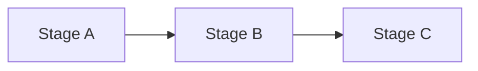

# {{workflow_name}} Workflow Guide

> **Note**:  
> Replace `{{workflow_name}}` with the specific workflow name, for example "mainstream model quantization" or "new model integration quantization". The name should let readers know immediately what is to be accomplished.  
>
> There are only three required sections: 1. Scope, 2. Inputs and Deliverables, and 3. Procedure. Sections whose headings carry `[OPTIONAL]` are kept as needed; if they are not needed, delete the whole section.

## 1. Scope

{{applicable_scope}}

> **Note**:  
> State clearly: who uses this workflow, in what scenarios it is used, and in what situations it should not be used. For example: models that have been verified in the support matrix and can use one-click quantization; unverified models should instead follow the new model quantization workflow.

## 2. [OPTIONAL] Process Relationships and Prerequisites

**Parent process**: {{parent_workflow}}  
**Prerequisites**:

- {{prerequisite_item_1}}
- {{prerequisite_item_2}}

**Follow-up operations**: {{follow_up_action}}

> **Note**:  
>
> - **Parent process**: the requirement or process from which this workflow is taken over, for example "after the model release review passes".  
> - **Prerequisites**: the environment, materials, or decisions that must already be in place before starting, written as checkable items, for example "msModelSlim of a compatible version is installed" or "the floating-point weights and tokenizer are ready".  
> - **Follow-up operations**: what follows after this workflow is completed, for example "proceed to release and monitoring", or "if the accuracy does not meet the requirement, proceed to tuning".

## 3. Inputs and Deliverables

| Type | Name | Source or Location | Format or Constraint | Acceptance Method |
| --- | --- | --- | --- | --- |
| Input | {{input_name}} | {{input_source}} | {{input_constraint}} | {{input_acceptance_method}} |
| Deliverable | {{deliverable_name}} | {{deliverable_location}} | {{deliverable_constraint}} | {{deliverable_acceptance_method}} |

> **Note**:  
>
> - **Input row**: what must be ready before the workflow starts. The name should be specific (such as "floating-point model directory"); the source states where it comes from; the constraint states which files or version requirements the directory should contain; the acceptance method states how availability is confirmed (such as "can be loaded by the target Transformers version").  
> - **Deliverable row**: what must be handed over when the workflow ends. The name should be specific (such as "quantized weight directory"); the location states the path; the constraint states which files must be included; the acceptance method states how compliance is confirmed (such as "contains quant_model_description.json and a smoke test of inference passes").  
>  
> Do not use names that cannot be located, such as "related files" or "processing results". Add table rows as needed.

## 4. [OPTIONAL] Process Overview

{{workflow_overview}}

> **Note**:  
> Give an end-to-end stage diagram before the procedure to help readers build a global order first.  
> A Mermaid or other flowchart is encouraged: replace Stage A/Stage B/Stage C with the real stage names, and annotate the main inputs and outputs on the edges when necessary.  
> The diagram is only an overview and cannot replace the "Procedure" below. Do not write `{{placeholder}}` in Mermaid code, because the curly braces are parsed as node shape syntax and cause an error.

## 5. Procedure

### Step {{step_number}}: {{step_name}}

> **Note**:  
> Copy this section in the actual execution order. Use "verb + object" for step headings, for example "confirm the model and quantization scheme" or "run one-click quantization".  
> Each step must at least contain "Action" and "Output"; the remaining fields are kept as needed.

**[OPTIONAL] Objective**: {{step_objective}}  

> **Note**:  
> State in one sentence the state this step should reach, for example "confirm that model_type and quant_type match the target inference scenario".

**[OPTIONAL] Inputs**: {{step_input}}  

> **Note**:  
> List the materials used directly in this step, preferring the output of the previous step or the specific items in the "Inputs and Deliverables" table, for example "the quantization scheme confirmed in Step 1 and the calibration dataset path".

**[OPTIONAL] Pre-execution Checks**: {{pre_execution_check}}  

> **Note**:  
> The conditions that must be verified before starting this step, for example "the quantization mode of this model is marked as verified in the support matrix" or "the NPU device is available". If the same requirement has already been written once in the global acceptance conditions, it need not be repeated here.

**Action**: {{step_action}}  

> **Note**:  
> Write actions that can be followed directly: commands, and which fields to change in the configuration. Explain the meaning of the parameters in the commands; for risky parameters such as trust_remote_code, state clearly the conditions for enabling them.

**Output**: {{step_output}}  

> **Note**:  
> Write the results newly produced by this step that subsequent steps can use, for example "the quantized weight directory `${SAVE_PATH}`". The output should be directly referenceable by the next step.

**[OPTIONAL] Pass conditions**: {{step_acceptance_criteria}}  

> **Note**:  
> The objective criteria for judging whether this step is finished, for example "the log outputs SUCCESS and the directory contains quant_model_description.json". Do not write only "success" or "done". If the same requirement is already written once in the global acceptance conditions, it need not be repeated here.

**[OPTIONAL] Audit Records**: {{retained_evidence}}  

> **Note**:  
> Write the information that needs to be retained for verification, reproduction, or audit; this is not a running log of every operation. Examples by scenario: the MD5/SHA256 of the quantized weight files, the YAML path actually used and its content hash, the version number of the evaluation report, a snapshot of the service configuration, and the debug_info directory path.

**[OPTIONAL] Troubleshooting**: {{exception_handling}}  

> **Note**:  
> Write what to do when this step fails or an exception occurs: what to check first, whether a retry is possible, which step to roll back to, and when to escalate. If this is already written once in the global troubleshooting, it need not be repeated here.

## 6. [OPTIONAL] Acceptance Conditions

{{global_acceptance_criteria}}

> **Note**:  
> The pass requirements at the level of the whole workflow, which are more macroscopic than the "Pass conditions" and "Pre-execution Checks" within a step, for example "an accuracy gain must not be claimed without a floating-point baseline" or "artifacts missing the description file must not be deployed".

## 7. [OPTIONAL] Troubleshooting

{{global_exception_handling}}

> **Note**:  
> The exception handling conventions at the level of the whole workflow, for example "if the accuracy does not meet the requirement, investigate according to the tuning guide and then rerun quantization and evaluation", or "if the requirement cannot be met, release a floating-point or higher-precision fallback version".  
> If the per-step "Troubleshooting" already covers this, delete this section to avoid duplication.

## 8. [OPTIONAL] Case List

| Case | Brief Description | Link |
| --- | --- | --- |
| {{case_name}} | {{case_summary}} | `[{{case_link_text}}]({{case_link}})`|

> **Note**:  
> Keep it an index table only: the case name, a one-sentence scenario description, and a clickable link. Write the detailed steps in the linked document; do not expand them into long text in this workflow guide.

## 9. [OPTIONAL] Terminology

| Term | Brief Description | Link |
| --- | --- | --- |
| {{term_name}} | {{term_summary}} | `[{{term_link_text}}]({{term_link}})` |

> **Note**:  
> Keep it an index table only: the term name, a one-sentence plain description, and a link to the authoritative definition or to the support matrix or algorithm document. Do not write long definitions in this table.

## 10. [OPTIONAL] Interface Documentation List

| API or Capability | Brief Description | Link |
| --- | --- | --- |
| {{interface_name}} | {{interface_summary}} | `[{{interface_link_text}}]({{interface_link}})` |

> **Note**:  
> Keep it an index table only: the command, API, or configuration protocol name, a one-sentence description of its purpose, and a link to the authoritative document. Write the parameter details in the linked document. For tool-oriented workflows, it is recommended to keep this section.

## 11. [OPTIONAL] Security Notes

{{security_considerations}}

> **Note**:  
> Write the security constraints specific to this workflow: for example, trust_remote_code may be enabled only for trusted models, the permission requirements for weights and calibration data, and whether logs contain sensitive content. If there are no additional security requirements, this section may be deleted.

## 12. [OPTIONAL] Product Form and Resource Constraints

{{product_form_and_resource_constraints}}

> **Note**:  
> Write the target product form and resource boundaries, for example: online inference service / offline batch processing; single-node multi-card / distributed; minimum NPU model and number of cards; minimum video memory / memory; supported version combinations of CANN, PyTorch, and the inference framework; Atlas inference products support only single-card quantization.  
> If there are no differences in form or resource constraints, this section may be deleted.
