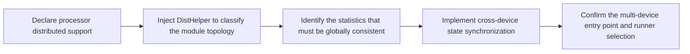

# Data Parallelism Usage Guide

## 1. Scope

This workflow applies to adapting the data parallelism mechanism for a quantization algorithm.

## 2. Process Relationships and Prerequisites

**Parent process**: the algorithm has completed quantization verification in a single-device scenario, and the model adapter has completed layer-wise loading adaptation (implementing the layer-wise interface of `ModelSlimPipelineInterfaceV1`).

**Prerequisites**:

- A single-node multi-device environment is available.

**Follow-up operations**: the model weights produced by multi-device quantization proceed to deployment and accuracy verification.

## 3. Inputs and Deliverables

| Type | Name | Source or Location | Format or Constraint | Acceptance Method |
| --- | --- | --- | --- | --- |
| Input | Quantization algorithm that has passed single-device verification | `msmodelslim/processor/` (an existing implementation in this repository or a new one) | The base class `support_distributed()` returns `False` by default and must be overridden according to this workflow | The single-device quantization artifact is correct and the quantization workflow runs through completely |
| Input | Model adapter | `msmodelslim/model/` | Supports `layer_wise` layer-by-layer loading (interfaces such as `generate_decoder_layer`) | `msmodelslim quant` can hit it and load it layer by layer on a single device |
| Deliverable | Processor code that declares and implements synchronization | `msmodelslim/processor/` (modified in place at the original path) | `support_distributed()` returns `True`; the Observer / Processor implements cross-device synchronization according to this workflow | Passes the distributed support check when `DPLayerWiseRunner` starts (no `UnsupportedError` in the log) |

## 4. Process Overview



## 5. Procedure

### Step 1: Declare Processor Distributed Support

**Objective**: make every Processor in the quantization pipeline declare that it supports multi-device execution.

**Inputs**: all Processor implementations involved in the quantization configuration `spec.process`.

**Action**:

1. In the Processor class, override `support_distributed()` (the base class [`BaseSessionProcessor`](https://gitcode.com/Ascend/msmodelslim/blob/master/msmodelslim/processor/base.py) returns `False` by default):

   ```python
   def support_distributed(self) -> bool:
       return True
   ```

2. Check the DP coverage against the Processor table in the [Parallel Mechanism Support List](../README.md#3-parallel-mechanism-support-list); Processors that do not yet support DP must be adapted according to the following steps.

**Output**: a Processor implementation whose `support_distributed()` returns `True`.

**Pass conditions**: starting on multiple devices no longer reports `UnsupportedError` because a processor is unsupported.

**Troubleshooting**: if the log reports unsupported processors, add the `support_distributed()` override for each of them.

### Step 2: Inject DistHelper to Classify Shared and Local Modules

**Objective**: enable the algorithm to determine "which modules need cross-device synchronization and which modules must not be synchronized", drawing a safe boundary for statistics reduction.

**Inputs**: the Processor from step 1 (its `preprocess` operates on the model structure).

**Pre-execution Checks**: whether the algorithm also performs structural changes in `preprocess`, such as inserting Observers or replacing the IR.

**Action**:

1. In `preprocess`, **after all structural changes are complete**, initialize and inject the statistics component `DistHelper` (taking FA3 as an example, see [`processor.py`](../../../../../msmodelslim/processor/quant/fa3/processor.py)):

   ```python
   if dist.is_initialized():
       self.dist_helper = DistHelper(request.module, prefix=request.name)
       for _, submodule in request.module.named_modules(prefix=request.name):
           if not isinstance(submodule, _FA3PerHeadObserver):
               continue
           submodule.set_dist_helper(self.dist_helper)
   ```

   - When `DistHelper` is constructed, it performs one `all_gather_object` over each rank's `named_modules` to automatically distinguish shared modules (present on every rank) from `local_only` modules (held only by the current rank, typically the routed experts under EP).
   - **Ordering constraint**: `DistHelper` is a topology snapshot and does not refresh after construction when the model changes; if an Observer is inserted or the IR is replaced after initialization, `is_shared` will return results based on the old structure, causing abnormal algorithm behavior. It must therefore be initialized after all structural changes are complete.

**Output**: the `DistHelper` instance injected into the statistics component.

**Pass conditions**: every rank returns the same result from `is_shared` for the same shared module name.

**Troubleshooting**: if the multi-device results are inconsistent and the classification is suspected of being stale, check whether `DistHelper` is initialized later than all structural changes; a `local_only` module (an EP local expert) that is misjudged as shared and synchronized will manifest as a hang or incorrect results.

### Step 3: Identify the Statistics That Must Be Globally Consistent

**Objective**: determine which variables in this algorithm must stay consistent across ranks, forming a list of items to synchronize.

**Inputs**: the algorithm's calibration forward pass and quantization parameter computation logic.

**Action**:

Sort out the variables in the algorithm that are accumulated from the calibration data and ultimately determine the quantization result, for example:

- **Activation statistics**: the `min` / `max` / `sum` and so on accumulated by the Observer;
- **Quantization parameters**: the quantization parameters computed from the statistics (scale / zero point) and so on;
- **Smoothing / rotation coefficients**: the smoothing coefficient of FlexSmoothQuant, the rotation matrix of QuaRot, and so on;
- **Calibration-period cache**: activation tensors cached per batch (such as `StatKey.TENSOR` statistics).

Decision principle: any quantity that each device computes from its own local slice of the calibration data as a different value but that must be written into the final model needs to be made consistent across devices.

**Output**: the list of variables to synchronize.

**Pass conditions**: the list covers every quantity in the algorithm that affects the final quantization result and varies with the calibration shard.

### Step 4: Implement Cross-Device State Synchronization

**Objective**: perform collective communication on the statistics / parameters of shared modules so that every rank obtains global values equivalent to holding the complete calibration set.

**Inputs**: the list of variables to synchronize from step 3, and the `DistHelper` injected in step 2.

**Action**: choose one or a combination of the following according to the algorithm's form, reusing the existing utilities in [`dist_ops.py`](https://gitcode.com/Ascend/msmodelslim/blob/master/msmodelslim/utils/distributed/dist_ops.py) where possible:

| Utility Function | Main Parameters | Function and Typical Scenario |
| --- | --- | --- |
| `sync_base_operation` | `tensor` (updated in place); `op`: `min`/`max`/`sum`/`mean`/`prod`; `group` (optional) | Performs collective communication on same-shaped tensors across ranks and writes the result back to the same `tensor`. Suitable for aligning statistics accumulated inside the Observer, such as min/max and channel_max |
| `sync_gather_tensors` | `tensor`; `variable_shapes`; `on_cpu`; `group` | Collects each rank's single tensor into a list of length `world_size`. Suitable when each rank's sharded data must be kept rather than merged into a single statistic |
| `sync_gather_tensor_lists` | `tensor_list`; `on_cpu`; `group` | Collects each rank's tensor list and flattens it into one large list. Suitable for merging the activation tensors cached per batch during calibration all at once in `postprocess` |

- **Form A: synchronization inside the Observer** (the statistics are accumulated in the Observer).
  Taking [FA3PerHeadObserver](https://gitcode.com/Ascend/msmodelslim/blob/master/msmodelslim/processor/quant/fa3/processor.py) as an example, the Observer passes a synchronization switch `sync` based on the shared-module decision during the forward pass:

  ```python
    def forward(self, x: torch.Tensor) -> torch.Tensor:
        samples = x.contiguous().view(x.shape[1], -1)
        sync = self._dist_helper is not None and self._dist_helper.is_shared(self._name)
        self._observer.update(samples, sync=sync)
        return x
  ```

  [RecallWindowObserver](https://gitcode.com/Ascend/msmodelslim/blob/master/msmodelslim/core/observer/recall_window.py) calls `sync_base_operation` to reduce according to the synchronization switch when it updates the activation statistics internally:

  ```python
    if sync and dist.is_initialized():
        sync_base_operation(self._min_values, op="min")
        sync_base_operation(self._max_values, op="max")
  ```

- **Form B: synchronization inside the Processor** (during calibration only activations are cached locally).
  Taking [FlexSmoothQuant](https://gitcode.com/Ascend/msmodelslim/blob/master/msmodelslim/processor/anti_outlier/flex_smooth/processor.py) as an example, the hook only appends activation tensors locally:

  ```python
  # FlexStatsCollector.create_hook: the calibration forward pass only collects locally
  cpu_tensor = tensor.to("cpu").reshape(-1, tensor.shape[-1])
  if StatKey.TENSOR not in module_stats:
      module_stats[StatKey.TENSOR] = [cpu_tensor]
  else:
      module_stats[StatKey.TENSOR].append(cpu_tensor)
  ```

  In `postprocess`, the class method `sync_act_stats` is called to merge each shared module's local tensor list across devices before continuing the algorithm:

  ```python
  # Inside FlexStatsCollector.sync_act_stats:
  local_tensors = self.act_stats[name][StatKey.TENSOR]
  merged = sync_gather_tensor_lists(local_tensors, on_cpu=on_cpu)
  self.act_stats[name][StatKey.TENSOR] = merged
  ```

**Output**: the Observer / Processor implementation with cross-device synchronization completed.

**Pass conditions**: after the multi-device calibration finishes, the values of the variables to synchronize are identical on every rank, semantically equivalent to full calibration on a single device.

**Troubleshooting**: on a deadlock or hang, check whether collective communication is being issued for `local_only` modules; when the values are inconsistent, check the `DistHelper` ordering (step 2) and whether the synchronization points cover all the variables to synchronize (step 3).

### Step 5: Confirm the Multi-Device Quantization Entry Point and Runner Selection

**Objective**: confirm that quantization will run in the multi-device DP manner, and clarify the trigger conditions and the effective scope.

**Inputs**: the quantization YAML and the target device list.

**Action**:

1. Declare the runner in the quantization configuration (choose one):

   ```yaml
   spec:
     runner: "dp_layer_wise"   # explicitly specify distributed layer-wise quantization
   # runner: "auto"            # or let the framework select automatically based on the device count
   ```

2. Specify multiple devices through the command line:

   ```shell
   msmodelslim quant \
     --model_path ${MODEL_PATH} \
     --save_path ${SAVE_PATH} \
     --model_type ${MODEL_TYPE} \
     --quant_type ${QUANT_TYPE} \
     --device npu \
     --device_id 0 1 2 3 4 5 6 7
   ```

   `--device_id 0 1 2 3 4 5 6 7` specifies the list of device indexes that participate in quantization.

3. Confirm the runner actually selected. `_choose_runner_type` of `modelslim_v1` decides the execution pipeline by the following rules (corresponding to [`quant_service.py`](https://gitcode.com/Ascend/msmodelslim/blob/master/msmodelslim/core/quant_service/modelslim_v1/quant_service.py)):

   | `spec.runner` Value | Device List | Selected Runner |
   | --- | --- | --- |
   | `model_wise` | Any | `ModelWiseRunner` |
   | `layer_wise` | Any | `LayerWiseRunner` |
   | `dp_layer_wise` | Any | `DPLayerWiseRunner` |
   | `auto` | Multiple devices (> 1) | `DPLayerWiseRunner` |
   | `auto` (or not configured) | Single device / unspecified | `LayerWiseRunner` |

   In `DPLayerWiseRunner.run()`, when the number of devices is <= 1 it falls back to single-device `LayerWiseRunner` execution and prints a warning ([`dp_layer_wise_runner.py`](https://gitcode.com/Ascend/msmodelslim/blob/master/msmodelslim/core/runner/dp_layer_wise_runner.py)).

**Output**: a configuration (YAML + command) confirmed to run multi-device quantization with `DPLayerWiseRunner`.

**Pass conditions**: the log shows `Starting distributed execution with N devices` (N >= 2) and each rank prints `Rank i/N initialized on device ...`.

**Troubleshooting**: if the log shows a fallback to a single device (`Number of devices <= 1, falling back to single-device execution`), check whether multiple indexes were passed to `--device_id` (for example `--device_id 0 1 2 3 4 5 6 7`); the multimodal VLM service does not support multiple devices (see Scope), so confirm that the target service is `modelslim_v1`.

## 6. Acceptance Conditions

- Multi-device quantization completes successfully after the multi-device quantization command is run, with no errors in the log;

## 7. Case List

| Case | Brief Description | Link |
| --- | --- | --- |
| FA3Quant multi-device adaptation | `sync_base_operation` inside the Observer reduces the per-head min/max; a complete example of completeness support (step 4 of this guide contains the code snippet) | [FA3QuantProcessor](https://gitcode.com/Ascend/msmodelslim/blob/master/msmodelslim/processor/quant/fa3/processor.py) |

## 8. Terminology

| Term | Brief Description | Link |
| --- | --- | --- |
| Data Parallelism (DP) | Each rank holds a complete model replica, the calibration data is split by rank, and statistics are reduced across devices | *[Data Parallelism](term_data_parallelism.md)* |
| Expert Parallelism (EP) | Routed experts are sharded by rank, introducing `local_only` modules held only by the current rank | *[Expert Parallelism](../expert_parallelism/term_expert_parallelism.md)* |

## 9. Interface Documentation List

| API or Capability | Brief Description | Link |
| --- | --- | --- |
| `DistHelper` | Module topology classification utility: `is_shared` / `is_local_only` | [dist_helper.py](https://gitcode.com/Ascend/msmodelslim/blob/master/msmodelslim/utils/distributed/dist_helper.py) |
| `sync_base_operation` and others | Cross-rank statistics reduction utility functions | [dist_ops.py](https://gitcode.com/Ascend/msmodelslim/blob/master/msmodelslim/utils/distributed/dist_ops.py) |
| `support_distributed()` | Processor distributed support declaration (the base class returns `False`) | [processor/base.py](https://gitcode.com/Ascend/msmodelslim/blob/master/msmodelslim/processor/base.py) |
| `ascendv1_saver_distributed` | Distributed saver (converted automatically from `ascendv1_saver`) | [ascendv1_distributed.py](https://gitcode.com/Ascend/msmodelslim/blob/master/msmodelslim/core/quant_service/modelslim_v1/save/ascendv1_distributed.py) |
| `--device npu --device_id 0 1 ...` | Multi-device quantization entry configuration | *[One-Click Quantization Usage Guide](../../../user_guide/usage_one_click_quantization.md)* |

## 10. Product Form and Resource Constraints

- **Limitation**: currently only single-node multi-device is supported; because the quantization scheduling flow on each device is essentially the same as the layer-wise quantization logic, the memory requirement is essentially the same as single-device quantization.
- **Resources**: the multi-device speedup is affected by I/O reads and writes, the algorithm's compute density, hardware performance, and synchronization frequency; the speedup does not scale strictly linearly with the number of devices.
- **Calibration set size**: when the calibration set is small, the communication overhead may exceed the parallel gain and the multi-device speedup is not obvious; evaluate the parallel gain against the actual calibration set size.
- **Algorithm support**: only algorithms that support distributed execution can work correctly in a multi-device environment.
