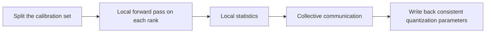

# Data Parallelism

> **Entry Category**: Other
>
> **English Name**: Data Parallelism
>
> **Abbreviation**: DP
>
> **Chinese Aliases**: Distributed Data Parallelism, Multi-Device Data Parallelism
>
> **Application Domain**: Large-model multi-device quantization, calibration data parallelism acceleration
>
> **msModelSlim Implementation**: [msmodelslim/core/runner/dp_layer_wise_runner.py](../../../../../msmodelslim/core/runner/dp_layer_wise_runner.py)

---

## 1. Overview

Data parallelism (Data Parallelism, DP) is the fundamental parallel paradigm in multi-device quantization: every rank holds a homogeneous model replica with identical values, the calibration data is split by rank, each device performs the forward pass and computes statistics only for its own shard, and collective communication brings every rank to a consistent quantization state. It solves the problems of insufficient single-device calibration throughput and of excessively long runtimes for very large calibration sets.

---

## 2. Term Description

### 2.1 Background and Motivation

Post-training quantization (Post-Training Quantization, PTQ) of large models relies on the calibration forward pass to collect activation statistics. As the model scale and the calibration sample size grow, serial calibration on a single device becomes a time bottleneck. An effective remedy is to split the calibration dataset and run the forward calibration on several model replicas at the same time.

### 2.2 Principles

#### 2.2.1 Core Idea

- **Homogeneous model replicas**: every rank loads the same set of model structure and weights, avoiding failures to align between ranks caused by topology differences.
- **Data sharding**: the calibration set is divided by rank and the forward calibration runs in parallel, which shortens the wall-clock time of the forward calibration.
- **State synchronization**: collective communication is performed on the statistics required for quantization, such as the maximum and the minimum of the activations, so that each rank's quantization state is semantically consistent with single-device quantization.

#### 2.2.2 Key Properties

- **Semantic equivalence**: given that collective communication is performed correctly, multi-device quantization and single-device quantization are semantically equivalent.

### 2.3 Process Flow

> For detailed adaptation steps and cases, see *[Data Parallelism Usage Guide](data_parallelism_guide.md)*.

### 2.4 Applicable Scenarios and Limitations

#### 2.4.1 Applicable Scenarios

- Multi-device PTQ with a large calibration set.

#### 2.4.2 Usage Limitations

- The memory of a single device must be able to hold at least one layer of model weights.
- Every algorithm involved in the quantization must already implement distributed support.

---

## 3. Related Workflows

- *[Data Parallelism Usage Guide](data_parallelism_guide.md)*: explains DP completeness support, statistics synchronization, and the adaptation steps.
- *[One-Click Quantization Usage Guide](../../../user_guide/usage_one_click_quantization.md)*: triggers multi-device quantization by passing multiple device indexes through the `--device npu --device_id 0 1 2 3 4 5 6 7` parameters.

---

## 4. Related Terms

- [Expert Parallelism](../expert_parallelism/term_expert_parallelism.md): a companion term; in MoE model quantization scenarios it is combined with DP to further accelerate and reduce memory usage.
- [Distributed Task Scheduler](../distributed_task_scheduler/term_distributed_task_scheduler.md): a follow-up term; it schedules the execution of compute-intensive algorithms on top of DP to further increase the quantization speed.

---

## 5. Reference Documents

1. *[One-Click Quantization Usage Guide](../../../user_guide/usage_one_click_quantization.md)*
