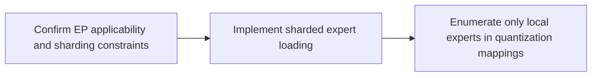

# Expert Parallelism Usage Guide

## 1. Scope

This workflow applies to multi-device quantization adaptation for MoE models, especially when the memory of a single device is insufficient to load all experts; integrating the expert parallelism mechanism can effectively reduce the memory requirement. The number of routed experts must be divisible by the number of devices.

## 2. Process Relationships and Prerequisites

**Parent process**: the model adapter has completed layer-wise loading adaptation; the quantization algorithm has completed support for the [Data Parallelism Usage Guide](../data_parallelism/data_parallelism_guide.md) (including DistHelper injection and cross-device synchronization).

**Prerequisites**:

- The algorithms involved in the quantization scheme already support DP.
- Distributed saving is handled by `DPLayerWiseRunner`, which automatically converts `ascendv1_saver` into `ascendv1_saver_distributed`; the adaptation side does not need to change the YAML.

**Follow-up operations**: quantization accuracy verification.

## 3. Inputs and Deliverables

| Type | Name | Source or Location | Format or Constraint | Acceptance Method |
| --- | --- | --- | --- | --- |
| Input | MoE model adapter | `msmodelslim/model/` (new or existing) | Supports layer-by-layer loading | `--model_type` hits the adapter |
| Input | Quantization algorithm with DP completeness adaptation completed | `msmodelslim/processor/` | DP support already implemented according to the [Data Parallelism Usage Guide](../data_parallelism/data_parallelism_guide.md) | Multi-device statistics synchronization is correct |
| Deliverable | EP-ified model loading / construction code | `msmodelslim/model/` (modified in place or a new patch module) | Each rank loads only local experts; in a single process it automatically degrades to all experts | On multiple devices, non-local expert modules do not exist on each rank (or are `None` slots) |

## 4. Process Overview



## 5. Procedure

### Step 1: Confirm EP Applicability and Sharding Constraints

**Objective**: confirm that the model is suitable for EP sharding and satisfies the framework's sharding constraints.

**Inputs**: the model's `config.json` (`num_experts` / `n_routed_experts`).

**Action**:

1. Confirm that the model has an MoE structure and that the number of routed experts is divisible by `world_size`. The framework's unified sharding utility [`utils.py`](https://gitcode.com/Ascend/msmodelslim/blob/master/msmodelslim/model/common/utils.py) behaves as follows:

   - `world_size <= 1` (distributed not initialized / single process): returns the full range `[0, num_experts)` and EP does not take effect;
   - `world_size > 1`: shards contiguously by `n_local = num_experts // world_size`, and the range of rank `r` is `[r * n_local, (r+1) * n_local)`;
   - `num_experts % world_size != 0`: raises `SchemaValidateError` (indicating that the number of experts must be divisible by the world size).

**Output**: a model structure analysis document.

### Step 2: Implement Sharded Expert Loading

**Objective**: make each rank load / hold only local experts, while ensuring that the single process scenario automatically degrades to all experts.

**Inputs**: the local expert range confirmed in step 1; the model construction code (custom weight-directory code or in-repository construction).

**Action**: rewrite the `__init__` and `forward` methods of the MoE class in the model construction file.

- **Form A: monkey-patch the model class** (case: [Kimi-K3 `ep_patches.py`](https://gitcode.com/Ascend/msmodelslim/blob/master/msmodelslim/model/kimi_k3/ep_patches.py)):

  1. Locate the MoE block class in the weight directory (for Kimi-K3 it is `KimiSparseMoeBlock`);
  2. Patch the `__init__` method to build a **full-length `ModuleList`** according to `resolve_expert_ep_range(config.num_experts)`, filling non-local experts with `None`:

     ```python
     self.experts = nn.ModuleList([
         mlp_cls(config, ...) if start <= i < end else None
         for i in range(config.num_experts)
     ])
     ```

  3. Patch the `forward` method to branch on `use_dp_ep = dist.is_initialized() and dist.get_world_size() > 1`: in a multi-process run, first perform DP token collection (seq_len `all_gather` + `DistHelper.gather_variable_shapes`), compute only the local experts on this rank (`moe_infer_local_experts` iterates over `[start, end)`), then `all_reduce` the local output before computing the latent projection and the shared experts, and finally switch back to this rank's sequence segment; in a single process it takes the full local path;
  4. Call the patch function in the adapter's `init_model`.

- **Form B: native in-repository construction** (case: [DeepSeek-V4 `model.py`](https://gitcode.com/Ascend/msmodelslim/blob/master/msmodelslim/model/deepseek_v4/model.py)):

  1. In the MoE block constructor, create only local experts directly according to `world_size`:

     ```python
     self.n_local_experts = args.n_routed_experts // world_size
     self.experts_start_idx = rank * self.n_local_experts
     self.experts_end_idx = self.experts_start_idx + self.n_local_experts

     self.experts = nn.ModuleList(
            [
                Expert(args.dim, args.moe_inter_dim, swiglu_limit=args.swiglu_limit)
                if self.experts_start_idx <= i < self.experts_end_idx
                else None
                for i in range(self.n_routed_experts)
            ]
        )
     ```

  2. The MoE forward pass performs DP token collection + local expert computation + `all_reduce` in a multi-process run (the same communication pattern as Form A);
  3. The adapter provides the local expert range query function `_get_local_expert_range()`.

**Output**: the model loaded in an EP-ified way.

**Pass conditions**: on multiple devices only the local expert shards exist in `named_modules`; in a single process all experts can be loaded.

**Troubleshooting**: if the patch does not take effect, check the timing of the patch call (the replacement must be completed before the model class is instantiated); if loading reports missing weights, check the local expert range against the sharded weight files.

### Step 3: Enumerate Only Local Experts in Quantization Mappings

**Objective**: make all expert-related quantization mappings (subgraphs, LN fusion, rotation) cover only the experts that actually exist on this rank, so that the Processor does not process modules that do not exist.

**Inputs**: the adapter's three mapping interfaces; the local expert range from step 2.

**Action**:

In `get_adapter_config_for_subgraph()` (the IterSmooth subgraph), `get_ln_fuse_map()` (QuaRot LN-Linear fusion), and `get_rotate_map()` (the QuaRot rotation mapping), **all expert-related entries are generated from the local expert range**, and enumerating all experts is forbidden:

```python
expert_start, expert_end = _get_expert_range(text_cfg)   # or the adapter's own _get_local_expert_range()
for expert in range(expert_start, expert_end):
    configs.append(AdapterConfig(
        subgraph_type="up-down",
        mapping=MappingConfig(
            source=f"{moe}.experts.{expert}.w3",
            targets=[f"{moe}.experts.{expert}.w2"],
        ),
    ))
```

Reference implementations:

- [DeepSeek-V4](../../../../../msmodelslim/model/deepseek_v4/model_adapter.py): `get_adapter_config_for_subgraph` / `get_ln_fuse_map` / `get_rotate_map` are all generated through `_get_local_expert_range()` (for example the targets of `ffn_norm` contain only the `w1`/`w3` of local experts, and the left/right of `rot` contain only the `w1`/`w2`/`w3` of local experts);
- [Kimi-K3](../../../../../msmodelslim/model/kimi_k3/quarot.py): the `rot_latent` rotation pair maps only experts within the range of `_get_expert_range(text_cfg)` (the slots of non-local experts are `None`, and mapping to a non-existent module fails directly).

**Output**: quantization mappings that contain only local experts.

**Pass conditions**: multi-device quantization runs through with no errors; the number of expert mappings for the same layer on each rank equals the number of local experts.

**Troubleshooting**: when a module is reported missing or a submodule cannot be obtained, check whether the mapping still enumerates all experts (using `range(num_experts)` instead of the local range).

## 6. Acceptance Conditions

- Multi-device quantization completes successfully after the multi-device quantization command is run, with no errors in the log.

## 7. Case List

| Case | Brief Description | Link |
| --- | --- | --- |
| Kimi-K3 EP integration | monkey-patch the model construction file in the weight directory | [ep_patches.py](https://gitcode.com/Ascend/msmodelslim/blob/master/msmodelslim/model/kimi_k3/ep_patches.py) |
| DeepSeek-V4 EP integration | Native in-repository construction | [model.py](https://gitcode.com/Ascend/msmodelslim/blob/master/msmodelslim/model/deepseek_v4/model.py) |

## 8. Terminology

| Term | Brief Description | Link |
| --- | --- | --- |
| Expert Parallelism (EP) | Routed experts are sharded by rank, introducing `local_only` modules held only by the current rank | *[Expert Parallelism](term_expert_parallelism.md)* |
| Data Parallelism (DP) | Each rank holds a complete model replica, the calibration data is split by rank, and the statistics of shared modules are reduced across devices | *[Data Parallelism](../data_parallelism/term_data_parallelism.md)* |
| Distributed Task Scheduler (DTS) | On top of DP completeness, it schedules algorithm subtasks across devices and must avoid tasks that depend on `local_only` modules | *[Distributed Task Scheduler](../distributed_task_scheduler/term_distributed_task_scheduler.md)* |

## 9. Interface Documentation List

| API or Capability | Brief Description | Link |
| --- | --- | --- |
| `resolve_expert_ep_range` / `_get_expert_range` | Local expert range resolution: a single process returns all experts, a multi-process run shards contiguously by `world_size`, and a non-divisible count raises an error | [common/utils.py](https://gitcode.com/Ascend/msmodelslim/blob/master/msmodelslim/model/common/utils.py) |
| `DistHelper` | Module topology classification: `is_shared` / `is_local_only` / `get_shared_modules_slice` | [dist_helper.py](https://gitcode.com/Ascend/msmodelslim/blob/master/msmodelslim/utils/distributed/dist_helper.py) |
| `DistributedAscendV1Saver` | Distributed saving: `local_only` modules are written exclusively, shared modules are assigned by role, and rank 0 merges the results | [ascendv1_distributed.py](https://gitcode.com/Ascend/msmodelslim/blob/master/msmodelslim/core/quant_service/modelslim_v1/save/ascendv1_distributed.py) |
| `--device npu --device_id 0 1 ...` | Multi-device quantization entry (EP takes effect after distributed initialization) | *[One-Click Quantization Usage Guide](../../../user_guide/usage_one_click_quantization.md)* |

## 10. Product Form and Resource Constraints

- **Resources**: the benefit of EP is that single-device memory decreases approximately linearly with the number of local experts; the cost is that the MoE forward pass introduces token collection and `all_reduce` communication.
