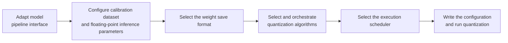

# Multimodal Generation Model (DiT) Quantization Usage Guide

## 1. Scope

This guide is intended for users who are performing [post-training quantization (PTQ)](../term_ptq.md) on a Diffusion Transformer multimodal generation model (such as FLUX.1, HunyuanVideo, Wan2.1, Wan2.2, and Qwen-Image-Edit) for the first time. It provides a standardized quantization workflow, systematically explaining the model adaptation interfaces, calibration set and floating-point inference configuration, save formats, algorithm selection, and the scheduler (Runner) mechanism, and it offers a complete out-of-the-box W8A8 quantization example.

Applicable scenarios:

- W8A8 MXFP8 quantization of text-to-image models (such as FLUX.1 and SD3);
- Low-bit quantization deployment of text-to-video models (such as HunyuanVideo, Wan2.2, and Wan2.1);
- Quantization deployment of image editing models (such as Qwen-Image-Edit);
- Preparing quantized weights for inference engines such as MindIE SD on an Ascend NPU.

To check whether the model is on the officially pre-validated list, see the [Foundation Model Support Matrix](../../model/README.md); for a quick introduction to basic CLI usage, see the [One-Click Quantization Usage Guide](../../../user_guide/usage_one_click_quantization.md).

## 2. Inputs and Deliverables

| Type | Name | Source or Location | Format or Constraint | Acceptance Method |
| --- | --- | --- | --- | --- |
| Input | Floating-point DiT model weight directory | Model download or local path | Contains model weight files and configuration files | Can be loaded normally by the inference pipeline |
| Input | Calibration dataset and task configuration | `dataset` and `multimodal_sd_config.inference_config` in the YAML | Specifies the task type (such as `t2v` and `i2v`) and parameters such as the inference resolution and step count; 50 calibration samples recommended | The adapter parses them successfully and completes the floating-point inference dump |
| Input | Quantization configuration file | Local YAML file | Complies with the `multimodal_sd_modelslim_v1` protocol specification | Passes schema validation |
| Deliverable | Quantized weight directory | Path specified by `--save_path` | MindIE SD format (containing the description file and sharded weights; multi-expert models include one subdirectory per expert) | Export is complete and the inference smoke test passes |

## 3. Process Overview

The overall DiT quantization workflow is as follows:



The key details of each stage are as follows:

Prerequisite: model adaptation. Model adaptation must be completed before quantization; the adapter implements interfaces such as PipelineInterface (the basic pipeline interface). For details see the *[DiT Model Integration Quantization Workflow Guide](./integration_guide_diffusion_transformer_quantization.md)*. If the target model is already in the official pre-validated list, no adapter code is needed; simply specify the corresponding `--model_type`. Model adaptation must be completed first before the quantization workflow can run.

- **Adapt the model pipeline interface**: ensure the model to be quantized has an adapter interface that complies with the `multimodal_sd_modelslim_v1` specification, so that it can drive floating-point inference to generate calibration data and be handled uniformly by the layer-wise quantization scheduler.
- **Configure the calibration dataset and floating-point inference parameters**: quantization calibration relies on running the complete floating-point denoising inference pipeline; it is configured jointly through `dataset` and `multimodal_sd_config`. 50 calibration samples are recommended, with the resolution, frame count, and denoising steps aligned with the production deployment scenario.
- **Select the weight save format**: `mindie_format_saver` is used uniformly to export the MindIE SD format, and multi-expert models automatically get an independent subdirectory per expert.
- **Select and orchestrate quantization algorithms**: W8A8 MXFP8 (with `mse_round` weight estimation) is recommended as the production baseline; for low-bit scenarios, add enhancement algorithms such as `online_quarot` and `fa3_quant` as needed.
- **Select the execution scheduler (Runner)**: `layer_wise` scheduling is fixed; cross-card data parallelism (`dp_layer_wise`) and whole-model residency (`model_wise`) are not supported.
- **Write the configuration and run quantization**: combine the above configuration into a complete YAML, start quantization with the `msmodelslim quant` command, and export the quantized weights and description file.

## 4. Procedure

### Step 1: Adapt the Model Pipeline Interface (V1 Interface)

**Objective**: Ensure the model to be quantized has an adapter interface that complies with the `multimodal_sd_modelslim_v1` specification, so that it can drive floating-point inference to generate calibration data and be handled uniformly by the layer-wise quantization scheduler.

**Action**:

If the target model is already in the official support list, no adapter code is needed; simply specify the corresponding `--model_type`. If you need to integrate a new DiT model, see the *[DiT Model Integration Quantization Workflow Guide](./integration_guide_diffusion_transformer_quantization.md)*.

That guide explains the `MultimodalPipelineInterface` specification in detail, the core methods (`get_inference_config_class`, `configure_runtime`, `prepare_calib_data`, `inference_dump_calib_data`, `quantization_context`, `get_expert_adapter`), and the adapter development steps for inference parameter validation, runtime configuration, floating-point calibration data export, and the quantization execution context.

**Output**: A usable multimodal model adapter registered in the framework (invoked through `--model_type`).

### Step 2: Configure the Calibration Dataset and Floating-Point Inference Parameters

**Objective**: Configure representative calibration prompts and floating-point inference pipeline parameters to generate calibration data that adequately covers the denoising process and the activation characteristics.

**Action**:

1. **Configuration mechanism**:
   Unlike LLMs, which take text tensors directly as input, DiT model quantization calibration relies on running the **complete floating-point denoising inference pipeline** to capture the inter-layer activation tensors of the model at different Timesteps. It is configured jointly in the YAML through `dataset` and `multimodal_sd_config`:

   ```yaml
   spec:
     dataset: <task_name>                 # Specifies the task calibration set identifier (such as t2v and i2v)
     multimodal_sd_config:
       dump_config:
         enable_dump: true                # Whether to run floating-point inference before quantization to export calibration data
         capture_mode: "args"
         dump_data_dir: ""                # Save path for the floating-point calibration data; when empty it is saved under save_path
       inference_config:
         size: "1280*720"                 # Resolution of the generated image/video
         frame_num: 81                    # Number of generated frames (video models only)
         sample_steps: 40                 # Number of denoising steps
         task: "t2v-A14B"                 # Specific task specification
   ```

2. **Calibration set and inference parameter selection guide**:
   - **Calibration sample count**: **50 is recommended** (for example, 50 representative text prompts or image-text pairs). Too few samples make it hard to cover the diverse generation distributions; too many multiply the runtime and storage cost of floating-point inference.
   - **Resolution and frame count**: keep them consistent with the mainstream production deployment scenario (for example, video generation models commonly use `1280*720`, with the frame count aligned to the deployment standard). If the resolution deviates from the real scenario, the estimated activation distribution of local features may be inaccurate.
   - **Denoising steps (`sample_steps`)**: set them to the values commonly used in production inference (such as 30~50 steps). The more complete the Timestep coverage, the more thorough the denoising trajectory statistics.
   - **Skipping the floating-point dump (pure dynamic quantization)**: if you are running pure dynamic quantization that does not rely on offline activation statistics (such as Wan2.1 dynamic), set `enable_dump: false` to skip the time-consuming floating-point denoising inference and quantize the weights directly.

**Output**: The `dataset` and `multimodal_sd_config` configured in the YAML.

### Step 3: Select the Weight Save Format

**Objective**: Choose the quantized weight export format that matches the requirements of the downstream multimodal generation model inference deployment engine.

**Action**:

1. **Configuration Interface**:
   Declare the save processor in the `spec.save` list of the YAML:

   ```yaml
   spec:
     save:
       - type: mindie_format_saver        # Deployment format for DiT models
   ```

2. **Format Selection and Documentation Links**:
   - **[mindie_format_saver Configuration Description](../../../api_reference/config/format/mindie_format_saver.md)**: the **core deployment format for DiT models**. Aimed at the Ascend MindIE SD inference engine, it exports a MindIE-compliant quantized description file and weights. For multi-expert models (such as Wan2.2) it automatically creates an independent subdirectory per expert under the save directory, such as `high_noise_model/` and `low_noise_model/`.

3. **Selection Guide**:
   - Multimodal generation models are currently deployed for inference on the Ascend platform uniformly with `mindie_format_saver`.

**Output**: The `save` format configured in the YAML.

### Step 4: Select and Orchestrate Quantization Algorithms

**Objective**: Determine the quantization numerical format, bit width, and optimization algorithms, choosing a quantization strategy suited to the distinctive activation distribution characteristics of DiT.

**Action**:

1. **Typical Quantization Algorithms**:
   The computational bottleneck of DiT models lies mainly in the linear projections and attention computation of the backbone Transformer. The low-bit quantization algorithms commonly used for generation models are as follows:

   | Algorithm | Brief Description | Use Cases | Link |
   | --- | --- | --- | --- |
   | MX format quantization (linear_quant) | The `mxfp8` (E4M3/E5M2) or `mxfp4` data type with `scope: per_block` (usually a scale shared per 32 elements), preserving the high dynamic range of floating point | Weight and activation quantization optimized for Ascend NPU hardware | [linear_quant Configuration Description](../../../api_reference/config/processor/linear_quant.md) |
   | INT8 dynamic quantization (linear_quant) | `dtype: int8`, with activations `per_token` computing the scale online per token (dynamic) and weights `per_channel`; no floating-point dump calibration data needed | Quick validation and lightweight deployment (such as Wan2.1) | [linear_quant Configuration Description](../../../api_reference/config/processor/linear_quant.md) |
   | MinMax / MSE | Activation quantization uses `minmax` extreme-value statistics; weight quantization prefers `mse_round`, which searches for the rounding that minimizes the mean squared error | Improves weight fidelity at low bit widths | [MinMax](../../quantization_algorithms/minmax/usage_minmax.md) |
   | Online orthogonal rotation (QuaRot / online_quarot) | Introduces an orthogonal transform matrix into the attention projection layers to spread the activation outlier channels | Image quality improvement for extremely sensitive layers or low-bit quantization | [QuaRot](../../quantization_algorithms/quarot/usage_quarot.md) |
   | FA3 attention quantization (fa3_quant) | Introduces `fp8_e4m3` or `mxfp4` low-bit execution for the self-attention QK^T and PV computations | Further compresses the attention computation cost together with low-bit schemes such as W4A4 | [fa3_quant Configuration Description](../../../api_reference/config/processor/fa3_quant.md) |
   | Per-expert configuration (per_expert) | Lets you specify a more conservative quantization strategy for sensitive experts | When the error tolerance differs greatly among experts in a multi-expert DiT | — |

   > For more quantization algorithm descriptions see the *[Quantization Algorithm Overview](../../quantization_algorithms/README.md)*.

2. **Algorithm Selection and Tuning**:
   - **W8A8 INT8 dynamic quantization (lightweight starting point)**: activations `per_token`, weights `per_channel`, and `dtype` `int8` for both. The scale is computed online per token, and `enable_dump: false` can be set to skip the floating-point inference dump; it suits quick validation and resource-constrained scenarios (see `lab_practice/wan2_1/wan2_1_w8a8_dynamic.yaml`, which excludes sensitive layers such as `*ffn.2*`).
   - **W8A8 MXFP8 quantization (recommended first choice)**: both weights and activations use `dtype: mxfp8` and `scope: per_block`, with weight estimation `mse_round` and `symmetric: true`. It is nearly lossless in image quality across major DiT models and is the recommended production baseline.
   - **Low-bit and high-precision enhancement**: configure `mxfp4` when a higher compression ratio is desired, and add `online_quarot` to suppress outliers and `fa3_quant` to compress the attention computation in the self-attention layers as needed.
   - **Single-variable tuning**: start from the standard W8A8 MXFP8 baseline; if image quality degrades slightly, first check the quality of the floating-point dump calibration data, or configure a fallback for specific experts/sensitive layers, rather than blindly combining multiple processors.

**Output**: The `process` and optional `per_expert` algorithm chains finalized in the YAML.

### Step 5: Select the Execution Scheduler (Runner)

**Objective**: Clarify the scheduling mode and hardware constraints of the quantization execution pipeline.

**Action**:

1. **Interface Principles and Scheduling Mechanism**:
   Specify it in `spec.runner` of the YAML (source code under `msmodelslim/core/runner/`):

   ```yaml
   spec:
     runner: layer_wise                   # DiT models always use layer_wise
   ```

   - **`LayerWiseRunner` (layer-wise quantization scheduler)**: loads the model parameters to the NPU layer by layer, using the captured activation tensors to complete the statistics and quantization of the current layer, and immediately unloads and frees the memory once quantization finishes. The memory usage of the whole machine is limited only by the weights of a single layer and the activation size of the current Batch.
   - **Scheduling constraints**: in the multimodal generation model quantization service (`multimodal_sd_modelslim_v1`), because the calibration data must be fully dumped per expert, **cross-card distributed data parallelism (`dp_layer_wise`) and whole-model residency (`model_wise`) are currently not supported**. Even if another runner type is configured or multiple cards are passed in, the quantization service converts uniformly to single-card `layer_wise` mode.

2. **Configuration Guide**:
   - **Set `runner: layer_wise` as a fixed configuration**.
   - Before running, make sure a single NPU has enough memory to hold the largest single network layer's parameters plus the temporary forward activations.

**Output**: The `runner` scheduling strategy confirmed in the YAML.

### Step 6: Write the Quantization Configuration and Run the Command

**Objective**: Combine the above steps into a complete YAML quantization configuration file and start quantization through the CLI. For the complete description of the quantization command parameters, see [Weight Quantization Usage Guide](../../../user_guide/usage_weight_quantization.md).

**Action**:

#### Complete Example 1: W8A8 MXFP8 Static Quantization (Recommended Starting Point; Balanced Generation Quality and Performance)

##### Configuration File: `dit_w8a8_mxfp8.yaml`

```yaml
apiversion: multimodal_sd_modelslim_v1
spec:
  runner: layer_wise                      # DiT uses single-card layer-wise quantization
  process:
    - type: linear_quant
      qconfig:
        act:
          dtype: mxfp8                    # Activations use the MXFP8 format
          scope: per_block                # Block-level granularity statistics
          symmetric: true
          method: minmax                  # Extreme-value statistics
        weight:
          dtype: mxfp8                    # Weights use the MXFP8 format
          scope: per_block
          symmetric: true
          method: mse_round               # Mean-squared-error rounding optimization for higher fidelity
      include: ["*"]                      # Quantize all backbone linear layers
  save:
    - type: mindie_format_saver           # Export in the MindIE SD format
  dataset: <task_name>                    # Task identifier (such as t2v)
  multimodal_sd_config:
    dump_config:
      enable_dump: true                   # Run floating-point inference to generate calibration data
      capture_mode: "args"
      dump_data_dir: ""                   # Falls back to save_path by default
    inference_config:
      size: "1280*720"                    # Generation resolution
      frame_num: 81                       # Number of generated frames
      sample_steps: 40                    # Number of denoising steps
      task: "t2v-A14B"                    # Task specification
```

##### Run Command (Single-Card Quantization)

```bash
msmodelslim quant \
  --model_path <float_model_dir> \
  --save_path <quantized_weight_output_dir> \
  --model_type <model_adapter_name> \
  --config ./dit_w8a8_mxfp8.yaml \
  --device npu \
  --device_id 0
```

#### Complete Example 2: W8A8 INT8 Dynamic Quantization (Lightweight Starting Point; No Floating-Point Dump Required)

##### Configuration File: `dit_w8a8_int8_dynamic.yaml`

```yaml
apiversion: multimodal_sd_modelslim_v1
spec:
  runner: layer_wise                      # DiT uses single-card layer-wise quantization
  process:
    - type: linear_quant
      qconfig:
        act:
          dtype: int8                     # INT8 activation quantization
          scope: per_token                # Dynamic activation quantization; the scale is computed online per token
          symmetric: true
          method: minmax
        weight:
          dtype: int8                     # INT8 weight quantization
          scope: per_channel              # Independent scale per channel
          symmetric: true
          method: minmax
      include: ["*"]                      # Quantize all backbone linear layers
  save:
    - type: mindie_format_saver           # Export in the MindIE SD format
      part_file_size: 0
  dataset: <task_name>                    # Task identifier (such as t2v)
  multimodal_sd_config:
    dump_config:
      enable_dump: false                  # Pure dynamic quantization does not rely on offline activation statistics, so skip the floating-point inference dump
      capture_mode: "args"
      dump_data_dir: ""
    inference_config:
      size: "1280*720"                    # Generation resolution
      frame_num: 81                       # Number of generated frames
      sample_steps: 40                    # Number of denoising steps
      task: "t2v-A14B"                    # Task specification
```

##### Run Command (Single-Card Quantization)

```bash
msmodelslim quant \
  --model_path <float_model_dir> \
  --save_path <quantized_weight_output_dir> \
  --model_type <model_adapter_name> \
  --config ./dit_w8a8_int8_dynamic.yaml \
  --device npu \
  --device_id 0
```

**Output**: Complete MindIE SD format quantized weights and description files are generated under the specified `--save_path` directory (multi-expert models are stored automatically in per-expert directories).

## 5. Terminology

| Term | Brief Description | Link |
| --- | --- | --- |
| DiT Quantization | Post-training quantization for Diffusion Transformer multimodal generation models | [DiT Quantization Entry](./term_diffusion_transformer_quantization.md) |
| PTQ | Post-Training Quantization | [Post-Training Quantization Entry](../term_ptq.md) |

## 6. Interface Documentation List

| API or Capability | Brief Description | Link |
| --- | --- | --- |
| `msmodelslim quant` | One-click quantization CLI entry point and complete command reference | *[One-Click Quantization Usage Guide](../../../user_guide/usage_one_click_quantization.md)* |
| multimodal_sd_modelslim_v1 Configuration Description | Field descriptions of task-level configuration such as `runner`/`process`/`per_expert`/`save`/`dataset`/`multimodal_sd_config` | [multimodal_sd_modelslim_v1 Configuration Description](../../../api_reference/config/quant/multimodal_sd_modelslim_v1.md) |
| linear_quant Configuration Description | Complete value descriptions for the `linear_quant` processor and each field of its `qconfig` | [linear_quant Configuration Description](../../../api_reference/config/processor/linear_quant.md) |
| Multimodal Generation Model Integration | DiT model integration and adapter development | [Multimodal Generation Model Integration](./integration_guide_diffusion_transformer_quantization.md) |
