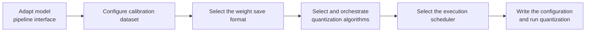

# Large Language Model (LLM) Quantization Usage Guide

## 1. Scope

This guide is intended for users who perform [post-training quantization (PTQ)](../term_ptq.md) on Decoder-only large language models (such as LLaMA, Qwen, GLM, and DeepSeek). It provides a standardized quantization workflow, systematically explaining the model adaptation interfaces, calibration set configuration, save formats, algorithm selection, and the scheduler (Runner) mechanism, and it offers complete out-of-the-box examples for W8A8 dynamic quantization and static quantization.

Applicable scenarios:

- Efficiently quantize floating-point LLM weights into low-bit formats such as W8/W4 and export them;
- Prepare deployment weights for online inference services (such as MindIE or vLLM-Ascend on an Ascend NPU).

To check whether the model is on the officially pre-validated list, see the [Foundation Model Support Matrix](../../model/README.md); for a quick introduction to basic CLI usage, see the [One-Click Quantization Usage Guide](../../../user_guide/usage_one_click_quantization.md).

## 2. Inputs and Deliverables

| Type | Name | Source or Location | Format or Constraint | Acceptance Method |
| --- | --- | --- | --- | --- |
| Input | Floating-point model weight directory | Model download or local path | HuggingFace format, containing `config.json` and `*.safetensors` shards | Can be loaded normally by the target Transformers version |
| Input | Calibration dataset | Built-in `lab_calib/` or a user-defined path | Text prompts in JSONL or JSON format, 50 recommended | Can be successfully encoded into forward tensors by the adapter's `handle_dataset` |
| Input | Quantization configuration file | Local YAML file | Complies with the `modelslim_v1` protocol specification | Passes schema validation |
| Deliverable | Quantized weight directory | Path specified by `--save_path` | Contains `quant_model_description.json` and `*.safetensors` shards | Export is complete and the inference smoke test passes |

## 3. Process Overview

The overall LLM quantization workflow is as follows:



The key details of each stage are as follows:

Prerequisite: model adaptation. Model adaptation must be completed before quantization; the adapter implements interfaces such as PipelineInterface (the basic pipeline interface). For details see the *[LLM Model Integration Quantization Workflow Guide](./integration_guide_large_language_model_quantization.md)*. If the target model is already in the official pre-validated list, no adapter code is needed; simply specify the corresponding `--model_type`. Model adaptation must be completed first before the quantization workflow can run.

- **Adapt the model pipeline interface**: ensure the model to be quantized has an adapter interface that complies with the `modelslim_v1` specification, so that it can be driven as a whole by the scheduler (Runner) and the processors (Processor).
- **Configure the calibration dataset**: specify the calibration data through `spec.dataset`. For general scenarios the built-in `mix_calib.jsonl` is recommended, with 50 samples and a sequence length of 2048~4096, to provide a sufficient basis for activation statistics.
- **Select the weight save format**: declare the save processor in `spec.save`. For Ascend NPU deployment `ascendv1_saver` is recommended; be sure to align with the deployment framework version.
- **Select and orchestrate quantization algorithms**: orchestrate the algorithm chain in declaration order in `spec.process`. Starting from W8A8 dynamic quantization (`minmax` estimation) is recommended, adding smoothing or rotation algorithms only if accuracy is insufficient.
- **Select the execution scheduler (Runner)**: specify the scheduling strategy in `spec.runner`; `auto` is recommended -- on a single card it automatically schedules layer by layer to lower peak memory, and on multiple cards it automatically enables data-parallel acceleration.
- **Write the configuration and run quantization**: combine the above configuration into a complete YAML, start quantization with the `msmodelslim quant` command, and export the quantized weights and description file.

## 4. Procedure

### Step 1: Adapt the Model Pipeline Interface (V1 Interface)

**Objective**: Ensure the model to be quantized has an adapter interface that complies with the `modelslim_v1` specification, so that it can be driven as a whole by the scheduler (Runner) and processors (Processor).

**Action**:

If the target model is already in the official support list, no adapter code is needed; simply specify the corresponding `--model_type`. If you need to integrate a new model or extend the quantization interfaces, see the *[LLM Model Integration Quantization Workflow Guide](./integration_guide_large_language_model_quantization.md#step-4-implement-the-pipeline-core-interface-methods)*.

That guide explains the `PipelineInterface` specification in detail, the core methods (`handle_dataset`, `init_model`, `generate_model_visit`, `generate_model_forward`, `enable_kv_cache`), and the adapter registration and development steps.

**Output**: A usable model adapter registered in the framework (invoked through `--model_type`).

### Step 2: Configure the Calibration Dataset

**Objective**: Select and configure a representative calibration dataset to provide a sufficient statistical basis for activation outlier detection and quantization parameter estimation.

**Action**:

1. **Configuration Method and Resolution Mechanism**:
   Specify it in the quantization YAML through `spec.dataset`:

   ```yaml
   spec:
     dataset: mix_calib.jsonl   # Relative file name or absolute path
   ```

   It is handled by `FileDatasetLoader` underneath: for a relative file name (such as `mix_calib.jsonl`) it automatically locates the built-in `lab_calib/` directory; for a path-containing or absolute path it loads the specified file directly. The file format supports `.jsonl` or `.json`; each sample is a string object containing a text prompt.

2. **Calibration Set Selection Guide and Recommended Configuration**:
   - **General model quantization (recommended)**: the built-in `mix_calib.jsonl` is used by default. This dataset covers general question answering, code, multilingual question answering, and multi-step mathematical reasoning, with a balanced and robust distribution.
   - **Fine-tuned models for specific vertical scenarios**: if the model targets a specific domain (such as professional medical question answering, code completion, or long contract parsing), prepare a dataset with the real business distribution. A mix of "80% real business data + 20% general data" is recommended to balance domain accuracy and general reasoning ability.
   - **Calibration sample count**: **50 is recommended**. With too few samples the activation statistics may be insufficient and sporadic outliers can be missed, biasing the parameter estimates; with too many samples the activation characteristics have largely converged but calibration time and memory consumption grow linearly.
   - **Sequence length**: set the truncation length to **2048 ~ 4096** at the tokenizer stage (aligned with the deployment context) to ensure adequate capture of long-context activation characteristics.

**Output**: The calibration dataset path and sample set determined and configured in the YAML.

### Step 3: Select the Weight Save Format

**Objective**: Choose the quantized weight organization and export format that matches the requirements of the downstream inference deployment framework.

**Action**:

1. **Configuration Interface**:
   Declare the save processor in the `spec.save` list of the YAML:

   ```yaml
   spec:
     save:
       - type: ascendv1_saver       # Save format type
   ```

2. **Format Selection and Documentation Links**:
   - **[ascendv1_saver Configuration Description](../../../api_reference/config/format/ascendv1_saver.md)**: the **recommended format for Ascend NPU deployment**. Designed for the Ascend acceleration library (ATB / Ascend Transformer Boost) and the MindIE inference engine, it produces a `quant_model_description.json` carrying quantized metadata plus sharded quantized weights `*.safetensors`, and automatically performs the weight repacking (Pack) and dequantization-coefficient preprocessing required by the hardware instructions.
   - **[mindie_format_saver Configuration Description](../../../api_reference/config/format/mindie_format_saver.md)**: a unified deployment format for the newer MindIE SD / MindIE ecosystem.

3. **Selection Guide**:
   - When running vLLM-Ascend, ATB-Models, or MindIE-Service on the Ascend platform, `ascendv1_saver` is the recommended first choice.
   - Be sure to align with the deployment framework version; a mismatched save format will cause an error when loading weights.

**Output**: The `save` format configured in the YAML.

### Step 4: Select and Orchestrate Quantization Algorithms

**Objective**: Determine the quantization bit width and granularity, and orchestrate the anti-outlier preprocessing algorithm chain as needed, to achieve the best balance between accuracy and performance.

**Action**:

1. **Typical Quantization Algorithms**:
   The quantization workflow is dispatched serially through the processor chain (`spec.process`) in declaration order. The commonly used algorithms are as follows:

   | Algorithm | Brief Description | Use Cases | Link |
   | --- | --- | --- | --- |
   | MinMax | Computes scale and zero-point directly from the tensor maximum/minimum; very low overhead | The default estimation algorithm for W8A8 dynamic and static quantization | [MinMax](../../quantization_algorithms/minmax/usage_minmax.md) |
   | SmoothQuant | Migrates outliers in the activations to the weights through channel-wise scaling, reducing the difficulty of activation quantization | Restores the accuracy of W8A8 static quantization | [SmoothQuant](../../quantization_algorithms/smooth_quant/usage_smooth_quant.md) |
   | QuaRot | Introduces an orthogonal Walsh-Hadamard rotation matrix to spread activation outlier channels without changing the forward output | When activation outliers are severe and smoothing algorithms do not deliver enough benefit | [QuaRot](../../quantization_algorithms/quarot/usage_quarot.md) |
   | KVCache Quant | Applies low-bit quantization to the Key/Value cache tensors | Memory and throughput optimization for long-sequence multi-turn conversations | [KVCache Quant](../../quantization_algorithms/kvcache_quant/usage_kvcache_quant.md) |

   > For the full set of supported outlier suppression algorithms, quantization optimization algorithms, and sensitive layer analysis algorithms, see the *[Quantization Algorithm Overview](../../quantization_algorithms/README.md)*.

2. **Algorithm Selection and Tuning**:
   - **W8A8 dynamic quantization (recommended starting point)**: activations `scope: per_token`, weights `scope: per_channel`, `symmetric: true`, estimation method `minmax`. The scale is computed dynamically per token, so it adapts well to outliers; accuracy is close to the floating-point baseline and no smoothing algorithm needs to be added.
   - **W8A8 static quantization (throughput first)**: activations `scope: per_tensor`, so inference needs no online scale statistics and throughput is higher; add the `smooth_quant` processor when accuracy degrades noticeably.
   - **Single-variable tuning**: run the `minmax` baseline first, and introduce smoothing or rotation algorithms only when the metrics do not meet the acceptance criteria, to avoid blind stacking.

**Output**: The `process` algorithm chain finalized in the YAML.

### Step 5: Select the Execution Scheduler (Runner)

**Objective**: Based on the available hardware resources (single card / multiple cards) and the model parameter scale, choose the optimal execution scheduling engine to prevent memory overflow and maximize quantization speed.

**Action**:

1. **Interface Principles and Scheduling Mechanism**:
   Specify it in `spec.runner` of the YAML (source code under `msmodelslim/core/runner/`):

   ```yaml
   spec:
     runner: auto   # auto | layer_wise | dp_layer_wise | model_wise
   ```

   - **`LayerWiseRunner` (layer-wise quantization scheduler)**: dynamically attaches a `LoadProcessor` before and after each network layer. It loads the current Decoder Layer from CPU/meta to the target NPU only when that layer is being processed, and immediately unloads and frees it afterwards. The peak memory of the whole machine depends only on the parameters of a single layer and the activations of the current Batch, so a single card can quantize very large models of 70B and above.
   - **`DPLayerWiseRunner` (data-parallel layer-wise scheduler)**: derived from `LayerWiseRunner`, it uses `torch.distributed` together with `DistributedSampler` to split the calibration data evenly across the cards, computes the single-layer forward pass in parallel on multiple cards, and synchronizes and aggregates the statistics.
   - **`PPRunner` / `model_wise` (whole-model scheduler)**: the entire model resides in memory, so it is suitable only for development and debugging with a very small parameter count or abundant single-card memory.
   - **`auto` (adaptive scheduling, recommended)**: on a single card it schedules `layer_wise`; when multiple devices are detected (`device_indices > 1`) it schedules `dp_layer_wise`.

2. **Configuration Guide**:
   - **`runner: auto` is recommended as the default**: it balances single-card stability with automatic multi-card parallel acceleration.
   - **Speeding up large-scale calibration**: when the calibration set is large or you want to shorten the runtime, pass multiple cards on the command line (such as `--device npu --device_id 0 1 2 3`); combined with `auto`, multi-card parallelism is enabled automatically.

3. **Scheduler selection comparison**:

   | Option | Description | Use Cases | Characteristics |
   |--------|------|----------|------|
   | auto | Automatically selected by the tool | Most scenarios | Automatically picks the optimal strategy from the model size, available memory, and device configuration |
   | layer_wise | Layer-wise quantization | Large models (>=32B) | Low memory usage; adaptation may be required |
   | dp_layer_wise | Distributed layer-wise quantization | Multi-card scenarios for large models (>=32B) | Multi-device parallelism that significantly improves quantization efficiency |
   | model_wise | Non-layer-wise quantization | Small models (<32B) | Higher memory usage, good compatibility |

   **Applicable scenarios**:

   | Scenario Type | Scenario Description | Recommended Option | Description |
   |----------|----------|----------|------|
   | Large model quantization | Models of 32B and above | Layer-wise quantization | Clear memory advantage |
   | Memory-constrained environments | NPU memory is insufficient to load the whole network | Layer-wise quantization | Greatly reduces memory requirements |
   | Pursuing quantization speed | Very large models or large-scale calibration sets | Distributed layer-wise quantization | Significant speedup from multi-card parallelism |

   **How it works and comparison of advantages**:

   | Characteristic | Traditional quantization (Model-wise) | Layer-wise quantization (single card) | Distributed layer-wise quantization (multi-card DP) |
   |----------|----------|----------|----------|
   | **Processing mode** | Whole-network processing at model level | Sequential layer-by-layer processing on a single device | Parallel layer-by-layer processing on multiple devices |
   | **Memory usage** | 2-3x the model size | **2-3x the size of a single layer** | **2-3x the size of a single layer** |
   | **Quantization efficiency** | Fast (for small models) | Slower (for large models) | **Significantly improved (multi-card parallelism)** |
   | **Applicable models** | Small models (<32B) | Large models (>=32B) | Very large models or large-scale calibration sets |

   **Selection advice**:

   - **auto**: suitable for most scenarios; the tool automatically selects the optimal strategy based on the model size, available memory, and device configuration.
   - **layer_wise**: suitable for models of 32B and above and for memory-constrained environments. When the model scale is > 32B, NPU memory is insufficient, or an out-of-memory error occurs during quantization, layer-wise quantization is recommended.
   - **dp_layer_wise**: suitable for multi-card scenarios with very large models or large-scale calibration sets.
   - **model_wise**: suitable for small models (<32B); it has the best compatibility.

**Output**: The `runner` scheduling strategy confirmed in the YAML.

### Step 6: Write the Quantization Configuration and Run the Command

**Objective**: Combine the above steps into a complete YAML quantization configuration file and start the quantization workflow through the CLI. For the complete description of the quantization command parameters, see [Weight Quantization Usage Guide](../../../user_guide/usage_weight_quantization.md).

**Action**:

#### Complete Example 1: W8A8 Dynamic Quantization (Recommended Starting Point; Balanced Accuracy and Usability)

##### Configuration File: `w8a8_dynamic.yaml`

```yaml
apiversion: modelslim_v1
spec:
  runner: auto                    # layer_wise for single-card, dp_layer_wise for multi-card
  process:
    - type: linear_quant
      qconfig:
        act:
          dtype: int8
          scope: per_token        # Dynamic activation quantization (independent scale per token); good accuracy
          symmetric: true
          method: minmax
        weight:
          dtype: int8
          scope: per_channel      # Weight quantization (independent scale per channel)
          symmetric: true
          method: minmax
      include: ["*"]              # Match and quantize all linear layers
  save:
    - type: ascendv1_saver        # Ascend inference standard save format
  dataset: mix_calib.jsonl        # built-in mixed calibration set
```

##### Run Command (Single-Card Quantization)

```bash
msmodelslim quant \
  --model_path <float_model_dir> \
  --save_path <quantized_weight_output_dir> \
  --model_type <model_adapter_name> \
  --config ./w8a8_dynamic.yaml \
  --device npu \
  --device_id 0
```

#### Complete Example 2: W8A8 Static Quantization (Inference Throughput First)

##### Configuration File: `w8a8_static.yaml`

```yaml
apiversion: modelslim_v1
spec:
  runner: auto
  process:
    - type: linear_quant
      qconfig:
        act:
          dtype: int8
          scope: per_tensor       # Static activation quantization (scale shared per layer tensor)
          symmetric: true
          method: minmax
        weight:
          dtype: int8
          scope: per_channel      # Weight quantization (independent scale per channel)
          symmetric: true
          method: minmax
      include: ["*"]
  save:
    - type: ascendv1_saver
  dataset: mix_calib.jsonl
```

##### Run Command (Single-Card Quantization)

```bash
msmodelslim quant \
  --model_path <float_model_dir> \
  --save_path <quantized_weight_output_dir> \
  --model_type <model_adapter_name> \
  --config ./w8a8_static.yaml \
  --device npu \
  --device_id 0
```

**Output**: Complete quantized weight files and description files are generated under the specified `--save_path` directory.

## 5. Terminology

| Term | Brief Description | Link |
| --- | --- | --- |
| PTQ | Post-Training Quantization | [Post-Training Quantization Entry](../term_ptq.md) |
| LLM Quantization | Post-training quantization for Decoder-only large language models | [LLM Quantization Entry](./term_large_language_model_quantization.md) |

## 6. Interface Documentation List

| API or Capability | Brief Description | Link |
| --- | --- | --- |
| `msmodelslim quant` | One-click quantization CLI entry point and complete command reference | *[One-Click Quantization Usage Guide](../../../user_guide/usage_one_click_quantization.md)* |
| modelslim_v1 Configuration Description | Field descriptions of task-level configuration such as `runner`/`process`/`save`/`dataset` | [modelslim_v1 Configuration Description](../../../api_reference/config/quant/modelslim_v1.md) |
