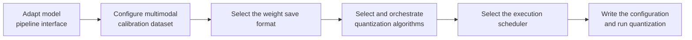

# Multimodal Understanding Model (VLM) Quantization Usage Guide

## 1. Scope

This guide is intended for users who perform [post-training quantization (PTQ)](../term_ptq.md) on multimodal vision-language models (such as Qwen2.5-VL, Qwen3-VL, GLM-4.6V, and InternVL3.5). It provides a standardized quantization workflow, systematically explaining the model adaptation interfaces, multimodal calibration set configuration, save formats, algorithm selection and visual component exclusion strategies, and the scheduler (Runner) mechanism, and it offers a complete out-of-the-box example.

Applicable scenarios:

- Efficiently quantize floating-point VLM weights into low-bit formats such as W8/W4 and export them;
- Perform mixed quantization on multimodal models with an MoE architecture (static quantization of Dense layers + dynamic quantization of Expert layers);
- Prepare deployment weights for multimodal online inference services (such as MindIE or vLLM-Ascend on an Ascend NPU).

To check whether the model is on the officially pre-validated list, see the [Foundation Model Support Matrix](../../model/README.md); for a quick introduction to basic CLI usage, see the [One-Click Quantization Usage Guide](../../../user_guide/usage_one_click_quantization.md).

## 2. Inputs and Deliverables

| Type | Name | Source or Location | Format or Constraint | Acceptance Method |
| --- | --- | --- | --- | --- |
| Input | Floating-point VLM weight directory | Model download or local path | HuggingFace format, containing `config.json` and `*.safetensors` shards | Can be loaded normally by the target Transformers version |
| Input | Multimodal calibration dataset | Built-in `lab_calib/calibImages/` or a user-defined path | A directory or JSONL containing image files and optional paired prompts, 50 recommended | Can be successfully encoded into multimodal input tensors by the adapter's `handle_dataset` |
| Input | Quantization configuration file | Local YAML file | Complies with the `multimodal_vlm_modelslim_v1` protocol specification | Passes schema validation |
| Deliverable | Quantized weight directory | Path specified by `--save_path` | Contains `quant_model_description.json` and `*.safetensors` shards | Export is complete and the inference smoke test passes |

## 3. Process Overview

The overall VLM quantization workflow is as follows:



The key details of each stage are as follows:

Prerequisite: model adaptation. Model adaptation must be completed before quantization; the adapter implements interfaces such as PipelineInterface (the basic pipeline interface). For details see the *[VLM Model Integration Quantization Workflow Guide](./integration_guide_vision_transformer_quantization.md)*. If the target model is already in the official pre-validated list, no adapter code is needed; simply specify the corresponding `--model_type`. Model adaptation must be completed first before the quantization workflow can run.

- **Adapt the model pipeline interface**: ensure the VLM model to be quantized has an adapter interface that complies with the `multimodal_vlm_modelslim_v1` specification, so that it can drive the joint forward pass of visual feature extraction and text decoding.
- **Configure the multimodal calibration dataset**: specify the image-text calibration data through `spec.dataset` and `spec.default_text`; 50 image samples with paired prompts are recommended to cover the general visual feature distribution stably.
- **Select the weight save format**: declare the save processor in `spec.save`. For Ascend deployment `ascendv1_saver` is the first choice; be sure to align with the deployment framework version.
- **Select and orchestrate quantization algorithms**: control the quantization scope with `include`/`exclude`, focusing on excluding the vision-sensitive projection layers (such as `*merger*` and `*linear_fc2`) from quantization to suppress cross-modal alignment error.
- **Select the execution scheduler (Runner)**: specify the scheduling strategy in `spec.runner`; `auto` is recommended, giving single-card layer-wise scheduling and automatic multi-card data parallelism. `model_wise` is not supported.
- **Write the configuration and run quantization**: combine the above configuration into a complete YAML, start quantization with the `msmodelslim quant` command, and export the quantized weights and description file.

## 4. Procedure

### Step 1: Adapt the Model Pipeline Interface (V1 Interface)

**Objective**: Ensure the VLM model to be quantized has an adapter interface that complies with the `multimodal_vlm_modelslim_v1` specification, so that it can drive the joint forward pass of visual feature extraction and text decoding.

**Action**:

If the target model is already in the official support list, no adapter code is needed; simply specify the corresponding `--model_type`. If you need to integrate a new VLM model, see the *[VLM Model Integration Quantization Workflow Guide](./integration_guide_vision_transformer_quantization.md)*.

That guide explains the `PipelineInterface` specification in detail, the core methods (`handle_dataset`, `init_model`, `generate_model_visit`, `generate_model_forward`, `enable_kv_cache`), and the visual component encapsulation plus adapter registration and development steps.

**Output**: A usable VLM adapter registered in the framework (invoked through `--model_type`).

### Step 2: Configure the Calibration Dataset

**Objective**: Select representative multimodal samples to accurately gather statistics on the activation distribution in the vision-text cross-modal forward pass.

**Action**:

1. **Configuration Method and Resolution Mechanism**:
   Specify them in the YAML through `spec.dataset` and `spec.default_text`:

   ```yaml
   spec:
     dataset: calibImages                            # Relative directory name or absolute path
     default_text: "Describe this image in detail." # Default prompt when an image sample has no text
   ```

   If it is configured as the relative name `calibImages`, the framework automatically locates the built-in `lab_calib/calibImages/` image directory; for a custom absolute path or a specified `index.jsonl` it loads the corresponding data source directly.

2. **Calibration Set Selection Guide and Recommended Configuration**:
   - **Confirm the modality support scope of the calibration set**: the modality support of a calibration set depends on the model type. **The differences in calibration set support between omni-modal models and non-omni-modal models are as follows**:
      - **Omni-modal models (such as Qwen3-Omni)**: a sample may contain `text` plus any combination of `image` / `audio` / `video`; when `text` is absent the configured `default_text` is used. Within one quantization task the effective modality signature of all samples must be identical (homogeneity constraint); for example, pure-text and image-text samples must not be mixed, nor must videos with and without an audio track.
      - **Non-omni-modal models (such as Qwen3-VL and Qwen3.5, VLMs that support only text + image)**: the adapter consumes only the `text` and `image` fields; samples containing `audio` or `video` are not supported by the adapter.
   - **General multimodal quantization (recommended)**: the built-in `calibImages` is used by default. The images cover general natural scenes, charts, and image-text layouts, and together with the default description prompt they cover the general visual feature distribution stably.
   - **Vertical scenario customization**: if the model targets industrial defect detection, medical imaging question answering, or autonomous driving, replace the images with real business images and align domain-specific instructions (such as "Please analyze the abnormal region in the image") in `default_text` or the index file.
   - **Calibration sample count**: **50 is recommended** (50 images and their paired prompts). In a multimodal forward pass the vision encoder has a higher computational cost than pure text, so 50 samples cover the feature distribution adequately while avoiding a significant increase in calibration time.

**Output**: The `dataset` and `default_text` configuration confirmed in the YAML.

#### <span id="dataset---calibration-data-path-configuration">Calibration Data Path Configuration (Reference)</span>

`dataset` can be configured as a **short name** (looked up under a dataset_dir such as lab_calib), an **absolute path**, or a **relative path**; the following three usage forms are supported.

**Form 1: index.json / index.jsonl (recommended)**

Point to an **index.json** or **index.jsonl** file, or to a directory that **contains exactly one index.json or index.jsonl**. It supports multiple modalities (image, audio, and video) with a well-defined format, and later features will evolve from this form.

- Each entry is a JSON object that **contains at least `text`** (a non-empty string); when absent, the configured `default_text` is used.
- Optional fields (if provided, the path must exist): `image` (.jpg/.jpeg/.png), `audio` (.wav/.mp3), `video` (.mp4); paths are relative to the directory containing the index file.

Directory example:

```text
calib_dir/
├── index.jsonl
├── img1.jpg
├── img2.png
└── a.wav
```

Example index.jsonl:

```json
{"image": "img1.jpg", "text": "Describe this image."}
{"image": "img2.jpg", "audio": "a.wav", "text": "What is in this picture?"}
```

Configuration example: `dataset: "/path/to/calib_dir"`, or `dataset: "/path/to/index.jsonl"`, or a short name that resolves to the above paths.

**Form 2: image-only directory**

The directory contains only image files, with no .json/.jsonl. All images use the configured `default_text` as their common text prompt.

**Note**: this form will not evolve further; use Form 1 for new scenarios.

Directory example:

```text
calibImages/
├── img1.jpg
├── img2.png
└── img3.jpeg
```

Configuration example:

```yaml
spec:
  dataset: "calibImages"   # Or an absolute/relative path
  default_text: "Describe this image in detail."
```

**Form 3: image directory + a single .json/.jsonl (any file name)**

The directory contains images and **one** .json or .jsonl file with an arbitrary file name (not index.json/index.jsonl), used to specify custom text for each image. Only the image field is supported; audio/video are not.

**Note**: this form will not evolve further; use Form 1 for new scenarios.

Directory example:

```text
calibImages/
├── img1.jpg
├── img2.png
├── img3.jpeg
└── calib_data.jsonl
```

Example calib_data.jsonl:

```json
{"image": "img1.jpg", "text": "What objects are in this image?"}
{"image": "img2.png", "text": "Describe the scene."}
```

Configuration example: `dataset: "calibImages"` or the corresponding path.

### Step 3: Select the Weight Save Format

**Objective**: Choose the quantized weight export format that matches the requirements of the downstream inference deployment framework.

**Action**:

1. **Configuration Interface**:
   Declare the save processor in the `spec.save` list of the YAML:

   ```yaml
   spec:
     save:
       - type: ascendv1_saver       # Recommended format for Ascend NPU deployment
   ```

2. **Format Selection and Documentation Links**:
   - **[ascendv1_saver Configuration Description](../../../api_reference/config/format/ascendv1_saver.md)**: the **recommended format for Ascend NPU deployment**. It fits the MindIE and vLLM-Ascend inference engines and exports a `quant_model_description.json` containing the multimodal model quantization parameters plus sharded quantized weights `*.safetensors`.
   - **[mindie_format_saver Configuration Description](../../../api_reference/config/format/mindie_format_saver.md)**: a unified deployment format for the MindIE SD / MindIE ecosystem.

3. **Selection Guide**:
   - For Ascend deployment `ascendv1_saver` is the first choice.
   - Be sure to align with the deployment framework version; a mismatched save format will cause an error when loading weights.

**Output**: The `save` format configured in the YAML.

### Step 4: Select and Orchestrate Quantization Algorithms

**Objective**: Determine the quantization bit width and scope, safeguarding cross-modal alignment accuracy mainly through a targeted module exclusion strategy.

**Action**:

1. **Typical Quantization Algorithms**:
   The quantization workflow is dispatched serially through the processor chain (`spec.process`) in declaration order. The commonly used algorithms are as follows:

   | Algorithm | Brief Description | Use Cases | Link |
   | --- | --- | --- | --- |
   | MinMax | Computes scale and zero-point directly from the tensor extrema; low overhead | The basic estimation algorithm for W8A8 quantization | [MinMax](../../quantization_algorithms/minmax/usage_minmax.md) |
   | SmoothQuant | Migrates activation outliers to the weights through channel-wise scaling | Reduces the difficulty of whole-network static quantization | [SmoothQuant](../../quantization_algorithms/smooth_quant/usage_smooth_quant.md) |
   | QuaRot | Introduces an orthogonal Walsh-Hadamard rotation matrix to spread activation outlier features | Improves the distribution shift of low-bit multimodal models | [QuaRot](../../quantization_algorithms/quarot/usage_quarot.md) |
   | KVCache Quant | Quantizes the Key/Value cache tensors in multi-turn image-text conversations | Memory optimization for multi-turn image-text conversations | [KVCache Quant](../../quantization_algorithms/kvcache_quant/usage_kvcache_quant.md) |

   > For the complete algorithm list see the *[Quantization Algorithm Overview](../../quantization_algorithms/README.md)*.

2. **Algorithm Selection and Tuning**:
   - **Excluding vision-sensitive projection layers (key strategy)**: the visual feature projection layers (such as `*merger*`, `*linear_fc2`, and `*deepstack_merger_list*`) map image patch features into the text token space and are highly sensitive to numerical precision. Explicitly excluding them in the `exclude` list and keeping them as floating-point weights suppresses the collapse of image-text understanding caused by cross-modal alignment error.
   - **W8A8 basic quantization (recommended starting point)**: symmetric `per_channel` weight quantization, with activations using `per_tensor` or `per_token` according to accuracy needs. Together with projection layer exclusion, this is the preferred baseline for most VLMs.
   - **MoE mixed quantization**: VLMs with an MoE architecture usually apply static quantization to the Shared/Dense layers and dynamic quantization to the Router/Expert layers, balancing throughput and routing accuracy.
   - **Single-variable tuning**: focus on adjusting the sensitive-layer exclusion range around `exclude`, and avoid blindly stacking multiple algorithms.

**Output**: The `process` algorithm chain and module filtering rules finalized in the YAML.

### Step 5: Select the Execution Scheduler (Runner)

**Objective**: Choose the best scheduling engine for the VLM vision encoder and the multi-card parallel environment.

**Action**:

1. **Interface Principles and Scheduling Mechanism**:
   Specify it in `spec.runner` of the YAML (source code under `msmodelslim/core/runner/`):

   ```yaml
   spec:
     runner: auto   # auto | layer_wise | dp_layer_wise
   ```

   - **`LayerWiseRunner` (layer-wise quantization scheduler)**: loads the weights only when the current network layer is being forwarded, and immediately unloads and frees them once it finishes.
   - **`DPLayerWiseRunner` (data-parallel layer-wise scheduler)**: splits the multimodal calibration data across multiple cards in parallel, aggregates the activation statistics through a distributed forward pass, and cuts quantization time by a large factor.
   - **`auto` (adaptive scheduling, recommended)**: on a single card it schedules `layer_wise`; when multiple devices are detected (`device_indices > 1`) it schedules `dp_layer_wise`.
   - **Constraint**: VLM quantization does **not support** the `model_wise` scheduler. If `model_wise` is configured, the framework warns and automatically falls back to `layer_wise`.

2. **Configuration Guide**:
   - **`runner: auto` is recommended as the default**: it is automatically compatible with both single-card and multi-card environments.
   - Multi-card parallel acceleration: pass multiple devices on the command line (such as `--device npu --device_id 0 1 2 3`); combined with `auto`, multi-card distributed layer-wise scheduling is enabled automatically.

**Output**: The `runner` scheduling strategy confirmed in the YAML.

### Step 6: Write the Quantization Configuration and Run the Command

**Objective**: Combine the above steps into a complete YAML quantization configuration file and start the quantization workflow through the CLI. For the complete description of the quantization command parameters, see [Weight Quantization Usage Guide](../../../user_guide/usage_weight_quantization.md).

**Action**:

#### Complete Example: VLM W8A8 Quantization (with Visual Projection Layer Exclusion)

##### Configuration File: `vlm_w8a8.yaml`

```yaml
apiversion: multimodal_vlm_modelslim_v1
spec:
  runner: auto                    # layer_wise for single-card, dp_layer_wise for multi-card
  process:
    - type: linear_quant
      qconfig:
        act:
          dtype: int8
          scope: per_tensor       # Static activation quantization
          symmetric: true
          method: minmax
        weight:
          dtype: int8
          scope: per_channel      # Channel-wise weight quantization
          symmetric: true
          method: minmax
      include: ["*"]              # Match all linear operators in the network
      exclude:
        - "*merger*"              # Exclude the visual projection layer and keep it in floating point
        - "*linear_fc2*"
        - "*deepstack_merger_list*"
  save:
    - type: ascendv1_saver        # Ascend inference standard save format
  dataset: calibImages            # Multimodal calibration image directory
  default_text: "Describe this image in detail."
```

##### Run Command (Single-Card Quantization)

```bash
msmodelslim quant \
  --model_path <float_model_dir> \
  --save_path <quantized_weight_output_dir> \
  --model_type <model_adapter_name> \
  --config ./vlm_w8a8.yaml \
  --device npu \
  --device_id 0
```

**Output**: Complete quantized weight files and description files are generated under the specified `--save_path` directory.

## 5. Terminology

| Term | Brief Description | Link |
| --- | --- | --- |
| PTQ | Post-Training Quantization | [Post-Training Quantization Entry](../term_ptq.md) |
| VLM Quantization | Post-training quantization for multimodal vision-language models | [VLM Quantization Entry](./term_vision_transformer_quantization.md) |

## 6. Interface Documentation List

| API or Capability | Brief Description | Link |
| --- | --- | --- |
| `msmodelslim quant` | One-click quantization CLI entry point and complete command reference | *[One-Click Quantization Usage Guide](../../../user_guide/usage_one_click_quantization.md)* |
| multimodal_vlm_modelslim_v1 Configuration Description | Field descriptions of task-level configuration such as `runner`/`process`/`save`/`dataset`/`default_text` | [multimodal_vlm_modelslim_v1 Configuration Description](../../../api_reference/config/quant/multimodal_vlm_modelslim_v1.md) |
