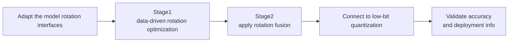

# Adapt Rotation Adaptive Rotation Optimization Algorithm Usage Guide

## 1. Scope

This guide is intended for users who need to use the [Adapt Rotation Adaptive Rotation Optimization Algorithm](./term_adapt_rotation.md). As an outlier-suppression algorithm, Adapt Rotation builds on [QuaRot](../quarot/term_quarot.md) by optimizing the orthogonal rotation matrix driven by calibration data, further smoothing activation outliers and improving low-bit quantization accuracy.

Applicable scenarios:

- The low-bit quantization accuracy requirement (such as W4A4 and W8A8) is extremely high, and the basic orthogonal rotation struggles to fully eliminate long-tail activation outliers;
- You need to learn a better orthogonal rotation transform from calibration samples so that the activation and weight distributions become more uniform.

To check whether the model is on the officially pre-validated list, see the [Foundation Model Support Matrix](../../model/README.md); for a quick introduction to basic CLI usage, see the [One-Click Quantization Usage Guide](../../../user_guide/usage_one_click_quantization.md).

## 2. Inputs and Deliverables

| Type | Name | Source or Storage Location | Format or Constraints | Acceptance Criteria |
| --- | --- | --- | --- | --- |
| Input | Floating-point model weight directory | Model download or a local path | HuggingFace format containing `config.json` and `*.safetensors` shards | Loadable by the target Transformers version |
| Input | Model adapter | User adaptation code, invoked via `--model_type` | Implements `PipelineInterface`, `AdaptRotationInterface`, and the QuaRot-related interfaces | Properly driven by the runner and processor |
| Input | Calibration dataset | Built-in `lab_calib/` or a user-defined path | Text prompts in JSONL or JSON format; 50 samples recommended | Successfully encoded into forward tensors by the adapter's `handle_dataset` |
| Input | Quantization configuration file | Local YAML file | Complies with the `modelslim_v1` protocol specification | Passes schema validation |
| Deliverable | Quantized weight directory | Path specified by `--save_path` | Contains `quant_model_description.json` and `*.safetensors` shards | Export is complete and the inference smoke test passes |

## 3. Process Overview

The overall workflow of Adapt Rotation is as follows:



Key details of each stage are as follows:

- **Adapt the model rotation interfaces**: the adapter must implement `AdaptRotationInterface`, `QuaRotInterface`, and `OnlineQuaRotInterface`, providing two-stage rotation, network mapping, and Norm fusion support. This is the precondition for executing the subsequent algorithm.
- **Stage1 data-driven rotation optimization**: in the `prior` stage, collect the activations of the specified projection layers based on calibration data, and minimize the simulated quantization error through gradient optimization to obtain the optimized rotation matrix.
- **Stage2 apply rotation fusion**: in the `process` stage, apply the optimized rotation matrix layer by layer to the weights and activations, supporting offline fusion or online rotation.
- **Connect to low-bit quantization**: after rotation the activation distribution becomes smoother and more uniform, so connecting to low-bit `linear_quant` greatly improves accuracy.
- **Validate accuracy and deployment info**: evaluate the quantization accuracy and generate the corresponding model description and weight shards at export time.

## 4. Procedure

### Step 1: Adapt the Model Pipeline and Rotation Interfaces

**Goal**: The quantization tool cannot operate directly on models of arbitrary structure; the model's operations must be standardized through an adapter. Adapt Rotation consists of Stage1 (data optimization) and Stage2 (rotation application), and can only run after the pipeline and rotation interfaces are implemented in the adapter.

**Action**: The model adaptation code must implement the following interfaces, all of which are aggregated and provided by `msmodelslim.model.interface_hub`:

1. **`PipelineInterface`** (`ModelSlimPipelineInterfaceV1`): the basic pipeline interface, responsible for model loading (`init_model`), data preprocessing (`handle_dataset`), layer-wise traversal (`generate_model_visit`), layer-wise forward pass (`generate_model_forward`), and so on.
2. **`AdaptRotationInterface`** (located at `msmodelslim.processor.adapt_rotation`): the adaptive rotation dedicated interface, defining the model subgraphs and rotation mappings required by Stage1 and Stage2.
3. **`QuaRotInterface`** / **`OnlineQuaRotInterface`**: the rotation quantization base interfaces, providing the LayerNorm fusion map (`get_ln_fuse_map`) and rotation pairs (`get_rotate_map`).

For a standard open-source LLM implemented with HuggingFace Transformers, it is recommended to build the adapter through compositional inheritance:

```python
from msmodelslim.model.interface_hub import (
    IModel,
    ModelInfoInterface,
    ModelSlimPipelineInterfaceV1 as PipelineInterface,
    # ---- Rotation algorithm adaptation interfaces (focus of this step) ----
    QuaRotInterface,          # Algorithm adaptation: provides the LayerNorm fusion map (get_ln_fuse_map) and rotation pairs (get_rotate_map)
    OnlineQuaRotInterface,    # Algorithm adaptation: provides online rotation capability
    AdaptRotationInterface,   # Algorithm adaptation: defines the model subgraphs and rotation mappings required by Stage1/Stage2
)

class MyModelAdapter(TransformersModel, ModelInfoInterface, PipelineInterface,
                     QuaRotInterface, OnlineQuaRotInterface, AdaptRotationInterface):
    pass
```

To develop new model adaptation code, see the [LLM Model Quantization Integration Guide](../../ptq/llm/integration_guide_large_language_model_quantization.md).

**Output**: A usable model adapter registered in the framework (invoked via `--model_type`).

### Step 2: Establish the Recommended Configuration

**Action**:

The following configuration establishes the **first comparable baseline**. If the target model already has a `lab_practice` recipe, prefer the verified recipe.

```yaml
spec:
  prior:
    - process:
        - type: "adapt_rotation"
          stage: 1
          layer_type: ["up_proj"]
          steps: 20
          quant_dtype: "int4"
          block_size: -1
          max_samples: 2048
      dataset: "boolq.jsonl"

  process:
    - type: "adapt_rotation"
      stage: 2
      online: false
      block_size: -1
      max_tp_size: 1
```

**Output**: A reproducible recommended configuration that serves as the comparison baseline for all subsequent parameter adjustments.

### Step 3: Select and Tune Parameters

**Action**:

msModelSlim implementation entry point:
[View the corresponding implementation directory](../../../../../msmodelslim/processor/adapt_rotation)

| Configuration Item | Meaning (Rationale) | Recommended Configuration | Selection and Tuning Advice |
| --- | --- | --- | --- |
| `type` | Processor type identifier, fixed to `adapt_rotation`. | Fixed to `adapt_rotation`. | Not recommended to change. |
| `stage` | Distinguishes Stage 1 (optimization learning) from Stage 2 (rotation application). | Run `1` first, then `2`. | The two stages cannot be omitted or swapped. |
| `steps` | Number of optimization iterations in Stage 1. | Keep it at `20` initially. | Watch the loss convergence; increasing it further after convergence only adds calibration time. |
| `quant_dtype` | The target bit width used by Stage 1 to simulate activation quantization error. | `int4` for W4A4, `int8` for W8A8. | Must be aligned with the final downstream activation quantization bit width. |
| `layer_type` | The target projection layers whose activations are collected in Stage 1 for rotation optimization. | `["up_proj"]` recommended. | Extend only when you are certain that other projections belong to the rotation optimization path. |
| `block_size` | Rotation block size; `-1` means whole-block rotation, and a positive value must be a power of 2. | Prefer `-1`. | The smaller the block, the weaker the cross-dimension diffusion, but the better it fits certain parallelism constraints. |
| `max_samples` | Maximum number of samples used for optimization per layer in Stage 1. | Start with `2048`. | Too few samples cause overfitting; too many increase the time cost. |
| `online` | Whether Stage 2 enables runtime online rotation. | Default `false` (offline fusion). | Enable it when the target deployment chain explicitly supports and requires online rotation. |
| `down_proj_online_layers` | Specifies which decoder layers' down_proj use online rotation in Stage 2. | Default `[]`. | Add entries only when specific layers cannot be fused offline. |
| `max_tp_size` | The maximum TP size supported by online rotation in Stage 2. | Keep the default for offline; set it to the actual deployment TP for online. | Keep it consistent with the deployment parallelism configuration. |

#### Parameter Combinations and Selection Order

**Tune only one main knob at the end**: keep the number of optimization steps `steps` at 20, and adjust it slightly only if the metrics fluctuate.

**Output**: An algorithm parameter plan that completes single-variable tuning, with a clear selection rationale and tuning direction for each key field.

### Step 4: Write the Quantization Configuration and Run the Command

**Goal**: Integrate the above steps into a complete YAML quantization configuration file and start the quantization workflow via the CLI.

#### Complete Example: Adapt Rotation + W4A4 Offline Quantization

##### Configuration File: `adapt_rotation_w4a4.yaml`

```yaml
apiversion: modelslim_v1
spec:
  runner: auto
  prior:
    - process:
        - type: adapt_rotation
          stage: 1
          layer_type: ["up_proj"]
          steps: 20
          quant_dtype: int4
          block_size: -1
          max_samples: 2048
      dataset: mix_calib.jsonl
  process:
    - type: adapt_rotation
      stage: 2
      online: false
      block_size: -1
      max_tp_size: 1
    - type: linear_quant
      qconfig:
        act:
          dtype: int4
          scope: per_token
          symmetric: true
          method: minmax
        weight:
          dtype: int4
          scope: per_channel
          symmetric: true
          method: minmax
      include: ["*"]
  save:
    - type: ascendv1_saver
  dataset: mix_calib.jsonl
```

##### Run the command (single-card quantization)

```bash
msmodelslim quant \
  --model_path <float_model_dir> \
  --save_path <quantized_weight_output_dir> \
  --model_type <model_adapter_name> \
  --config ./adapt_rotation_w4a4.yaml \
  --device npu \
  --device_id 0
```

**Output**: Complete quantized weight files and description files are generated in the directory specified by `--save_path`.

## 5. Terminology

| Term | Brief Description | Link |
| --- | --- | --- |
| Adapt Rotation Adaptive Rotation Optimization Algorithm | Explains the definition, core principle, key properties, applicable scenarios, and limitations of the algorithm. | [Adapt Rotation Adaptive Rotation Optimization Algorithm Terminology Entry](./term_adapt_rotation.md) |

## 6. Related Documents

| API or Document | Brief Description | Link |
| --- | --- | --- |
| `PipelineInterface` | Model pipeline adaptation interface (data preprocessing, model loading, module traversal). | [LLM Quantization Usage Guide, Step 1](../../ptq/llm/usage_large_language_model_quantization.md) |
| `AdaptRotationInterface` / `QuaRotInterface` | Adaptive rotation model adaptation interfaces, exported together from `msmodelslim.model.interface_hub`. | [Interface hub module](../../../../../msmodelslim/model/interface_hub.py) |
| adapt_rotation Configuration Description | Field types, default values, valid values, and complete configuration constraints. | [adapt_rotation Configuration Description](../../../api_reference/config/processor/adapt_rotation.md) |
| modelslim_v1 Configuration Description | Consult this when you need to explore task-level advanced configurations such as runner, prior, save, and dataset. | [modelslim_v1 Configuration Description](../../../api_reference/config/quant/modelslim_v1.md) |
| Weight Quantization Usage Guide | User guide: quantization command parameters and complete usage instructions. | [Weight Quantization Usage Guide](../../../user_guide/usage_weight_quantization.md) |
