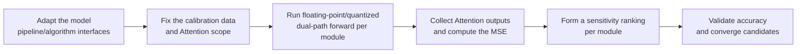

# Attention MSE Analysis Configuration Workflow Guide

## 1. Scope

This guide is intended for users who need to use the [Attention MSE Sensitive Layer Analysis Algorithm](./term_attention_mse.md). Attention MSE (`mse`), as a metrics indicator of `msmodelslim analyze attn`, evaluates the quantization sensitivity of each Attention module from the perspective of the Attention module's output, and assists in fallback or protection decisions for Attention structures.

Applicable scenarios:

- Before the Attention structures take part in weight quantization, you need to locate the Attention modules with larger output drift and form a fallback or priority-protection candidate set;
- You need to re-check the sensitivity conclusions of weight-type indicators (such as `std`) using the actual output error of the Attention subsystem.

To check whether the model is on the officially pre-validated list, see the [Foundation Model Support Matrix](../../model/README.md); for a quick introduction to basic CLI usage, see the [One-Click Quantization Usage Guide](../../../user_guide/usage_one_click_quantization.md).

## 2. Inputs and Deliverables

| Type | Name | Source or Storage Location | Format or Constraints | Acceptance Criteria |
| --- | --- | --- | --- | --- |
| Input | Floating-point model weight directory | Model download or a local path | HuggingFace format containing `config.json` and `*.safetensors` shards | Loadable by the target Transformers version |
| Input | Model adapter | User adaptation code, invoked via `--model_type` | Implements `PipelineInterface` and the dedicated `AttentionAnalysisInterface` interface | Properly driven by the runner and processor |
| Input | Calibration dataset | Built-in `lab_calib/` or a user-defined path | Text prompts in JSONL or JSON format; 50 samples recommended | Successfully encoded into forward tensors by the adapter's `handle_dataset` |
| Deliverable | Attention sensitivity analysis result | The path specified by `--save_path` (YAML); if unspecified, printed to the console only | The MSE score and Top-K ranking corresponding to the quantization perturbation of each Attention module | The result is stable and reproducible and can serve as input for Attention fallback or protection candidates |

## 3. Process Overview

The overall workflow of Attention MSE is as follows:



Key details of each stage are as follows:

- **Adapt the model pipeline/algorithm interfaces**: the adapter must implement the basic `PipelineInterface` and implement `AttentionAnalysisInterface` to provide the Attention module matching and output extraction logic. This is the precondition for all subsequent analysis steps.
- **Fix the calibration data and Attention scope**: the `attn` scope covers all Attention modules in the model by default; the calibration data (50 samples recommended) should cover the real input distribution, and the data and quantization baseline must not change during analysis, otherwise the ranking cannot be attributed.
- **Run floating-point/quantized dual-path forward per module**: the processor runs the floating-point path and the quantized path forward separately for each Attention module while keeping all other conditions identical, forming a controlled intervention.
- **Collect Attention outputs and compute the MSE**: collect the two paths' Attention outputs through hooks, compute the mean squared error per sample and then average, so that the amplification or suppression of Q/K/V errors through the dot product and softmax nonlinearity is fully included in the evaluation.
- **Form a sensitivity ranking per module**: take the Top-K candidates ranked by `mse` score as the fallback or priority-protection candidate set, rather than applying a hard threshold.
- **Validate accuracy and converge candidates**: candidates must be validated against actual quantization accuracy or model task metrics before being fixed into the final strategy.

## 4. Procedure

### Step 1: Adapt the Model Pipeline and Algorithm Interfaces

**Goal**: The quantization tool cannot operate directly on models of arbitrary structure; it requires each model to be wrapped in an "adapter" first that translates the model's various operations into standard methods the framework can call uniformly. This step confirms and completes that adapter layer together with the Attention MSE dedicated interface. **Model adaptation must be completed first before Attention MSE sensitivity analysis can run.**

**Action**: The model adaptation code must implement the following interfaces:

1. **`PipelineInterface`** (`ModelSlimPipelineInterfaceV1`): the basic pipeline interface, responsible for model loading (`init_model`), data preprocessing (`handle_dataset`), layer-wise traversal (`generate_model_visit`), layer-wise forward pass (`generate_model_forward`), and so on.
2. **`AttentionAnalysisInterface`** (exported together from `msmodelslim.model.interface_hub`, with the implementation located at `msmodelslim.processor.analysis.binary_operator.metrics.attention_mse.interface`): the Attention MSE analysis dedicated interface.

```python
from abc import ABC, abstractmethod
from typing import Callable, Union

import torch

class AttentionAnalysisInterface(ABC):
    @abstractmethod
    def get_attention_module_cls(self) -> str:
        """Return the string representation of the module class used to match attention layers (that is, the attention submodule that needs a hook attached)."""
        ...

    @abstractmethod
    def get_attention_output_extractor(self) -> Callable[[Union[tuple, torch.Tensor]], torch.Tensor]:
        """Return an extraction function used to take the tensor part for sensitivity analysis out of the attention module's forward output."""
        ...
```

- **`get_attention_module_cls`**: returns the class-name string of the Attention module. The processor matches exactly by `module.__class__.__name__` and attaches an output hook, for example `"DeepseekV3Attention"` or `"MLA"`.
- **`get_attention_output_extractor`**: extracts the main tensor used for sensitivity analysis from the Attention module's `forward` return value (Tensor, tuple, etc.). For example, DeepSeek-V3's `forward` returns a tuple `(attn_output, ...)`, so return `lambda x: x[0]`; when the GLM series returns the output tensor directly, return `lambda x: x`.

For a standard open-source LLM implemented with HuggingFace Transformers, it is recommended to build the adapter quickly through compositional inheritance:

```python
from msmodelslim.model.interface_hub import (
    IModel,
    ModelInfoInterface,
    ModelSlimPipelineInterfaceV1 as PipelineInterface,
    # ---- Attention MSE algorithm adaptation interfaces (focus of this step) ----
    AttentionAnalysisInterface,  # Algorithm adaptation: locate the attention submodule that needs a hook and extract the attention output
)

class MyModelAdapter(TransformersModel, ModelInfoInterface, PipelineInterface,
                     AttentionAnalysisInterface):
    def get_attention_module_cls(self) -> str:
        return "MyModelAttention"  # Class name of the attention submodule that needs a hook attached

    def get_attention_output_extractor(self):
        return lambda x: x[0]  # Extract the attention output tensor from the forward output
```

The adapter is then referenced in the analysis command via `--model_type MyModelAdapter`. Reference adaptation implementations in the repository include `msmodelslim/model/deepseek_v3/model_adapter.py` and `msmodelslim/model/glm_5/model_adapter.py`.

To develop new model adaptation code, see the [LLM Model Quantization Integration Guide](../../ptq/llm/integration_guide_large_language_model_quantization.md).

**Output**: A usable model adapter registered in the framework (invoked via `--model_type`).

### Step 2: Establish the Recommended Configuration

**Action**:

The following parameters establish the **first comparable baseline**.

- Analysis scope: `attn`;
- `--metrics`: `mse`;
- `--top_k`: start with `15`;
- Calibration data: 50 samples recommended, the same as or with the same distribution as the subsequent formal quantization.

**Output**: A reproducible set of Attention sensitivity analysis baseline parameters used to generate the first candidate ranking.

### Step 3: Select and Tune Parameters

**Action**:

Tune only one variable per round and keep the same calibration set and quantization baseline.

| Configuration Item | Meaning (Rationale) | Recommended Configuration | Selection and Tuning Advice |
| --- | --- | --- | --- |
| Analysis scope `attn` | Fixed to the `attn` subcommand; the analysis target covers all Attention modules in the model by default and cannot be narrowed via `--patterns`/`--quant_modules`. | Fixed to `attn`. | When you need attention-head granularity (induction/echo head) analysis, use the `ra_compress` indicator of `attn_head`; its ranking meaning differs from this indicator, so they should not be mixed. |
| `--metrics` | Specifies the analysis indicator `mse` used in this guide, which defines the score and the meaning of the ranking. | Fixed to `mse`. | A high score means the quantization perturbation of that Attention module is more readily reflected at its own output; its numerical scale/ranking differs from other indicators, so thresholds should not be mixed. |
| `--calibration_dataset` | The calibration data used to collect Attention outputs during the dual-path forward pass; a JSON/JSONL text sample file, 50 samples recommended, default `mix_calib.jsonl`. | The same calibration set as, or one with the same distribution as, the subsequent formal quantization. | When the ranking changes markedly across different data, first check whether the calibration set covers the real lengths and topics. |
| `--top_k` | Controls the number of high-scoring candidates finally displayed or exported. Default: `15`; it does not change the score computation. | Start from `15`. | Increase the value when more fallback candidates are needed, and decrease it for quick manual review; do not treat `top_k` as a sensitivity threshold. |
| `--device_id` | Analysis device index; passing multiple indices (such as `0 1 2 3`) automatically enables the distributed analysis runner. | Omit for a single card; use multiple cards in parallel for larger models. | This indicator supports distributed execution; the ranking should be consistent between multi-card and single-card runs, so when the difference is marked, check the calibration data sharding first. |

> Backward compatibility: the old usage `msmodelslim analyze --metrics attention_mse` is deprecated; the CLI converts it automatically to `attn --metrics mse` and prints a warning. New scripts should use the `analyze attn` form directly.

**Output**: An analysis parameter plan that completes single-variable tuning, with a clear selection rationale and tuning direction for each key field.

### Step 4: Run the Analysis Command

**Goal**: Integrate the above steps and start the Attention MSE sensitivity analysis workflow via the CLI.

#### Complete Example: Attention MSE Sensitivity Analysis

##### Run the command (single-card analysis)

```bash
msmodelslim analyze attn \
  --model_path <float_model_dir> \
  --model_type <model_adapter_name> \
  --metrics mse \
  --top_k 15 \
  --calibration_dataset ./mix_calib.jsonl \
  --device npu
```

For multi-card analysis, append `--device_id 0 1 2 3`; to save the result file, append `--save_path <result_dir>` (YAML format); otherwise the result is printed to the console only.

**Output**: The command line outputs the `mse` score and Top-K ranking for each Attention module, saved to the specified `--save_path` file, as input for subsequent Attention fallback or priority-protection candidates.

## 5. Terminology

| Term | Brief Description | Link |
| --- | --- | --- |
| Attention MSE Sensitive Layer Analysis Algorithm | Explains the definition, core principle, key properties, applicable scenarios, and limitations of the algorithm. | [Attention MSE Sensitive Layer Analysis Algorithm Terminology Entry](./term_attention_mse.md) |

## 6. Related Documents

| API or Document | Brief Description | Link |
| --- | --- | --- |
| `PipelineInterface` | Model pipeline adaptation interface (data preprocessing, model loading, module traversal). | [LLM Quantization Usage Guide, Step 1](../../ptq/llm/usage_large_language_model_quantization.md) |
| `AttentionAnalysisInterface` | Attention MSE analysis model adaptation interface, exported together from `msmodelslim.model.interface_hub`. | [Interface hub module](../../../../../msmodelslim/model/interface_hub.py) |
| Sensitive Layer Analysis Usage Guide | Complete CLI, inputs and outputs, and advanced workflows. | [Sensitive Layer Analysis Usage Guide](../../../user_guide/usage_sensitive_layer_analysis.md) |
| Weight Quantization Usage Guide | User guide: quantization command parameters and complete usage instructions. | [Weight Quantization Usage Guide](../../../user_guide/usage_weight_quantization.md) |
