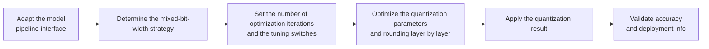

# AutoRound Low-Bit Quantization Algorithm Usage Guide

## 1. Scope

This guide is intended for users who need to use the [AutoRound Low-Bit Quantization Algorithm](./term_autoround.md). As a weight quantization processor, AutoRound solves for the optimal quantization parameters layer by layer through learnable rounding and SignSGD optimization, and is used for ultra-low-bit quantization scenarios such as 4-bit.

Applicable scenarios:

- W4 and other low-bit weight quantization accuracy does not meet the target and needs to be improved through the joint optimization of learnable rounding and MinMax;
- Mixed-bit-width deployment by module is needed (for example, W8A8 for most modules and W4A4 for sensitive projection layers), solved through a unified optimization procedure.

To check whether the model is on the officially pre-validated list, see the [Foundation Model Support Matrix](../../model/README.md); for a quick introduction to basic CLI usage, see the [One-Click Quantization Usage Guide](../../../user_guide/usage_one_click_quantization.md).

## 2. Inputs and Deliverables

| Type | Name | Source or Storage Location | Format or Constraints | Acceptance Criteria |
| --- | --- | --- | --- | --- |
| Input | Target model and quantization objective | The model to quantize and the deployment/evaluation plan | Clarifies the target numerical format or bit width, the target modules, the accuracy/performance goals, and the deployment constraints | Explains why this algorithm is chosen and where it fits in the overall quantization plan |
| Input | Model adapter | User adaptation code, invoked via `--model_type` | Implements the `PipelineInterface` interface | Properly driven by the runner and processor |
| Input | Configuration constraints and practical baseline | This algorithm's configuration description, the target model's existing `lab_practice` recipe (if any) | Field names, supported combinations, scope, and model adaptation are consistent with the current version | The recommended starting point is traceable to the current configuration definition or a verified practice |
| Input | Calibration data (when required by the algorithm) | Task `dataset`, a calibration set, or a model practice recipe | The data should represent the real input distribution; for multi-stage algorithms, keep the data distribution consistent across stages | Readable by the current quantization workflow and covering the main input forms |
| Deliverable | AutoRound parameter configuration plan | User quantization YAML or task configuration | Parameter values are valid and the scope of effect is explicit; the selection rationale of key parameters is explained | Can serve as algorithm configuration input for the subsequent quantization workflow and can reproduce the baseline selection in this guide |

## 3. Process Overview

The overall workflow of AutoRound is as follows:



Key details of each stage are as follows:

- **Adapt the model pipeline interface**: the adapter needs to implement `PipelineInterface` (the basic pipeline interface); the quantization runner and processor drive the model only through the standard pipeline methods. Model adaptation must be completed before AutoRound can run.
- **Determine the mixed-bit-width strategy**: use `strategies` to assign different `qconfig` settings (bit width, granularity, symmetry) to different modules; the strategy boundaries determine which layers ultimately carry the low-bit error.
- **Set the number of optimization iterations and the tuning switches**: `iters` controls the number of optimization iterations, while `enable_minmax_tuning` and `enable_round_tuning` control the learnable optimization of the quantization range and the rounding direction respectively.
- **Optimize the quantization parameters and rounding layer by layer**: the processor solves layer by layer for the target Linear layers, optimizing the rounding direction and quantization range through SignSGD to alleviate the reconstruction error at low bit widths.
- **Apply the quantization result**: the optimized weight rounding and quantization range are written back to the model to complete the final quantized weight generation.
- **Validate accuracy and deployment information**: compare the end-to-end accuracy before and after quantization and confirm that the mixed-bit-width strategy satisfies the deployment constraints; the final criterion is compatibility validation with the actual deployment chain.

## 4. Procedure

### Step 1: Adapt the Model Pipeline Interface

**Goal**: The quantization tool cannot directly operate on models with arbitrary structures; an adapter is needed to convert model operations into standard methods. The `autoround_quant` processor drives the model through the standard pipeline methods, so the model adapter only needs to implement the basic pipeline interface. Model adaptation must be completed before AutoRound can run.

**Action**: The model adaptation code must implement the following interfaces, which are aggregated and provided by `msmodelslim.model.interface_hub`:

1. **`PipelineInterface`** (`ModelSlimPipelineInterfaceV1`): the basic pipeline interface, responsible for model loading (`init_model`), data preprocessing (`handle_dataset`), layer-wise traversal (`generate_model_visit`), layer-wise forward pass (`generate_model_forward`), and so on. The quantization runner and processor drive the model only through these standard methods and are independent of the model's internal structure.

For a standard open-source LLM implemented with HuggingFace Transformers, it is recommended to build the adapter through compositional inheritance:

```python
from msmodelslim.model.interface_hub import (
    IModel,
    ModelInfoInterface,
    ModelSlimPipelineInterfaceV1 as PipelineInterface,
)

class MyModelAdapter(TransformersModel, ModelInfoInterface, PipelineInterface):
    pass
```

The adapter is then referenced in the quantization command via `--model_type MyModelAdapter`.

To develop new model adaptation code, see the [LLM Model Quantization Integration Guide](../../ptq/llm/integration_guide_large_language_model_quantization.md). Note that model adaptation must be completed first before the subsequent quantization workflow can run.

**Output**: A usable model adapter registered in the framework (invoked via `--model_type`).

### Step 2: Establish the Recommended Configuration

**Action**:

The following configuration establishes the **first comparable baseline**. If the target model already has a `lab_practice` recipe, prefer the verified recipe.

```yaml
spec:
  process:
    - type: "autoround_quant"
      iters: 400
      enable_minmax_tuning: true
      enable_round_tuning: true
      strategies:
        - qconfig:
            act:
              dtype: "int8"
              scope: "per_token"
              symmetric: true
              method: "minmax"
            weight:
              dtype: "int8"
              scope: "per_channel"
              symmetric: true
              method: "autoround"
          exclude: ["*.up_proj", "*.gate_proj", "*.o_proj"]
        - qconfig:
            act:
              dtype: "int4"
              scope: "per_token"
              symmetric: true
              method: "minmax"
            weight:
              dtype: "int4"
              scope: "per_channel"
              symmetric: true
              method: "autoround"
          include: ["*.up_proj", "*.gate_proj", "*.o_proj"]
```

**Output**: A reproducible recommended configuration that serves as the comparison baseline for all subsequent parameter adjustments.

### Step 3: Select and Tune Parameters

**Action**:

msModelSlim implementation entry point:
[View the corresponding implementation directory](../../../../../msmodelslim/processor/quant/autoround.py)

| Configuration Item | Meaning (Rationale) | Recommended Configuration | Selection and Tuning Advice |
| --- | --- | --- | --- |
| `type` | Processor identifier, fixed to `autoround_quant`. | Fixed. | Not a tuning item. |
| `iters` | The number of AutoRound optimization iterations. The code default `10` favors a fast start; the Qwen3 W4A4 practice in the repository uses `400`, which shows that low-bit accuracy optimization often needs significantly more iterations. | For a formal accuracy baseline, start from `400`; use a smaller value when only validating the pipeline. | Continue increasing the iterations only if the result keeps improving; if the result has stabilized, there is no need to pursue a larger number. Do not misinterpret "default 10" as the best value for low-bit accuracy. |
| `enable_minmax_tuning` | Whether the clipping boundary/quantization range may be optimized. When enabled, the algorithm not only optimizes the rounding but can also adjust the MinMax range. | `true` is recommended. | Usually keep it enabled. Disable it only for ablation studies or when the quantization range must be locked; if accuracy drops after disabling it, restore this switch first. |
| `enable_round_tuning` | Whether the weight rounding direction is optimized; this is the core mechanism that distinguishes AutoRound from ordinary MinMax weight quantization. | `true` is recommended. | Disabling it is not recommended for conventional use; after disabling it, even a very large `iters` cannot deliver the full AutoRound rounding optimization gain. |
| `strategies` | The list of mixed quantization strategies. Each strategy has its own `qconfig` and `include/exclude`, allowing different modules to use different bit widths/granularities. | Prefer reusing the model practice. When there is no dedicated recipe, first cover most modules with a higher precision and then lower the clearly suitable modules to the target low bit width. | The strategy adjustment order should be: protect the few sensitive modules first, then expand the low-bit coverage. If low-bit accuracy is insufficient, move the most sensitive layers to a high-precision strategy first, rather than immediately raising the bit width of the whole model. |
| `strategies[].qconfig.act` | The activation quantization configuration of each strategy. The activation bit width/granularity determines the full W/A error environment faced during optimization. | Consistent with the final activation deployment format; common INT activations start from `per_token + symmetric + minmax`. | Changing the activation bit width changes the optimal weight rounding and should be treated as a change of the whole target, requiring re-optimization. |
| `strategies[].qconfig.weight` | The AutoRound weight quantization configuration; `method` should be `autoround`, and the bit width/granularity determine the weight codebook and the optimization difficulty. | Consistent with the final weight format; the repository practices use per-channel symmetric weights. | Lower bit widths mean greater error pressure. When changing from INT8 to INT4, rerun the optimization and re-evaluate `iters` and the strategy scope. |
| `strategies[].include/exclude` | Divides the module scope of each mixed-precision strategy. | Follow the validated model recipe directly; when customizing, keep each strategy's scope clear and try to avoid ambiguous overlap. | When accuracy is insufficient, prefer local strategy migration: move the most sensitive projection layers from the low-bit strategy to the high-bit strategy and then look at the gain. |

#### Parameter Combinations and Selection Order

**Finally tune only one main knob**: `iters` is not the first parameter to tune. First ensure that the final W/A bit width, granularity, and module scope in the strategies are correct, and then use `iters` to control the degree of optimization; otherwise more iterations only optimize the wrong objective.

**Output**: An algorithm parameter plan that completes single-variable tuning, with a clear selection rationale and tuning direction for each key field.

### Step 4: Write the Quantization Configuration and Run the Command

**Goal**: Integrate the above steps into a complete YAML quantization configuration file and start the quantization workflow via the CLI.

#### Complete Example: AutoRound Mixed-Bit-Width Quantization

##### Configuration File: `autoround_mixed.yaml`

```yaml
apiversion: modelslim_v1
spec:
  runner: auto                    # layer_wise for single-card, dp_layer_wise for multi-card
  process:
    - type: autoround_quant       # AutoRound low-bit quantization
      iters: 400
      enable_minmax_tuning: true
      enable_round_tuning: true
      strategies:
        - qconfig:
            act:
              dtype: int8
              scope: per_token
              symmetric: true
              method: minmax
            weight:
              dtype: int8
              scope: per_channel
              symmetric: true
              method: autoround
          exclude: ["*.up_proj", "*.gate_proj", "*.o_proj"]
        - qconfig:
            act:
              dtype: int4
              scope: per_token
              symmetric: true
              method: minmax
            weight:
              dtype: int4
              scope: per_channel
              symmetric: true
              method: autoround
          include: ["*.up_proj", "*.gate_proj", "*.o_proj"]
  save:
    - type: ascendv1_saver        # Ascend inference standard save format
  dataset: mix_calib.jsonl        # built-in mixed calibration set
```

##### Run the command (single-card quantization)

```bash
msmodelslim quant \
  --model_path <float_model_dir> \
  --save_path <quantized_weight_output_dir> \
  --model_type <model_type> \
  --config ./autoround_mixed.yaml \
  --device npu \
  --device_id 0
```

**Output**: Complete quantized weight files and description files are generated in the directory specified by `--save_path`.

## 5. Terminology

| Term | Brief Description | Link |
| --- | --- | --- |
| AutoRound Low-Bit Quantization Algorithm | Explains the definition, core principle, key properties, applicable scenarios, and limitations of the algorithm. | [AutoRound Low-Bit Quantization Algorithm Terminology Entry](./term_autoround.md) |

## 6. Related Documents

| API or Document | Brief Description | Link |
| --- | --- | --- |
| `PipelineInterface` | Model pipeline interface, aggregated and exported by `msmodelslim.model.interface_hub`. | [Interface hub module](../../../../../msmodelslim/model/interface_hub.py) |
| autoround_quant Configuration Description | Field types, default values, valid values, and complete configuration constraints. | [autoround_quant Configuration Description](../../../api_reference/config/processor/autoround_quant.md) |
| modelslim_v1 Configuration Description | Consult this when you need to explore task-level advanced configurations such as runner, prior, save, and dataset. | [modelslim_v1 Configuration Description](../../../api_reference/config/quant/modelslim_v1.md) |
| Weight Quantization Usage Guide | User guide: quantization command parameters and complete usage instructions. | [Weight Quantization Usage Guide](../../../user_guide/usage_weight_quantization.md) |
