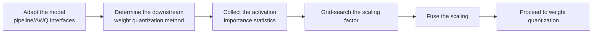

# AWQ Smooth Parameter Configuration Workflow Guide

## 1. Scope

This guide is intended for users who need to use the [AWQ Activation-Aware Weight Quantization Algorithm](./term_awq_smooth.md). As an outlier suppression algorithm, AWQ is usually a preprocessing step before weight quantization: it searches for the optimal scaling factor in an activation-aware way to improve the accuracy of low-bit quantization.

## 2. Inputs and Deliverables

| Type | Name | Source or Storage Location | Format or Constraints | Acceptance Criteria |
| --- | --- | --- | --- | --- |
| Input | Target model and quantization objective | The model to quantize and the deployment/evaluation plan | Clarifies the target numerical format or bit width, the target modules, the accuracy/performance goals, and the deployment constraints | Explains why this algorithm is chosen and where it fits in the overall quantization plan |
| Input | Model adapter | User adaptation code, invoked through `--model_type` | Implements the `PipelineInterface` and `AWQInterface` interfaces | Can be driven normally by the runner and the processor |
| Input | Configuration constraints and practical baseline | This algorithm's configuration description, the target model's existing `lab_practice` recipe (if any) | Field names, supported combinations, scope, and model adaptation are consistent with the current version | The recommended starting point is traceable to the current configuration definition or a verified practice |
| Input | Calibration data (when required by the algorithm) | Task `dataset`, a calibration set, or a model practice recipe | The data should represent the real input distribution; for multi-stage algorithms, keep the data distribution consistent across stages | Readable by the current quantization workflow and covering the main input forms |
| Deliverable | AWQ Smooth parameter configuration plan | User quantization YAML or task configuration | Parameter values are valid and the scope of effect is explicit; the selection rationale of key parameters is explained | Can serve as algorithm configuration input for the subsequent quantization workflow and can reproduce the baseline selection in this guide |

## 3. Process Overview

The overall workflow of AWQ is as follows:



Key details of each stage are as follows:

- **Adapt the model pipeline/AWQ interfaces**: the adapter needs to implement `PipelineInterface` (the basic pipeline interface) and `AWQInterface` (the AWQ-specific interface) to provide the AWQ subgraph structure mapping; this is the prerequisite for all subsequent search and application steps. Model adaptation must be completed before the AWQ algorithm can run.
- **Determine the downstream weight quantization method**: first fix the final quantization format/bit width, the target of application, and the evaluation baseline; the weight quantization configuration used by AWQ to simulate the search for the scaling coefficient must be consistent with the final weight quantizer.
- **Collect the activation importance statistics**: measure the activation importance with the calibration data (50 samples recommended) as the basis for searching the scaling factor.
- **Grid-search the scaling factor**: grid-search the optimal scaling factor in an activation-aware way; the denser the grid, the finer the candidates, and the longer the search time.
- **Fuse the scaling**: fuse the searched scaling factor into the weights so the activation distribution becomes more uniform and the weight quantization error smaller.
- **Proceed to weight quantization**: after smoothing, connect to the final weight quantization step; it is recommended to keep the subsequent quantization configuration unchanged and adjust only the AWQ parameters to isolate the gain.

## 4. Procedure

### Step 1: Adapt the Model Pipeline and AWQ Interfaces

**Goal**: The quantization tool cannot directly operate on models with arbitrary structures; an adapter is needed to convert model operations into standard methods. For AWQ, besides the pipeline interface, the model adapter must also implement the AWQ-specific interface to provide the AWQ subgraph structure mapping. Model adaptation must be completed before the AWQ algorithm can run.

**Action**: The model adaptation code must implement the following interfaces:

1. **`PipelineInterface`** (`ModelSlimPipelineInterfaceV1`): the basic pipeline interface, provided together by `msmodelslim.model.interface_hub`, responsible for model loading (`init_model`), data preprocessing (`handle_dataset`), layer-wise traversal (`generate_model_visit`), layer-wise forward pass (`generate_model_forward`), and so on.
2. **`AWQInterface`**: the AWQ-specific interface, provided by `msmodelslim.processor.anti_outlier.awq`, whose core method `get_adapter_config_for_subgraph()` returns the AWQ subgraph mapping configuration (subgraph types such as `norm-linear`, `linear-linear`, `ov`, and `up-down`). The AWQ processor mandates that the adapter implement this interface.

For a standard open-source LLM implemented with HuggingFace Transformers, it is recommended to build the adapter through compositional inheritance:

```python
from msmodelslim.model.interface_hub import (
    IModel,
    ModelInfoInterface,
    ModelSlimPipelineInterfaceV1 as PipelineInterface,
)
from msmodelslim.processor.anti_outlier.awq import (
    # ---- AWQ algorithm adaptation interfaces (the focus of this step) ----
    AWQInterface,  # Algorithm adaptation: get_adapter_config_for_subgraph returns the AWQ subgraph mapping
)

class MyModelAdapter(TransformersModel, ModelInfoInterface, PipelineInterface, AWQInterface):
    pass
```

The adapter is then referenced in the quantization command via `--model_type MyModelAdapter`.

To develop new model adaptation code, see the [LLM Model Quantization Integration Guide](../../ptq/llm/integration_guide_large_language_model_quantization.md). Note that model adaptation must be completed first before the subsequent quantization workflow can run.

**Output**: A usable model adapter registered in the framework (invoked via `--model_type`).

### Step 2: Establish the Recommended Configuration

**Action**:

The following configuration establishes the **first comparable baseline**. If the target model already has a `lab_practice` recipe, prefer the verified recipe, then use this section to understand why each parameter is chosen this way.

```yaml
spec:
  process:
    - type: "awq"
      weight_qconfig:
        scope: "per_channel"
        dtype: "int8"
        symmetric: true
        method: "minmax"
      n_grid: 20
      enable_subgraph_type:
        - "norm-linear"
        - "linear-linear"
        - "ov"
        - "up-down"
      include: ["*"]
      exclude: []
```

**Output**: A reproducible recommended configuration that serves as the comparison baseline for all subsequent parameter adjustments.

### Step 3: Select and Tune Parameters

**Action**:

msModelSlim implementation entry point:
[View the corresponding implementation directory](../../../../../msmodelslim/processor/anti_outlier/awq)

| Configuration Item | Meaning (Rationale) | Recommended Configuration | Selection and Tuning Advice |
| --- | --- | --- | --- |
| `type` | Processor identifier, fixed to `awq`. | Fixed. | Not an accuracy knob. |
| `weight_qconfig` | The configuration used by AWQ to simulate the final weight quantization error when searching the scaling coefficient. The searcher uses it to evaluate candidate scales, so its `dtype/scope/symmetric/method` must represent the final weight quantizer. | Must be consistent with the downstream final weight quantization configuration. For an INT4 weight target, use an INT4 configuration; for W8-only weight quantization, use INT8. | Once the final weight quantization method changes, the AWQ scale should be searched again. Do not use INT8 search results directly for INT4, and do not search with per-channel while deploying with another granularity. |
| `n_grid` | The grid search density of the AWQ scaling coefficient, default `20`. The denser the grid, the finer the candidates, and the longer the search time. | Start with the default `20`. | Increase it when the optimum is very sensitive to the grid position and repeated trials show that a coarse grid misses a clearly better interval; reduce it for quick verification. If the accuracy problem comes from a wrong qconfig or subgraph scope, increasing the grid size will not solve it. |
| `enable_subgraph_type` | Controls on which fusable structures AWQ searches/applies smoothing; `norm-linear`, `linear-linear`, `ov`, and `up-down` are supported. Different model structures can match different subgraphs. | When there is no model recipe, establish a coverage baseline from the four default types; when a practical configuration exists, enable only the structures validated in that practice. | If a certain structure does not match, gives unstable results, or is not supported by deployment fusion, disable only that type; do not close all subgraphs to work around a single problem. Recalibrate after adding subgraph types, because both the search data and the weight paths change. |
| `include` | Allow list for the scope; a module-name pattern determines which matched modules enter the current algorithm. It only decides *where* the algorithm is applied and does not change the algorithm's internal formula. | Start from `["*"]` when there is no model-specific recipe; when a `lab_practice` recipe exists, inherit its module scope directly. | First ensure the scope covers the intended modules, then check accuracy. If the scope is too broad, a few incompatible structures or sensitive layers amplify the overall risk; if it is too narrow, the algorithm's benefit may not be visible. When narrowing the scope, adjust by structural family or known sensitive layers rather than deleting a large number of layers by index alone. |
| `exclude` | Deny list for the scope; matched modules are removed from the `include` candidates. It takes precedence over `include`. It is suitable for protecting sensitive layers, the first and last layers, or model-specific incompatible structures. | Keep the list empty by default; add entries only when a practical recipe, a compatibility constraint, or a sensitivity result provides explicit evidence. | For local accuracy problems, prefer using `exclude` for a small-scope fallback; this preserves gains more easily than raising the bit width of the whole model or disabling the entire algorithm. After adding each exclusion, confirm that the wildcard does not accidentally affect adjacent modules. |

#### Parameter Combinations and Selection Order

The most critical coupling in AWQ is **`weight_qconfig` <-> the final weight quantization configuration**. Fix the target qconfig first, then decide the subgraph scope, and only then use `n_grid` to fine-tune the search precision. Change only one variable per round and keep the same calibration set and evaluation set; if there is no stable gain after the adjustment, return to the previous baseline.

**Output**: An algorithm parameter plan that completes single-variable tuning, with a clear selection rationale and tuning direction for each key field.

### Step 4: Write the Quantization Configuration and Run the Command

**Goal**: Integrate the above steps into a complete YAML quantization configuration file and start the quantization workflow via the CLI.

#### Complete Example: AWQ + W4A8 Dynamic Quantization (Recommended Starting Point)

##### Configuration File: `awq_w4a8.yaml`

```yaml
apiversion: modelslim_v1
spec:
  runner: auto
  process:
    - type: awq                     # Activation-aware search for the weight scaling factor
      weight_qconfig:               # Consistent with the final weight quantization configuration
        scope: per_channel
        dtype: int4
        symmetric: true
        method: minmax
      n_grid: 20
      enable_subgraph_type:
        - "norm-linear"
        - "linear-linear"
        - "ov"
        - "up-down"
      include: ["*"]
    - type: linear_quant            # connect to W4A8 dynamic quantization
      qconfig:
        act:
          dtype: int8
          scope: per_token
          symmetric: true
          method: minmax
        weight:
          dtype: int4
          scope: per_channel
          symmetric: true
          method: minmax
      include: ["*"]
  save:
    - type: ascendv1_saver          # Ascend inference standard save format
  dataset: mix_calib.jsonl          # built-in mixed calibration set
```

##### Run the command (single-card quantization)

```bash
msmodelslim quant \
  --model_path <float_model_dir> \
  --save_path <quantized_weight_output_dir> \
  --model_type <model_adapter_name> \
  --config ./awq_w4a8.yaml \
  --device npu \
  --device_id 0
```

**Output**: Complete quantized weight files and description files are generated in the directory specified by `--save_path`.

## 5. Terminology

| Term | Brief Description | Link |
| --- | --- | --- |
| AWQ Activation-Aware Weight Quantization Algorithm | Explains the definition, core principle, key properties, applicable scenarios, and limitations of the algorithm. | [AWQ Activation-Aware Weight Quantization Algorithm Terminology Entry](./term_awq_smooth.md) |

## 6. Related Documents

| API or Document | Brief Description | Link |
| --- | --- | --- |
| `PipelineInterface` | The model pipeline interface, exported together from `msmodelslim.model.interface_hub`; `AWQInterface` is provided by `msmodelslim.processor.anti_outlier.awq`. | [Interface hub module](../../../../../msmodelslim/model/interface_hub.py) |
| awq Configuration Description | Field types, default values, valid values, and complete configuration constraints. | [awq Configuration Description](../../../api_reference/config/processor/awq.md) |
| modelslim_v1 Configuration Description | Consult this when you need to explore task-level advanced configurations such as runner, prior, save, and dataset. | [modelslim_v1 Configuration Description](../../../api_reference/config/quant/modelslim_v1.md) |
| Weight Quantization Usage Guide | User guide: quantization command parameters and complete usage instructions. | [Weight Quantization Usage Guide](../../../user_guide/usage_weight_quantization.md) |
