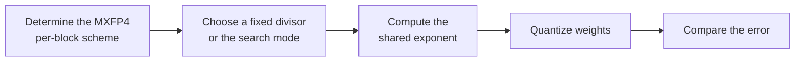

# Ceil_X Parameter Configuration Workflow Guide

## 1. Scope

This guide is intended for users who need to use the [Ceil_X Adaptive Divisor MXFP4 Quantization Algorithm](./term_ceil_x.md). As a weight quantization method of the `linear_quant` processor, Ceil_X optimizes the shared exponent through ceil plus a configurable divisor, reducing the clipping of large values and improving mxFP4 weight quantization accuracy.

## 2. Inputs and Deliverables

| Type | Name | Source or Storage Location | Format or Constraints | Acceptance Criteria |
| --- | --- | --- | --- | --- |
| Input | Floating-point model weight directory | Model download or a local path | HuggingFace format containing `config.json` and `*.safetensors` shards | Loadable by the target Transformers version |
| Input | Calibration dataset | Task `dataset`, a calibration set, or a model practice recipe | Text prompts in JSONL or JSON format; 50 samples recommended | Represents the real input distribution and is readable and encodable into forward tensors by the current quantization workflow |
| Input | Quantization configuration file | Local YAML file | Complies with the `modelslim_v1` protocol specification | Passes schema validation |
| Deliverable | Quantized weight directory | Path specified by `--save_path` | Contains `quant_model_description.json` and `*.safetensors` shards | Export is complete and the inference smoke test passes |

## 3. Process Overview

The overall workflow of Ceil_X is as follows:



Key details of each stage are as follows:

- **Prerequisite: model adaptation.** Model adaptation must be completed before quantization. The adapter implements interfaces such as `PipelineInterface` (the basic pipeline interface); see the [LLM Model Quantization Integration Guide](../../ptq/llm/integration_guide_large_language_model_quantization.md) for details. Model adaptation must be completed first before the quantization workflow can run.
- **Determine the MXFP4 per-block scheme**: Ceil_X is only registered as MXFP4 `per_block` weight quantization; the block-shared exponent is part of the algorithm definition, and the format and granularity are fixed constraints.
- **Choose a fixed divisor or the search mode**: first establish a baseline with the default divisor `7.25`; enable the automatic MSE search only when the fixed value fails to meet the accuracy requirement, rather than making large manual adjustments based on experience.
- **Compute the shared exponent**: compute the shared exponent as ceil plus a configurable divisor; the larger the divisor, the finer the step size, but the higher the overflow risk.
- **Quantize weights**: apply MXFP4 block-wise quantization to the weights with the computed shared exponent.
- **Compare the error**: observe overflow/saturation and the reconstruction error; consider adjusting the search configuration only when the best candidate stays near the boundary of the search interval for a long time.

## 4. Procedure

### Step 1: Confirm Objectives and Constraints

**Action**: First fix the target model, the final quantization format/bit width, the target objects, and the evaluation baseline, then confirm the parameter combinations supported by the current version. If the target model already has a `lab_practice` recipe, use that recipe as the practical baseline first; when there is no model-specific recipe, use the general recommended starting point given in this guide. If the algorithm relies on calibration statistics or optimization data, also fix representative data (50 samples recommended) before tuning, to avoid mistaking a change in the data distribution for a parameter gain.

**Output**: An explicit configuration objective: target bit width/format, processing scope, calibration conditions, evaluation baseline, and deployment constraints.

### Step 2: Establish the Recommended Configuration

**Action**:

The following configuration establishes the **first comparable baseline**. If the target model already has a `lab_practice` recipe, prefer the verified recipe, then use this section to understand why each parameter is chosen this way.

```yaml
spec:
  process:
    - type: "linear_quant"
      qconfig:
        weight:
          scope: "per_block"
          dtype: "mxfp4"
          symmetric: true
          method: "ceil_x"
          ext:
            ceil_x_value: 7.25        # Divisor, valid range [6.0, 12.0]
            enable_search: false      # Whether to enable the MSE search
            search_min: 6.0           # Lower bound of the search range
            search_max: 12.0          # Upper bound of the search range
            search_step: 0.25         # Search step
```

**Output**: A reproducible recommended configuration that serves as the comparison baseline for all subsequent parameter adjustments.

### Step 3: Select and Tune Parameters

**Action**:

| Configuration Item | Meaning (Rationale) | Recommended Configuration | Selection and Tuning Advice |
| --- | --- | --- | --- |
| `scope` | The current Ceil_X quantizer is only registered for MXFP4 `per_block` weight quantization. The block-shared exponent is part of the algorithm definition. | Fixed to `per_block`. | When another granularity is needed, switch the quantizer instead of modifying this field. |
| `dtype` | Currently only `mxfp4` is supported. The MXFP4 block size is defined by the MX format of the dtype. | Fixed to `mxfp4`. | Do not use Ceil_X when the target backend is not MXFP4. |
| `symmetric` | The currently registered combination is symmetric quantization. | Fixed to `true`. | Do not change it to asymmetric; there is currently no corresponding registered implementation. |
| `method` | Selects the Ceil_X shared exponent strategy. | Fixed to `ceil_x`. | Switching the method means switching the algorithm. |
| `ext.axes` | Specifies the tensor dimensions along which MX block reshape/shared exponent is performed; default `-1` (the last dimension). The choice of axis changes which elements share a block and therefore directly affects the scale statistics and the exported layout. | For linear weights, usually keep the default `-1`; modify it only when the model/backend layout explicitly requires another axis. | Do not treat `axes` as an accuracy fine-tuning parameter. Before changing the axis, confirm that the target weight dimensions, the block layout, and the backend are consistent; otherwise, even if the offline error decreases, correct deployment may not be possible. |
| `ext.ceil_x_value` | The divisor for the shared exponent computation in Ceil_X, in the range `[6,12]`, default `7.25`. In the source code, the larger `c` is, the smaller the shared exponent and the finer the quantization step, but the closer it gets to the representable upper limit and the higher the overflow risk. | Use the default `7.25` when not searching. | If the error with the fixed value is unsatisfactory, prefer enabling the automatic MSE search rather than making large manual adjustments based on experience. When tuning manually, vary the value in small steps within the valid range and observe both overflow/saturation and the reconstruction error. |
| `ext.enable_search` | Whether to enumerate `ceil_x_value` within the given interval and select the best candidate by the weight reconstruction MSE. | Use `false` for a fast/stable recipe; set it to `true` when accuracy is the priority for a standalone model. | If the fixed 7.25 already meets the accuracy requirement, no search is needed; enable it when the distributions of different layers differ noticeably or when the loss with the fixed value is on the high side. Once enabled, `ceil_x_value` is only an initial/configuration value and is no longer the main manual tuning knob. |
| `ext.search_min` / `ext.search_max` | The automatic search interval, default `[6,12]`; both bounds must lie within the range allowed by the algorithm, and the upper bound must be greater than the lower bound. | Keep `6.0` / `12.0`. | Consider narrowing or adjusting the interval only when the best candidate is observed to stay near the boundary for a long time; because the algorithm's own valid range is `[6,12]`, it cannot be extended outward indefinitely. |
| `ext.search_step` | The candidate step, default `0.25`. The number of candidates is roughly determined by the interval width divided by the step; the smaller the step, the finer the search but the higher the time cost. | Start with `0.25`. | If the MSE curve near the best point is very steep and the accuracy is sensitive to the candidate, reduce the step; if only quick screening is needed, it can be increased moderately. Fix the search range first, then change the step, so the gain is easier to attribute. |

#### Parameter Combinations and Selection Order

What is really tunable in Ceil_X is `ceil_x_value` or its search configuration; `dtype/scope/symmetric/method/axes` are more a matter of format and layout constraints. When accuracy is insufficient, first enable the search with the default range, and only then consider changing the search granularity.

**Output**: An algorithm parameter plan that completes single-variable tuning, with a clear selection rationale and tuning direction for each key field.

### Step 4: Converge the Parameter Plan Based on Results

**Action**:

- Fixing `7.25` is a low-cost starting point; enable the search only when the fixed value fails to meet the accuracy requirement, which avoids paying the search cost in every trial.
- **Run the recommended configuration first, then tune one variable at a time.** Do not change the bit width, granularity, algorithm parameters, and layer scope simultaneously; otherwise it is difficult to attribute an accuracy change to a specific item.
- **Prefer local fallback over raising precision globally.** If only a few layers are sensitive, use `exclude` or a mixed strategy to preserve high precision for them; this is usually more cost-effective than raising the bit width of the entire model.
- **The model's practical configuration and deployment capability take precedence.** The introductory recommendation is meant to establish a stable starting point; if the target model already has a `lab_practice` recipe, prefer reusing the verified combination.

**Output**: A final parameter plan ready for the subsequent quantization workflow, retaining a record of adjustments relative to the recommended configuration.

## 5. Terminology

| Term | Brief Description | Link |
| --- | --- | --- |
| Ceil_X Adaptive Divisor MXFP4 Quantization Algorithm | Explains the definition, core principle, key properties, applicable scenarios, and limitations of the algorithm. | [Ceil_X Adaptive Divisor MXFP4 Quantization Algorithm Terminology Entry](./term_ceil_x.md) |

## 6. Related Documents

| API or Document | Brief Description | Link |
| --- | --- | --- |
| linear_quant Configuration Description | Field types, default values, valid values, and complete configuration constraints. | [linear_quant Configuration Description](../../../api_reference/config/processor/linear_quant.md) |
| modelslim_v1 Configuration Description | Consult this when you need to explore task-level advanced configurations such as runner, prior, save, and dataset. | [modelslim_v1 Configuration Description](../../../api_reference/config/quant/modelslim_v1.md) |
| Weight Quantization Usage Guide | User guide: quantization command parameters and complete usage instructions. | [Weight Quantization Usage Guide](../../../user_guide/usage_weight_quantization.md) |
