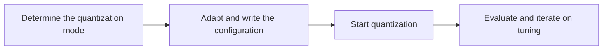

# DAOS Parameter Configuration Workflow Guide

## 1. Scope

This guide is intended for users who need to use the [DAOS Low-Bit Quantization Solution](./term_daos.md). DAOS is a joint low-bit solution for multimodal **generative** models. By chaining `oasq` (outlier-aware smoothing) with `trainable_linear_quant` (TLQ, trainable linear quantization), it targets extremely low-bit scenarios such as W4A4 / MXFP; when further accelerating Attention inference is needed, `fa3_quant` can additionally be configured for FA quantization.

This guide explains the chaining order, stage goals, and constraints. For each algorithm's recommended starting configuration and field tuning, see the [OASQ Outlier-Aware Smooth Quantization Algorithm Usage Guide](../oasq/usage_oasq.md), the [Trainable Linear Quantization Algorithm Usage Guide](../trainable_linear_quant/usage_trainable_linear_quant.md), and the [FA3 Quant Parameter Configuration Workflow Guide](../fa3_quant/usage_fa3_quant.md) respectively; they are not repeated here.

- **Applicable**: you need OASQ + TLQ to jointly recover low-bit accuracy; the task protocol is `multimodal_sd_modelslim_v1` (or the corresponding multimodal generative task protocol).
- **Not applicable**: a single calibration pass is sufficient and OASQ/TLQ is not needed; the target dtype/scope/method has no corresponding TLQ kernel; the adapter cannot provide OASQ-fusible subgraphs and default probing does not apply either; or the device memory/duration cannot support block-level training.

> **Resource note**: DAOS includes OASQ smoothing and TLQ block-level training, so quantization time and memory usage are significantly higher than for single-calibration algorithms; whether memory is sufficient usually cannot be confirmed until quantization is started, as described in the relevant step.

If the target model already has a complete, verified quantization recipe, prefer reusing that recipe.

## 2. Inputs and Deliverables

| Type | Name | Source or Storage Location | Format or Constraints | Acceptance Criteria |
| --- | --- | --- | --- | --- |
| Input | Floating-point model weight directory | Model download or a local path | HuggingFace format containing `config.json` and `*.safetensors` shards | Loadable by the target Transformers version |
| Input | Model adapter | User adaptation code, invoked via `--model_type` | Implements `PipelineInterface` and the dedicated interfaces for OASQ/TLQ (and optionally FA3) | Properly driven by the runner and processor |
| Input | Calibration dataset | Task `dataset`, a calibration set, or a model practice recipe | Text prompts in JSONL or JSON format; 50 samples recommended | Represents the real input distribution and is successfully encoded into forward tensors by the adapter's `handle_dataset` |
| Input | Quantization task configuration | The user's YAML or a `lab_practice` recipe | Complies with `multimodal_sd_modelslim_v1` (or the corresponding task protocol) and can be chained into `spec.process` | Passes schema validation and can be loaded by the quantization workflow |
| Deliverable | DAOS configuration snippet | The `process` entries written into the above YAML | `oasq` first, then `trainable_linear_quant`; append `fa3_quant` as needed; each section's fields comply with the corresponding algorithm's configuration description | Quantization can be reproduced with the complete configuration |

## 3. Process Overview

The overall workflow of DAOS is as follows:

Key details of each stage are as follows:

- **Determine the quantization mode**: fix the quantization mode DAOS will implement, including the target bit width and numerical format of the linear layers' W/A, whether to apply FA quantization to Attention, and TLQ's preferred OP path.
- **Adapt and write the configuration**: complete subgraph adaptation in the order OASQ → TLQ → optional FA3, and write a loadable DAOS chained configuration into `spec.process`.
- **Start quantization**: start the whole-chain quantization and get it running; if memory is insufficient, adjust the resource-related parameters first and retry.
- **Evaluate and iterate on tuning**: complete the end-to-end evaluation; if it falls short, iterate on single-variable tuning according to the corresponding algorithm's usage guide until the target is met or a fallback strategy is determined.

## 4. Procedure

### Step 1: Determine the Quantization Mode

**Goal**: Fix the quantization mode DAOS will implement, as the precondition for subsequent adaptation and configuration.

**Action**:

1. Determine the target bit width and numerical format of the linear layers' W/A (such as MXFP4 / INT4).
2. Determine whether FA quantization of Attention is needed to accelerate inference (whether to include `fa3_quant`).
3. Determine TLQ's preferred OP path: usually `minmax_tune` + `round_tune`; you may also enable `trainable_smooth` **alone** according to the TLQ usage guide (it cannot be combined with the former two).

> The required memory and time are hard to estimate accurately before configuration, so there is no need to quantify resources in this step; rely on the actual run in Step 3.

**Output**: A clear statement of the quantization mode (W/A target, whether FA is enabled, TLQ OP path).

### Step 2: Complete Model Adaptation and Configuration Authoring

**Goal**: Complete adaptation according to the corresponding algorithm documents, and write a loadable DAOS chained configuration into `spec.process`.

**Action**:

1. If the target model already has a `lab_practice` recipe containing the complete DAOS chain, prefer reusing it.
2. Otherwise, complete adaptation and configuration authoring in the order **OASQ → TLQ → optional FA3**:
   - **OASQ**: see the [OASQ Outlier-Aware Smooth Quantization Algorithm Usage Guide](../oasq/usage_oasq.md) to complete subgraph adaptation and write `oasq`.
   - **TLQ**: see the [Trainable Linear Quantization Algorithm Usage Guide](../trainable_linear_quant/usage_trainable_linear_quant.md) to complete adaptation and write `trainable_linear_quant`; configure `operations` according to the path chosen in Step 1; keep `strategies[].qconfig` consistent with the final deployment bit width. If `trainable_smooth` is selected, confirm the subgraph capability according to that guide.
   - **FA3**: if Step 1 decided to enable FA, see the [FA3 Quant Parameter Configuration Workflow Guide](../fa3_quant/usage_fa3_quant.md) to complete adaptation, and append `fa3_quant` after TLQ.
3. For field types and constraints, see the related documents in Chapter 6.
4. Verify the chaining constraints:
   - The order is OASQ → TLQ → optional FA3.
   - OASQ's `symmetric` should be consistent with the symmetry assumption of the subsequent quantization.
   - Do not mix `minmax_tune` / `round_tune` with `trainable_smooth`.

**Output**: The DAOS `process` chained entries written into the YAML.

### Step 3: Start Quantization

**Goal**: Start the whole-chain quantization and get it running; if memory is insufficient, adjust the resource-related parameters below first and retry.

**Action**:

1. Start quantization using the configuration from Step 2.
2. If OASQ appears to be a no-op, first troubleshoot the adaptation and `include`/`exclude` according to the [OASQ Outlier-Aware Smooth Quantization Algorithm Usage Guide](../oasq/usage_oasq.md), then continue with the subsequent training-related parameter adjustments.
3. **When memory is insufficient**, try the following adjustments first, changing only one item at a time; for details see the [Trainable Linear Quantization Algorithm Usage Guide](../trainable_linear_quant/usage_trainable_linear_quant.md):
   - Increase `train_config.gradient_accumulate_steps` to reduce peak memory; this change alters the effective update frequency.
   - Narrow the low-bit range that needs training in the TLQ `strategies`, for example by adding `exclude` entries or moving some modules to a higher-bit-width strategy.
   - If necessary, temporarily lower `train_config.iters` to first verify the chain runs; restore a reasonable number of iterations for formal accuracy runs.
4. Once it runs, the quantization artifacts are produced; proceed to the evaluation in Step 4.

**Output**: A reproducible quantization run result; if the configuration was adjusted due to insufficient memory, keep the final working configuration.

### Step 4: Evaluation and Iterative Tuning

**Goal**: After quantization, perform an end-to-end evaluation; if it falls short, iterate on single-variable tuning until the target is met or a fallback strategy is determined.

**Action**:

1. Keep the evaluation conditions unchanged and compare the end-to-end metrics before and after quantization (or against a single-calibration baseline).
2. When accuracy falls short, make single-variable adjustments according to the corresponding algorithm's usage guide and re-quantize, for example:
   - OASQ: scope, `enable_subgraph_type`, `max_iters`, and so on.
   - TLQ: `strategies` mixed bit widths, `train_config` (`iters` / `lr`, etc.), and OP-related switches.
   - FA3: qconfig and the Attention scope (if enabled).
3. After the upstream OASQ or the main target bit width changes, re-run the whole chain rather than splicing together old results.
4. Change only one item at a time and keep a record of adjustments relative to the baseline.

**Output**: The final DAOS snippet that can be merged into the task configuration, along with the record of adjustments relative to the baseline.

## 5. Terminology

| Term | Brief Description | Link |
| --- | --- | --- |
| DAOS Low-Bit Quantization Solution | The solution's definition, principle, properties, and limitations. | [DAOS Low-Bit Quantization Solution Terminology Entry](./term_daos.md) |
| OASQ | DAOS's upstream outlier suppression. | [OASQ Outlier-Aware Smooth Quantization Algorithm Terminology Entry](../oasq/term_oasq.md) |
| Trainable Linear Quant | DAOS's trainable linear quantization stage. | [Trainable Linear Quantization Algorithm Terminology Entry](../trainable_linear_quant/term_trainable_linear_quant.md) |
| FA3 Quant | Optional Attention FA quantization. | [FA3 Quant Attention Activation Quantization Algorithm Terminology Entry](../fa3_quant/term_fa3_quant.md) |

## 6. Related Documents

| API or Document | Brief Description | Link |
| --- | --- | --- |
| oasq Configuration Description | Field types, default values, and constraints. | [oasq Configuration Description](../../../api_reference/config/processor/oasq.md) |
| trainable_linear_quant Configuration Description | Field types, default values, and constraints. | [trainable_linear_quant Configuration Description](../../../api_reference/config/processor/trainable_linear_quant.md) |
| fa3_quant Configuration Description | Field types, default values, and constraints. | [fa3_quant Configuration Description](../../../api_reference/config/processor/fa3_quant.md) |
| multimodal_sd_modelslim_v1 | Multimodal generative task-level configuration. | [multimodal_sd_modelslim_v1 Configuration Description](../../../api_reference/config/quant/multimodal_sd_modelslim_v1.md) |
| Weight Quantization Usage Guide | User guide: quantization command parameters and complete usage instructions. | [Weight Quantization Usage Guide](../../../user_guide/usage_weight_quantization.md) |
