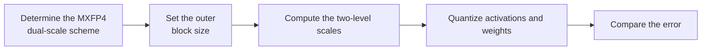

# DualScale Parameter Configuration Workflow Guide

## 1. Scope

This guide is intended for users who need to use the [DualScale Dual-Scale Quantization Algorithm](./term_dual_scale.md). As a quantization method of the `linear_quant` processor, DualScale mitigates the impact of outlier channels through a two-level progressive scaling structure, and is used for W4A4 low-bit quantization of Qwen3 dense-series models.

## 2. Inputs and Deliverables

| Type | Name | Source or Storage Location | Format or Constraints | Acceptance Criteria |
| --- | --- | --- | --- | --- |
| Input | Floating-point model weight directory | Model download or a local path | HuggingFace format containing `config.json` and `*.safetensors` shards | Loadable by the target Transformers version |
| Input | Calibration dataset | Task `dataset`, a calibration set, or a model practice recipe | Text prompts in JSONL or JSON format; 50 samples recommended | Represents the real input distribution and is readable and encodable into forward tensors by the current quantization workflow |
| Input | Quantization configuration file | Local YAML file | Complies with the `modelslim_v1` protocol specification | Passes schema validation |
| Deliverable | Quantized weight directory | Path specified by `--save_path` | Contains `quant_model_description.json` and `*.safetensors` shards | Export is complete and the inference smoke test passes |

## 3. Process Overview

The overall workflow of DualScale is as follows:



Key details of each stage are as follows:

- **Prerequisite: model adaptation.** Model adaptation must be completed before quantization. The adapter implements interfaces such as `PipelineInterface` (the basic pipeline interface); see the [LLM Model Quantization Integration Guide](../../ptq/llm/integration_guide_large_language_model_quantization.md) for details. Model adaptation must be completed first before the quantization workflow can run.
- **Determine the MXFP4 dual-scale scheme**: DualScale is registered as a dedicated MXFP4 `dual_scale` granularity, which introduces a second-level scale of coarser granularity on top of the regular MXFP4 block scale.
- **Set the outer block size**: set the size of the large block covered by the second-level scale through `ext.dual_block_size`; the smaller the large block, the better it adapts to the local distribution, but the higher the number of scales and the overhead.
- **Compute the two-level scales**: internally, MXFP4 per-block MinMax quantization is performed first, and then the additional scale is computed/saved according to `dual_block_size`.
- **Quantize activations and weights**: both the activation path and the weight path can use `dual_scale`; for the first comparison it is recommended to keep the block size consistent on both sides.
- **Compare the error**: on the same model, compare the reconstruction/task accuracy and the scale overhead of different outer block sizes, and adjust one variable at a time.

## 4. Procedure

### Step 1: Confirm Objectives and Constraints

**Action**: First fix the target model, the final quantization format/bit width, the target objects, and the evaluation baseline, then confirm the parameter combinations supported by the current version. If the target model already has a `lab_practice` recipe, use that recipe as the practical baseline first; when there is no model-specific recipe, use the general recommended starting point given in this guide. If the algorithm relies on calibration statistics or optimization data, also fix representative data (50 samples recommended) before tuning, to avoid mistaking a change in the data distribution for a parameter gain.

**Output**: An explicit configuration objective: target bit width/format, processing scope, calibration conditions, evaluation baseline, and deployment constraints.

### Step 2: Establish the Recommended Configuration

**Action**:

The following configuration establishes the **first comparable baseline**. If the target model already has a `lab_practice` recipe, prefer the verified recipe, then use this section to understand why each parameter is chosen this way.

```yaml
spec:
  process:
    - type: "linear_quant"
      qconfig:
        act:
          scope: "dual_scale"
          dtype: "mxfp4"
          symmetric: True
          method: "dualscale"
          ext:
            dual_block_size: 512
        weight:
          scope: "dual_scale"
          dtype: "mxfp4"
          symmetric: True
          method: "dualscale"
          ext:
            dual_block_size: 512
```

**Output**: A reproducible recommended configuration that serves as the comparison baseline for all subsequent parameter adjustments.

### Step 3: Select and Tune Parameters

**Action**:

| Configuration Item | Meaning (Rationale) | Recommended Configuration | Selection and Tuning Advice |
| --- | --- | --- | --- |
| `scope` | The dedicated granularity currently registered by the DualScale quantizer, meaning that a second-level scale of coarser granularity is introduced on top of the regular MXFP4 block scale. | Fixed to `dual_scale`. | Other scopes do not belong to this algorithm. |
| `dtype` | The currently registered format is `mxfp4`. Internally, MXFP4 per-block MinMax is still applied first, and then the second-level scale is multiplied in. | Fixed to `mxfp4`. | When the deployment format changes, the corresponding algorithm should be selected. |
| `symmetric` | The currently registered combination is symmetric MXFP4 DualScale. | Fixed to `true`. | Modification is not recommended at present. |
| `method` | Selects the DualScale implementation. | Fixed to `dualscale`. | This is not an accuracy knob. |
| `ext.axes` | Determines the dimension along which the inner block and the outer dual block are reshaped; default `-1`. It affects the direction in which the scales are shared. | Usually keep `-1`, unless the practical configuration or the backend explicitly specifies another axis. | The axis is bound to the tensor layout and must not be changed merely for offline MSE; after changing it, the layout and deployment parsing of both the weight and activation paths must be verified as well. |
| `ext.dual_block_size` | The size of the large block covered by the second-level scale. Internally, MXFP4 small-block quantization is performed first, and the additional scale is then computed/saved according to `dual_block_size`; the smaller the large block, the more localized the second-level scale and the stronger its adaptation to the local distribution, but the higher the number of scales and the processing overhead. | The Qwen-Image-Edit practice in the repository uses `512` for both activations and weights, which can serve as the preferred starting point for this model family/format. | Decrease it when the local dynamic range differs greatly; increase it when scale metadata or processing overhead matters more. The activation and weight values do not have to be identical when tuning, but the first comparison should keep them consistent to avoid changing both directions at once. |

#### Parameter Combinations and Selection Order

The core knob of DualScale is `dual_block_size`. First fix the MXFP4 + dual_scale format and the axes; then, on the same model, compare the reconstruction/task accuracy and the scale overhead of different outer block sizes.

**Output**: An algorithm parameter plan that completes single-variable tuning, with a clear selection rationale and tuning direction for each key field.

### Step 4: Converge the Parameter Plan Based on Results

**Action**:

- **Run the recommended configuration first, then tune one variable at a time.** Do not change the bit width, granularity, algorithm parameters, and layer scope simultaneously; otherwise it is difficult to attribute an accuracy change to a specific item.
- **Prefer local fallback over raising accuracy globally.** If only a few layers are sensitive, use `exclude` or a mixed strategy to preserve high accuracy for them; this is usually more cost-effective than raising the bit width of the entire model.
- **The model's practical configuration and deployment capability take precedence.** The introductory recommendation is meant to establish a stable starting point; if the target model already has a `lab_practice` recipe, prefer reusing the verified combination.

**Output**: A final parameter plan ready for the subsequent quantization workflow, retaining a record of adjustments relative to the recommended configuration.

## 5. Terminology

| Term | Brief Description | Link |
| --- | --- | --- |
| DualScale Dual-Scale Quantization Algorithm | Explains the definition, core principle, key properties, applicable scenarios, and limitations of the algorithm. | [DualScale Dual-Scale Quantization Algorithm Terminology Entry](./term_dual_scale.md) |

## 6. Related Documents

| API or Document | Brief Description | Link |
| --- | --- | --- |
| linear_quant Configuration Description | Field types, default values, valid values, and complete configuration constraints. | [linear_quant Configuration Description](../../../api_reference/config/processor/linear_quant.md) |
| modelslim_v1 Configuration Description | Consult this when you need to explore task-level advanced configurations such as runner, prior, save, and dataset. | [modelslim_v1 Configuration Description](../../../api_reference/config/quant/modelslim_v1.md) |
| Weight Quantization Usage Guide | User guide: quantization command parameters and complete usage instructions. | [Weight Quantization Usage Guide](../../../user_guide/usage_weight_quantization.md) |
