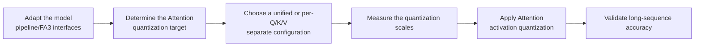

# FA3 Quant Parameter Configuration Workflow Guide

## 1. Scope

FA3 Quant attention activation quantization algorithm. As an activation quantization processor, FA3 Quant performs per-head quantization on the Q, K, and V activations of the attention mechanism, reducing memory usage and improving inference efficiency.

## 2. Inputs and Deliverables

| Type | Name | Source or Storage Location | Format or Constraints | Acceptance Criteria |
| --- | --- | --- | --- | --- |
| Input | Target model and quantization objective | The model to quantize and the deployment/evaluation plan | Clarifies the target numerical format or bit width, the target modules, the accuracy/performance goals, and the deployment constraints | Explains why this algorithm is chosen and where it fits in the overall quantization plan |
| Input | Model adapter | User adaptation code, invoked through `--model_type` | Implements the `PipelineInterface` and `FA3QuantAdapterInterface` interfaces | Can be driven normally by the runner and the processor |
| Input | Configuration constraints and practical baseline | This algorithm's configuration description, the target model's existing `lab_practice` recipe (if any) | Field names, supported combinations, scope, and model adaptation are consistent with the current version | The recommended starting point is traceable to the current configuration definition or a verified practice |
| Input | Calibration data (when required by the algorithm) | Task `dataset`, a calibration set, or a model practice recipe | The data should represent the real input distribution; for multi-stage algorithms, keep the data distribution consistent across stages | Readable by the current quantization workflow and covering the main input forms |
| Deliverable | FA3 Quant parameter configuration plan | User quantization YAML or task configuration | Parameter values are valid and the scope of effect is explicit; the selection rationale of key parameters is explained | Can serve as algorithm configuration input for the subsequent quantization workflow and can reproduce the baseline selection in this guide |

## 3. Process Overview



## 4. Procedure

### Step 1: Adapt the Model Pipeline and FA3 Interfaces

**Goal**: The quantization tool cannot directly operate on models with arbitrary structures; an adapter is needed to convert model operations into standard methods. For FA3 Quant, besides the pipeline interface, the model adapter must also implement the FA3-specific interface to inject quantization placeholder modules at designated positions in the Attention. Model adaptation must be completed before FA3 quantization can run.

**Action**: The model adaptation code must implement the following interfaces, all of which are aggregated and provided by `msmodelslim.model.interface_hub`:

1. **`PipelineInterface`** (`ModelSlimPipelineInterfaceV1`): the basic pipeline interface, responsible for model loading (`init_model`), data preprocessing (`handle_dataset`), layer-wise traversal (`generate_model_visit`), layer-wise forward pass (`generate_model_forward`), and so on.
2. **`FA3QuantAdapterInterface`**: the FA3-specific interface, whose core method is `inject_fa3_placeholders(root_name, root_module, should_inject)`: it installs the `FA3QuantPlaceHolder` placeholder module at the designated insertion point inside the Attention module through `set_submodule`, and whether to inject is determined by the `should_inject(full_module_name)` callback. The placeholder modules are later replaced by the FA3 processor with listeners that collect Q/K/V per-head activation statistics.

For a standard open-source LLM implemented with HuggingFace Transformers, it is recommended to build the adapter through compositional inheritance:

```python
from msmodelslim.model.interface_hub import (
    IModel,
    ModelInfoInterface,
    ModelSlimPipelineInterfaceV1 as PipelineInterface,
    # ---- FA3 algorithm adaptation interfaces (the focus of this step) ----
    FA3QuantAdapterInterface,  # Algorithm adaptation: inject_fa3_placeholders injects the FA3QuantPlaceHolder placeholder module at designated positions in the Attention
)

class MyModelAdapter(TransformersModel, ModelInfoInterface, PipelineInterface, FA3QuantAdapterInterface):
    pass
```

The adapter is then referenced in the quantization command via `--model_type MyModelAdapter`.

To develop new model adaptation code, see the [LLM Model Quantization Integration Guide](../../ptq/llm/integration_guide_large_language_model_quantization.md). Note that model adaptation must be completed first before the subsequent quantization workflow can run.

**Output**: A usable model adapter registered in the framework (invoked via `--model_type`).

### Step 2: Establish the Recommended Configuration

**Action**:

The following configuration establishes the **first comparable baseline**. If the target model already has a `lab_practice` recipe, prefer the verified recipe, then use this section to understand why each parameter is chosen this way.

```yaml
spec:
  process:
    - type: "fa3_quant"
      # If qconfig/details are not set: the default INT8 per-head symmetric quantization is used.
      include: ["*"]
      exclude: []
```

**Output**: A reproducible recommended configuration that serves as the comparison baseline for all subsequent parameter adjustments.

### Step 3: Select and Tune Parameters

**Action**:

msModelSlim implementation entry point:
[View the corresponding implementation directory](../../../../../msmodelslim/processor/quant/fa3)

| Configuration Item | Meaning (Rationale) | Recommended Configuration | Selection and Tuning Advice |
| --- | --- | --- | --- |
| `type` | Processor identifier, fixed to `fa3_quant`. | Fixed. | Not a tuning item. |
| `qconfig` | One set of quantization configuration shared by Q/K/V; mutually exclusive with `details`. When both are omitted, the current processor constructs a default INT8, `per_head`, symmetric, MinMax configuration. | For the first validation of the general Attention/MLA path it can be omitted, using the default INT8 per-head; when a model practice exists, prefer following it and using `fp8_e4m3 + per_token`, INT8 per-token, or MXFP4 per-block explicitly. | Do not use `details` to add complexity when a unified configuration already satisfies the accuracy of all three paths. Recalibration/validation is required after changing the dtype/scope; in particular, `per_head` and `per_token/per_block` differ in their statistics and data dependencies. |
| `qconfig.dtype` | The numeric format of Q/K/V. The repository practices already include `int8`, `fp8_e4m3`, and `mxfp4`, and the specific validity also depends on the scope/method registration and the deployment backend. | Use the default INT8 first when there is no model-specific recipe; when a practical recipe exists and the target backend supports it, follow its FP8/MXFP format directly. | The dtype is a deployment target, not a simple "accuracy knob". When switching formats, also check the scope, the quantization method, and the hardware/operator support, and redo the quantization evaluation. |
| `qconfig.scope` | Determines the scale granularity of the FA tensor. The current FA3 post-processing explicitly supports `per_head`, `per_token`, and `per_block`. `per_head` stores statistical scales for each attention head; `per_token/per_block` are more like runtime or format-local scales. | The general default is `per_head`; several FA3 practices in the repository use `per_token`, and the MXFP4 practice uses `per_block`. | `per_head` requires calibration statistics and can capture the range differences between heads; in the source code, the data-free path is taken only when all enabled branches are per-token/per-block. Prefer selecting by model practice and deployment format rather than assuming "finer is always better". |
| `qconfig.symmetric` / `method` | Determines whether there is a zero-point and how the scale is estimated. The existing default and the main practices all use symmetric + MinMax. | Prefer `symmetric: true` and `method: minmax`. | Deviate only when the registered combination and the deployment side explicitly support other settings; do not apply an unsupported general QConfig enumeration directly to FA3. |
| `details` | Allows `fa_q`, `fa_k`, and `fa_v` to be configured separately, which suits scenarios where the three paths differ in sensitivity or target format; when one path is configured as `null`, the current processing logic can skip that branch. | Not set at the introductory stage. Split it only when a unified `qconfig` cannot accommodate all three paths. | Use Attention MSE or a quantization evaluation first to locate whether Q, K, or V is more sensitive, and then raise the precision/change the granularity only for the sensitive branch. Do not give all three paths different configurations from the start, which makes attribution very difficult. |
| `include` | Allow list for the scope; a module-name pattern determines which matched modules enter the current algorithm. It only decides *where* the algorithm is applied and does not change the algorithm's internal formula. | Start from `["*"]` when there is no model-specific recipe; when a `lab_practice` recipe exists, inherit its module scope directly. | First ensure the scope covers the intended modules, then check accuracy. If the scope is too broad, a few incompatible structures or sensitive layers amplify the overall risk; if it is too narrow, the algorithm's benefit may not be visible. When narrowing the scope, adjust by structural family or known sensitive layers rather than deleting a large number of layers by index alone. |
| `exclude` | Deny list for the scope; matched modules are removed from the `include` candidates. It takes precedence over `include`. It is suitable for protecting sensitive layers, the first and last layers, or model-specific incompatible structures. | Keep the list empty by default; add entries only when a practical recipe, a compatibility constraint, or a sensitivity result provides explicit evidence. | For local accuracy problems, prefer using `exclude` for a small-scope fallback; this preserves gains more easily than raising the bit width of the whole model or disabling the entire algorithm. After adding each exclusion, confirm that the wildcard does not accidentally affect adjacent modules. |

#### Parameter Combinations and Selection Order

The primary decision for FA3 is between a unified `qconfig` configuration and a split `details` configuration. Start unified, then locate the sensitive branch; split only when there is evidence that Q/K/V have different requirements. Change only one variable per round and keep the same calibration set and evaluation set; if there is no stable gain after the adjustment, return to the previous baseline.

**Output**: An algorithm parameter plan that completes single-variable tuning, with a clear selection rationale and tuning direction for each key field.

### Step 4: Write the Quantization Configuration and Run the Command

**Goal**: Integrate the above steps into a complete YAML quantization configuration file and start the quantization workflow via the CLI.

#### Complete Example: FA3 Quant + W8A8 Dynamic Quantization (Recommended Starting Point)

##### Configuration File: `fa3_quant_w8a8.yaml`

```yaml
apiversion: modelslim_v1
spec:
  runner: auto
  process:
    - type: fa3_quant               # Attention Q/K/V activation quantization, with per-head scale statistics
      qconfig:
        dtype: int8
        scope: per_head
        symmetric: true
        method: minmax
      include: ["*"]
    - type: linear_quant            # connect to W8A8 dynamic quantization
      qconfig:
        act:
          dtype: int8
          scope: per_token
          symmetric: true
          method: minmax
        weight:
          dtype: int8
          scope: per_channel
          symmetric: true
          method: minmax
      include: ["*"]
  save:
    - type: ascendv1_saver          # Ascend inference standard save format
  dataset: mix_calib.jsonl          # built-in mixed calibration set
```

##### Run the command (single-card quantization)

```bash
msmodelslim quant \
  --model_path <float_model_dir> \
  --save_path <quantized_weight_output_dir> \
  --model_type <model_adapter_name> \
  --config ./fa3_quant_w8a8.yaml \
  --device npu \
  --device_id 0
```

**Output**: Complete quantized weight files and description files are generated in the directory specified by `--save_path`.

## 5. Terminology

| Term | Brief Description | Link |
| --- | --- | --- |
| FA3 Quant Attention Activation Quantization Algorithm | Explains the definition, core principle, key properties, applicable scenarios, and limitations of the algorithm. | [FA3 Quant Attention Activation Quantization Algorithm Terminology Entry](./term_fa3_quant.md) |

## 6. Related Documents

| API or Document | Brief Description | Link |
| --- | --- | --- |
| `PipelineInterface` / `FA3QuantAdapterInterface` | Model pipeline and FA3 Quant algorithm adaptation interfaces, both exported together from `msmodelslim.model.interface_hub`. | [Interface hub module](../../../../../msmodelslim/model/interface_hub.py) |
| fa3_quant Configuration Description | Field types, default values, valid values, and complete configuration constraints. | [fa3_quant Configuration Description](../../../api_reference/config/processor/fa3_quant.md) |
| modelslim_v1 Configuration Description | Consult this when you need to explore task-level advanced configurations such as runner, prior, save, and dataset. | [modelslim_v1 Configuration Description](../../../api_reference/config/quant/modelslim_v1.md) |
| Weight Quantization Usage Guide | User guide: quantization command parameters and complete usage instructions. | [Weight Quantization Usage Guide](../../../user_guide/usage_weight_quantization.md) |
