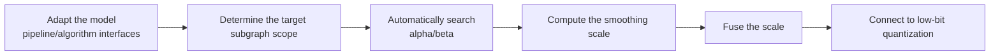

# Flex Smooth Quant Flexible Smooth Quantization Algorithm Usage Guide

## 1. Scope

This guide is intended for users who need to use the [Flex Smooth Quant Flexible Smooth Quantization Algorithm](./term_flex_smooth_quant.md). As an outlier suppression algorithm, Flex Smooth Quant is usually a preprocessing step before quantization: it suppresses activation outliers by automatically searching for the optimal `alpha`/`beta` parameters, improving the accuracy of low-bit quantization.

Applicable scenarios:

- The activation distribution has significant outlier channels, so direct low-bit quantization degrades accuracy and the smoothing strength is hard to determine manually;
- The model has smoothing structures such as `norm-linear`, `linear-linear`, `ov`, and `up-down`, and the optimal `alpha`/`beta` combination is expected to be found by automatic search.

To check whether the model is on the officially pre-validated list, see the [Foundation Model Support Matrix](../../model/README.md); for a quick introduction to basic CLI usage, see the [One-Click Quantization Usage Guide](../../../user_guide/usage_one_click_quantization.md).

## 2. Inputs and Deliverables

| Type | Name | Source or Storage Location | Format or Constraints | Acceptance Criteria |
| --- | --- | --- | --- | --- |
| Input | Floating-point model weight directory | Model download or a local path | HuggingFace format containing `config.json` and `*.safetensors` shards | Loadable by the target Transformers version |
| Input | Model adapter | User adaptation code, invoked via `--model_type` | Implements the `PipelineInterface` and `FlexSmoothQuantInterface` interfaces | Properly driven by the runner and processor |
| Input | Calibration dataset | Built-in `lab_calib/` or a user-defined path | Text prompts in JSONL or JSON format; 50 samples recommended | Successfully encoded into forward tensors by the adapter's `handle_dataset` |
| Input | Quantization configuration file | Local YAML file | Complies with the `modelslim_v1` protocol specification | Passes schema validation |
| Deliverable | Quantized weight directory | Path specified by `--save_path` | Contains `quant_model_description.json` and `*.safetensors` shards | Export is complete and the inference smoke test passes |

## 3. Process Overview

The overall workflow of Flex Smooth Quant is as follows:



Key details of each stage are as follows:

- **Adapt the model pipeline/algorithm interfaces**: the adapter needs to implement `PipelineInterface` (the basic pipeline interface) and `FlexSmoothQuantInterface` (the dedicated flexible smoothing interface) to provide the model's smoothing subgraph structure mapping; this is the prerequisite for all subsequent smoothing steps. Model adaptation must be completed before the Flex Smooth Quant algorithm can run.
- **Determine the target subgraph scope**: use `enable_subgraph_type` to select smoothing structures such as `norm-linear`, `linear-linear`, `ov`, and `up-down`, and use `include`/`exclude` to delimit the scope of modules to which the algorithm applies.
- **Automatically search alpha/beta**: in the current implementation, if either `alpha` or `beta` is missing, an automatic search is entered; the first stage scans alpha with `beta=1-alpha`, and the second stage continues scanning beta under the best alpha, selecting the combination by the output normalized RMSE. At the introductory stage it is recommended not to set them explicitly and let the algorithm search automatically.
- **Compute the smoothing scale**: based on the calibration data (50 samples recommended), collect statistics of the activation and weight magnitudes, and compute the channel-level smoothing scale from the searched `alpha`/`beta`.
- **Fuse the smoothing scale**: absorb and fuse the inverse of the smoothing scale into the preceding Norm structure to preserve mathematical equivalence.
- **Connect to low-bit quantization**: after smoothing, the tensor distribution is flatter, so connecting to low-bit quantization such as `linear_quant` improves accuracy. It is recommended to keep the subsequent quantization configuration unchanged and adjust only the current algorithm's parameters so the gain can be isolated.

## 4. Procedure

### Step 1: Adapt the Model Pipeline and Algorithm Interfaces

**Goal**: The quantization tool cannot directly operate on models with arbitrary structures; an adapter is needed to convert model operations into standard methods. For Flex Smooth Quant, the model adapter must inherit and implement the pipeline interface and the flexible smoothing interface. Model adaptation must be completed before the Flex Smooth Quant algorithm can run.

**Action**: The model adaptation code must implement the following interfaces, all of which are aggregated and provided by `msmodelslim.model.interface_hub`:

1. **`PipelineInterface`** (`ModelSlimPipelineInterfaceV1`): the basic pipeline interface, responsible for model loading (`init_model`), data preprocessing (`handle_dataset`), layer-wise traversal (`generate_model_visit`), layer-wise forward pass (`generate_model_forward`), and so on.
2. **`FlexSmoothQuantInterface`**: the dedicated interface for flexible smooth quantization, aggregated and exported by `msmodelslim.model.interface_hub`. It provides the model's smooth subgraph topology configuration describing the connections between Norm and the subsequent Linear, OV, up/down structures, so that the smooth processor can locate the modules to smooth.

For a standard open-source LLM implemented with HuggingFace Transformers, it is recommended to build the adapter through compositional inheritance:

```python
from msmodelslim.model.interface_hub import (
    IModel,
    ModelInfoInterface,
    ModelSlimPipelineInterfaceV1 as PipelineInterface,
    # ---- Flex Smooth algorithm adaptation interfaces (the focus of this step) ----
    FlexSmoothQuantInterface,  # Algorithm adaptation: get_adapter_config_for_subgraph returns the outlier migration/smoothing subgraph topology
)

class MyModelAdapter(TransformersModel, ModelInfoInterface, PipelineInterface, FlexSmoothQuantInterface):
    pass
```

Descriptions of each interface method:

- The standard methods of **`PipelineInterface`**: loading data (`handle_dataset`), loading the model (`init_model`), layer-wise traversal (`generate_model_visit`), layer-wise forward pass (`generate_model_forward`), and controlling the KV cache (`enable_kv_cache`). The quantization runner and processor drive the model only through these standard methods and are independent of the model's internal structure.
- The core methods of **`FlexSmoothQuantInterface`**: return the topology configuration of the subgraphs to be smoothed (subgraph types such as `norm-linear`, `linear-linear`, `ov`, and `up-down`); the smoothing processor uses it to locate and fuse the smoothing scales.

The adapter is then referenced in the quantization command via `--model_type MyModelAdapter`.

To develop new model adaptation code, see the [LLM Model Quantization Integration Guide](../../ptq/llm/integration_guide_large_language_model_quantization.md). Note that model adaptation must be completed first before the subsequent quantization workflow can run.

**Output**: A usable model adapter registered in the framework (invoked via `--model_type`).

### Step 2: Establish the Recommended Configuration

**Action**:

The following configuration establishes the **first comparable baseline**. If the target model already has a `lab_practice` recipe, prefer the verified recipe.

```yaml
spec:
  process:
    - type: "flex_smooth_quant"
      # For beginners, do not set alpha/beta explicitly; let the algorithm search automatically.
      enable_subgraph_type:
        - "norm-linear"
        - "linear-linear"
        - "ov"
        - "up-down"
      include: ["*"]
      exclude: []
```

**Output**: A reproducible recommended configuration that serves as the comparison baseline for all subsequent parameter adjustments.

### Step 3: Select and Tune Parameters

**Action**:

msModelSlim implementation entry point:
[View the corresponding implementation directory](../../../../../msmodelslim/processor/anti_outlier/flex_smooth)

| Configuration Item | Meaning (Rationale) | Recommended Configuration | Selection and Tuning Advice |
| --- | --- | --- | --- |
| `type` | Processor identifier, fixed to `flex_smooth_quant`. | Fixed. | Do not tune. |
| `alpha` | The exponential weight of the activation statistics in the smoothing scale. In the current implementation, if either `alpha` or `beta` is missing, an automatic alpha/beta search is entered; the first stage scans alpha with `beta=1-alpha`. | At the introductory stage it is recommended not to configure it explicitly and let the algorithm search automatically. | Set it manually only when a stable model recipe already exists and a fixed scale is to be reproduced. If only alpha is filled in and beta is left empty, the current logic still searches the parameters, which is not the same as "fixing alpha". |
| `beta` | The exponential weight of the weight statistics in the smoothing scale. The second stage of the automatic search continues scanning beta under the best alpha and selects the combination by the output normalized RMSE. | Omit it together with alpha and let the search decide both. | To fully fix the manual parameters, provide both alpha and beta; changing only one may trigger a new search. |
| `enable_subgraph_type` | Selects smoothing structures such as `norm-linear`, `linear-linear`, `ov`, and `up-down`. | Prefer reusing the model practice; when there is no recipe, start from a small number of subgraphs most relevant to the model's quantization objective. | The subgraph types change the activations/weights seen by the search and the fusable paths. Recalibrate after expanding the scope; if a certain structure gives unstable gains, remove that type alone. |
| `include` | Allow list for the scope; a module-name pattern determines which matched modules enter the current algorithm. | Start from `["*"]` when there is no model-specific recipe; when a `lab_practice` recipe exists, inherit its module scope directly. | First ensure the scope covers the intended modules, then check accuracy. When narrowing the scope, adjust by structural family or known sensitive layers. |
| `exclude` | Deny list for the scope; matched modules are removed from the `include` candidates. It takes precedence over `include`. | Keep the list empty by default; add entries only when a practical recipe, a compatibility constraint, or a sensitivity result provides explicit evidence. | For local accuracy problems, prefer using `exclude` for a small-scope fallback; this preserves gains more easily than raising the bit width of the whole model or disabling the entire algorithm. |

#### Parameter Combinations and Selection Order

**Finally tune only one main knob**: change only one item at a time among the `alpha`/`beta` search strategy and the subgraph types, and keep the same calibration set and evaluation set. If the automatic search is used, do not fill in only an alpha or only a beta expecting a "semi-fixed" behavior: in the current implementation, a missing value on either side enters the search.

**Output**: An algorithm parameter plan that completes single-variable tuning, with a clear selection rationale and tuning direction for each key field.

### Step 4: Write the Quantization Configuration and Run the Command

**Goal**: Integrate the above steps into a complete YAML quantization configuration file and start the quantization workflow via the CLI.

#### Complete Example: Flex Smooth Quant + W8A8 Dynamic Quantization (Recommended Starting Point)

##### Configuration File: `flex_smooth_quant_w8a8.yaml`

```yaml
apiversion: modelslim_v1
spec:
  runner: auto
  process:
    - type: flex_smooth_quant       # Flex Smooth Quant flexible smoothing preprocessing
      # For beginners, do not set alpha/beta explicitly; let the algorithm search automatically.
      enable_subgraph_type:
        - "norm-linear"
        - "linear-linear"
        - "ov"
        - "up-down"
      include: ["*"]
    - type: linear_quant            # connect to low-bit quantization
      qconfig:
        act:
          dtype: int8
          scope: per_token          # dynamic activation quantization, good accuracy
          symmetric: true
          method: minmax
        weight:
          dtype: int8
          scope: per_channel
          symmetric: true
          method: minmax
      include: ["*"]
  save:
    - type: ascendv1_saver          # Ascend inference standard save format
  dataset: mix_calib.jsonl          # built-in mixed calibration set
```

##### Run the command (single-card quantization)

```bash
msmodelslim quant \
  --model_path <float_model_dir> \
  --save_path <quantized_weight_output_dir> \
  --model_type <model_adapter_name> \
  --config ./flex_smooth_quant_w8a8.yaml \
  --device npu \
  --device_id 0
```

**Output**: Complete quantized weight files and description files are generated in the directory specified by `--save_path`.

## 5. Terminology

| Term | Brief Description | Link |
| --- | --- | --- |
| Flex Smooth Quant Flexible Smooth Quantization Algorithm | Explains the definition, core principle, key properties, applicable scenarios, and limitations of the algorithm. | [Flex Smooth Quant Flexible Smooth Quantization Algorithm Terminology Entry](./term_flex_smooth_quant.md) |

## 6. Related Documents

| API or Document | Brief Description | Link |
| --- | --- | --- |
| `PipelineInterface` / `FlexSmoothQuantInterface` | Model pipeline and Flex Smooth Quant algorithm adaptation interfaces, both exported together from `msmodelslim.model.interface_hub`. | [Interface hub module](../../../../../msmodelslim/model/interface_hub.py) |
| flex_smooth_quant Configuration Description | Field types, default values, valid values, and complete configuration constraints. | [flex_smooth_quant Configuration Description](../../../api_reference/config/processor/flex_smooth_quant.md) |
| modelslim_v1 Configuration Description | Consult this when you need to explore task-level advanced configurations such as runner, prior, save, and dataset. | [modelslim_v1 Configuration Description](../../../api_reference/config/quant/modelslim_v1.md) |
| Weight Quantization Usage Guide | User guide: quantization command parameters and complete usage instructions. | [Weight Quantization Usage Guide](../../../user_guide/usage_weight_quantization.md) |
