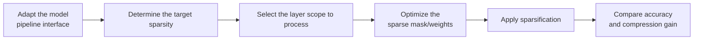

# Float Sparse Parameter Configuration Workflow Guide

## 1. Scope

This guide is intended for users who need to use the [Float Sparse (ADMM) Algorithm](./term_float_sparse.md). Float Sparse sparsifies floating-point weights with the ADMM algorithm and, combined with hardware compression units, enables deployment with a high compression ratio.

## 2. Inputs and Deliverables

| Type | Name | Source or Storage Location | Format or Constraints | Acceptance Criteria |
| --- | --- | --- | --- | --- |
| Input | Target model and quantization objective | The model to quantize and the deployment/evaluation plan | Clarifies the target numerical format or bit width, the target modules, the accuracy/performance goals, and the deployment constraints | Explains why this algorithm is chosen and where it fits in the overall quantization plan |
| Input | Model adapter | User adaptation code, invoked via `--model_type` | Implements the `PipelineInterface` interface | Properly driven by the runner and processor |
| Input | Configuration constraints and practical baseline | This algorithm's configuration description, the target model's existing `lab_practice` recipe (if any) | Field names, supported combinations, scope, and model adaptation are consistent with the current version | The recommended starting point is traceable to the current configuration definition or a verified practice |
| Input | Calibration data (when required by the algorithm) | Task `dataset`, a calibration set, or a model practice recipe | The data should represent the real input distribution; for multi-stage algorithms, keep the data distribution consistent across stages | Readable by the current quantization workflow and covering the main input forms |
| Deliverable | Float sparse parameter configuration plan | User quantization YAML or task configuration | Parameter values are valid and the scope of effect is explicit; the selection rationale of key parameters is explained | Can serve as algorithm configuration input for the subsequent quantization workflow and can reproduce the baseline selection in this guide |

## 3. Process Overview

The overall workflow of Float Sparse is as follows:



Key details of each stage are as follows:

- **Adapt the model pipeline interface**: the adapter needs to implement `PipelineInterface` (the basic pipeline interface); the quantization runner and processor drive the model only through the standard pipeline methods. Model adaptation must be completed before Float Sparse can run.
- **Determine the target sparsity**: first establish a medium-sparsity baseline with the default `0.3`, which leaves room to trade off between observable compression gain and accuracy risk.
- **Select the layer scope to process**: first restrict it with `include`/`exclude` to the linear layers suitable for sparsification, and then raise the ratio step by step.
- **Optimize the sparse mask/weights**: the algorithm prunes with the calibration data and second-order/reconstruction information, optimizing the sparse mask and the remaining weights.
- **Apply sparsification**: apply the sparsification result to the model weights, producing a zero-weight distribution.
- **Compare accuracy and compression gain**: observe whether the accuracy drop is concentrated in a few layers, and at the same time confirm whether the deployment backend really exploits the sparse format, instead of continuing to raise the sparsity ratio.

## 4. Procedure

### Step 1: Adapt the Model Pipeline Interface

**Goal**: The quantization tool cannot directly operate on models with arbitrary structures; an adapter is needed to convert model operations into standard methods. The `float_sparse` processor drives the model through the standard pipeline methods, so the model adapter only needs to implement the basic pipeline interface. Model adaptation must be completed before Float Sparse can run.

**Action**: The model adaptation code must implement the following interfaces, which are aggregated and provided by `msmodelslim.model.interface_hub`:

1. **`PipelineInterface`** (`ModelSlimPipelineInterfaceV1`): the basic pipeline interface, responsible for model loading (`init_model`), data preprocessing (`handle_dataset`), layer-wise traversal (`generate_model_visit`), layer-wise forward pass (`generate_model_forward`), and so on. The quantization runner and processor drive the model only through these standard methods and are independent of the model's internal structure.

For a standard open-source LLM implemented with HuggingFace Transformers, it is recommended to build the adapter through compositional inheritance:

```python
from msmodelslim.model.interface_hub import (
    IModel,
    ModelInfoInterface,
    ModelSlimPipelineInterfaceV1 as PipelineInterface,
)

class MyModelAdapter(TransformersModel, ModelInfoInterface, PipelineInterface):
    pass
```

The adapter is then referenced in the quantization command via `--model_type MyModelAdapter`.

To develop new model adaptation code, see the [LLM Model Quantization Integration Guide](../../ptq/llm/integration_guide_large_language_model_quantization.md). Note that model adaptation must be completed first before the subsequent quantization workflow can run.

**Output**: A usable model adapter registered in the framework (invoked via `--model_type`).

### Step 2: Establish the Recommended Configuration

**Action**:

The following configuration establishes the **first comparable baseline**. If the target model already has a `lab_practice` recipe, prefer the verified recipe, then use this section to understand why each parameter is chosen this way.

```yaml
spec:
  process:
    - type: "float_sparse"
      sparse_ratio: 0.3          # Sparsity ratio, valid range 0.0~1.0, default 0.3.
      include: ["*"]             # Layers to include, wildcards supported.
      exclude: ["*self_attn*"]   # Layers to exclude, wildcards supported.
```

Starting from `sparse_ratio: 0.3` is recommended because it leaves room to trade off between observable compression gain and accuracy risk. `include`/`exclude` are as important as the sparsity ratio: first restrict to the linear layers suitable for sparsification and then raise the ratio step by step; this makes problems easier to locate and preserves accuracy better than applying a high sparsity ratio to the whole model at once.

**Output**: A reproducible recommended configuration that serves as the comparison baseline for all subsequent parameter adjustments.

### Step 3: Select and Tune Parameters

**Action**:

msModelSlim implementation entry point:
[View the corresponding implementation directory](../../../../../msmodelslim/processor/sparse)

| Configuration Item | Meaning (Rationale) | Recommended Configuration | Selection and Tuning Advice |
| --- | --- | --- | --- |
| `type` | Processor identifier, fixed to `float_sparse`. | Fixed. | Do not tune. |
| `sparse_ratio` | The target proportion of weights to zero out, in the range 0~1. The algorithm prunes with the calibration data and second-order/reconstruction information; a higher ratio means more aggressive compression, fewer remaining non-zero weights, and greater reconstruction pressure. The code default is `0.3`; the Qwen3 W16A16S practice uses `0.4`. | For a new model, establish an accuracy baseline from the default `0.3`; use `0.4` directly only when it has been explicitly validated by a practice on the same model. | Raise it gradually when there is sufficient accuracy headroom and higher sparsity is desired; if the task metrics drop noticeably, lower the ratio first and then consider excluding sensitive layers. Do not treat the 0.4 validated on a single model as a universal value for all models. |
| `include` | Allow list for the scope; a module-name pattern determines which matched modules enter the current algorithm. It only decides *where* the algorithm is applied and does not change the algorithm's internal formula. | Start from `["*"]` when there is no model-specific recipe; when a `lab_practice` recipe exists, inherit its module scope directly. | First ensure the scope covers the intended modules, then check accuracy. If the scope is too broad, a few incompatible structures or sensitive layers amplify the overall risk; if it is too narrow, the algorithm's benefit may not be visible. When narrowing the scope, adjust by structural family or known sensitive layers rather than deleting a large number of layers by index alone. |
| `exclude` | Deny list for the scope; matched modules are removed from the `include` candidates. It takes precedence over `include`. It is suitable for protecting sensitive layers, the first and last layers, or model-specific incompatible structures. | Keep the list empty by default; add entries only when a practical recipe, a compatibility constraint, or a sensitivity result provides explicit evidence. | For local accuracy problems, prefer using `exclude` for a small-scope fallback; this preserves gains more easily than raising the bit width of the whole model or disabling the entire algorithm. After adding each exclusion, confirm that the wildcard does not accidentally affect adjacent modules. |

#### Parameter Combinations and Selection Order

Float Sparse has essentially only one continuous knob, `sparse_ratio`. It is therefore all the more important to tune "ratio" and "scope" separately: first find an acceptable ratio over a stable scope, and then decide whether to extend it to more layers. Change only one variable per round and keep the same calibration set and evaluation set; if there is no stable gain after the adjustment, return to the previous baseline. If a few layers are very sensitive, prefer local protection through `exclude` rather than lowering the sparsity ratio of all layers.

**Output**: An algorithm parameter plan that completes single-variable tuning, with a clear selection rationale and tuning direction for each key field.

### Step 4: Write the Quantization Configuration and Run the Command

**Goal**: Integrate the above steps into a complete YAML quantization configuration file and start the quantization workflow via the CLI.

#### Complete Example: Float Sparse W16A16S (Recommended Starting Point)

##### Configuration File: `float_sparse_w16a16s.yaml`

```yaml
apiversion: modelslim_v1
spec:
  runner: auto
  process:
    - type: float_sparse            # ADMM floating-point sparsification
      sparse_ratio: 0.3             # Sparsity ratio, valid range 0.0~1.0
      include: ["*"]                # Layers to include, wildcards supported
      exclude: ["*self_attn*"]      # Layers to exclude, wildcards supported
  save:
    - type: ascendv1_saver          # Ascend inference standard save format
  dataset: mix_calib.jsonl          # built-in mixed calibration set
```

##### Run the command (single-card quantization)

```bash
msmodelslim quant \
  --model_path <float_model_dir> \
  --save_path <quantized_weight_output_dir> \
  --model_type <model_adapter_name> \
  --config ./float_sparse_w16a16s.yaml \
  --device npu \
  --device_id 0
```

**Output**: Complete quantized weight files and description files are generated in the directory specified by `--save_path`.

## 5. Terminology

| Term | Brief Description | Link |
| --- | --- | --- |
| Float Sparse (ADMM) Algorithm | Explains the definition, core principle, key properties, applicable scenarios, and limitations of the algorithm. | [Float Sparse (ADMM) Algorithm Terminology Entry](./term_float_sparse.md) |

## 6. Related Documents

| API or Document | Brief Description | Link |
| --- | --- | --- |
| `PipelineInterface` | Model pipeline interface, aggregated and exported by `msmodelslim.model.interface_hub`. | [Interface hub module](../../../../../msmodelslim/model/interface_hub.py) |
| float_sparse Configuration Description | Field types, default values, valid values, and complete configuration constraints. | [float_sparse Configuration Description](../../../api_reference/config/processor/float_sparse.md) |
| modelslim_v1 Configuration Description | Consult this when you need to explore task-level advanced configurations such as runner, prior, save, and dataset. | [modelslim_v1 Configuration Description](../../../api_reference/config/quant/modelslim_v1.md) |
| Weight Quantization Usage Guide | User guide: quantization command parameters and complete usage instructions. | [Weight Quantization Usage Guide](../../../user_guide/usage_weight_quantization.md) |
