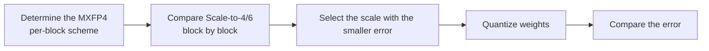

# FourOverSix Parameter Configuration Workflow Guide

## 1. Scope

This guide is intended for users who need to use the [FourOverSix Adaptive Block Scaling Quantization Algorithm](./term_fouroversix.md). As a weight quantization method of the `linear_quant` processor, FourOverSix improves mxFP4 weight quantization accuracy by selecting, per block, the better of Scale-to-6 and Scale-to-4 by MSE.

Applicable scenarios:

- Need to compare Scale-to-4 and Scale-to-6 block by block in mxFP4 weight quantization scenarios and choose the scheme with the smaller reconstruction error by MSE;
- Need to improve low-bit weight quantization accuracy while respecting the MXFP4 per-block layout constraints.

To check whether the model is on the officially pre-validated list, see the [Foundation Model Support Matrix](../../model/README.md); for a quick introduction to basic CLI usage, see the [One-Click Quantization Usage Guide](../../../user_guide/usage_one_click_quantization.md).

## 2. Inputs and Deliverables

| Type | Name | Source or Storage Location | Format or Constraints | Acceptance Criteria |
| --- | --- | --- | --- | --- |
| Input | Floating-point model weight directory | Model download or a local path | HuggingFace format containing `config.json` and `*.safetensors` shards | Loadable by the target Transformers version |
| Input | Calibration dataset | Built-in `lab_calib/` or a user-defined path | Text prompts in JSONL or JSON format; 50 samples recommended | Readable by the current quantization workflow and covering the main input forms |
| Input | Quantization configuration file | Local YAML file | Complies with the `modelslim_v1` protocol specification | Passes schema validation |
| Deliverable | FourOverSix parameter configuration plan | User quantization YAML or task configuration | Parameter values are valid and the scope of effect is explicit; the selection rationale of key parameters is explained | Can serve as algorithm configuration input for the subsequent quantization workflow and can reproduce the baseline selection in this guide |

## 3. Process Overview

The overall workflow of FourOverSix is as follows:



Key details of each stage are as follows:

- **Prerequisite: model adaptation.** Model adaptation must be completed before quantization. The adapter implements interfaces such as `PipelineInterface` (the basic pipeline interface); see the [LLM Model Quantization Integration Guide](../../ptq/llm/integration_guide_large_language_model_quantization.md) for details. Model adaptation must be completed first before the quantization workflow can run.
- **Determine the MXFP4 per-block scheme**: first fix the deployment target and the `dtype + scope + symmetric + method` combination actually registered by the current quantizer; the current implementation only registers mxFP4 per-block symmetric quantization.
- **Compare Scale-to-4/6 block by block**: for each MXFP4 block, the algorithm tries the two scaling schemes scale-to-6 and scale-to-4 separately.
- **Select the scale with the smaller error**: the scheme with the smaller error is selected within each block by reconstruction MSE, which is the core source of FourOverSix's benefit over a single scale.
- **Quantize weights**: apply the final quantization according to the selected scale; control the MXFP4 block division axis through `ext.axes`.
- **Compare the error**: compare end-to-end accuracy with the baseline configuration to decide whether to keep FourOverSix or adjust the block layout.

## 4. Procedure

### Step 1: Confirm Objectives and Constraints

**Action**: First fix the target model, the final quantization format/bit width, the target objects, and the evaluation baseline, then confirm the parameter combinations supported by the current version. If the target model already has a `lab_practice` recipe, use that recipe as the practical baseline first; when there is no model-specific recipe, use the general recommended starting point given in this guide. If the algorithm relies on calibration statistics or optimization data, also fix representative data before tuning, to avoid mistaking a change in the data distribution for a parameter gain.

**Output**: An explicit configuration objective: target bit width/format, processing scope, calibration conditions, evaluation baseline, and deployment constraints.

### Step 2: Establish the Recommended Configuration

**Action**:

The following configuration establishes the **first comparable baseline**. If the target model already has a `lab_practice` recipe, prefer the verified recipe, then use this section to understand why each parameter is chosen this way.

```yaml
spec:
  process:
    - type: "linear_quant"
      qconfig:
        weight:
          scope: "per_block"    # Quantization scope
          dtype: "mxfp4"        # Quantization data type
          symmetric: true       # Whether to use symmetric quantization
          method: "fouroversix" # Quantization algorithm - FourOverSix
```

**Output**: A reproducible recommended configuration that serves as the comparison baseline for all subsequent parameter adjustments.

### Step 3: Select and Tune Parameters

**Action**:

| Configuration Item | Meaning (Rationale) | Recommended Configuration | Selection and Tuning Advice |
| --- | --- | --- | --- |
| `scope` | The current implementation only registers MXFP4 per-block weight quantization. | Fixed to `per_block`. | Switch algorithms if it is not supported. |
| `dtype` | Currently only `mxfp4` is supported. | Fixed to `mxfp4`. | Not a tuning item. |
| `symmetric` | The currently registered combination is symmetric. | Fixed to `true`. | Do not change it to asymmetric. |
| `method` | Selects FourOverSix: for each MXFP4 block, scale-to-6 and scale-to-4 are tried separately and the better scheme is selected by reconstruction MSE. | Fixed to `fouroversix`. | Switching it means switching the algorithm. |
| `ext.axes` | Specifies the dimensions along which the MXFP4 blocks are divided; default `-1`. The current implementation also requires the length of the selected axis to be divisible by the MXFP4 block_size, otherwise it reports an error directly. | For linear weights, prefer keeping `-1`. | Change the axis only when the model weight layout/deployment format explicitly requires it; before changing it, check whether the corresponding dimension is divisible by block_size. FourOverSix itself has no additional "4/6 threshold" to tune; `axes` is mainly a layout choice and should not be treated as an everyday accuracy knob. |

#### Parameter Combinations and Selection Order

FourOverSix is an automatic per-block either-or algorithm, so there is usually no need to manually search for 4/6 parameters. What the user really needs to confirm is whether the MXFP4 format, the block axes, and the backend layout are consistent.

**Output**: An algorithm parameter plan that completes single-variable tuning, with a clear selection rationale and tuning direction for each key field.

### Step 4: Converge the Parameter Plan Based on Results

**Action**:

- **Run the recommended configuration first, then tune one variable at a time.** Do not change the bit width, granularity, algorithm parameters, and layer scope simultaneously; otherwise it is difficult to attribute an accuracy change to a specific item.
- **Prefer local fallback over raising precision globally.** If only a few layers are sensitive, use `exclude` or a mixed strategy to preserve high precision for them; this is usually more cost-effective than raising the bit width of the entire model.
- **The model's practical configuration and deployment capability take precedence.** The introductory recommendation is meant to establish a stable starting point; if the target model already has a `lab_practice` recipe, prefer reusing the verified combination.

**Output**: A final parameter plan ready for the subsequent quantization workflow, retaining a record of adjustments relative to the recommended configuration.

## 5. Terminology

| Term | Brief Description | Link |
| --- | --- | --- |
| FourOverSix Adaptive Block Scaling Quantization Algorithm | Explains the definition, core principle, key properties, applicable scenarios, and limitations of the algorithm. | [FourOverSix Adaptive Block Scaling Quantization Algorithm Terminology Entry](./term_fouroversix.md) |

## 6. Related Documents

| API or Document | Brief Description | Link |
| --- | --- | --- |
| linear_quant Configuration Description | Field types, default values, valid values, and complete configuration constraints. | [linear_quant Configuration Description](../../../api_reference/config/processor/linear_quant.md) |
| modelslim_v1 Configuration Description | Consult this when you need to explore task-level advanced configurations such as runner, prior, save, and dataset. | [modelslim_v1 Configuration Description](../../../api_reference/config/quant/modelslim_v1.md) |
| Weight Quantization Usage Guide | User guide: quantization command parameters and complete usage instructions. | [Weight Quantization Usage Guide](../../../user_guide/usage_weight_quantization.md) |
