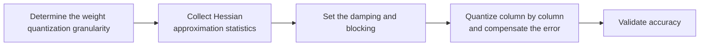

# GPTQ Parameter Configuration Workflow Guide

## 1. Scope

This guide is intended for users who need to use the [GPTQ Second-Order Error Compensation Weight Quantization Algorithm](./term_gptq.md). As a weight quantization method of the `linear_quant` processor, GPTQ improves weight quantization accuracy through column-wise quantization and second-order error compensation.

Applicable scenarios:

- Need to use Hessian second-order information to compensate for the column-wise quantization error in W8/W4 weight quantization scenarios;
- Need to stabilize the quantization process through damping and blocking parameters while retaining flexible per-channel/per-group granularity.

To check whether the model is on the officially pre-validated list, see the [Foundation Model Support Matrix](../../model/README.md); for a quick introduction to basic CLI usage, see the [One-Click Quantization Usage Guide](../../../user_guide/usage_one_click_quantization.md).

## 2. Inputs and Deliverables

| Type | Name | Source or Storage Location | Format or Constraints | Acceptance Criteria |
| --- | --- | --- | --- | --- |
| Input | Floating-point model weight directory | Model download or a local path | HuggingFace format containing `config.json` and `*.safetensors` shards | Loadable by the target Transformers version |
| Input | Calibration dataset | Built-in `lab_calib/` or a user-defined path | Text prompts in JSONL or JSON format; 50 samples recommended | Readable by the current quantization workflow and covering the main input forms |
| Input | Quantization configuration file | Local YAML file | Complies with the `modelslim_v1` protocol specification | Passes schema validation |
| Deliverable | GPTQ parameter configuration plan | User quantization YAML or task configuration | Parameter values are valid and the scope of effect is explicit; the selection rationale of key parameters is explained | Can serve as algorithm configuration input for the subsequent quantization workflow and can reproduce the baseline selection in this guide |

## 3. Process Overview

The overall workflow of GPTQ is as follows:



Key details of each stage are as follows:

- **Prerequisite: model adaptation.** Model adaptation must be completed before quantization. The adapter implements interfaces such as `PipelineInterface` (the basic pipeline interface); see the [LLM Model Quantization Integration Guide](../../ptq/llm/integration_guide_large_language_model_quantization.md) for details. Model adaptation must be completed first before the quantization workflow can run.
- **Determine the weight quantization granularity**: first fix the `dtype + scope + symmetric + method` combination; GPTQ supports `per_channel` and `per_group`, and the latter requires `group_size`.
- **Collect Hessian approximation statistics**: run a forward pass with the calibration data (50 samples recommended) to estimate the input second-order moment of each Linear as the Hessian approximation.
- **Set the damping and blocking**: `percdamp` controls the damping ratio on the Hessian diagonal, and `block_size` controls the computation block size for column-wise processing.
- **Quantize column by column and compensate the error**: within each block the columns are quantized in order and the error is propagated to subsequent columns; compensation is also performed between blocks.
- **Validate accuracy**: compare the end-to-end accuracy before and after quantization; when accuracy is insufficient, prefer local fallback or adjusting scope/group_size rather than raising the bit width of the whole model.

## 4. Procedure

### Step 1: Confirm Objectives and Constraints

**Action**: First fix the target model, the final quantization format/bit width, the target objects, and the evaluation baseline, then confirm the parameter combinations supported by the current version. If the target model already has a `lab_practice` recipe, use that recipe as the practical baseline first; when there is no model-specific recipe, use the general recommended starting point given in this guide. If the algorithm relies on calibration statistics or optimization data, also fix representative data before tuning, to avoid mistaking a change in the data distribution for a parameter gain.

**Output**: An explicit configuration objective: target bit width/format, processing scope, calibration conditions, evaluation baseline, and deployment constraints.

### Step 2: Establish the Recommended Configuration

**Action**:

The following configuration establishes the **first comparable baseline**. If the target model already has a `lab_practice` recipe, prefer the verified recipe, then use this section to understand why each parameter is chosen this way.

```yaml
spec:
  process:
    - type: "linear_quant"
      qconfig:
        weight:
          scope: "per_channel"   # Quantization scope
          dtype: "int8"          # Quantization data type
          symmetric: true        # Whether to use symmetric quantization
          method: "gptq"         # Quantization algorithm - GPTQ
          ext: # Optional, extension parameters
            percdamp: 0.01       # Optional, damping coefficient, default 0.01
            block_size: 128      # Optional, block size, default 128
```

**Output**: A reproducible recommended configuration that serves as the comparison baseline for all subsequent parameter adjustments.

### Step 3: Select and Tune Parameters

**Action**:

| Configuration Item | Meaning (Rationale) | Recommended Configuration | Selection and Tuning Advice |
| --- | --- | --- | --- |
| `scope` | The current GPTQ weight quantizer supports `per_channel` and `per_group`. Per-channel shares one set of quantization parameters across each output channel; per-group further groups along the input columns, giving a more local scale but increasing the quantization parameters and layout constraints. | Use `per_channel` first when there is no explicit group-wise deployment requirement; use `per_group` for a target low-bit group-wise weight. | Switching the scope changes the scale granularity and the GPTQ update process, so recalibration is needed. Per-group must also be paired with `group_size` and requires the number of input channels to be divisible by that value. |
| `dtype` | GPTQ currently registers INT8 and INT4 weights, and both bit widths support per-channel/per-group. The lower the bit width, the larger the individual rounding error, and the more pronounced the value of GPTQ's second-order compensation usually is. | Decided by the final deployment target; for a conventional accuracy baseline, INT8 can be used first, while for a low-bit target, evaluate directly with INT4. | Do not use INT8 results as a substitute validation for INT4. After changing the bit width, collect/use the calibration data again and run GPTQ. |
| `symmetric` | GPTQ currently registers symmetric and asymmetric implementations for both per-channel/per-group INT8/INT4. Asymmetric has one extra offset and can represent a shifted distribution, but deployment and metadata are more complex. | Prefer `true` when there is no explicit offset requirement; compare with `false` only when the target backend supports it and the weight distribution is clearly non-centered. | Switching between symmetric/asymmetric changes the initial MinMax qparam and the subsequent error compensation, so it should not be treated as a mere export parameter; requantization and evaluation are required. |
| `method` | Fixed to GPTQ. | Fixed to `gptq`. | Switching the method means switching the weight optimization algorithm. |
| `ext.percdamp` | The Hessian damping ratio, default `0.01`. The source code adds `percdamp x mean(diag(H))` to the Hessian diagonal and then performs Cholesky decomposition/inversion; 0.01 therefore means a damping of 1% relative to the average curvature. Damping alleviates an ill-conditioned/near-singular Hessian, but too much of it also flattens real curvature differences. | Start with the default `0.01`. | Increase it gradually if the Hessian decomposition becomes unstable, the numerical conditioning is poor, or the quantization result is extremely sensitive to the calibration batch; keep the default if the algorithm is stable and stronger second-order information is desired. Do not treat percdamp as ordinary regularization where larger is always better. |
| `ext.block_size` | The computation block size for GPTQ column-wise processing, default `128`. Within each block the columns are quantized in order and the error is propagated to subsequent columns, and compensation is also performed between blocks. It mainly affects the temporary computation/execution granularity and the numerical behavior. | Start with `128`. | Reduce it when memory/compute resources are limited; increase it to reduce the number of loop blocks, but revalidate numerical stability and runtime. `block_size` is not a quantization `scope`; do not confuse it with `group_size`. |
| `ext.group_size` | Used only by `per_group` GPTQ, default `128`. It determines the width over which each group of input columns shares quantization parameters; the source code requires the number of input channels to be divisible by `group_size`. | When using `per_group`, start from `128` and first check that the input dimension of every target Linear is divisible. No configuration is needed for per-channel. | Reducing `group_size` makes the scale more local, which usually helps low-bit reconstruction but increases scale/offset metadata; increasing it does the opposite. The deployment operator support and the divisibility constraint must also be satisfied. |

#### Parameter Combinations and Selection Order

For GPTQ, the recommended selection order is **bit width -> scope/group_size -> percdamp -> block_size**. `group_size` determines the quantized representation, `percdamp` determines the second-order numerical stability, and `block_size` is more about the execution granularity; do not reverse the order and tune the computation block first.

**Output**: An algorithm parameter plan that completes single-variable tuning, with a clear selection rationale and tuning direction for each key field.

### Step 4: Converge the Parameter Plan Based on Results

**Action**:

- Prefer keeping `percdamp=0.01` and adjust the layer scope/grouping granularity first; touch the damping only when numerical instability or an unreliable second-order estimate occurs.
- **Run the recommended configuration first, then tune one variable at a time.** Do not change the bit width, granularity, algorithm parameters, and layer scope simultaneously; otherwise it is difficult to attribute an accuracy change to a specific item.
- **Prefer local fallback over raising precision globally.** If only a few layers are sensitive, use `exclude` or a mixed strategy to preserve high precision for them; this is usually more cost-effective than raising the bit width of the entire model.
- **The model's practical configuration and deployment capability take precedence.** The introductory recommendation is meant to establish a stable starting point; if the target model already has a `lab_practice` recipe, prefer reusing the verified combination.

**Output**: A final parameter plan ready for the subsequent quantization workflow, retaining a record of adjustments relative to the recommended configuration.

## 5. Terminology

| Term | Brief Description | Link |
| --- | --- | --- |
| GPTQ Weight Quantization Algorithm | Explains the definition, core principle, key properties, applicable scenarios, and limitations of the algorithm. | [GPTQ Weight Quantization Algorithm Terminology Entry](./term_gptq.md) |

## 6. Related Documents

| API or Document | Brief Description | Link |
| --- | --- | --- |
| linear_quant Configuration Description | Field types, default values, valid values, and complete configuration constraints. | [linear_quant Configuration Description](../../../api_reference/config/processor/linear_quant.md) |
| modelslim_v1 Configuration Description | Consult this when you need to explore task-level advanced configurations such as runner, prior, save, and dataset. | [modelslim_v1 Configuration Description](../../../api_reference/config/quant/modelslim_v1.md) |
| Weight Quantization Usage Guide | User guide: quantization command parameters and complete usage instructions. | [Weight Quantization Usage Guide](../../../user_guide/usage_weight_quantization.md) |
