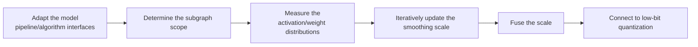

# Iterative Smooth Iterative Smoothing Algorithm Usage Guide

## 1. Scope

This guide is intended for users who need to use the [Iterative Smooth Iterative Smoothing Algorithm](./term_iterative_smooth.md). As an outlier suppression algorithm, Iterative Smooth is usually a preprocessing step before quantization, used to migrate activation outliers to the weights and improve the accuracy of low-bit quantization.

Applicable scenarios:

- The activation distribution has significant outlier channels, so direct W8A8 quantization degrades accuracy;
- The model has smoothing structures such as `norm-linear`, `linear-linear`, `ov`, and `up-down`, and the activation dynamic range can be migrated to the weights by iteratively updating the smoothing scale.

To check whether the model is on the officially pre-validated list, see the [Foundation Model Support Matrix](../../model/README.md); for a quick introduction to basic CLI usage, see the [One-Click Quantization Usage Guide](../../../user_guide/usage_one_click_quantization.md).

## 2. Inputs and Deliverables

| Type | Name | Source or Storage Location | Format or Constraints | Acceptance Criteria |
| --- | --- | --- | --- | --- |
| Input | Floating-point model weight directory | Model download or a local path | HuggingFace format containing `config.json` and `*.safetensors` shards | Loadable by the target Transformers version |
| Input | Model adapter | User adaptation code, invoked via `--model_type` | Implements the `PipelineInterface` and `IterSmoothInterface` interfaces | Properly driven by the runner and processor |
| Input | Calibration dataset | Built-in `lab_calib/` or a user-defined path | Text prompts in JSONL or JSON format; 50 samples recommended | Successfully encoded into forward tensors by the adapter's `handle_dataset` |
| Input | Quantization configuration file | Local YAML file | Complies with the `modelslim_v1` protocol specification | Passes schema validation |
| Deliverable | Quantized weight directory | Path specified by `--save_path` | Contains `quant_model_description.json` and `*.safetensors` shards | Export is complete and the inference smoke test passes |

## 3. Process Overview

The overall workflow of Iterative Smooth is as follows:



Key details of each stage are as follows:

- **Adapt the model pipeline/algorithm interfaces**: the adapter needs to implement `PipelineInterface` (the basic pipeline interface) and `IterSmoothInterface` (the dedicated iterative smoothing interface) to provide the model's smoothing subgraph structure mapping; this is the prerequisite for all subsequent smoothing steps. Model adaptation must be completed before the Iterative Smooth algorithm can run.
- **Determine the subgraph scope**: use `enable_subgraph_type` to select smoothing structures such as `norm-linear`, `linear-linear`, `ov`, and `up-down`, and use `include`/`exclude` to delimit the scope of modules to which the algorithm applies.
- **Measure the activation/weight distributions**: run a forward pass with the calibration dataset (50 samples recommended) and measure the activation and weight magnitude distributions of each channel.
- **Iteratively update the smoothing scale**: use the hyperparameter `alpha` (default `0.9`) to control the smoothing migration strength, iteratively updating the channel-level smoothing scale to migrate the activation outlier pressure to the weights equivalently; `scale_min` is used to avoid numerical problems caused by extremely small scales.
- **Fuse the smoothing scale**: absorb and fuse the inverse of the smoothing scale into the preceding Norm structure to preserve mathematical equivalence.
- **Connect to low-bit quantization**: after smoothing, the tensor distribution is flatter, so connecting to low-bit quantization such as `linear_quant` improves accuracy. It is recommended to keep the subsequent quantization configuration unchanged and adjust only the current algorithm's parameters so the gain can be isolated.

## 4. Procedure

### Step 1: Adapt the Model Pipeline and Algorithm Interfaces

**Goal**: The quantization tool cannot directly operate on models with arbitrary structures; an adapter is needed to convert model operations into standard methods. For Iterative Smooth, the model adapter must inherit and implement the pipeline interface and the iterative smoothing interface. Model adaptation must be completed before the Iterative Smooth algorithm can run.

**Action**: The model adaptation code must implement the following interfaces, all of which are aggregated and provided by `msmodelslim.model.interface_hub`:

1. **`PipelineInterface`** (`ModelSlimPipelineInterfaceV1`): the basic pipeline interface, responsible for model loading (`init_model`), data preprocessing (`handle_dataset`), layer-wise traversal (`generate_model_visit`), layer-wise forward pass (`generate_model_forward`), and so on.
2. **`IterSmoothInterface`**: the dedicated iterative smoothing interface, exported together from `msmodelslim.model.interface_hub`, which provides the topology configuration of the model's smoothing subgraphs, describing the connections between the Norm and the subsequent Linear, OV, and up/down structures so that the smoothing processor can locate the modules to be smoothed.

For a standard open-source LLM implemented with HuggingFace Transformers, it is recommended to build the adapter through compositional inheritance:

```python
from msmodelslim.model.interface_hub import (
    IModel,
    ModelInfoInterface,
    ModelSlimPipelineInterfaceV1 as PipelineInterface,
    # ---- Iter Smooth algorithm adaptation interfaces (the focus of this step) ----
    IterSmoothInterface,  # Algorithm adaptation: returns the smoothing subgraph topology such as norm-linear/linear-linear/ov/up-down
)

class MyModelAdapter(TransformersModel, ModelInfoInterface, PipelineInterface, IterSmoothInterface):
    pass
```

Descriptions of each interface method:

- The standard methods of **`PipelineInterface`**: loading data (`handle_dataset`), loading the model (`init_model`), layer-wise traversal (`generate_model_visit`), layer-wise forward pass (`generate_model_forward`), and controlling the KV cache (`enable_kv_cache`). The quantization runner and processor drive the model only through these standard methods and are independent of the model's internal structure.
- The core methods of **`IterSmoothInterface`**: return the topology configuration of the subgraphs to be smoothed (subgraph types such as `norm-linear`, `linear-linear`, `ov`, and `up-down`); the smoothing processor uses it to locate and iteratively update the smoothing scales.

The adapter is then referenced in the quantization command via `--model_type MyModelAdapter`.

To develop new model adaptation code, see the [LLM Model Quantization Integration Guide](../../ptq/llm/integration_guide_large_language_model_quantization.md). Note that model adaptation must be completed first before the subsequent quantization workflow can run.

**Output**: A usable model adapter registered in the framework (invoked via `--model_type`).

### Step 2: Establish the Recommended Configuration

**Action**:

The following configuration establishes the **first comparable baseline**. If the target model already has a `lab_practice` recipe, prefer the verified recipe.

```yaml
spec:
  process:
    - type: "iter_smooth"
      alpha: 0.9
      scale_min: 1e-5
      symmetric: true
      enable_subgraph_type:
        - "norm-linear"
        - "linear-linear"
        - "ov"
        - "up-down"
      include: ["*"]
      exclude: []
```

**Output**: A reproducible recommended configuration that serves as the comparison baseline for all subsequent parameter adjustments.

### Step 3: Select and Tune Parameters

**Action**:

msModelSlim implementation entry point:
[View the corresponding implementation directory](../../../../../msmodelslim/processor/anti_outlier/iter_smooth)

| Configuration Item | Meaning (Rationale) | Recommended Configuration | Selection and Tuning Advice |
| --- | --- | --- | --- |
| `type` | Processor identifier, fixed to `iter_smooth`. | Fixed. | Do not tune. |
| `alpha` | The smoothing migration strength, 0~1, default `0.9`. A larger value usually migrates more activation outlier pressure to the weights. The most common value in the repository practices is 0.9, with a few models using 0.5. | When there is no model recipe, start from the default/mainstream practice value `0.9`; when a practice exists, follow it directly. | It can be on the higher side when activation quantization is still dominated by extreme values; if the weight-side error increases noticeably or low-bit weights are more sensitive, it can be lowered toward a more conservative value such as 0.5. A larger alpha is not necessarily better and must be evaluated together with the subsequent W/A qconfig. |
| `scale_min` | The lower bound of the smoothing scale, default `1e-5`, used to avoid underflow or numerical amplification caused by extremely small scales. | Keep `1e-5`. | It is mainly a numerical stability protection and should not be used as a regular accuracy knob. Investigate adjusting it only when some channels are confirmed to have their scales heavily clipped by the lower bound with a resulting impact. |
| `symmetric` | Determines the subsequent quantization assumption and whether the smoothing needs a shift. The current asymmetric path mainly supports `norm-linear`, and other subgraphs disable the shift. | For conventional W8A8 practices, prefer `true`. | Set it to `false` only when asymmetric activation/weight quantization is explicitly adopted and the subgraph capability matches. If smoothing is to be applied uniformly across multiple subgraphs, do not hastily switch to asymmetric for the sake of a small shifted distribution. |
| `enable_subgraph_type` | Determines which structures IterSmooth applies to. | Use the target model practice first; when there is no recipe, start from the four default types and confirm them through matching/evaluation. | If the asymmetric mode, deployment fusion, or the model structure restricts a certain subgraph type, narrow that type first; do not compensate for incorrect subgraph matching by modifying alpha. |
| `include` | Allow list for the scope; a module-name pattern determines which matched modules enter the current algorithm. | Start from `["*"]` when there is no model-specific recipe; when a `lab_practice` recipe exists, inherit its module scope directly. | First ensure the scope covers the intended modules, then check accuracy. When narrowing the scope, adjust by structural family or known sensitive layers. |
| `exclude` | Deny list for the scope; matched modules are removed from the `include` candidates. It takes precedence over `include`. | Keep the list empty by default; add entries only when a practical recipe, a compatibility constraint, or a sensitivity result provides explicit evidence. | For local accuracy problems, prefer using `exclude` for a small-scope fallback; this preserves gains more easily than raising the bit width of the whole model or disabling the entire algorithm. |

#### Parameter Combinations and Selection Order

**Finally tune only one main knob**: the main knob of IterSmooth is `alpha`; `scale_min` mainly preserves numerical stability, and `symmetric` relates to the subgraph capability. First determine whether the subsequent quantization is symmetric and the subgraph scope, then tune alpha, keeping the same calibration set and evaluation set.

**Output**: An algorithm parameter plan that completes single-variable tuning, with a clear selection rationale and tuning direction for each key field.

### Step 4: Write the Quantization Configuration and Run the Command

**Goal**: Integrate the above steps into a complete YAML quantization configuration file and start the quantization workflow via the CLI.

#### Complete Example: Iterative Smooth + W8A8 Dynamic Quantization (Recommended Starting Point)

##### Configuration File: `iter_smooth_w8a8.yaml`

```yaml
apiversion: modelslim_v1
spec:
  runner: auto
  process:
    - type: iter_smooth             # Iterative Smooth iterative smoothing preprocessing
      alpha: 0.9
      scale_min: 1e-5
      symmetric: true
      enable_subgraph_type:
        - "norm-linear"
        - "linear-linear"
        - "ov"
        - "up-down"
      include: ["*"]
    - type: linear_quant            # connect to low-bit quantization
      qconfig:
        act:
          dtype: int8
          scope: per_token          # dynamic activation quantization, good accuracy
          symmetric: true
          method: minmax
        weight:
          dtype: int8
          scope: per_channel
          symmetric: true
          method: minmax
      include: ["*"]
  save:
    - type: ascendv1_saver          # Ascend inference standard save format
  dataset: mix_calib.jsonl          # built-in mixed calibration set
```

##### Run the command (single-card quantization)

```bash
msmodelslim quant \
  --model_path <float_model_dir> \
  --save_path <quantized_weight_output_dir> \
  --model_type <model_adapter_name> \
  --config ./iter_smooth_w8a8.yaml \
  --device npu \
  --device_id 0
```

**Output**: Complete quantized weight files and description files are generated in the directory specified by `--save_path`.

## 5. Terminology

| Term | Brief Description | Link |
| --- | --- | --- |
| Iterative Smooth Iterative Smoothing Algorithm | Explains the definition, core principle, key properties, applicable scenarios, and limitations of the algorithm. | [Iterative Smooth Iterative Smoothing Algorithm Terminology Entry](./term_iterative_smooth.md) |

## 6. Related Documents

| API or Document | Brief Description | Link |
| --- | --- | --- |
| `PipelineInterface` / `IterSmoothInterface` | Model pipeline and Iterative Smooth algorithm adaptation interfaces, both exported together from `msmodelslim.model.interface_hub`. | [Interface hub module](../../../../../msmodelslim/model/interface_hub.py) |
| iter_smooth Configuration Description | Field types, default values, valid values, and complete configuration constraints. | [iter_smooth Configuration Description](../../../api_reference/config/processor/iter_smooth.md) |
| modelslim_v1 Configuration Description | Consult this when you need to explore task-level advanced configurations such as runner, prior, save, and dataset. | [modelslim_v1 Configuration Description](../../../api_reference/config/quant/modelslim_v1.md) |
| Weight Quantization Usage Guide | User guide: quantization command parameters and complete usage instructions. | [Weight Quantization Usage Guide](../../../user_guide/usage_weight_quantization.md) |
