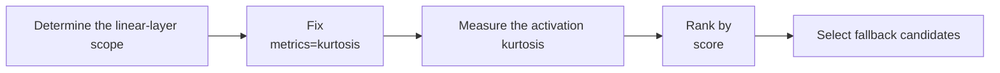

# Kurtosis Parameter Configuration Workflow Guide

## 1. Scope

This guide is intended for users who need to use the [Kurtosis Sensitive Layer Analysis Algorithm](./term_kurtosis.md). As the default metrics indicator of `msmodelslim analyze linear`, Kurtosis is used for sensitivity ranking at linear-layer granularity and identifies the impact of spiky distributions and extreme tail values.

Applicable scenarios:

- Need to screen sensitive candidates at linear-layer granularity at low cost, as input for subsequent fallback or mixed precision;
- Need to identify high-risk modules with spiky/heavy-tailed distributions before the quantization bit width is decided.

If the goal is to directly generate quantized weights rather than to screen sensitive objects, this guide cannot replace the formal quantization workflow; the analysis score should not be treated as a hard fallback threshold that requires no validation.

To check whether the model is on the officially pre-validated list, see the [Foundation Model Support Matrix](../../model/README.md); for a quick introduction to basic CLI usage, see the [One-Click Quantization Usage Guide](../../../user_guide/usage_one_click_quantization.md).

## 2. Inputs and Deliverables

| Type | Name | Source or Storage Location | Format or Constraints | Acceptance Criteria |
| --- | --- | --- | --- | --- |
| Input | Floating-point model weight directory | Model download or a local path | HuggingFace format containing `config.json` and `*.safetensors` shards | Loadable by the target Transformers version |
| Input | Calibration dataset | Built-in `lab_calib/` or a user-defined path | Text prompts in JSONL or JSON format; 50 samples recommended | Readable by the current quantization workflow and covering the main input forms |
| Input | Quantization configuration file | Local YAML file | Complies with the `modelslim_v1` protocol specification | Passes schema validation |
| Deliverable | Kurtosis analysis configuration plan | Sensitive layer analysis command/configuration or review record | Records the metric, analysis scope, number of candidates, and selection rationale; the result serves as candidate input for subsequent fallback or mixed precision | The same analysis conditions can be reproduced stably, and it explains how the candidates are used for subsequent quantization decisions |

## 3. Process Overview

The overall workflow of Kurtosis is as follows:

Key details of each stage are as follows:

- **Prerequisite: model adaptation.** Model adaptation must be completed before analysis. The adapter implements interfaces such as `PipelineInterface` (the basic pipeline interface); see the [LLM Model Quantization Integration Guide](../../ptq/llm/integration_guide_large_language_model_quantization.md) for details. Model adaptation must be completed first before the analysis workflow can run.
- **Determine the linear-layer scope**: keep the analysis scope consistent with the subsequent actual quantization scope to avoid a mismatch between the candidate set and the actual quantization targets.
- **Fix metrics=kurtosis**: the metric determines the definition of the score and the meaning of the ranking; `kurtosis` measures the degree to which the activation distribution is spiky/heavy-tailed.
- **Measure the activation kurtosis**: perform strided sampling on the sorted activations and compute the standardized fourth moment minus 3; a high score usually indicates a spikier/heavier-tailed distribution.
- **Rank by score**: take the Top-K high-scoring candidates as the candidate set for subsequent fallback or mixed precision, rather than as a hard threshold.
- **Select fallback candidates**: candidates must be validated with actual quantization accuracy or model task metrics before being fixed into the final strategy.

## 4. Procedure

### Step 1: Confirm Objectives and Constraints

**Action**: Fix the model to analyze, the formal quantization baseline, the calibration data, and the analysis scope. First confirm whether this analysis is meant to screen linear layers, Decoder layers, Attention structures, or other candidate objects, and align the analysis scope with the subsequent actual quantization scope. If the model, calibration data, quantization baseline, or candidate scope change at the same time, the score ranking becomes hard to attribute, so these conditions should be fixed first before adjusting the metric or the number of candidates.

**Output**: A fixed analysis context: model version, quantization baseline, calibration data, analysis scope, and the fallback/mixed-precision problem to be solved.

### Step 2: Establish the Recommended Configuration

**Action**:

- Analysis scope: `linear`;
- `--metrics`: `kurtosis`;
- `--top_k`: start with `15`;
- `--patterns`: start with `"*"` to establish a baseline over all linear layers;

**Output**: A reproducible set of sensitivity analysis baseline parameters used to generate the first candidate ranking.

### Step 3: Select and Tune Parameters

**Action**:

| Configuration Item | Meaning (Rationale) | Recommended Configuration | When to Tune |
| --- | --- | --- | --- |
| Analysis scope `linear` | Computes the excess kurtosis on the input activations of linear/convolutional modules. The implementation performs strided sampling on the sorted activations and then computes the standardized fourth moment minus 3; a high score usually indicates a spikier/heavier-tailed distribution. | Fixed to `linear`. | Fixed to linear; this metric is a distribution-statistics proxy and does not directly simulate a quantization run. |
| `--metrics` | Selects the analysis metric `kurtosis` corresponding to this guide; the metric determines the definition of the score and the meaning of the ranking. | Fixed to `kurtosis`. | Keep `kurtosis`. High kurtosis is a risk signal for outliers/heavy tails, but it is not the end-to-end quantization loss itself; do not use one fixed absolute threshold to decide that a fallback is "mandatory" across different models. |
| `--patterns` | A list of linear-layer name wildcards used to restrict the candidate layers to be measured and displayed. | `["*"]` for the first run; afterwards it can be aligned with the actual `linear_quant.include`. | The first analysis should cover a candidate scope consistent with the actual quantization plan; narrow it only after confirming that a certain type of module will not be quantized. A change in scope changes the candidate set, so rankings obtained under different scopes should not be compared directly as if they came from the same experiment. |
| `--calibration_dataset` | Calibration data used to collect activations or floating-point/quantized outputs during the forward pass, in **JSON/JSONL format** (an LLM text-sample file, 50 samples recommended; for VLM it is a multimodal directory). The data distribution directly determines the statistics, MSE, or head scores, so it is a core input that affects analysis validity rather than a plain file path. | Prefer a calibration set that is **the same as, or drawn from the same distribution as,** the subsequent formal quantization. Use the built-in example only for quick verification. | If the ranking changes noticeably across datasets, first check whether the calibration set covers the real sequence lengths, topics, and input forms before considering a larger `top_k`. Formal fallback decisions should be made on representative data whenever possible. |
| `--top_k` | Controls the number of high-scoring candidates finally displayed or exported. Default: `15`. It does not change the underlying score computation and does not make the algorithm analyze more data. | Start from `15`. | Candidates are only a set for subsequent validation: increase the value when more fallback candidates are needed, and decrease it for quick manual review. Do not treat `top_k` as a sensitivity threshold; the absolute score scale differs across models and metrics. |

#### Parameter Combinations and Result Interpretation

- **Fix the calibration set and quantization baseline first, then compare rankings.** If the data, quantization configuration, and analysis scope are changed at the same time, the change in score cannot be attributed.
- **A high score means "more noteworthy under the `kurtosis` definition" and is not equivalent to a mandatory fallback**. The Top-K should be treated as a candidate set and then validated with actual quantization accuracy or model task metrics.
- **`top_k` only changes the output size.** What actually determines *who ranks first* is usually the calibration data, the candidate scope, and the statistical definition of the metric itself.

Kurtosis is suitable for low-cost candidate screening. If a high-kurtosis layer turns out not to be sensitive after actual quantization, do not fall back merely because the statistic is high; you can additionally combine MSE-type analysis or real task evaluation.

**Output**: An analysis configuration with clear parameter meanings and tuning directions, where each modification can be mapped to a change in the ranking.

### Step 4: Interpret Results and Converge the Candidate Plan

**Action**:

- Objects with a higher score enter the "fallback/bit-width-increase candidate pool" first, but whether to actually fall back should still be decided together with end-to-end accuracy validation.
- `top_k` is only the number of candidates displayed, not an accuracy threshold; do not mechanically treat a position such as the 15th as the fallback boundary.
- The analysis scope (`patterns`/`quant_modules`) should be as consistent as possible with the actual quantization scope; otherwise the resulting ranking cannot accurately guide the final YAML.

**Output**: A set of sensitive-object candidates validated by actual quantization or task metrics, together with corresponding suggestions for local fallback, bit-width increase, or protection.

## 5. Terminology

| Term | Brief Description | Link |
| --- | --- | --- |
| Kurtosis Sensitive Layer Analysis Algorithm | Explains the definition, core principle, key properties, applicable scenarios, and limitations of the algorithm. | [Kurtosis Sensitive Layer Analysis Algorithm Terminology Entry](./term_kurtosis.md) |

## 6. Related Documents

| API or Document | Brief Description | Link |
| --- | --- | --- |
| Sensitive Layer Analysis Usage Guide | Complete CLI, inputs and outputs, and advanced workflows. | [Sensitive Layer Analysis Usage Guide](../../../user_guide/usage_sensitive_linear_analysis.md) |
| modelslim_v1 Configuration Description | Consult this when you need to explore task-level advanced configurations such as runner, prior, save, and dataset. | [modelslim_v1 Configuration Description](../../../api_reference/config/quant/modelslim_v1.md) |
| Weight Quantization Usage Guide | User guide: quantization command parameters and complete usage instructions. | [Weight Quantization Usage Guide](../../../user_guide/usage_weight_quantization.md) |
