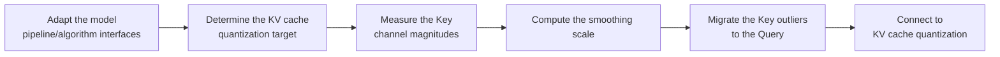

# KV Smooth Cache Smoothing Algorithm Usage Guide

## 1. Scope

This guide is intended for users who need to use the [KV Smooth Cache Smoothing Algorithm](./term_kv_smooth.md). As an outlier suppression algorithm, KV Smooth is usually a step preceding KV cache quantization, used to compress the dynamic range of the Key and improve the accuracy of cache quantization.

Applicable scenarios:

- Accuracy degrades after KV cache quantization because the Key channels have significant outliers and an overly large dynamic range;
- The dynamic-range pressure of the Key needs to be redistributed to the Query side so that the KV cache is easier to represent at low bit widths.

To check whether the model is on the officially pre-validated list, see the [Foundation Model Support Matrix](../../model/README.md); for a quick introduction to basic CLI usage, see the [One-Click Quantization Usage Guide](../../../user_guide/usage_one_click_quantization.md).

## 2. Inputs and Deliverables

| Type | Name | Source or Storage Location | Format or Constraints | Acceptance Criteria |
| --- | --- | --- | --- | --- |
| Input | Floating-point model weight directory | Model download or a local path | HuggingFace format containing `config.json` and `*.safetensors` shards | Loadable by the target Transformers version |
| Input | Model adapter | User adaptation code, invoked through `--model_type` | Implements the `PipelineInterface` and `KVSmoothFusedInterface` interfaces | Can be driven normally by the runner and the processor |
| Input | Calibration dataset | Built-in `lab_calib/` or a user-defined path | Text prompts in JSONL or JSON format; 50 samples recommended | Successfully encoded into forward tensors by the adapter's `handle_dataset` |
| Input | Quantization configuration file | Local YAML file | Complies with the `modelslim_v1` protocol specification | Passes schema validation |
| Deliverable | Quantized weight directory | Path specified by `--save_path` | Contains `quant_model_description.json` and `*.safetensors` shards | Export is complete and the inference smoke test passes |

## 3. Process Overview

The overall workflow of KV Smooth is as follows:



Key details of each stage are as follows:

- **Adapt the model pipeline/algorithm interfaces**: the adapter needs to implement `PipelineInterface` (the basic pipeline interface) and `KVSmoothFusedInterface` (the dedicated KV smoothing interface) to provide the model's Q/K/V subgraph structure information; this is the prerequisite for all subsequent smoothing steps. Model adaptation must be completed before the KV Smooth algorithm can run.
- **Determine the KV cache quantization target**: confirm the target bit width of the KV cache and the deployment backend (such as C8), and delimit the scope of modules to which the algorithm applies through `include`/`exclude`.
- **Measure the Key channel magnitudes**: run a forward pass with the calibration dataset (50 samples recommended), and aggregate the channel magnitudes from the Key absolute maximum along the paired RoPE dimensions.
- **Compute the smoothing scale**: compute the channel-level smoothing scale using `scale = key_abs_max ** smooth_factor` (`smooth_factor` defaults to `1.0`).
- **Migrate the Key outliers to the Query**: divide the K-side weight/bias by the scale and multiply the Q side by the corresponding scale, thereby transferring the dynamic-range pressure of K to Q while preserving the mathematical equivalence of the attention computation.
- **Connect to KV cache quantization**: after smoothing, the Key distribution is flatter, so connecting to KV cache quantization (such as C8) improves accuracy; it is recommended to keep the subsequent quantization configuration unchanged and adjust only `smooth_factor` to isolate the gain.

## 4. Procedure

### Step 1: Adapt the Model Pipeline and Algorithm Interfaces

**Goal**: The quantization tool cannot directly operate on models with arbitrary structures; an adapter is needed to convert model operations into standard methods. For KV Smooth, the model adapter must inherit and implement the pipeline interface and the KV smoothing interface. Model adaptation must be completed before the KV Smooth algorithm can run.

**Action**: The model adaptation code must implement the following interfaces, all of which are aggregated and provided by `msmodelslim.model.interface_hub`:

1. **`PipelineInterface`** (`ModelSlimPipelineInterfaceV1`): the basic pipeline interface, responsible for model loading (`init_model`), data preprocessing (`handle_dataset`), layer-wise traversal (`generate_model_visit`), layer-wise forward pass (`generate_model_forward`), and so on.
2. **`KVSmoothFusedInterface`**: the dedicated KV smoothing interface, exported together from `msmodelslim.model.interface_hub`, which provides the model's Q/K/V subgraph structure information so that the smoothing processor can locate the correspondence between the K-side weights/biases and the Q-side projection.

For a standard open-source LLM implemented with HuggingFace Transformers, it is recommended to build the adapter through compositional inheritance:

```python
from msmodelslim.model.interface_hub import (
    IModel,
    ModelInfoInterface,
    ModelSlimPipelineInterfaceV1 as PipelineInterface,
    # ---- KV Smooth algorithm adaptation interfaces (the focus of this step) ----
    KVSmoothFusedInterface,  # Algorithm adaptation: returns the K/V smoothing fused subgraph (get_kvcache_smooth_fused_subgraph) and structural information such as head_dim and the number of KV groups
)

class MyModelAdapter(TransformersModel, ModelInfoInterface, PipelineInterface, KVSmoothFusedInterface):
    pass
```

Descriptions of each interface method:

- The standard methods of **`PipelineInterface`**: loading data (`handle_dataset`), loading the model (`init_model`), layer-wise traversal (`generate_model_visit`), layer-wise forward pass (`generate_model_forward`), and controlling the KV cache (`enable_kv_cache`). The quantization runner and processor drive the model only through these standard methods and are independent of the model's internal structure.
- The core methods of **`KVSmoothFusedInterface`**: provide the model's Q/K/V subgraph structure information (such as the K-side weight/bias names, the Q-side projection name, and the paired RoPE dimensions); the smoothing processor uses it to locate and fuse the smoothing scales.

The adapter is then referenced in the quantization command via `--model_type MyModelAdapter`.

To develop new model adaptation code, see the [LLM Model Quantization Integration Guide](../../ptq/llm/integration_guide_large_language_model_quantization.md). Note that model adaptation must be completed first before the subsequent quantization workflow can run.

**Output**: A usable model adapter registered in the framework (invoked via `--model_type`).

### Step 2: Establish the Recommended Configuration

**Action**:

The following configuration establishes the **first comparable baseline**. If the target model already has a `lab_practice` recipe, prefer the verified recipe.

```yaml
spec:
  process:
    - type: "kv_smooth"
      smooth_factor: 1.0
      include: ["*"]
      exclude: []
```

**Output**: A reproducible recommended configuration that serves as the comparison baseline for all subsequent parameter adjustments.

### Step 3: Select and Tune Parameters

**Action**:

msModelSlim implementation entry point:
[View the corresponding implementation directory](../../../../../msmodelslim/processor/kv_smooth)

| Configuration Item | Meaning (Rationale) | Recommended Configuration | Selection and Tuning Advice |
| --- | --- | --- | --- |
| `type` | Processor identifier, fixed to `kv_smooth`. | Fixed. | Do not tune. |
| `smooth_factor` | The KV smoothing strength, which must be greater than 0; default `1.0`. The implementation aggregates the Key absolute maximum along the paired RoPE dimensions and then uses `scale = key_abs_max ** smooth_factor`; the K-side weight/bias is divided by the scale and the Q side is multiplied by the corresponding scale, thereby transferring the dynamic-range pressure of K to Q. | Start from the default `1.0`. | It is not a simple linear multiplier: because a power function is used, the response differs depending on whether the original max is greater or less than 1. Increase it within a small range when K outliers are still obvious and KV cache quantization is mainly limited by the K range; reduce it if the Q-side magnitude/quantization error degrades noticeably. Each adjustment should consider both the QK attention error and the KV cache quantization result. |
| `include` | Allow list for the scope; a module-name pattern determines which matched modules enter the current algorithm. | Start from `["*"]` when there is no model-specific recipe; when a `lab_practice` recipe exists, inherit its module scope directly. | First ensure the scope covers the intended modules, then check accuracy. When narrowing the scope, adjust by structural family or known sensitive layers. |
| `exclude` | Deny list for the scope; matched modules are removed from the `include` candidates. It takes precedence over `include`. | Keep the list empty by default; add entries only when a practical recipe, a compatibility constraint, or a sensitivity result provides explicit evidence. | For local accuracy problems, prefer using `exclude` for a small-scope fallback; this preserves gains more easily than raising the bit width of the whole model or disabling the entire algorithm. |

#### Parameter Combinations and Selection Order

**Finally tune only one main knob**: the goal of KV Smooth is to redistribute the Q/K numeric ranges, not a one-way "flatter is better". Start with `1.0`, then decide the direction according to **whether K is still the bottleneck** and **whether Q is over-amplified**, keeping the same calibration set and evaluation set.

**Output**: An algorithm parameter plan that completes single-variable tuning, with a clear selection rationale and tuning direction for each key field.

### Step 4: Write the Quantization Configuration and Run the Command

**Goal**: Integrate the above steps into a complete YAML quantization configuration file and start the quantization workflow via the CLI.

#### Complete Example: KV Smooth + KV Cache C8 Quantization (Recommended Starting Point)

##### Configuration File: `kv_smooth_c8.yaml`

```yaml
apiversion: modelslim_v1
spec:
  runner: auto
  process:
    - type: kv_smooth               # KV Smooth cache smoothing preprocessing
      smooth_factor: 1.0            # KV smoothing strength, default 1.0
      include: ["*"]
    - type: linear_quant            # connect to low-bit quantization
      qconfig:
        act:
          dtype: int8
          scope: per_token          # dynamic activation quantization, good accuracy
          symmetric: true
          method: minmax
        weight:
          dtype: int8
          scope: per_channel
          symmetric: true
          method: minmax
      include: ["*"]
      kv_cache:
        k_dtype: int8               # KV cache C8 quantization
        v_dtype: int8
  save:
    - type: ascendv1_saver          # Ascend inference standard save format
  dataset: mix_calib.jsonl          # built-in mixed calibration set
```

##### Run the command (single-card quantization)

```bash
msmodelslim quant \
  --model_path <float_model_dir> \
  --save_path <quantized_weight_output_dir> \
  --model_type <model_adapter_name> \
  --config ./kv_smooth_c8.yaml \
  --device npu \
  --device_id 0
```

**Output**: Complete quantized weight files and description files are generated in the directory specified by `--save_path`.

## 5. Terminology

| Term | Brief Description | Link |
| --- | --- | --- |
| KV Smooth Cache Smoothing Algorithm | Explains the definition, core principle, key properties, applicable scenarios, and limitations of the algorithm. | [KV Smooth Cache Smoothing Algorithm Terminology Entry](./term_kv_smooth.md) |

## 6. Related Documents

| API or Document | Brief Description | Link |
| --- | --- | --- |
| `PipelineInterface` / `KVSmoothFusedInterface` | Model pipeline and KV Smooth algorithm adaptation interfaces, both exported together from `msmodelslim.model.interface_hub`. | [Interface hub module](../../../../../msmodelslim/model/interface_hub.py) |
| kv_smooth Configuration Description | Field types, default values, valid values, and complete configuration constraints. | [kv_smooth Configuration Description](../../../api_reference/config/processor/kv_smooth.md) |
| modelslim_v1 Configuration Description | Consult this when you need to explore task-level advanced configurations such as runner, prior, save, and dataset. | [modelslim_v1 Configuration Description](../../../api_reference/config/quant/modelslim_v1.md) |
| Weight Quantization Usage Guide | User guide: quantization command parameters and complete usage instructions. | [Weight Quantization Usage Guide](../../../user_guide/usage_weight_quantization.md) |
