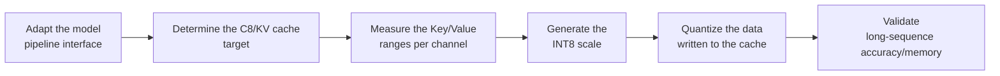

# KVCache Quant Parameter Configuration Workflow Guide

## 1. Scope

This guide is intended for users who need to use the [KVCache Quant Cache Quantization Algorithm](./term_kvcache_quant.md). As a cache quantization processor (`dynamic_cache`), KVCache Quant performs INT8 quantization on the Key/Value states written to the KV cache, reducing cache memory usage and improving long-sequence inference efficiency.

Applicable scenarios:

- The KV cache memory usage becomes the bottleneck in long-sequence inference and the K/V states need to be reduced from floating point to INT8;
- The K/V ranges need to be measured per channel while retaining per-channel quantization granularity, to match the cache quantization operators on the deployment side.

To check whether the model is on the officially pre-validated list, see the [Foundation Model Support Matrix](../../model/README.md); for a quick introduction to basic CLI usage, see the [One-Click Quantization Usage Guide](../../../user_guide/usage_one_click_quantization.md).

## 2. Inputs and Deliverables

| Type | Name | Source or Storage Location | Format or Constraints | Acceptance Criteria |
| --- | --- | --- | --- | --- |
| Input | Target model and quantization objective | The model to quantize and the deployment/evaluation plan | Clarifies the target numerical format or bit width, the target modules, the accuracy/performance goals, and the deployment constraints | Explains why this algorithm is chosen and where it fits in the overall quantization plan |
| Input | Model adapter | User adaptation code, invoked via `--model_type` | Implements the `PipelineInterface` interface | Properly driven by the runner and processor |
| Input | Configuration constraints and practical baseline | This algorithm's configuration description, the target model's existing `lab_practice` recipe (if any) | Field names, supported combinations, scope, and model adaptation are consistent with the current version | The recommended starting point is traceable to the current configuration definition or a verified practice |
| Input | Calibration data (when required by the algorithm) | Task `dataset`, a calibration set, or a model practice recipe | The data should represent the real input distribution; for multi-stage algorithms, keep the data distribution consistent across stages | Readable by the current quantization workflow and covering the main input forms |
| Deliverable | KVCache Quant parameter configuration plan | User quantization YAML or task configuration | Parameter values are valid and the scope of effect is explicit; the selection rationale of key parameters is explained | Can serve as algorithm configuration input for the subsequent quantization workflow and can reproduce the baseline selection in this guide |

## 3. Process Overview

The overall workflow of KVCache Quant is as follows:



Key details of each stage are as follows:

- **Adapt the model pipeline interface**: the adapter needs to implement `PipelineInterface` (the basic pipeline interface); the quantization runner and processor drive the model only through the standard pipeline methods. Model adaptation must be completed before KVCache Quant can run.
- **Determine the C8/KV cache target**: fix the `dtype + scope + symmetric + method` combination; the current `dynamic_cache` processor accepts only `per_channel` granularity.
- **Measure the Key/Value ranges per channel**: run a forward pass with the calibration data (50 samples recommended) and measure the ranges per channel after reshaping the KV tensor.
- **Generate the INT8 scale**: generate the quantization parameters according to the symmetric/asymmetric choice; INT8 is the mainstream KV cache bit width in the repository practices.
- **Quantize the data written to the cache**: write the quantized K/V layer by layer over the scope delimited by `include`/`exclude`; the scope determines which modules enter cache quantization.
- **Validate long-sequence accuracy/memory**: compare the accuracy and memory gain under long-sequence inputs, and if necessary alleviate accuracy loss through KV Smooth or layer-scope fallback.

## 4. Procedure

### Step 1: Adapt the Model Pipeline Interface

**Goal**: The quantization tool cannot directly operate on models with arbitrary structures; an adapter is needed to convert model operations into standard methods. The `dynamic_cache` processor drives the calibration and fake quantization of the KV cache through the standard pipeline methods, so the model adapter only needs to implement the basic pipeline interface. Model adaptation must be completed before KVCache Quant can run.

**Action**: The model adaptation code must implement the following interfaces, which are aggregated and provided by `msmodelslim.model.interface_hub`:

1. **`PipelineInterface`** (`ModelSlimPipelineInterfaceV1`): the basic pipeline interface, responsible for model loading (`init_model`), data preprocessing (`handle_dataset`), layer-wise traversal (`generate_model_visit`), layer-wise forward pass (`generate_model_forward`), and so on. The quantization runner and processor drive the model only through these standard methods and are independent of the model's internal structure.

For a standard open-source LLM implemented with HuggingFace Transformers, it is recommended to build the adapter through compositional inheritance:

```python
from msmodelslim.model.interface_hub import (
    IModel,
    ModelInfoInterface,
    ModelSlimPipelineInterfaceV1 as PipelineInterface,
)

class MyModelAdapter(TransformersModel, ModelInfoInterface, PipelineInterface):
    pass
```

The adapter is then referenced in the quantization command via `--model_type MyModelAdapter`.

To develop new model adaptation code, see the [LLM Model Quantization Integration Guide](../../ptq/llm/integration_guide_large_language_model_quantization.md). Note that model adaptation must be completed first before the subsequent quantization workflow can run.

**Output**: A usable model adapter registered in the framework (invoked via `--model_type`).

### Step 2: Establish the Recommended Configuration

**Action**:

The following configuration establishes the **first comparable baseline**. If the target model already has a `lab_practice` recipe, prefer the verified recipe, then use this section to understand why each parameter is chosen this way.

```yaml
spec:
  process:
    - type: "dynamic_cache"
      qconfig:
        scope: "per_channel"
        dtype: "int8"
        symmetric: true
        method: "minmax"
      include: ["*"]
      exclude: []
```

**Output**: A reproducible recommended configuration that serves as the comparison baseline for all subsequent parameter adjustments.

### Step 3: Select and Tune Parameters

**Action**:

| Configuration Item | Meaning (Rationale) | Recommended Configuration | Selection and Tuning Advice |
| --- | --- | --- | --- |
| `type` | Processor identifier, fixed to `dynamic_cache`, which calibrates and fake-quantizes the K/V states of the Transformers DynamicCache for deployment. | Fixed. | Do not tune. |
| `qconfig.scope` | The current DynamicCacheQuantProcessor explicitly accepts only `per_channel` in the source code; during processing it reshapes the KV tensor and measures per channel. | Fixed to `per_channel`. | Other scopes directly violate the current processor constraints. When a different granularity is needed, another KV/FA solution should be used. |
| `qconfig.dtype` | The KV cache numeric format. Both dynamic_cache practices in the current repository use INT8. | Prefer `int8`. | Try lower bit widths/other formats only when both the corresponding quantizer and the deployment chain support them. KV cache error keeps entering the attention computation as the sequence grows, so do not choose the bit width based on the memory gain alone. |
| `qconfig.symmetric` | Whether to quantize the K/V channels symmetrically. The repository practices use `true`. | Prefer `true`. | Compare with `false` only when the activation distribution is confirmed to be clearly shifted and both the corresponding per-channel asymmetric activation quantizer and the deployment side support it; recalibrate after switching. |
| `qconfig.method` | The quantization parameter estimation method. The repository dynamic_cache practices use MinMax. | `minmax` is recommended. | Establish the C8 baseline with the simple and stable MinMax first. Do not directly apply methods such as GPTQ/SSZ that are dedicated to linear weights; validity is determined by the registered combination of AutoActQuantizer. |
| `include` | Allow list for the scope; a module-name pattern determines which matched modules enter the current algorithm. It only decides *where* the algorithm is applied and does not change the algorithm's internal formula. | Start from `["*"]` when there is no model-specific recipe; when a `lab_practice` recipe exists, inherit its module scope directly. | First ensure the scope covers the intended modules, then check accuracy. If the scope is too broad, a few incompatible structures or sensitive layers amplify the overall risk; if it is too narrow, the algorithm's benefit may not be visible. When narrowing the scope, adjust by structural family or known sensitive layers rather than deleting a large number of layers by index alone. |
| `exclude` | Deny list for the scope; matched modules are removed from the `include` candidates. It takes precedence over `include`. It is suitable for protecting sensitive layers, the first and last layers, or model-specific incompatible structures. | Keep the list empty by default; add entries only when a practical recipe, a compatibility constraint, or a sensitivity result provides explicit evidence. | For local accuracy problems, prefer using `exclude` for a small-scope fallback; this preserves gains more easily than raising the bit width of the whole model or disabling the entire algorithm. After adding each exclusion, confirm that the wildcard does not accidentally affect adjacent modules. |

#### Parameter Combinations and Selection Order

The degree of freedom of the current DynamicCache is actually not large: **per-channel is a hard constraint, and the repository baseline is INT8 + symmetric + MinMax**. Accuracy problems should preferably be solved through KV Smooth, layer-scope fallback, or more suitable data calibration, rather than arbitrarily switching to an unvalidated granularity. Change only one variable per round and keep the same calibration set and evaluation set; if there is no stable gain after the adjustment, return to the previous baseline.

**Output**: An algorithm parameter plan that completes single-variable tuning, with a clear selection rationale and tuning direction for each key field.

### Step 4: Write the Quantization Configuration and Run the Command

**Goal**: Integrate the above steps into a complete YAML quantization configuration file and start the quantization workflow via the CLI.

#### Complete Example: KVCache Quant C8 + W8A8 Dynamic Quantization (Recommended Starting Point)

##### Configuration File: `kvcache_c8_w8a8.yaml`

```yaml
apiversion: modelslim_v1
spec:
  runner: auto
  process:
    - type: dynamic_cache           # KV cache INT8 per-channel quantization
      qconfig:
        scope: per_channel
        dtype: int8
        symmetric: true
        method: minmax
      include: ["*"]
    - type: linear_quant            # connect to W8A8 dynamic quantization
      qconfig:
        act:
          dtype: int8
          scope: per_token
          symmetric: true
          method: minmax
        weight:
          dtype: int8
          scope: per_channel
          symmetric: true
          method: minmax
      include: ["*"]
  save:
    - type: ascendv1_saver          # Ascend inference standard save format
  dataset: mix_calib.jsonl          # built-in mixed calibration set
```

##### Run the command (single-card quantization)

```bash
msmodelslim quant \
  --model_path <float_model_dir> \
  --save_path <quantized_weight_output_dir> \
  --model_type <model_adapter_name> \
  --config ./kvcache_c8_w8a8.yaml \
  --device npu \
  --device_id 0
```

**Output**: Complete quantized weight files and description files are generated in the directory specified by `--save_path`.

## 5. Terminology

| Term | Brief Description | Link |
| --- | --- | --- |
| KVCache Quant Cache Quantization Algorithm | Explains the definition, core principle, key properties, applicable scenarios, and limitations of the algorithm. | [KVCache Quant Cache Quantization Algorithm Terminology Entry](./term_kvcache_quant.md) |

## 6. Related Documents

| API or Document | Brief Description | Link |
| --- | --- | --- |
| `PipelineInterface` | Model pipeline interface, aggregated and exported by `msmodelslim.model.interface_hub`. | [Interface hub module](../../../../../msmodelslim/model/interface_hub.py) |
| dynamic_cache Configuration Description | Field types, default values, valid values, and complete configuration constraints. | [dynamic_cache Configuration Description](../../../api_reference/config/processor/dynamic_cache.md) |
| modelslim_v1 Configuration Description | Consult this when you need to explore task-level advanced configurations such as runner, prior, save, and dataset. | [modelslim_v1 Configuration Description](../../../api_reference/config/quant/modelslim_v1.md) |
| Weight Quantization Usage Guide | User guide: quantization command parameters and complete usage instructions. | [Weight Quantization Usage Guide](../../../user_guide/usage_weight_quantization.md) |
