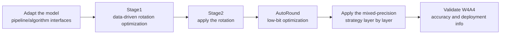

# LAOS Low-Bit Quantization Algorithm Usage Guide

## 1. Scope

This guide is intended for users who need to use the [LAOS Low-Bit Quantization Solution](./term_laos.md). LAOS is a W4A4 low-bit **joint** quantization solution (for large language models). By combining the `adapt_rotation` (rotation optimization) and `autoround_quant` (low-bit quantization) processors, it targets ultra-low-bit quantization of LLMs such as the Qwen3 dense series.

Applicable scenarios:

- The accuracy of ultra-low-bit quantization such as W4A4 falls short, and you need data-driven rotation optimization to break up activation outlier channels;
- You need to balance compression ratio and accuracy under ultra-low bit widths through a mixed-precision strategy (W8A8 protection scope + W4A4 compression scope).

To check whether the model is on the officially pre-validated list, see the [Foundation Model Support Matrix](../../model/README.md); for a quick introduction to basic CLI usage, see the [One-Click Quantization Usage Guide](../../../user_guide/usage_one_click_quantization.md).

## 2. Inputs and Deliverables

| Type | Name | Source or Storage Location | Format or Constraints | Acceptance Criteria |
| --- | --- | --- | --- | --- |
| Input | Floating-point model weight directory | Model download or a local path | HuggingFace format containing `config.json` and `*.safetensors` shards | Loadable by the target Transformers version |
| Input | Model adapter | User adaptation code, invoked via `--model_type` | Implements `PipelineInterface` and the `LAOSOnlineRotationInterface` and `QuaRotInterface` interfaces | Properly driven by the runner and processor |
| Input | Calibration dataset | Built-in `lab_calib/` (such as `laos_calib.jsonl`) or a user-defined path | Text prompts in JSONL or JSON format; 50 samples recommended | Successfully encoded into forward tensors by the adapter's `handle_dataset` |
| Input | Quantization configuration file | Local YAML file | Complies with the `modelslim_v1` protocol specification | Passes schema validation |
| Deliverable | Quantized weight directory | Path specified by `--save_path` | Contains `quant_model_description.json` and `*.safetensors` shards | Export is complete and the inference smoke test passes |

## 3. Process Overview

The overall workflow of LAOS is as follows:



Key details of each stage are as follows:

- **Adapt the model pipeline/algorithm interfaces**: the adapter must implement `PipelineInterface` (the basic pipeline interface) and interfaces such as `LAOSOnlineRotationInterface` (LAOS online rotation) and `QuaRotInterface` (rotation-related), providing network structure information such as the attention head dimension and the rotation pairs of the O/V and up/down projections of each decoder layer. This is the precondition for all subsequent rotation steps. Model adaptation must be completed first before the LAOS algorithm can run.
- **Stage1 data-driven rotation optimization**: the first stage of `adapt_rotation` learns the rotation from calibration activations (`steps: 20`, `quant_dtype: int4`, `layer_type: ["up_proj"]`), so that the subsequent low-bit quantization faces a more balanced channel distribution.
- **Stage2 apply the rotation**: the second stage of `adapt_rotation` actually applies the rotation learned in Stage 1 to the model, and decides which rotations are fused offline (`online: false`) and which must be kept online.
- **AutoRound low-bit optimization**: `autoround_quant` optimizes the quantization range/rounding on the rotated model (`iters: 400`, with minmax and round tuning enabled).
- **Apply the mixed-precision strategy layer by layer**: use multiple `strategies` to keep sensitive modules such as Attention and down_proj within the W8A8 protection scope, while using W4A4 for the main MLP compression scope.
- **Validate W4A4 accuracy and deployment info**: the end-to-end W4A4 accuracy and deployment-chain compatibility verification are authoritative; after upstream targets (bit width, data distribution, rotation structure) change, re-run the whole set starting from Stage 1.

## 4. Procedure

### Step 1: Adapt the Model Pipeline and Algorithm Interfaces

**Goal**: The quantization tool cannot operate directly on models of arbitrary structure; an adapter is needed to convert the model's operations into standard methods. For LAOS, the model adapter must inherit and implement the pipeline interface and the LAOS rotation-related interfaces. Model adaptation must be completed first before the LAOS algorithm can run.

**Action**: The model adaptation code must implement the following interfaces, all of which are aggregated and provided by `msmodelslim.model.interface_hub`:

1. **`PipelineInterface`** (`ModelSlimPipelineInterfaceV1`): the basic pipeline interface, responsible for model loading (`init_model`), data preprocessing (`handle_dataset`), layer-wise traversal (`generate_model_visit`), layer-wise forward pass (`generate_model_forward`), and so on.
2. **`LAOSOnlineRotationInterface`** (located at `msmodelslim.processor.quarot.offline_quarot.quarot_interface`): the LAOS online rotation interface, used to describe the attention head dimension and the rotation pairs of the O/V and up/down projections of each decoder layer.
3. **`QuaRotInterface`** (located at `msmodelslim.processor.quarot.offline_quarot.quarot_interface`): the offline rotation core interface, providing network structure information such as rotation mappings, Norm fusion, and mean fusion.

For a standard open-source LLM implemented with HuggingFace Transformers, it is recommended to build the adapter through compositional inheritance:

```python
from msmodelslim.model.interface_hub import (
    IModel,
    ModelInfoInterface,
    ModelSlimPipelineInterfaceV1 as PipelineInterface,
    # ---- Rotation algorithm adaptation interfaces (focus of this step) ----
    LAOSOnlineRotationInterface,  # Algorithm adaptation: provides head_dim, the number of attention heads, and per-layer OV rotation pairs (get_layer_wise_ov_pair)
    QuaRotInterface,              # Algorithm adaptation: provides the LayerNorm fusion map (get_ln_fuse_map) and rotation pairs (get_rotate_map)
)

class MyModelAdapter(TransformersModel, ModelInfoInterface, PipelineInterface,
                     LAOSOnlineRotationInterface, QuaRotInterface):
    pass
```

Descriptions of each interface method:

- The standard methods of **`PipelineInterface`**: loading data (`handle_dataset`), loading the model (`init_model`), layer-wise traversal (`generate_model_visit`), layer-wise forward pass (`generate_model_forward`), and controlling the KV cache (`enable_kv_cache`). The quantization runner and processor drive the model only through these standard methods and are independent of the model's internal structure.
- Core methods of **`LAOSOnlineRotationInterface`**: `get_head_dim` (returns the attention head dimension), `get_num_attention_heads` (returns the number of attention heads), `get_layer_wise_ov_pair` (returns the O/V projection rotation pairs of each decoder layer), and `get_layer_wise_up_down_pair` (returns the up/down projection rotation pairs).
- Core methods of **`QuaRotInterface`**: `get_rotate_map` (returns the rotation map, including the rotation pair lists of the pre-run and preprocess stages), `get_ln_fuse_map` (returns the fusion map between LayerNorm layers and Linear layers), and `get_bake_names` (returns the list of Linear layer names that need mean fusion).

The adapter is then referenced in the quantization command via `--model_type MyModelAdapter`.

To develop new model adaptation code, see the [LLM Model Quantization Integration Guide](../../ptq/llm/integration_guide_large_language_model_quantization.md). Note that model adaptation must be completed first before the subsequent quantization workflow can run.

**Output**: A usable model adapter registered in the framework (invoked via `--model_type`).

### Step 2: Establish the Recommended Configuration

**Action**:

The following configuration establishes the **first comparable baseline**. If the target model already has a `lab_practice` recipe, prefer the verified recipe.

```yaml
spec:
  prior:
    - process:
        - type: "adapt_rotation"
          stage: 1
          steps: 20
          quant_dtype: "int4"
          layer_type: ["up_proj"]
      dataset: "laos_calib.jsonl"

  process:
    - type: "adapt_rotation"
      stage: 2
      online: false
      block_size: -1
      max_tp_size: 1

    - type: "autoround_quant"
      iters: 400
      enable_minmax_tuning: true
      enable_round_tuning: true
      strategies:
        - qconfig:
            act:
              dtype: "int8"
              scope: "per_token"
              symmetric: true
              method: "minmax"
            weight:
              dtype: "int8"
              scope: "per_channel"
              symmetric: true
              method: "autoround"
          include: ["*self_attn*", "*.down_proj"]
        - qconfig:
            act:
              dtype: "int4"
              scope: "per_token"
              symmetric: true
              method: "minmax"
            weight:
              dtype: "int4"
              scope: "per_channel"
              symmetric: true
              method: "autoround"
          include: ["*.up_proj", "*.gate_proj"]

  dataset: "laos_calib.jsonl"
```

**Output**: A reproducible recommended configuration that serves as the comparison baseline for all subsequent parameter adjustments.

### Step 3: Select and Tune Parameters

**Action**:

LAOS is a chained solution of "adaptive rotation + AutoRound mixed low-bit optimization": the upstream rotation changes the downstream weight and activation distributions, while AutoRound's bit width/strategy defines the final target the rotation actually serves. The core principle is that **a change in an upstream target invalidates the downstream optimum**: after the bit width, calibration distribution, or rotation structure changes, regenerate the rotation and re-run AutoRound.

| Configuration Item | Meaning (Rationale) | Recommended Configuration | Selection and Tuning Advice |
| --- | --- | --- | --- |
| `adapt_rotation.stage: 1` | The first stage learns the rotation from calibration activations so that the subsequent low-bit quantization faces a more balanced channel distribution. | LAOS must run Stage 1 first. | After the final bit width, rotation scope, calibration data, or block size changes materially, re-learn the rotation. |
| `adapt_rotation.steps` | The number of rotation optimization steps in Stage 1; the gain gradually plateaus. | The repository's Qwen3 W4A4 practice uses `20`. | If the rotation objective still decreases markedly around 20 steps, increase it slightly; once the metrics have stabilized, adding more steps is not cost-effective. |
| `adapt_rotation.quant_dtype` | The target type used by Stage 1 to simulate downstream activation quantization noise; supports INT4/INT8. | Use `int4` for a W4A4 target and `int8` for a W8A8 target. | Stage 1 must be re-run when the bit width changes. This parameter takes precedence over `steps`. |
| `adapt_rotation.layer_type` | Determines which projection layers Stage 1 collects activations from to estimate the rotation objective. | The verified starting point for Qwen3/LAOS is `["up_proj"]`. | Expand it only when you have confirmed that the final low-bit scope extends to other rotation paths; if the module names are not matched correctly, fix the scope first. |
| `adapt_rotation.stage: 2` | The second stage actually applies the rotation learned in Stage 1 to the model. | Run it after Stage 1 completes. | Stage 2 does not search for the optimum rotation again; if the Stage 1 objective changes, re-run it. |
| `adapt_rotation.online` | Whether to keep online rotation; `false` fuses offline as much as possible, with lower runtime overhead. | The repository's LAOS/Qwen3 W4A4 practice uses `false`. | Prefer offline for a first try; enable it only when the deployment chain explicitly supports online rotation and there are layers that must be handled online. |
| `adapt_rotation.block_size` | The rotation block size; `-1` means whole-block rotation by hidden dimension. | The repository's LAOS practice uses `-1`. | Keep whole-block rotation when accuracy is the priority; change it only when the target operator/parallel layout explicitly requires blocking. |
| `adapt_rotation.max_tp_size` | The maximum TP parallelism related to online rotation; a deployment-compatibility parameter. | The repository's LAOS practice uses `1`; for online deployment, set it to the actual maximum TP. | Do not enlarge it arbitrarily; adjust it when the deployment TP changes. |
| `autoround_quant.iters` | The number of AutoRound optimization iterations. | Start from `400` for a formal reproduction; lower it temporarily only to verify the workflow. | Confirm the strategy scope is correct first, then decide whether more iterations are needed. |
| `enable_minmax_tuning` | Whether AutoRound may adjust the quantization clipping range. | Recommended to keep enabled. | Disable it only for algorithm ablations. |
| `enable_round_tuning` | Whether the weight rounding direction is optimized; a key AutoRound capability. | `true`. | Not recommended to disable for regular LAOS, especially with W4 weights. |
| `strategies[].qconfig` | The activation/weight quantization target of each mixed-precision strategy. | Use W8A8 for the sensitive/protected scope and W4A4 for the main compression scope; for the specific layer scope, follow the model practice first. | When W4 accuracy is insufficient, first move a few sensitive layers to a W8 strategy rather than raising the whole model to W8. |
| `strategies[].include/exclude` | Defines which modules W8A8 and W4A4 cover respectively. | The first choice is to reuse the repository's verified layer scope. | When accuracy is insufficient, prefer expanding the W8 protection set in a small scope; migrate only one group of structurally similar layers at a time. |
| `dataset` | Both data-driven stages depend on the calibration distribution. | Use data with the same distribution as the real workload; use `laos_calib.jsonl` when reproducing a recipe. | When the dataset or task distribution changes markedly, re-run the whole set starting from Stage 1. |

#### Parameter Combinations and Selection Order

1. **Determine the final W/A target first**: decide which modules are W4A4 and which need W8A8 protection, and make Adapt Rotation's `quant_dtype` consistent with the main target.
2. **Then fix the calibration data and Stage 1**: complete the rotation with representative data, and adjust `steps` only after confirming the target and data are correct.
3. **Apply Stage 2 and decide online/block/TP by deployment constraints**: these parameters mainly address deployment issues; do not use them as substitutes for accuracy tuning.
4. **Optimize AutoRound last**: start with the repository practice's `iters` and the two tuning switches, then perform local W8 fallback through the strategy scope.

**Output**: An algorithm parameter plan that completes single-variable tuning, with a clear selection rationale and tuning direction for each key field.

### Step 4: Write the Quantization Configuration and Run the Command

**Goal**: Integrate the above steps into a complete YAML quantization configuration file and start the quantization workflow via the CLI.

#### Complete Example: LAOS W4A4 Joint Quantization (Recommended Starting Point)

##### Configuration File: `laos_w4a4.yaml`

```yaml
apiversion: modelslim_v1
spec:
  runner: auto
  prior:
    - process:
        - type: adapt_rotation       # Stage 1 data-driven rotation optimization
          stage: 1
          steps: 20                  # Number of rotation optimization steps
          quant_dtype: int4          # Consistent with the final activation bit width
          layer_type: ["up_proj"]    # The projection layers whose activations are collected
      dataset: laos_calib.jsonl
  process:
    - type: adapt_rotation           # Stage 2 apply the rotation
      stage: 2
      online: false                  # Prefer offline rotation fusion
      block_size: -1                 # Rotation over the full hidden_dim
      max_tp_size: 1
    - type: autoround_quant          # AutoRound low-bit optimization
      iters: 400
      enable_minmax_tuning: true
      enable_round_tuning: true
      strategies:
        - qconfig:                   # W8A8 protection scope
            act:
              dtype: int8
              scope: per_token
              symmetric: true
              method: minmax
            weight:
              dtype: int8
              scope: per_channel
              symmetric: true
              method: autoround
          include: ["*self_attn*", "*.down_proj"]
        - qconfig:                   # W4A4 compression scope
            act:
              dtype: int4
              scope: per_token
              symmetric: true
              method: minmax
            weight:
              dtype: int4
              scope: per_channel
              symmetric: true
              method: autoround
          include: ["*.up_proj", "*.gate_proj"]
  save:
    - type: ascendv1_saver           # Ascend inference standard save format
  dataset: laos_calib.jsonl          # LAOS calibration set
```

##### Run the command (single-card quantization)

```bash
msmodelslim quant \
  --model_path <float_model_dir> \
  --save_path <quantized_weight_output_dir> \
  --model_type <model_adapter_name> \
  --config ./laos_w4a4.yaml \
  --device npu \
  --device_id 0
```

**Output**: Complete quantized weight files and description files are generated in the directory specified by `--save_path`.

## 5. Terminology

| Term | Brief Description | Link |
| --- | --- | --- |
| LAOS Low-Bit Quantization Solution | Explains the definition, core principle, key properties, applicable scenarios, and limitations of the algorithm. | [LAOS Low-Bit Quantization Solution Terminology Entry](./term_laos.md) |

## 6. Related Documents

| API or Document | Brief Description | Link |
| --- | --- | --- |
| `PipelineInterface` / `LAOSOnlineRotationInterface` / `QuaRotInterface` | Model pipeline and LAOS algorithm adaptation interfaces, all exported together from `msmodelslim.model.interface_hub`. | [Interface hub module](../../../../../msmodelslim/model/interface_hub.py) |
| adapt_rotation Configuration Description | Field types, default values, valid values, and complete configuration constraints. | [adapt_rotation Configuration Description](../../../api_reference/config/processor/adapt_rotation.md) |
| autoround_quant Configuration Description | AutoRound parameters for LAOS's second stage. | [autoround_quant Configuration Description](../../../api_reference/config/processor/autoround_quant.md) |
| modelslim_v1 Configuration Description | Consult this when you need to explore task-level advanced configurations such as runner, prior, save, and dataset. | [modelslim_v1 Configuration Description](../../../api_reference/config/quant/modelslim_v1.md) |
| Weight Quantization Usage Guide | User guide: quantization command parameters and complete usage instructions. | [Weight Quantization Usage Guide](../../../user_guide/usage_weight_quantization.md) |
