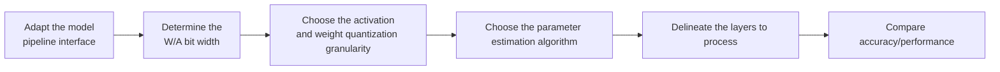

# Linear Quantization Parameter Configuration Workflow Guide

## 1. Scope

This guide is intended for users who need to use the [Linear Quantization Algorithm](./term_linear_quant.md). Linear quantization uses the `linear_quant` processor to quantize the weights and activations of the model's linear layers (`nn.Linear`), and is the foundation of most quantization solutions.

Applicable scenarios:

- You need to perform basic quantization on the weights and activations of the model's linear layers to establish a comparable quantization baseline;
- You need to locate accuracy or compression-ratio gains on top of the baseline by adjusting the bit width, granularity, and parameter estimation algorithm of activations/weights.

To check whether the model is on the officially pre-validated list, see the [Foundation Model Support Matrix](../../model/README.md); for a quick introduction to basic CLI usage, see the [One-Click Quantization Usage Guide](../../../user_guide/usage_one_click_quantization.md).

## 2. Inputs and Deliverables

| Type | Name | Source or Storage Location | Format or Constraints | Acceptance Criteria |
| --- | --- | --- | --- | --- |
| Input | Target model and quantization objective | The model to quantize and the deployment/evaluation plan | Clarifies the target numerical format or bit width, the target modules, the accuracy/performance goals, and the deployment constraints | Explains why this algorithm is chosen and where it fits in the overall quantization plan |
| Input | Model adapter | User adaptation code, invoked via `--model_type` | Implements the `PipelineInterface` interface | Properly driven by the runner and processor |
| Input | Configuration constraints and practical baseline | This algorithm's configuration description, the target model's existing `lab_practice` recipe (if any) | Field names, supported combinations, scope, and model adaptation are consistent with the current version | The recommended starting point is traceable to the current configuration definition or a verified practice |
| Input | Calibration data (when required by the algorithm) | Task `dataset`, a calibration set, or a model practice recipe | The data should represent the real input distribution; for multi-stage algorithms, keep the data distribution consistent across stages | Readable by the current quantization workflow and covering the main input forms |
| Deliverable | Linear quantization parameter configuration plan | The user's quantization YAML or task configuration | Parameter values are valid and the scope is explicit; key parameters state the rationale for the choice | Can serve as the algorithm configuration input for the subsequent quantization workflow and can reproduce the baseline choices in this guide |

## 3. Process Overview

The overall workflow of linear quantization is as follows:



Key details of each stage are as follows:

- **Adapt the model pipeline interface**: the adapter must implement `PipelineInterface` (the basic pipeline interface); the quantization runner and processor drive the model only through standard pipeline methods. Model adaptation must be completed first before linear quantization can run.
- **Determine the W/A bit width**: fix the target bit width first, then confirm the parameter combinations supported by the current version; the bit width is determined by the product and backend targets and is not a fine-tuning knob.
- **Choose the activation and weight quantization granularity**: the more local the granularity, the better it adapts to dynamic-range variation, but runtime scale computation and metadata are usually greater; a registered quantizer must exist for the combination with dtype/symmetric/method.
- **Choose the parameter estimation algorithm**: first make the method match dtype/scope, then consider complexity; do not replace a method that already meets the accuracy requirement just because another algorithm is "more advanced".
- **Delineate the layers to process**: control the scope via `include/exclude`; too broad a scope amplifies the risk from incompatible or sensitive layers, while too narrow a scope may make the algorithm's benefit invisible.
- **Compare accuracy/performance**: change only one variable per round and compare directly against the baseline; when the result is unsatisfactory, first revert to the most recently modified parameters.

## 4. Procedure

### Step 1: Adapt the Model Pipeline Interface

**Goal**: The quantization tool cannot operate directly on models of arbitrary structure; an adapter is needed to convert the model's operations into standard methods. The `linear_quant` processor drives the model through standard pipeline methods, so the model adapter only needs to implement the basic pipeline interface. Model adaptation must be completed first before linear quantization can run.

**Action**: The model adaptation code must implement the following interfaces, which are aggregated and provided by `msmodelslim.model.interface_hub`:

1. **`PipelineInterface`** (`ModelSlimPipelineInterfaceV1`): the basic pipeline interface, responsible for model loading (`init_model`), data preprocessing (`handle_dataset`), layer-wise traversal (`generate_model_visit`), layer-wise forward pass (`generate_model_forward`), and so on. The quantization runner and processor drive the model only through these standard methods and are independent of the model's internal structure.

For a standard open-source LLM implemented with HuggingFace Transformers, it is recommended to build the adapter through compositional inheritance:

```python
from msmodelslim.model.interface_hub import (
    IModel,
    ModelInfoInterface,
    ModelSlimPipelineInterfaceV1 as PipelineInterface,
)

class MyModelAdapter(TransformersModel, ModelInfoInterface, PipelineInterface):
    pass
```

The adapter is then referenced in the quantization command via `--model_type MyModelAdapter`.

To develop new model adaptation code, see the [LLM Model Quantization Integration Guide](../../ptq/llm/integration_guide_large_language_model_quantization.md). Note that model adaptation must be completed first before the subsequent quantization workflow can run.

**Output**: A usable model adapter registered in the framework (invoked via `--model_type`).

### Step 2: Establish the Recommended Configuration

**Action**:

The following configuration establishes the **first comparable baseline**. If the target model already has a `lab_practice` recipe, prefer the verified recipe, then use this section to understand why each parameter is chosen this way.

```yaml
spec:
  process:
    - type: "linear_quant"
      qconfig:
        act:
          scope: "per_token"
          dtype: "int8"
          symmetric: true
          method: "minmax"
        weight:
          scope: "per_channel"
          dtype: "int8"
          symmetric: true
          method: "minmax"
      include: ["*"]
      exclude: []
```

**Output**: A reproducible recommended configuration that serves as the comparison baseline for all subsequent parameter adjustments.

### Step 3: Select and Tune Parameters

**Action**:

msModelSlim implementation entry point:
[View the corresponding implementation directory](../../../../../msmodelslim/processor/quant/linear.py)

| Configuration Item | Meaning (Rationale) | Recommended Configuration | Selection and Tuning Advice |
| --- | --- | --- | --- |
| `type` | Processor identifier, fixed to `linear_quant`. | Fixed. | Not a tuning parameter. |
| `qconfig.act.dtype` | The activation numerical format. `float` means activations are not quantized; the current general QConfig also supports INT8/INT4/MXFP8/MXFP4/FP8 E4M3, but whether it can be used for Linear depends on the actual registered combination. | For a general LLM W8A8, start from `int8`; for weight-only quantization use `float`; choose MX/FP8 only according to a verified model/backend recipe. | The dtype is determined by the product and backend targets and is not a fine-tuning knob. Lowering the bit width directly increases quantization noise, so the scope/method should be re-selected and fully evaluated. |
| `qconfig.act.scope` | The activation scale granularity. The most common W8A8 recipe in the repository is `per_token`; there are also dedicated combinations such as INT8 per-tensor asymmetric, PDMIX, MX per-block, and DualScale. The more local the granularity, the better it adapts to dynamic-range variation, but runtime scale computation/metadata is usually greater. | For a general INT8 LLM, prefer `per_token`; when a model practice exists, follow its per-tensor/PDMIX/per-block combination. | Do not pick a scope arbitrarily from the QConfig enumeration; a registered quantizer must exist for the combination with dtype/symmetric/method. If per-token accuracy already meets the requirement, there is no need to switch to a more complex dedicated scope for the sake of "finer" granularity. |
| `qconfig.act.symmetric` | Determines whether activations use a zero-point. Symmetric quantization is centered on 0 and simple to compute; asymmetric quantization can adapt to clearly shifted distributions. | Use `true` for the INT8 per-token baseline; the repository also has per-tensor asymmetric and PDMIX `false` practices. | This is subject to quantizer support and the backend. Consider asymmetric quantization when the activation distribution is clearly shifted and per-tensor symmetric loss is high; when per-token symmetric quantization already adapts locally, keep the simple option. |
| `qconfig.act.method` | The activation scale/clipping estimation method. MinMax is the most commonly used baseline in the repository; Histogram is currently dedicated to INT8 per-tensor activations, searching for clipping via a histogram. The method for certain special formats is defined by a dedicated quantizer. | Start with `minmax`; consider `histogram` or a dedicated method only when a long-tail clipping problem clearly exists and the combination is supported. | Changing the method changes the calibration requirements and the definition of quantization error. There is no need to add a complex algorithm when MinMax already meets the accuracy requirement; introduce Histogram when the long tail is obvious. |
| `qconfig.weight.dtype` | The weight numerical format. INT8 per-channel is common in the repository; W4A8 practices use INT4 per-channel SSZ; MX models use MXFP4/8 per-block. | Use `int8` for a general W8A8; for low-bit targets choose `int4` or MXFP4 according to the model practice. | The weight bit width is an important source of compression gains and also a source of accuracy risk. Try INT4 only after the INT8 baseline is sound, which makes it easier to tell whether degradation comes from the bit width or from other processing. |
| `qconfig.weight.scope` | The weight scale granularity. INT weights commonly use per-channel; GPTQ also supports per-group; MX formats commonly use per-block, and DualScale uses a dedicated scope. | The general starting point for INT8/INT4 weights is `per_channel`. | When finer group-wise GPTQ or MX blocks are needed, configure them according to the corresponding algorithm guide. Finer granularity generally adapts better to intra-channel differences, but places higher demands on scale metadata and the backend. |
| `qconfig.weight.symmetric` | Whether weights are symmetric. Transformer Linear weights are usually centered on 0, and the mainstream INT/MX practices in the repository all use symmetric quantization. | Prefer `true`. | Compare against false only when the target quantizer explicitly registers an asymmetric combination (such as GPTQ) and the backend supports it; ordinary MinMax INT4/INT8 weights currently register mainly symmetric per-channel. |
| `qconfig.weight.method` | The weight quantization algorithm. `minmax` is simple to compute; `ssz` iteratively optimizes the scale for low-bit per-channel weights; `gptq` uses the Hessian of calibration activations for second-order error compensation; `mse_round/ceil_x/fouroversix/dualscale` belong to specific MX formats. | Start from `minmax` for W8A8; the repository already has `ssz` practices for W4A8; follow the GPTQ guide when second-order low-bit optimization is needed; MX formats use their dedicated method. | First make the method match dtype/scope, then consider complexity. Do not replace MinMax, which already meets the accuracy requirement, just because another algorithm is "more advanced"; advanced algorithms usually increase calibration/search cost. |
| `qconfig.*.ext` | Quantizer-specific extension parameters whose meaning differs completely between methods, for example GPTQ's `percdamp/block_size/group_size`, SSZ's `step`, and MX methods' `axes`/search parameters. | Keep it empty for ordinary MinMax when there is no special requirement; fill it in according to the corresponding guide only when that method is selected. | Do not reuse ext fields across algorithms. After changing the method, clear the ext entries that do not belong to the new quantizer, so as to avoid invalid or misleading configurations. |
| `include` | Allow list for the scope; a module-name pattern determines which matched modules enter the current algorithm. It only decides *where* the algorithm is applied and does not change the algorithm's internal formula. | Start from `["*"]` when there is no model-specific recipe; when a `lab_practice` recipe exists, inherit its module scope directly. | First ensure the scope covers the intended modules, then check accuracy. If the scope is too broad, a few incompatible structures or sensitive layers amplify the overall risk; if it is too narrow, the algorithm's benefit may not be visible. When narrowing the scope, adjust by structural family or known sensitive layers rather than deleting a large number of layers by index alone. |
| `exclude` | Deny list for the scope; matched modules are removed from the `include` candidates. It takes precedence over `include`. It is suitable for protecting sensitive layers, the first and last layers, or model-specific incompatible structures. | Keep the list empty by default; add entries only when a practical recipe, a compatibility constraint, or a sensitivity result provides explicit evidence. | For local accuracy problems, prefer using `exclude` for a small-scope fallback; this preserves gains more easily than raising the bit width of the whole model or disabling the entire algorithm. After adding each exclusion, confirm that the wildcard does not accidentally affect adjacent modules. |

### How to Choose Common Combinations

| Target | Activation Recommendation | Weight Recommendation | Description |
| --- | --- | --- | --- |
| General W8A8 baseline | `int8 / per_token / symmetric / minmax` | `int8 / per_channel / symmetric / minmax` | The most frequent combination in the repository's `lab_practice`; suitable for establishing a stable baseline first. |
| Weight-only quantization | `float` | `int8 / per_channel / symmetric / minmax` | Activations are not quantized; suitable for validating weight quantization risk first. |
| W4A8 | `int8 / per_token / symmetric / minmax` | `int4 / per_channel / symmetric / ssz` | The repository already has DeepSeek/GLM-type practices; see the corresponding guide for SSZ details. |
| MXFP8 | `mxfp8 / per_block / symmetric / minmax` | `mxfp8 / per_block / symmetric / minmax` or `mse_round` | Use only when the target backend supports MX formats. |

When choosing, first determine the "final deployment format", then the "quantization granularity", and finally the "parameter estimation algorithm". `include/exclude` is for local fallback; do not experiment by arbitrarily mixing unregistered QConfig combinations. Change only one variable per round and keep the same calibration set and evaluation set; if an adjustment yields no stable gain, revert to the previous baseline.

**Output**: An algorithm parameter plan that completes single-variable tuning, with a clear selection rationale and tuning direction for each key field.

### Step 4: Write the Quantization Configuration and Run the Command

**Goal**: Integrate the above steps into a complete YAML quantization configuration file and start the quantization workflow via the CLI.

#### Complete Example: Linear Quantization W8A8 Dynamic Quantization (Recommended Starting Point)

##### Configuration File: `linear_quant_w8a8.yaml`

```yaml
apiversion: modelslim_v1
spec:
  runner: auto
  process:
    - type: linear_quant            # W8A8 dynamic quantization for linear layers
      qconfig:
        act:
          dtype: int8
          scope: per_token          # dynamic activation quantization, good accuracy
          symmetric: true
          method: minmax
        weight:
          dtype: int8
          scope: per_channel
          symmetric: true
          method: minmax
      include: ["*"]
  save:
    - type: ascendv1_saver          # Ascend inference standard save format
  dataset: mix_calib.jsonl          # built-in mixed calibration set
```

##### Run the command (single-card quantization)

```bash
msmodelslim quant \
  --model_path <float_model_dir> \
  --save_path <quantized_weight_output_dir> \
  --model_type <model_adapter_name> \
  --config ./linear_quant_w8a8.yaml \
  --device npu \
  --device_id 0
```

**Output**: Complete quantized weight files and description files are generated in the directory specified by `--save_path`.

## 5. Terminology

| Term | Brief Description | Link |
| --- | --- | --- |
| Linear Quantization Algorithm | Explains the definition, core principle, key properties, applicable scenarios, and limitations of the algorithm. | [Linear Quantization Algorithm Terminology Entry](./term_linear_quant.md) |

## 6. Related Documents

| API or Document | Brief Description | Link |
| --- | --- | --- |
| `PipelineInterface` | Model pipeline interface, aggregated and exported by `msmodelslim.model.interface_hub`. | [Interface hub module](../../../../../msmodelslim/model/interface_hub.py) |
| linear_quant Configuration Description | Field types, default values, valid values, and complete configuration constraints. | [linear_quant Configuration Description](../../../api_reference/config/processor/linear_quant.md) |
| modelslim_v1 Configuration Description | Consult this when you need to explore task-level advanced configurations such as runner, prior, save, and dataset. | [modelslim_v1 Configuration Description](../../../api_reference/config/quant/modelslim_v1.md) |
| Weight Quantization Usage Guide | User guide: quantization command parameters and complete usage instructions. | [Weight Quantization Usage Guide](../../../user_guide/usage_weight_quantization.md) |
