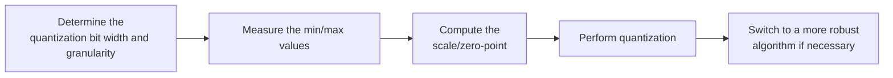

# MinMax Parameter Configuration Workflow Guide

## 1. Scope

This guide is intended for users who need to use the [MinMax Minimum-Maximum Quantization Algorithm](./term_minmax.md). As an activation or weight quantization method of the `linear_quant` processor, MinMax computes quantization parameters by taking statistics of the tensor extremes, and is the first choice for most conventional quantization scenarios.

Applicable scenarios:

- Need to choose a simple, stable, and interpretable parameter estimation algorithm for the activation or weight quantization of `linear_quant`;
- Need to establish a comparable quantization baseline with the fewest configuration variables in conventional quantization scenarios.

To check whether the model is on the officially pre-validated list, see the [Foundation Model Support Matrix](../../model/README.md); for a quick introduction to basic CLI usage, see the [One-Click Quantization Usage Guide](../../../user_guide/usage_one_click_quantization.md).

## 2. Inputs and Deliverables

| Type | Name | Source or Storage Location | Format or Constraints | Acceptance Criteria |
| --- | --- | --- | --- | --- |
| Input | Floating-point model weight directory | Model download or a local path | HuggingFace format containing `config.json` and `*.safetensors` shards | Loadable by the target Transformers version |
| Input | Calibration dataset | Built-in `lab_calib/` or a user-defined path | Text prompts in JSONL or JSON format; 50 samples recommended | Readable by the current quantization workflow and covering the main input forms |
| Input | Configuration constraints and practical baseline | This algorithm's configuration description, the target model's existing `lab_practice` recipe (if any) | Field names, supported combinations, scope, and model adaptation are consistent with the current version | The recommended starting point is traceable to the current configuration definition or a verified practice |
| Deliverable | MinMax parameter configuration plan | User quantization YAML or task configuration | Parameter values are valid and the scope of effect is explicit; the selection rationale of key parameters is explained | Can serve as algorithm configuration input for the subsequent quantization workflow and can reproduce the baseline selection in this guide |

## 3. Process Overview

The overall workflow of MinMax is as follows:



Key details of each stage are as follows:

- **Prerequisite: model adaptation.** Model adaptation must be completed before quantization. The adapter implements interfaces such as `PipelineInterface` (the basic pipeline interface); see the [LLM Model Quantization Integration Guide](../../ptq/llm/integration_guide_large_language_model_quantization.md) for details. Model adaptation must be completed first before the quantization workflow can run.
- **Determine the quantization bit width and granularity**: first fix the deployment target and the `dtype + scope + symmetric + method` combination actually registered by the current quantizer; the more local the granularity, the better it adapts to dynamic-range variation, but the higher the requirements on metadata and the backend.
- **Measure the min/max values**: MinMax observes the tensor extremes through the calibration data and does not proactively discard the tail; the data distribution directly determines the statistics.
- **Compute the scale/zero-point**: the quantization parameters are determined from the observed range; symmetric quantization is centered on 0, while asymmetric quantization can adapt to a clearly shifted distribution.
- **Perform quantization**: apply quantization layer by layer over the scope delimited by `include/exclude`; the scope should first cover the expected modules before accuracy is examined.
- **Switch to a more robust algorithm if necessary**: when accuracy is insufficient, first locate the source of the problem - adjust `scope` for a granularity problem; introduce smoothing or Histogram for an outlier problem; switch to SSZ/GPTQ for a low-bit weight problem, instead of piling irrelevant parameters onto MinMax.

## 4. Procedure

### Step 1: Confirm Objectives and Constraints

**Action**: First fix the target model, the final quantization format/bit width, the target objects, and the evaluation baseline, then confirm the parameter combinations supported by the current version. If the target model already has a `lab_practice` recipe, use that recipe as the practical baseline first; when there is no model-specific recipe, use the general recommended starting point given in this guide. If the algorithm relies on calibration statistics or optimization data, also fix representative data before tuning, to avoid mistaking a change in the data distribution for a parameter gain.

**Output**: An explicit configuration objective: target bit width/format, processing scope, calibration conditions, evaluation baseline, and deployment constraints.

### Step 2: Establish the Recommended Configuration

**Action**:

The following configuration establishes the **first comparable baseline**. If the target model already has a `lab_practice` recipe, prefer the verified recipe, then use this section to understand why each parameter is chosen this way.

```yaml
spec:
  process:
    - type: "linear_quant"
      qconfig:
        act:
          scope: "per_token"
          dtype: "int8"
          symmetric: true
          method: "minmax"
        weight:
          scope: "per_channel"
          dtype: "int8"
          symmetric: true
          method: "minmax"
      include: ["*"]
      exclude: []
```

**Output**: A reproducible recommended configuration that serves as the comparison baseline for all subsequent parameter adjustments.

### Step 3: Select and Tune Parameters

**Action**:

| Configuration Item | Meaning (Rationale) | Recommended Configuration | Selection and Tuning Advice |
| --- | --- | --- | --- |
| `qconfig.act.dtype/scope/symmetric` | MinMax is only the method of "how to compute qparam from the observed range"; the actual scale granularity and numeric format are still determined by dtype/scope/symmetric. The most common W8A8 in the repository is INT8 per-token symmetric; there are also INT8 per-tensor asymmetric, PDMIX, and MX per-block. | For general W8A8, start from `int8 + per_token + symmetric`. | If MinMax accuracy is insufficient, first determine whether the problem comes from a granularity that is too coarse or from extreme values. For a granularity problem, change `scope` first; only for a long-tail clipping problem consider methods such as Histogram/Smooth, rather than replacing all fields aimlessly. |
| `qconfig.act.method` | When fixed to `minmax`, the quantization range is determined from the observed minimum/maximum values and the tail is not proactively discarded. The advantages are simplicity, stability, and interpretability; the disadvantage is that a few outliers may widen the step size. | Fixed to `minmax` for ordinary baselines. | When a long activation tail leaves the bulk interval with insufficient resolution, compare with Histogram or apply smoothing first; if MinMax already reaches the target accuracy, there is usually no need to add a search algorithm. |
| `qconfig.weight.dtype/scope/symmetric` | Weight MinMax commonly uses per-channel symmetric INT8/INT4. Per-channel gives every output channel its own scale, which is usually more stable than sharing one scale across the whole tensor. MXFP4/8 instead uses per-block MinMax and can specify the block axis through `ext.axes`. | For INT weights, start from `int8 + per_channel + symmetric`; for low-bit/special formats, follow the target recipe. | INT4 is more sensitive to the weight dynamic range; if plain MinMax degrades noticeably, consider SSZ/GPTQ. For MX formats, confirm the block layout first and do not apply per-channel experience directly to per-block. |
| `qconfig.weight.method` | Fixed to `minmax` means the scale is computed directly from the weight range, with no need to calibrate activations and at the lowest cost. | Prefer `minmax` for W8 weights. | Switch to SSZ/GPTQ and similar only when further optimization at low bit widths is needed; after changing the method, handle `ext` and the calibration requirements again according to the corresponding algorithm. |
| `ext.aggregation_type` | Some MinMax activation observers support an aggregation extension, with a default of `max`; it affects how statistics from multiple observations are merged. Note that the per-token path currently uses max aggregation directly, so this is not treated as a regular tunable item. | Keep the default in conventional use; do not configure it explicitly. | Adjust it only when you explicitly use a per-tensor/per-channel/PDMIX observation path that supports this `ext` and understand the multi-batch statistics requirement; at the introductory stage it is not recommended as a substitute for the more direct scope/smoothing choices. |
| `ext.axes` | The blocking axis used by MXFP4/MXFP8 per-block MinMax, default `-1`. INT per-token/per-channel MinMax does not need this field. | For MX weights/activations, keep `-1` in practice unless the backend layout requires otherwise. | This is a layout parameter. Changing `axes` changes the block grouping and the scale shape and must be consistent with the deployment side. |

### Parameter Combinations and Selection Order

The reason MinMax is the preferred baseline is that it has the fewest variables. When accuracy is insufficient, locate the problem first: **granularity problem -> adjust `scope`; outlier problem -> smoothing/Histogram; low-bit weight problem -> SSZ/GPTQ**, instead of continuing to pile irrelevant parameters onto MinMax.

**Output**: An algorithm parameter plan that completes single-variable tuning, with a clear selection rationale and tuning direction for each key field.

### Step 4: Converge the Parameter Plan Based on Results

**Action**:

- **Run the recommended configuration first, then tune one variable at a time.** Do not change the bit width, granularity, algorithm parameters, and layer scope simultaneously; otherwise it is difficult to attribute an accuracy change to a specific item.
- **Prefer local fallback over raising accuracy globally.** If only a few layers are sensitive, use `exclude` or a mixed strategy to preserve high accuracy for them; this is usually more cost-effective than raising the bit width of the entire model.
- **The model's practical configuration and deployment capability take precedence.** The introductory recommendation is meant to establish a stable starting point; if the target model already has a `lab_practice` recipe, prefer reusing the verified combination.

**Output**: A final parameter plan ready for the subsequent quantization workflow, retaining a record of adjustments relative to the recommended configuration.

## 5. Terminology

| Term | Brief Description | Link |
| --- | --- | --- |
| MinMax Minimum-Maximum Quantization Algorithm | Explains the definition, core principle, key properties, applicable scenarios, and limitations of the algorithm. | [MinMax Minimum-Maximum Quantization Algorithm Terminology Entry](./term_minmax.md) |

## 6. Related Documents

| API or Document | Brief Description | Link |
| --- | --- | --- |
| linear_quant Configuration Description | Field types, default values, valid values, and complete configuration constraints. | [linear_quant Configuration Description](../../../api_reference/config/processor/linear_quant.md) |
| modelslim_v1 Configuration Description | Consult this when you need to explore task-level advanced configurations such as runner, prior, save, and dataset. | [modelslim_v1 Configuration Description](../../../api_reference/config/quant/modelslim_v1.md) |
| Weight Quantization Usage Guide | User guide: quantization command parameters and complete usage instructions. | [Weight Quantization Usage Guide](../../../user_guide/usage_weight_quantization.md) |
