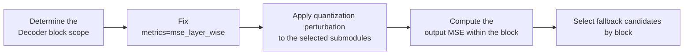

# Layer-Wise MSE Analysis Configuration Workflow Guide

## 1. Scope

This guide is intended for users who need to use the [Layer-Wise MSE Sensitive Layer Analysis Algorithm](./term_mse_layer_wise.md). As a metrics indicator of `msmodelslim analyze layer`, Layer-Wise MSE (`mse_layer_wise`) is used for sensitivity ranking at Decoder-block granularity and supports whole-layer or whole-block fallback decisions.

Applicable scenarios:

- Need to identify the Decoder blocks whose local output is more easily perturbed under the current quantization module scope, forming a fallback/bit-width-increase candidate pool;
- Need to provide a Decoder-block-granularity sensitivity ranking as the basis for whole-layer or whole-block fallback and mixed-precision decisions.

If the goal is to directly generate quantized weights rather than to screen sensitive objects, this guide cannot replace the formal quantization workflow; the analysis score should not be treated as a hard fallback threshold that requires no validation.

To check whether the model is on the officially pre-validated list, see the [Foundation Model Support Matrix](../../model/README.md); for a quick introduction to basic CLI usage, see the [One-Click Quantization Usage Guide](../../../user_guide/usage_one_click_quantization.md).

## 2. Inputs and Deliverables

| Type | Name | Source or Storage Location | Format or Constraints | Acceptance Criteria |
| --- | --- | --- | --- | --- |
| Input | Model to analyze and quantization baseline | Model to analyze, configuration planned for formal quantization | Fix the model version, the target quantization scope, and the quantization baseline; the analysis scope should be consistent with the subsequent actual quantization targets | The model state and candidate scope to be compared in this round of analysis can be clearly identified |
| Input | Calibration data and analysis parameter constraints | Representative calibration data (50 samples recommended), sensitive layer analysis guide, and related configurations | The data distribution should cover the real inputs as much as possible; metrics, `patterns`/scope, and candidate counts use values supported by the current version | The same data, metric definition, and analysis scope are used within one comparison round |
| Deliverable | Layer-wise MSE analysis configuration plan | Sensitive layer analysis command/configuration or review record | Records the metric, analysis scope, number of candidates, and selection rationale; the result serves as candidate input for subsequent fallback or mixed precision | The same analysis conditions can be reproduced stably, and it explains how the candidates are used for subsequent quantization decisions |

## 3. Process Overview

The overall workflow of Layer-Wise MSE analysis is as follows:

Key details of each stage are as follows:

- **Prerequisite: model adaptation.** Model adaptation must be completed before analysis. The adapter implements interfaces such as `PipelineInterface` (the basic pipeline interface); see the [LLM Model Quantization Integration Guide](../../ptq/llm/integration_guide_large_language_model_quantization.md) for details. Model adaptation must be completed first before the analysis workflow can run.
- **Determine the Decoder block scope**: fix the model to analyze and the analysis scope, and keep the analysis scope consistent with the subsequent actual quantization targets; otherwise the ranking cannot guide the final configuration.
- **Fix metrics=mse_layer_wise**: the metric determines the definition of the score and the meaning of the ranking; scores under different `quant_modules` configurations cannot be compared directly with one another.
- **Apply quantization perturbation to the selected submodules**: compare the "current block quantization path" with the floating-point path block by block over the Decoder blocks to obtain the local intervention error.
- **Compute the output MSE within the block**: the calibration data distribution directly determines the MSE statistics and is a core input that affects analysis validity.
- **Select fallback candidates by block**: `top_k` only controls the output size, and high-scoring candidates are only a candidate set; whether to actually fall back should still be decided together with end-to-end accuracy validation.

## 4. Procedure

### Step 1: Confirm Objectives and Constraints

**Action**: Fix the model to analyze, the formal quantization baseline, the calibration data, and the analysis scope. First confirm whether this analysis is meant to screen linear layers, Decoder layers, Attention structures, or other candidate objects, and align the analysis scope with the subsequent actual quantization scope. If the model, calibration data, quantization baseline, or candidate scope change at the same time, the score ranking becomes hard to attribute, so these conditions should be fixed first before adjusting the metric or the number of candidates.

**Output**: A fixed analysis context: model version, quantization baseline, calibration data, analysis scope, and the fallback/mixed-precision problem to be solved.

### Step 2: Establish the Recommended Configuration

**Action**:

- Analysis scope: `layer`;
- `--metrics`: `mse_layer_wise`;
- `--top_k`: start with `15`;
- `--quant_modules`: keep it consistent with the actual quantization plan first; start from `"*"` when uncertain.

**Output**: A reproducible set of sensitivity analysis baseline parameters used to generate the first candidate ranking.

### Step 3: Select and Tune Parameters

**Action**:

| Configuration Item | Meaning (Rationale) | Recommended Configuration | When to Tune |
| --- | --- | --- | --- |
| Analysis scope `layer` | Compares, for each Decoder block, the block output MSE of the "current block quantization path" and of the floating-point path to obtain the local intervention error. | Fixed to `layer`. | Fixed to layer. This metric is suitable for locating the local error caused by the target quantization modules within a Decoder block. |
| `--metrics` | Selects the analysis metric `mse_layer_wise` corresponding to this guide; the metric determines the definition of the score and the meaning of the ranking. | Fixed to `mse_layer_wise`. | Fixed to `mse_layer_wise`. A high score means that the local output of that block is more easily perturbed under the current quantization module scope; scores under different `quant_modules` configurations cannot be compared directly with one another. |
| `--quant_modules` | Specifies which submodules within each Decoder block participate in the quantization comparison according to the analysis template; it should be consistent with the `linear_quant.include` module family in the plan. | Start from `["*"]` when uncertain; aligning directly with the module wildcards to be quantized is more recommended. | The first analysis should cover a candidate scope consistent with the actual quantization plan; narrow it only after confirming that a certain type of module will not be quantized. A change in scope changes the candidate set, so rankings obtained under different scopes should not be compared directly as if they came from the same experiment. |
| `--calibration_dataset` | Calibration data used to collect activations or floating-point/quantized outputs during the forward pass, in **JSON/JSONL format** (an LLM text-sample file such as `mix_calib.jsonl`; for VLM it is a multimodal directory), 50 samples recommended. The data distribution directly determines the statistics, MSE, or head scores, so it is a core input that affects analysis validity rather than a plain file path. | Prefer a calibration set that is **the same as, or drawn from the same distribution as,** the subsequent formal quantization. Use the built-in example only for quick verification. | If the ranking changes noticeably across datasets, first check whether the calibration set covers the real sequence lengths, topics, and input forms before considering a larger `top_k`. Formal fallback decisions should be made on representative data whenever possible. |
| `--top_k` | Controls the number of high-scoring candidates finally displayed or exported. Default: `15`. It does not change the underlying score computation and does not make the algorithm analyze more data. | Start from `15`. | Candidates are only a set for subsequent validation: increase the value when more fallback candidates are needed, and decrease it for quick manual review. Do not treat `top_k` as a sensitivity threshold; the absolute score scale differs across models and metrics. |

### Parameter Combinations and Result Interpretation

- **Fix the calibration set and quantization baseline first, then compare rankings.** If the data, quantization configuration, and analysis scope are changed at the same time, the change in score cannot be attributed.
- **A high score means "more noteworthy under the `mse_layer_wise` definition" and is not equivalent to a mandatory fallback**. The Top-K should be treated as a candidate set and then validated with actual quantization accuracy or model task metrics.
- **`top_k` only changes the output size.** What actually determines *who ranks first* is usually the calibration data, the candidate scope, and the statistical definition of the metric itself.

Layer-wise MSE is more suitable for local fallback candidates. If the final configuration quantizes only the MLP, do not use the all-module scores obtained with `quant_modules="*"` to decide the MLP fallback directly; the analysis scope should be kept consistent with the quantization scope.

**Output**: An analysis configuration with clear parameter meanings and tuning directions, where each modification can be mapped to a change in the ranking.

### Step 4: Interpret Results and Converge the Candidate Plan

**Action**:

- Objects with a higher score enter the "fallback/bit-width-increase candidate pool" first, but whether to actually fall back should still be decided together with end-to-end accuracy validation.
- `top_k` is only the number of candidates displayed, not an accuracy threshold; do not mechanically treat a position such as the 15th as the fallback boundary.
- The analysis scope (`patterns`/`quant_modules`) should be as consistent as possible with the actual quantization scope; otherwise the resulting ranking cannot accurately guide the final YAML.

**Output**: A set of sensitive-object candidates validated by actual quantization or task metrics, together with corresponding suggestions for local fallback, bit-width increase, or protection.

## 5. Terminology

| Term | Brief Description | Link |
| --- | --- | --- |
| Layer-Wise MSE Sensitive Layer Analysis Algorithm | Explains the definition, core principle, key properties, applicable scenarios, and limitations of the algorithm. | [Layer-Wise MSE Sensitive Layer Analysis Algorithm Terminology Entry](./term_mse_layer_wise.md) |

## 6. Related Documents

| API or Document | Brief Description | Link |
| --- | --- | --- |
| Sensitive Layer Analysis Usage Guide | Complete CLI, inputs and outputs, and advanced workflows. | [Sensitive Layer Analysis Usage Guide](../../../user_guide/usage_sensitive_layer_analysis.md) |
| Weight Quantization Usage Guide | User guide: quantization command parameters and complete usage instructions. | [Weight Quantization Usage Guide](../../../user_guide/usage_weight_quantization.md) |
