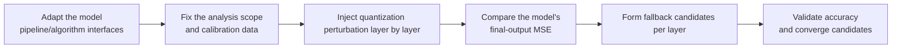

# Model-wise MSE Analysis Configuration Usage Guide

## 1. Scope

This guide is intended for users who need to use the [Model-wise MSE Sensitive Layer Analysis Algorithm](./term_mse_model_wise.md). Model-wise MSE (`mse_model_wise`), as a metrics indicator of `msmodelslim analyze layer`, evaluates the quantization sensitivity of each layer from the perspective of the model's final output, and assists in whole-layer or whole-block fallback decisions.

Applicable scenarios:

- Before low-bit quantization such as W8/W4, you need to locate sensitive layers from an end-to-end output-error perspective and form a fallback or mixed-precision candidate set;
- The ranking of local indicators such as layer-wise is unstable and you need to re-check the sensitive-layer conclusions using the model's final-output MSE.

To check whether the model is on the officially pre-validated list, see the [Foundation Model Support Matrix](../../model/README.md); for a quick introduction to basic CLI usage, see the [One-Click Quantization Usage Guide](../../../user_guide/usage_one_click_quantization.md).

## 2. Inputs and Deliverables

| Type | Name | Source or Storage Location | Format or Constraints | Acceptance Criteria |
| --- | --- | --- | --- | --- |
| Input | Floating-point model weight directory | Model download or a local path | HuggingFace format containing `config.json` and `*.safetensors` shards | Loadable by the target Transformers version |
| Input | Model adapter | User adaptation code, invoked via `--model_type` | Implements the `PipelineInterface` and the corresponding dedicated `MSEModelWiseAnalysisInterface` interface | Properly driven by the runner and processor |
| Input | Calibration dataset | Built-in `lab_calib/` or a user-defined path | Text prompts in JSONL or JSON format; 50 samples recommended | Successfully encoded into forward tensors by the adapter's `handle_dataset` |
| Deliverable | Sensitive layer analysis result | The path specified by `--save_path` (YAML); if unspecified, printed to the console only | The model-wise MSE score and Top-K ranking corresponding to the quantization perturbation of each layer | The result is stable and reproducible and can serve as input for fallback or mixed-precision candidates |

## 3. Process Overview

The overall workflow of Model-wise MSE is as follows:



Key details of each stage are as follows:

- **Adapt the model pipeline/algorithm interfaces**: the adapter must implement the basic `PipelineInterface`; it may optionally implement `MSEModelWiseAnalysisInterface` to provide the hidden-states extraction logic for block I/O. This is the precondition for all subsequent analysis steps.
- **Fix the analysis scope and calibration data**: keep the analysis scope consistent with the actual subsequent quantization scope, and the calibration data (50 samples recommended) should cover the real input distribution; do not change the data or the quantization baseline during analysis, otherwise the ranking cannot be attributed.
- **Inject quantization perturbation layer by layer**: the processor creates a quantization path for each candidate decoder block in turn, replicating the `quant_modules` scope in the formal quantization plan.
- **Compare the model's final-output MSE**: compute the MSE between the model's final output and the floating-point baseline, so that the effect of error propagation to the output is fully included in the evaluation.
- **Form fallback candidates per layer**: take the Top-K candidates ranked by `mse_model_wise` score as the fallback or mixed-precision candidate set, rather than applying a hard threshold.
- **Validate accuracy and converge candidates**: candidates must be validated against actual quantization accuracy or model task metrics before being fixed into the final strategy.

## 4. Procedure

### Step 1: Adapt the Model Pipeline and Algorithm Interfaces

**Goal**: The quantization tool cannot operate directly on models of arbitrary structure; it requires each model to be wrapped in an "adapter" first that translates the model's various operations into standard methods the framework can call uniformly. This step confirms and completes that adapter layer together with the model-wise MSE dedicated interface. **Model adaptation must be completed first before model-wise MSE sensitive layer analysis can run.**

**Action**: The model adaptation code must implement the following interfaces, all of which are aggregated and exported by `msmodelslim.model.interface_hub`:

1. **`PipelineInterface`** (`ModelSlimPipelineInterfaceV1`): the basic pipeline interface, responsible for model loading (`init_model`), data preprocessing (`handle_dataset`), layer-wise traversal (`generate_model_visit`), layer-wise forward pass (`generate_model_forward`), and so on.
2. **`MSEModelWiseAnalysisInterface`** (located at `msmodelslim.processor.analysis.binary_operator_model_wise.metrics.mse_model_wise.interface`): the model-wise MSE analysis dedicated interface (optional).

```python
from abc import ABC, abstractmethod
from typing import Any

import torch

class MSEModelWiseAnalysisInterface(ABC):
    @abstractmethod
    def extract_hidden_states(self, value: Any) -> torch.Tensor:
        """Extract from the block-related data the main tensor used for MSE comparison / inter-layer chained propagation."""
        ...
```

- **`extract_hidden_states`**: extracts the main tensor from the block `forward` return value (Tensor, tuple, ModelOutput, dict, etc.); during inter-layer chained propagation, the processor uses its return value as the first positional arg of the next layer's `forward`.
- When this interface is not implemented, the processor uses `DefaultMSEModelWiseBlockData` to handle common LLM block I/O; structures such as VLMs where the default logic is insufficient must be handled in the adapter.

For a standard open-source LLM implemented with HuggingFace Transformers, it is recommended to build the adapter quickly through compositional inheritance:

```python
from msmodelslim.model.interface_hub import (
    IModel,
    ModelInfoInterface,
    ModelSlimPipelineInterfaceV1 as PipelineInterface,
    # ---- MSE Model Wise algorithm adaptation interfaces (focus of this step) ----
    MSEModelWiseAnalysisInterface,  # Algorithm adaptation: extract block input/output hidden states for block-level MSE comparison
)

class MyModelAdapter(TransformersModel, ModelInfoInterface, PipelineInterface,
                     MSEModelWiseAnalysisInterface):
    def extract_hidden_states(self, value):
        # Extract from the block output the main tensor used for MSE comparison
        ...
```

The adapter is then referenced in the analysis command via `--model_type MyModelAdapter`.

To develop new model adaptation code, see the [LLM Model Quantization Integration Guide](../../ptq/llm/integration_guide_large_language_model_quantization.md).

**Output**: A usable model adapter registered in the framework (invoked via `--model_type`).

### Step 2: Establish the Recommended Configuration

**Action**:

The following parameters establish the **first comparable baseline**.

- Analysis scope: `layer`;
- `--metrics`: `mse_model_wise`;
- `--top_k`: start with `15`;
- `--quant_modules`: keep it consistent with the actual quantization plan; when unsure, start from `"*"`.

**Output**: A reproducible set of sensitivity analysis baseline parameters used to generate the first candidate ranking.

### Step 3: Select and Tune Parameters

**Action**:

Tune only one variable per round and keep the same calibration set and quantization baseline.

| Configuration Item | Meaning (Rationale) | Recommended Configuration | Selection and Tuning Advice |
| --- | --- | --- | --- |
| Analysis scope `layer` | Creates a candidate quantization path for each layer in turn, then computes the MSE between the model's final output and the floating-point baseline. | Fixed to `layer`. | Closer to the end-to-end effect, but execution/storage cost is usually higher than comparing block outputs only. |
| `--metrics` | Specifies the analysis indicator `mse_model_wise` used in this guide, which defines the score and the meaning of the ranking. | Fixed to `mse_model_wise`. | A high score means the layer's quantization perturbation propagates more easily to the model's final output; its numerical scale/ranking differs from other indicators, so thresholds should not be mixed. |
| `--quant_modules` | The module scope actually quantized within each candidate decoder block; replicate the formal quantization plan as closely as possible. | `["*"]` when unsure; align with the actual quantized modules for formal decisions. | Narrow it only when you are certain that a class of modules will not be quantized; do not compare rankings across different scopes directly. |
| `--calibration_dataset` | The calibration data used to collect outputs during the forward pass, in JSON/JSONL format (an LLM text sample file; 50 samples recommended). | The same calibration set as, or one with the same distribution as, the subsequent formal quantization. | When the ranking changes markedly across different data, first check whether the calibration set covers the real lengths and topics. |
| `--top_k` | Controls the number of high-scoring candidates finally displayed or exported. Default: `15`; it does not change the score computation. | Start from `15`. | Increase the value when more fallback candidates are needed, and decrease it for quick manual review; do not treat `top_k` as a sensitivity threshold. |

**Output**: An analysis parameter plan that completes single-variable tuning, with a clear selection rationale and tuning direction for each key field.

### Step 4: Run the Analysis Command

**Goal**: Integrate the above steps and start the model-wise MSE sensitive layer analysis workflow via the CLI.

#### Complete Example: Model-wise MSE Sensitive Layer Analysis

##### Run the command (single-card analysis)

```bash
msmodelslim analyze layer \
  --model_path <float_model_dir> \
  --model_type <model_adapter_name> \
  --metrics mse_model_wise \
  --top_k 15 \
  --quant_modules "*" \
  --calibration_dataset ./mix_calib.jsonl \
  --device npu \
  --device_id 0
```

For multi-card analysis, append `--device_id 0 1 2 3`; to save the result file, append `--save_path <result_dir>` (YAML format); otherwise the result is printed to the console only.

**Output**: The command line outputs the `mse_model_wise` score and Top-K ranking for each layer, as input for subsequent fallback or mixed-precision candidates.

## 5. Terminology

| Term | Brief Description | Link |
| --- | --- | --- |
| Model-wise MSE Sensitive Layer Analysis Algorithm | Explains the definition, core principle, key properties, applicable scenarios, and limitations of the algorithm. | [Model-wise MSE Sensitive Layer Analysis Algorithm Terminology Entry](./term_mse_model_wise.md) |

## 6. Related Documents

| API or Document | Brief Description | Link |
| --- | --- | --- |
| `PipelineInterface` | Model pipeline adaptation interface (data preprocessing, model loading, module traversal). | [LLM Quantization Usage Guide, Step 1](../../ptq/llm/usage_large_language_model_quantization.md) |
| `MSEModelWiseAnalysisInterface` | Model-wise MSE analysis model adaptation interface, exported together from `msmodelslim.model.interface_hub`. | [Interface hub module](../../../../../msmodelslim/model/interface_hub.py) |
| binary_operator_model_wise Configuration Description | Field types, default values, valid values, and complete configuration constraints. | [binary_operator_model_wise Configuration Description](../../../api_reference/config/processor/binary_operator_model_wise.md) |
| modelslim_v1 Configuration Description | Consult this when you need to explore task-level advanced configurations such as runner, prior, save, and dataset. | [modelslim_v1 Configuration Description](../../../api_reference/config/quant/modelslim_v1.md) |
| Weight Quantization Usage Guide | User guide: quantization command parameters and complete usage instructions. | [Weight Quantization Usage Guide](../../../user_guide/usage_weight_quantization.md) |
