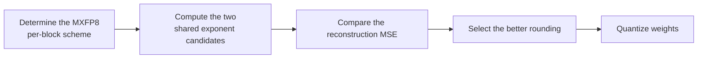

# MSE_Round Parameter Configuration Workflow Guide

## 1. Scope

This guide is intended for users who need to use the [MSE_Round Weight Quantization Algorithm](./term_mse_round.md). As a weight quantization method of the `linear_quant` processor, MSE_Round compares, per block, the MSE of the two shared exponent candidates (ceil/floor) to improve MXFP8 weight quantization accuracy.

Applicable scenarios:

- MXFP8 weight quantization accuracy does not meet the target and the reconstruction error needs to be reduced through per-block rounding selection;
- The target deployment backend explicitly supports the MXFP8 per-block weight format and a better shared exponent rounding strategy is needed.

To check whether the model is on the officially pre-validated list, see the [Foundation Model Support Matrix](../../model/README.md); for a quick introduction to basic CLI usage, see the [One-Click Quantization Usage Guide](../../../user_guide/usage_one_click_quantization.md).

## 2. Inputs and Deliverables

| Type | Name | Source or Storage Location | Format or Constraints | Acceptance Criteria |
| --- | --- | --- | --- | --- |
| Input | Floating-point model weight directory | Model download or a local path | HuggingFace format containing `config.json` and `*.safetensors` shards | Loadable by the target Transformers version |
| Input | Calibration dataset | Built-in `lab_calib/` or a user-defined path | Text prompts in JSONL or JSON format; 50 samples recommended | Readable by the current quantization workflow and covering the main input forms |
| Input | Configuration constraints and practical baseline | This algorithm's configuration description, the target model's existing `lab_practice` recipe (if any) | Field names, supported combinations, scope, and model adaptation are consistent with the current version | The recommended starting point is traceable to the current configuration definition or a verified practice |
| Deliverable | MSE_Round parameter configuration plan | User quantization YAML or task configuration | Parameter values are valid and the scope of effect is explicit; the selection rationale of key parameters is explained | Can serve as algorithm configuration input for the subsequent quantization workflow and can reproduce the baseline selection in this guide |

## 3. Process Overview

The overall workflow of MSE_Round is as follows:



Key details of each stage are as follows:

- **Prerequisite: model adaptation.** Model adaptation must be completed before quantization. The adapter implements interfaces such as `PipelineInterface` (the basic pipeline interface); see the [LLM Model Quantization Integration Guide](../../ptq/llm/integration_guide_large_language_model_quantization.md) for details. Model adaptation must be completed first before the quantization workflow can run.
- **Determine the MXFP8 per-block scheme**: currently MSE_Round only registers MXFP8 per-block symmetric weight quantization, so the main task on the user side is to confirm the format and the axes layout.
- **Compute the two shared exponent candidates**: the algorithm computes two candidates (round-up/round-down) for the shared exponent of each block, without user intervention.
- **Compare the reconstruction MSE**: the algorithm automatically compares the reconstruction MSE of the two candidates and selects the rounding result with the smaller error.
- **Quantize weights**: perform per-block weight quantization according to the selected rounding to improve MXFP8 weight accuracy.
- **Switch to a more robust algorithm if necessary**: if the MXFP8 per-block format itself does not meet the target, switch to MXFP4 or another verified scheme instead of adding extra search parameters to MSE_Round.

## 4. Procedure

### Step 1: Confirm Objectives and Constraints

**Action**: First fix the target model, the final quantization format/bit width, the target objects, and the evaluation baseline, then confirm the parameter combinations supported by the current version. If the target model already has a `lab_practice` recipe, use that recipe as the practical baseline first; when there is no model-specific recipe, use the general recommended starting point given in this guide. If the algorithm relies on calibration statistics or optimization data, also fix representative data before tuning, to avoid mistaking a change in the data distribution for a parameter gain.

**Output**: An explicit configuration objective: target bit width/format, processing scope, calibration conditions, evaluation baseline, and deployment constraints.

### Step 2: Establish the Recommended Configuration

**Action**:

The following configuration establishes the **first comparable baseline**. If the target model already has a `lab_practice` recipe, prefer the verified recipe, then use this section to understand why each parameter is chosen this way.

```yaml
spec:
  process:
    - type: "linear_quant"
      qconfig:
        act:
          scope: "per_block"
          dtype: "mxfp8"
          symmetric: true
          method: "minmax"
        weight:
          scope: "per_block"
          dtype: "mxfp8"
          symmetric: true
          method: "mse_round"
```

**Output**: A reproducible recommended configuration that serves as the comparison baseline for all subsequent parameter adjustments.

### Step 3: Select and Tune Parameters

**Action**:

| Configuration Item | Meaning (Rationale) | Recommended Configuration | Selection and Tuning Advice |
| --- | --- | --- | --- |
| `scope` | Currently MSE_Round only registers MXFP8 per-block weight quantization. | Fixed to `per_block`. | Other scopes are not supported. |
| `dtype` | Currently only `mxfp8` is supported. | Fixed to `mxfp8`. | If MXFP4 is required, the corresponding algorithm should be used. |
| `symmetric` | Currently registered as symmetric MXFP8. | Fixed to `true`. | Do not tune. |
| `method` | Fixed to `mse_round`. For the shared exponent of each block, the algorithm compares the two candidates (round-up/round-down) and selects the one with the smaller reconstruction MSE. | Fixed. | The algorithm already performs the local rounding selection automatically, so there is no need to expose a "round-up/round-down ratio" parameter. |
| `ext.axes` | Determines the dimensions along which the MXFP8 blocks are divided; default `-1`. It changes the block composition and the shared exponent statistics and is an important part of the layout/format. | Usually `-1`. | Modify it only when the target model or the deployment format explicitly requires other axes; changing the axes redefines every block and requires requantization and revalidation. |

### Parameter Combinations and Selection Order

Inside the MSE_Round algorithm, the two exponent roundings are already compared automatically, so the main task on the user side is to confirm the MXFP8 per-block format and the axes; there is no need to manually add extra search knobs.

**Output**: An algorithm parameter plan that completes single-variable tuning, with a clear selection rationale and tuning direction for each key field.

### Step 4: Converge the Parameter Plan Based on Results

**Action**:

- **Run the recommended configuration first, then tune one variable at a time.** Do not change the bit width, granularity, algorithm parameters, and layer scope simultaneously; otherwise it is difficult to attribute an accuracy change to a specific item.
- **Prefer local fallback over raising precision globally.** If only a few layers are sensitive, use `exclude` or a mixed strategy to preserve high precision for them; this is usually more cost-effective than raising the bit width of the entire model.
- **The model's practical configuration and deployment capability take precedence.** The introductory recommendation is meant to establish a stable starting point; if the target model already has a `lab_practice` recipe, prefer reusing the verified combination.

**Output**: A final parameter plan ready for the subsequent quantization workflow, retaining a record of adjustments relative to the recommended configuration.

## 5. Terminology

| Term | Brief Description | Link |
| --- | --- | --- |
| MSE_Round Weight Quantization Algorithm | Explains the definition, core principle, key properties, applicable scenarios, and limitations of the algorithm. | [MSE_Round Weight Quantization Algorithm Terminology Entry](./term_mse_round.md) |

## 6. Related Documents

| API or Document | Brief Description | Link |
| --- | --- | --- |
| linear_quant Configuration Description | Field types, default values, valid values, and complete configuration constraints. | [linear_quant Configuration Description](../../../api_reference/config/processor/linear_quant.md) |
| modelslim_v1 Configuration Description | Consult this when you need to explore task-level advanced configurations such as runner, prior, save, and dataset. | [modelslim_v1 Configuration Description](../../../api_reference/config/quant/modelslim_v1.md) |
| Weight Quantization Usage Guide | User guide: quantization command parameters and complete usage instructions. | [Weight Quantization Usage Guide](../../../user_guide/usage_weight_quantization.md) |
