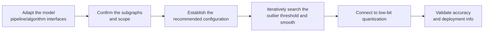

# OASQ Outlier-Aware Smooth Quantization Algorithm Usage Guide

## 1. Scope

This guide is intended for users who need to use the [OASQ Outlier-Aware Smooth Quantization Algorithm](./term_oasq.md). As an outlier-suppression algorithm, OASQ (Outlier-Aware Smooth Quantization) is usually written in `spec.process` of the quantization YAML, as preprocessing before subsequent steps such as linear quantization.

Applicable scenarios:

- The subsequent quantization target (such as W8A8 / W4A8) is already decided and you need to add OASQ to the configuration to suppress activation-channel outliers;
- The activation distribution has significant outlier channels and you need to iteratively search for the outlier threshold and smooth the activation distribution.

Inapplicable scenarios:

- The target model structure cannot provide fusible subgraphs and the default hook probing does not apply either;
- Only one calibration-based quantization pass is needed and no outlier suppression is required.

To check whether the model is on the officially pre-validated list, see the [Foundation Model Support Matrix](../../model/README.md); for a quick introduction to basic CLI usage, see the [One-Click Quantization Usage Guide](../../../user_guide/usage_one_click_quantization.md).

## 2. Inputs and Deliverables

| Type | Name | Source or Storage Location | Format or Constraints | Acceptance Criteria |
| --- | --- | --- | --- | --- |
| Input | Floating-point model weight directory | Model download or a local path | HuggingFace format containing `config.json` and `*.safetensors` shards | Loadable by the target Transformers version |
| Input | Model adapter | User adaptation code, invoked via `--model_type` | Implements `PipelineInterface` and the dedicated `OASQInterface` interface | Properly driven by the runner and processor |
| Input | Calibration dataset | Built-in `lab_calib/` or a user-defined path | Text prompts in JSONL or JSON format; 50 samples recommended | Successfully encoded into forward tensors by the adapter's `handle_dataset` |
| Input | Quantization configuration file | Local YAML file | Complies with the `modelslim_v1` protocol specification | Passes schema validation |
| Deliverable | Quantized weight directory | Path specified by `--save_path` | Contains `quant_model_description.json` and `*.safetensors` shards | Export is complete and the inference smoke test passes |

## 3. Process Overview

The overall workflow of OASQ is as follows:



Key details of each stage are as follows:

- **Adapt the model pipeline/algorithm interfaces**: the adapter must implement the basic `PipelineInterface` and implement `OASQInterface` to provide the fusible subgraph topology. This is the precondition for all subsequent smoothing steps.
- **Confirm the subgraphs and scope**: determine the `enable_subgraph_type` values to enable (such as `norm-linear` and `ov`) and confirm that the subgraphs returned by the adapter cover these types; if the interface is not implemented, it falls back to default hook auto-probing, which may match inaccurately for complex structures.
- **Establish the recommended configuration**: write the OASQ configuration in `spec.process` with default parameters as the comparison starting point for subsequent tuning.
- **Iteratively search the outlier threshold and smooth**: iteratively search for the outlier threshold according to `max_iters`, and perform outlier-aware smoothing on subgraphs such as `norm-linear`, `linear-linear`, `ov`, and `up-down`.
- **Connect to low-bit quantization**: place OASQ before the actual quantization processors, connecting to low-bit quantization steps such as `linear_quant` / `trainable_linear_quant`.
- **Validate accuracy and deployment info**: compare the end-to-end accuracy without OASQ and with OASQ, and decide whether to keep the current configuration or continue fine-tuning.

## 4. Procedure

### Step 1: Adapt the Model Pipeline and Algorithm Interfaces

**Goal**: The quantization tool cannot operate directly on models of arbitrary structure; it requires each model to be wrapped in an "adapter" first that translates the model's various operations into standard methods the framework can call uniformly. This step confirms and completes that adapter layer together with the OASQ dedicated interface. **Model adaptation must be completed first before the OASQ algorithm can run.**

**Action**: The model adaptation code must implement the following interfaces, all of which are aggregated and exported by `msmodelslim.model.interface_hub`:

1. **`PipelineInterface`** (`ModelSlimPipelineInterfaceV1`): the basic pipeline interface, responsible for model loading (`init_model`), data preprocessing (`handle_dataset`), layer-wise traversal (`generate_model_visit`), layer-wise forward pass (`generate_model_forward`), and so on.
2. **`OASQInterface`** (located at `msmodelslim.processor.anti_outlier.oasq.interface`): the OASQ dedicated interface.

```python
from abc import ABC, abstractmethod
from typing import List
from msmodelslim.core.graph.adapter_types import AdapterConfig

class OASQInterface(ABC):
    @abstractmethod
    def get_adapter_config_for_subgraph(self) -> List[AdapterConfig]:
        """Return the subgraph topology to be smoothed, describing the connections between Norm and the subsequent Linear layers."""
        ...
```

- **`get_adapter_config_for_subgraph`**: returns the `List[AdapterConfig]` covering the target structures, describing the fusible subgraph topology; if it is not implemented, it falls back to default hook auto-probing, which may match inaccurately for complex structures.
- If the adapter code is modified, re-run `bash install.sh` in the repository root for the adaptation to take effect.

For a standard open-source LLM implemented with HuggingFace Transformers, it is recommended to build the adapter quickly through compositional inheritance:

```python
from msmodelslim.model.interface_hub import (
    IModel,
    ModelInfoInterface,
    ModelSlimPipelineInterfaceV1 as PipelineInterface,
    # ---- OASQ algorithm adaptation interfaces (focus of this step) ----
    OASQInterface,  # Algorithm adaptation: get_adapter_config_for_subgraph returns subgraph mapping topologies such as norm-linear/ov
)

class MyModelAdapter(TransformersModel, ModelInfoInterface, PipelineInterface, OASQInterface):
    def get_adapter_config_for_subgraph(self):
        # Return the mapping topologies such as norm-linear / ov for each layer of the model
        ...
```

The adapter is then referenced in the quantization command via `--model_type MyModelAdapter`.

To develop new model adaptation code, see the [LLM Model Quantization Integration Guide](../../ptq/llm/integration_guide_large_language_model_quantization.md).

**Output**: A usable model adapter registered in the framework (invoked via `--model_type`).

### Step 2: Establish the Recommended Configuration

**Action**:

The following configuration establishes the **first comparable baseline**. If the target model already has a `lab_practice` recipe containing OASQ, reuse that snippet first.

```yaml
spec:
  process:
    - type: "oasq"
      # For a first try, do not set max_iters explicitly; use the implementation default (currently 8).
      symmetric: true
      enable_subgraph_type:
        - "norm-linear"
        - "linear-linear"
        - "ov"
        - "up-down"
      include: ["*"]
      exclude: []
    # Followed by quantization steps such as linear_quant / trainable_linear_quant
```

Place OASQ **before** the actual quantization processors. `symmetric` should be consistent with the symmetry assumption of the subsequent weight/activation quantization.

**Output**: A reproducible recommended configuration that serves as the comparison baseline for all subsequent parameter adjustments.

### Step 3: Select and Tune Parameters

**Action**:

Change only one variable per round and keep the same calibration set and subsequent quantization configuration.

| Configuration Item | Meaning (Rationale) | Recommended Configuration | Selection and Tuning Advice |
| --- | --- | --- | --- |
| `type` | Processor identifier, fixed to `oasq`. | Fixed. | Not a tuning parameter. |
| `max_iters` | Maximum number of iterations for the outlier-threshold search; when unset, the implementation default is used (currently `8`), and an explicit value must be >0. | Omit it and use the default. | Increase it slightly only when the log shows the iterations are exhausted and the outlier ratio still struggles to fall within the target range. |
| `symmetric` | Whether statistics are collected under the symmetric assumption; when asymmetric, `norm-linear` can enable shift while other subgraphs disable it. | `true`. | Set it to `false` only when the subsequent quantization is explicitly asymmetric and relies mainly on `norm-linear`. |
| `enable_subgraph_type` | The list of subgraph types to which OASQ is applied. | Four types by default; if a practical recipe exists, follow it. | When a certain structure type is ineffective or incompatible, remove that type alone rather than compensating with `max_iters`. |
| `include` / `exclude` | Module-name wildcard allow list / deny list; `exclude` takes precedence. | `include: ["*"]`, `exclude: []`. | Use `exclude` to fall back for locally sensitive or incompatible layers; after changing the scope, re-run the quantization comparison. |

Recommended tuning order: fix `symmetric` and the subgraph types first, then change `include`/`exclude`, and touch `max_iters` last. Change only one item at a time and keep the subsequent quantization configuration and calibration set unchanged.

**Output**: An algorithm parameter plan that completes single-variable tuning, with a clear selection rationale and tuning direction for each key field.

### Step 4: Write the Quantization Configuration and Run the Command

**Goal**: Integrate the above steps into a complete YAML quantization configuration file and start the quantization workflow via the CLI.

#### Complete Example: OASQ + W8A8 Dynamic Quantization

##### Configuration File: `oasq_w8a8.yaml`

```yaml
apiversion: modelslim_v1
spec:
  runner: auto                    # layer_wise for single-card, dp_layer_wise for multi-card
  process:
    - type: oasq                  # Outlier-aware smoothing preprocessing
      symmetric: true
      enable_subgraph_type:
        - "norm-linear"
        - "linear-linear"
        - "ov"
        - "up-down"
      include: ["*"]
      exclude: []
    - type: linear_quant          # connect to low-bit quantization
      qconfig:
        act:
          dtype: int8
          scope: per_token        # dynamic activation quantization, good accuracy
          symmetric: true
          method: minmax
        weight:
          dtype: int8
          scope: per_channel
          symmetric: true
          method: minmax
      include: ["*"]
  save:
    - type: ascendv1_saver        # Ascend inference standard save format
  dataset: mix_calib.jsonl        # built-in mixed calibration set
```

##### Run the command (single-card quantization)

```bash
msmodelslim quant \
  --model_path <float_model_dir> \
  --save_path <quantized_weight_output_dir> \
  --model_type <model_adapter_name> \
  --config ./oasq_w8a8.yaml \
  --device npu \
  --device_id 0
```

**Output**: Complete quantized weight files and description files are generated in the directory specified by `--save_path`.

## 5. Terminology

| Term | Brief Description | Link |
| --- | --- | --- |
| OASQ Outlier-Aware Smooth Quantization Algorithm | Explains the definition, core principle, key properties, applicable scenarios, and limitations of the algorithm. | [OASQ Outlier-Aware Smooth Quantization Algorithm Terminology Entry](./term_oasq.md) |

## 6. Related Documents

| API or Document | Brief Description | Link |
| --- | --- | --- |
| `PipelineInterface` | Model pipeline adaptation interface (data preprocessing, model loading, module traversal). | [LLM Quantization Usage Guide, Step 1](../../ptq/llm/usage_large_language_model_quantization.md) |
| `OASQInterface` | OASQ algorithm model adaptation interface, exported together from `msmodelslim.model.interface_hub`. | [Interface hub module](../../../../../msmodelslim/model/interface_hub.py) |
| oasq Configuration Description | Field types, default values, valid values, and complete configuration constraints. | [oasq Configuration Description](../../../api_reference/config/processor/oasq.md) |
| modelslim_v1 Configuration Description | Consult this when you need to explore task-level advanced configurations such as runner, prior, save, and dataset. | [modelslim_v1 Configuration Description](../../../api_reference/config/quant/modelslim_v1.md) |
| Weight Quantization Usage Guide | User guide: quantization command parameters and complete usage instructions. | [Weight Quantization Usage Guide](../../../user_guide/usage_weight_quantization.md) |
