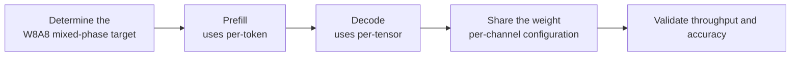

# PDMIX Parameter Configuration Workflow Guide

## 1. Scope

This guide is intended for users who need to use the [PDMIX Inter-Phase Mixed Quantization Algorithm](./term_pdmix.md). As an activation quantization method of the `linear_quant` processor, PDMIX uses dynamic quantization in the Prefilling phase and static quantization in the Decoding phase to balance accuracy and inference performance.

Applicable scenarios:

- Prefill accuracy and Decode performance need to be balanced, with Prefill using per-token dynamic quantization and Decode using per-tensor static quantization;
- The target deployment chain supports the PDMIX inter-phase mixed activation quantization combination and a W8A8C8-type quantization baseline needs to be established.

To check whether the model is on the officially pre-validated list, see the [Foundation Model Support Matrix](../../model/README.md); for a quick introduction to basic CLI usage, see the [One-Click Quantization Usage Guide](../../../user_guide/usage_one_click_quantization.md).

## 2. Inputs and Deliverables

| Type | Name | Source or Storage Location | Format or Constraints | Acceptance Criteria |
| --- | --- | --- | --- | --- |
| Input | Floating-point model weight directory | Model download or a local path | HuggingFace format containing `config.json` and `*.safetensors` shards | Loadable by the target Transformers version |
| Input | Calibration dataset | Built-in `lab_calib/` or a user-defined path | Text prompts in JSONL or JSON format; 50 samples recommended | Readable by the current quantization workflow and covering the main input forms |
| Input | Configuration constraints and practical baseline | This algorithm's configuration description, the target model's existing `lab_practice` recipe (if any) | Field names, supported combinations, scope, and model adaptation are consistent with the current version | The recommended starting point is traceable to the current configuration definition or a verified practice |
| Deliverable | PDMIX parameter configuration plan | User quantization YAML or task configuration | Parameter values are valid and the scope of effect is explicit; the selection rationale of key parameters is explained | Can serve as algorithm configuration input for the subsequent quantization workflow and can reproduce the baseline selection in this guide |

## 3. Process Overview

The overall workflow of PDMIX is as follows:



Key details of each stage are as follows:

- **Prerequisite: model adaptation.** Model adaptation must be completed before quantization. The adapter implements interfaces such as `PipelineInterface` (the basic pipeline interface); see the [LLM Model Quantization Integration Guide](../../ptq/llm/integration_guide_large_language_model_quantization.md) for details. Model adaptation must be completed first before the quantization workflow can run.
- **Determine the W8A8 mixed-phase target**: the four activation fields in PDMIX are basically fixed definitions; first confirm that the target deployment chain supports the `pd_mix` scope and the asymmetric activation combination.
- **Prefill uses per-token**: in the source code, Prefill uses per-token symmetric fake-quantization behavior to guarantee Prefill accuracy.
- **Decode uses per-tensor**: Decode measures and exports per-tensor asymmetric parameters (including the zero-point) to reduce the Decode scale overhead.
- **Share the weight per-channel configuration**: the weights are still determined by the weight qconfig of `linear_quant`; the repository practices pair it with `int8 + per_channel + symmetric + minmax`.
- **Validate throughput and accuracy**: the goal of PDMIX is to balance accuracy and inference performance, so the final criterion is end-to-end throughput and accuracy validation.

## 4. Procedure

### Step 1: Confirm Objectives and Constraints

**Action**: First fix the target model, the final quantization format/bit width, the target objects, and the evaluation baseline, then confirm the parameter combinations supported by the current version. If the target model already has a `lab_practice` recipe, use that recipe as the practical baseline first; when there is no model-specific recipe, use the general recommended starting point given in this guide. If the algorithm relies on calibration statistics or optimization data, also fix representative data before tuning, to avoid mistaking a change in the data distribution for a parameter gain.

**Output**: An explicit configuration objective: target bit width/format, processing scope, calibration conditions, evaluation baseline, and deployment constraints.

### Step 2: Establish the Recommended Configuration

**Action**:

The following configuration establishes the **first comparable baseline**. If the target model already has a `lab_practice` recipe, prefer the verified recipe, then use this section to understand why each parameter is chosen this way.

```yaml
spec:
  process:
    - type: "linear_quant"     # Linear-layer quantization mode processor
      qconfig:
        act: # Activation quantization configuration
          scope: "pd_mix"      # prefilling: per-token; decoding: per-tensor
          dtype: "int8"        # Only INT8 is supported for now
          symmetric: false     # PDMIX quantization is overall asymmetric
          method: "minmax"     # Only the MinMax algorithm is supported for now
        weight: # Weight quantization configuration
          scope: "per_channel" # Currently only weight per_channel quantization is supported
          dtype: "int8"        # Currently only INT8 weight quantization is supported
          symmetric: true      # Only symmetric weight quantization is supported
          method: "minmax"     # Weight quantization algorithm
```

**Output**: A reproducible recommended configuration that serves as the comparison baseline for all subsequent parameter adjustments.

### Step 3: Select and Tune Parameters

**Action**:

| Configuration Item | Meaning (Rationale) | Recommended Configuration | Selection and Tuning Advice |
| --- | --- | --- | --- |
| `qconfig.act.scope` | The dedicated `pd_mix` scope of PDMIX: the calibration/deployment semantics distinguish Prefill from Decode. In the source code, Prefill uses per-token symmetric fake-quantization behavior, while Decode measures and exports per-tensor asymmetric parameters, balancing Prefill accuracy against the Decode scale overhead. | Fixed to `pd_mix`. | This is the algorithm definition; it cannot be replaced by ordinary per-token/per-tensor while still being called PDMIX. |
| `qconfig.act.dtype` | The current PDMIX activation quantizer registers INT8. | Fixed to `int8`. | Another solution should be used when a different bit width is needed. |
| `qconfig.act.symmetric` | The final registered scheme of PDMIX is the asymmetric `int8_pd_mix_asym`, used for the Decode per-tensor zero-point; this is therefore a support constraint, not a free switch to be chosen by looking at the distribution. | Fixed to `false`. | Do not change it to true; there is currently no corresponding symmetric PDMIX registered implementation. |
| `qconfig.act.method` | The current PDMIX activation statistics for Prefill/Decode are collected by the MinMax observer. | Fixed to `minmax`. | This is not a replaceable general method. |
| `qconfig.weight.*` | PDMIX is essentially an activation quantization strategy, and the weights are still determined by the weight qconfig of `linear_quant`. The repository W8A8C8 practice pairs it with `int8 + per_channel + symmetric + minmax`; this is a validated companion configuration, not the only mathematically possible weight form for PDMIX. | For the introductory/reproduction practice, use the INT8 per-channel symmetric MinMax weight. | If the low-bit weight algorithm is to be changed, revalidate the whole PDMIX model according to the supported combinations of that weight quantizer, rather than treating "weights can only be INT8" as a principle constraint of PDMIX. |

### Parameter Combinations and Selection Order

The four activation fields in PDMIX are basically fixed definitions; what is truly variable is which weight quantization combination it is paired with. On first use, reproduce the repository W8A8C8 combination and, after confirming that the activation path is correct, explore the weight side.

**Output**: An algorithm parameter plan that completes single-variable tuning, with a clear selection rationale and tuning direction for each key field.

### Step 4: Converge the Parameter Plan Based on Results

**Action**:

- **Run the recommended configuration first, then tune one variable at a time.** Do not change the bit width, granularity, algorithm parameters, and layer scope simultaneously; otherwise it is difficult to attribute an accuracy change to a specific item.
- **Prefer local fallback over raising accuracy globally.** If only a few layers are sensitive, use `exclude` or a mixed strategy to preserve high accuracy for them; this is usually more cost-effective than raising the bit width of the entire model.
- **The model's practical configuration and deployment capability take precedence.** The introductory recommendation is meant to establish a stable starting point; if the target model already has a `lab_practice` recipe, prefer reusing the verified combination.

**Output**: A final parameter plan ready for the subsequent quantization workflow, retaining a record of adjustments relative to the recommended configuration.

## 5. Terminology

| Term | Brief Description | Link |
| --- | --- | --- |
| PDMIX Inter-Phase Mixed Quantization Algorithm | Explains the definition, core principle, key properties, applicable scenarios, and limitations of the algorithm. | [PDMIX Inter-Phase Mixed Quantization Algorithm Terminology Entry](./term_pdmix.md) |

## 6. Related Documents

| API or Document | Brief Description | Link |
| --- | --- | --- |
| linear_quant Configuration Description | Field types, default values, valid values, and complete configuration constraints. | [linear_quant Configuration Description](../../../api_reference/config/processor/linear_quant.md) |
| modelslim_v1 Configuration Description | Consult this when you need to explore task-level advanced configurations such as runner, prior, save, and dataset. | [modelslim_v1 Configuration Description](../../../api_reference/config/quant/modelslim_v1.md) |
| Weight Quantization Usage Guide | User guide: quantization command parameters and complete usage instructions. | [Weight Quantization Usage Guide](../../../user_guide/usage_weight_quantization.md) |
