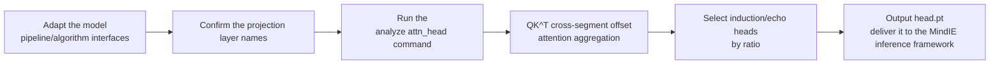

# RA Compress Attention Head Analysis Usage Guide

## 1. Scope

This guide is intended for users who need to use the [RA Compress Attention Head Analysis Algorithm](./term_ra_compress.md). RA Compress (`ra_compress`), as a metrics indicator of `msmodelslim analyze attn_head`, performs screening at KV attention-head granularity, outputs the selected indices of induction heads and echo heads, and delivers them to the MindIE inference framework for long-sequence KV cache compression: users can complete long-sequence compression on this basis, and the compressed model can be used for subsequent inference deployment. For the specific list of supported quantized models, see the "Models supported by MindIE" section of [What Is MindIE](https://www.hiascend.com/document/detail/en/mindie/10RC3/whatismindie/mindie_what_0001.html). This artifact is not written into the quantization configuration.

Applicable scenarios:

- You need to generate the key-head list (`head.pt`) required for KV Cache compression in long-sequence inference;
- You need to understand which KV heads in the model carry cross-segment information transfer (induction / copying heads).

Inapplicable scenarios:

- **Multimodal understanding models (VLMs)** and **multimodal generative models** (text-to-image / text-to-video, etc.): `ra_compress` / `analyze attn_head` currently supports large language models (LLMs) only;
- The adapter for the target `model_type` neither implements `RaCompressAnalysisInterface` nor has Q/K projection layer names that match the default patterns (`q_proj` / `k_proj` / `qkv_proj`).

To check whether the model is on the officially pre-validated list, see the [Foundation Model Support Matrix](../../model/README.md); for a quick introduction to basic CLI usage, see the [One-Click Quantization Usage Guide](../../../user_guide/usage_one_click_quantization.md).

## 2. Inputs and Deliverables

| Type | Name | Source or Storage Location | Format or Constraints | Acceptance Criteria |
| --- | --- | --- | --- | --- |
| Input | Floating-point model weight directory | Model download or a local path | HuggingFace format containing `config.json` and `*.safetensors` shards | Loadable by the target Transformers version |
| Input | Model adapter | User adaptation code, invoked via `--model_type` | Implements `PipelineInterface` and `RaCompressAnalysisInterface` (both `get_proj_names` and `get_tokenizer` must be implemented) | Properly driven by the runner and processor |
| Input | Calibration input | Controlled input constructed by the algorithm itself at runtime | The first token + 2500 random tokens repeated over 4 segments, total length `1 + 2500 × 4` | No user specification needed; `attn_head` does not provide `--calibration_dataset` |
| Input | Quantization configuration file | Local YAML file | Complies with the `modelslim_v1` protocol specification | Passes schema validation |
| Deliverable | `head.pt` | The path specified by `--save_path` | A `.pt` file with a serialized dict containing the `prefix_matching` and `copying` fields | The file exists and can be read by `torch.load`; it is delivered to the MindIE inference framework for long-sequence KV Cache compression and is not written into the quantization configuration |

## 3. Process Overview

The overall workflow of RA Compress is as follows:



Key details of each stage are as follows:

- **Adapt the model pipeline/algorithm interfaces**: the adapter must implement the basic `PipelineInterface` and implement `RaCompressAnalysisInterface`: `get_proj_names` provides the name fragments of the Q/K/QKV projection layers, and `get_tokenizer` returns the model's own tokenizer.
- **Confirm the projection layer names**: in the patterns returned by `get_proj_names()`, an empty string means that projection does not exist; when this interface is not wired in, matching uses the default patterns `q_proj`, `k_proj`, and `qkv_proj`.
- **Run the analyze attn_head command**: start KV attention-head granularity analysis with `--metrics ra_compress`.
- **Q@K^T cross-segment offset attention aggregation**: compute offset attention at segment boundaries to measure the cross-segment information transfer capability of each KV head.
- **Select induction/echo heads by ratio**: induction heads (prefix matching) and echo heads (copying matching) form the selected indices according to ratios (`induction_head_ratio` defaults to 0.14, `echo_head_ratio` defaults to 0.01).
- **Output head.pt and deliver it to the MindIE inference framework**: `head.pt` is delivered to the MindIE inference framework; in MindIE, configure that file path in the parameters related to long-sequence KV Cache compression, and MindIE performs KV Cache compression according to this key-head list during long-sequence inference. Users can complete long-sequence compression on this basis, and the compressed model can be used for subsequent inference deployment; this artifact is not written into the quantization configuration.

## 4. Procedure

### Step 1: Adapt the Model Pipeline and Algorithm Interfaces

**Goal**: The quantization tool cannot operate directly on models of arbitrary structure; it requires each model to be wrapped in an "adapter" first that translates the model's various operations into standard methods the framework can call uniformly. This step confirms and completes that adapter layer together with the RA Compress dedicated interface. **Model adaptation must be completed first before RA Compress attention head analysis can run.**

**Action**: The model adaptation code must implement the following interfaces, all of which are aggregated and exported by `msmodelslim.model.interface_hub`:

1. **`PipelineInterface`** (`ModelSlimPipelineInterfaceV1`): the basic pipeline interface, responsible for model loading (`init_model`), data preprocessing (`handle_dataset`), layer-wise traversal (`generate_model_visit`), layer-wise forward pass (`generate_model_forward`), and so on.
2. **`RaCompressAnalysisInterface`** (located at `msmodelslim.processor.analysis.unary_operator.metrics.ra_compress.interface`): the RA Compress analysis interface; both the `get_proj_names` and `get_tokenizer` methods are required.

```python
from abc import ABC, abstractmethod
from typing import Any, Dict

class RaCompressAnalysisInterface(ABC):
    @abstractmethod
    def get_proj_names(self) -> Dict[str, str]:
        """Return the name fragments of the Q/K/QKV projection layers."""
        ...

    @abstractmethod
    def get_tokenizer(self) -> Any:
        """Return the tokenizer actually used by the model."""
        ...
```

- **`get_proj_names`**: returns a `{"q": "...", "k": "...", "qkv": "..."}` dictionary describing the name fragments of the Q projection layers, the K projection layers, and the fused QKV projection layers. The analysis method matches `nn.Linear` layer names in the model by substring, so a fragment of the name is enough; the full layer name is not required. An empty string means that projection does not exist (it is not treated as "match all Linear"); for example, when there is no QKV fusion, `qkv=""`.
- **`get_tokenizer`**: returns the tokenizer actually used by the model, usually `AutoTokenizer.from_pretrained(model_path)`; the analysis method uses it to obtain the first token of the "repeated segment" in the calibration input. If it returns `None` or raises an exception, the metrics side falls back to a default value and warns, without interrupting the analysis.
- When the model's Q/K projection layers are named `q_proj` / `k_proj` / `qkv_proj`, this interface can be omitted and the tool matches using the default patterns.

For a standard open-source LLM implemented with HuggingFace Transformers, it is recommended to build the adapter quickly through compositional inheritance:

```python
from transformers import AutoTokenizer
from msmodelslim.model.interface_hub import (
    IModel,
    ModelInfoInterface,
    ModelSlimPipelineInterfaceV1 as PipelineInterface,
    # ---- RA Compress algorithm adaptation interfaces (focus of this step) ----
    RaCompressAnalysisInterface,  # Algorithm adaptation: provide the Q/K/QKV projection layer name fragments and the model tokenizer
)

class MyModelAdapter(TransformersModel, ModelInfoInterface, PipelineInterface,
                     RaCompressAnalysisInterface):
    def get_proj_names(self):
        # Return the model's actual Q/K/QKV projection layer name fragments
        return {"q": "q_proj", "k": "k_proj", "qkv": "qkv_proj"}

    def get_tokenizer(self):
        # Return the tokenizer actually used by the model, usually the same one used when loading it
        return AutoTokenizer.from_pretrained(model_path)
```

The adapter is then referenced in the analysis command via `--model_type MyModelAdapter`.

To develop new model adaptation code, see the [LLM Model Quantization Integration Guide](../../ptq/llm/integration_guide_large_language_model_quantization.md).

**Output**: A usable model adapter registered in the framework (invoked via `--model_type`).

### Step 2: Establish the Recommended Configuration

**Action**:

The following parameters establish the **first comparable baseline**.

- `--metrics`: `ra_compress`;
- Calibration input: `attn_head` does not provide `--calibration_dataset`; the `ra_compress` calibration input is constructed by the algorithm itself at runtime;
- Selection ratio of top heads: use the implementation's internal defaults (induction head `0.14`, echo head `0.01`); the CLI does not provide related parameters, so keep the defaults. If adjustment is genuinely needed, see the [unary_analysis Configuration Description](../../../api_reference/config/processor/unary_analysis.md);
- `--save_path`: specifies the directory where `head.pt` is saved.

**Output**: A reproducible set of attention head analysis baseline parameters used to generate the first induction/echo heads ranking.

### Step 3: Select and Tune Parameters

**Action**:

Change only one variable per round and keep the same model version.

| Configuration Item | Meaning (Rationale) | Recommended Configuration | Selection and Tuning Advice |
| --- | --- | --- | --- |
| `attn_head` | The KV attention-head granularity analysis subcommand. | Fixed. | Not a tuning parameter. |
| `--metrics` | Specifies the analysis algorithm; a value of `ra_compress` uses this algorithm. | Fixed to `ra_compress`. | Not a tuning parameter. |
| `--save_path` | The directory where `head.pt` is saved. | Specify as needed. | Ensure the directory exists and is writable. |
| `--trust_remote_code` | Whether to trust the model's remote code. | Set to `true` when the model contains custom code. | Set it according to the model's requirements. |

> The table above lists only the CLI parameters covered by this guide. The selection ratios of induction heads / echo heads (`induction_head_ratio`, `echo_head_ratio`) are not CLI parameters; the command-line workflow uses the implementation's internal defaults. The configuration entry corresponding to these ratios is the `metric_params` field of the `unary_analysis` processor on the configuration side; for the field meaning, default values, and adjustment method, see the [unary_analysis Configuration Description](../../../api_reference/config/processor/unary_analysis.md).

**Output**: An analysis configuration with clear parameter meanings and adjustment directions.

### Step 4: Write the Quantization Configuration and Run the Command

**Goal**: Integrate the above steps into a complete command and start the attention head analysis workflow via the CLI.

#### Complete Example: RA Compress Attention Head Analysis

##### Run the command (single-card analysis)

```bash
msmodelslim analyze attn_head \
  --model_path <float_model_dir> \
  --model_type <model_adapter_name> \
  --metrics ra_compress \
  --trust_remote_code true \
  --save_path ./head_result \
  --device npu \
  --device_id 0
```

Parameter description:

| Parameter | Description |
| --- | --- |
| `attn_head` | KV attention-head granularity analysis |
| `--metrics` | Specifies the analysis algorithm; a value of `ra_compress` uses this algorithm |
| `--device` | The analysis device; values are `npu` and `cpu` |
| `--device_id` | Device index, such as `0`; passing multiple indices (such as `0 1 2 3`) enables multi-card analysis |
| `--save_path` | The directory where `head.pt` is saved |

> `attn_head` does not provide `--calibration_dataset` (nor `--top_k`; passing it raises `unrecognized arguments`): the `ra_compress` calibration input (the first token plus a random repeated segment) is constructed by the algorithm itself at runtime.

**Output**: The command line prints the list of selected induction heads / echo heads; `head.pt` (containing the `prefix_matching` and `copying` fields) is generated in the `--save_path` directory and delivered to the MindIE inference framework for long-sequence KV Cache compression; it is not written into the quantization configuration.

Confirm the `head.pt` structure as `{"prefix_matching": {layer_idx: [kv_head_idx, ...]}, "copying": {layer_idx: [kv_head_idx, ...]}}`, then configure that file path in the long-sequence KV Cache compression parameters in MindIE, and you can complete long-sequence inference deployment with the compression configuration. For the specific list of supported quantized models, see the "Models supported by MindIE" section of [What Is MindIE](https://www.hiascend.com/document/detail/en/mindie/10RC3/whatismindie/mindie_what_0001.html).

## 5. Terminology

| Term | Brief Description | Link |
| --- | --- | --- |
| RA Compress Attention Head Analysis Algorithm | Explains the definition, core principle, key properties, applicable scenarios, and limitations of the algorithm. | [RA Compress Long-Sequence Compression Algorithm Terminology Entry](./term_ra_compress.md) |

## 6. Related Documents

| API or Document | Brief Description | Link |
| --- | --- | --- |
| `RaCompressAnalysisInterface` | RA Compress analysis model adaptation interface (must implement `get_proj_names` and `get_tokenizer`), exported together from `msmodelslim.model.interface_hub`. | [Interface hub module](../../../../../msmodelslim/model/interface_hub.py) |
| unary_analysis Configuration Description | Field types, default values, valid values, and complete configuration constraints. | [unary_analysis Configuration Description](../../../api_reference/config/processor/unary_analysis.md) |
| modelslim_v1 Configuration Description | Consult this when you need to explore task-level advanced configurations such as runner, prior, save, and dataset. | [modelslim_v1 Configuration Description](../../../api_reference/config/quant/modelslim_v1.md) |
| Weight Quantization Usage Guide | User guide: quantization command parameters and complete usage instructions. | [Weight Quantization Usage Guide](../../../user_guide/usage_weight_quantization.md) |
