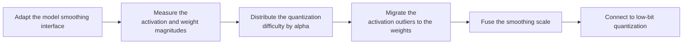

# SmoothQuant Smooth Quantization Algorithm Usage Guide

## 1. Scope

This guide is intended for users who need to use the [SmoothQuant Smooth Quantization Algorithm](./term_smooth_quant.md). As an outlier suppression algorithm, SmoothQuant is usually a preprocessing step before quantization, used to migrate activation outliers to the weights proportionally and improve the accuracy of low-bit quantization.

Applicable scenarios:

- The activation distribution has significant outlier channels, causing accuracy degradation under direct W8A8 quantization;
- The model has a standard `Norm-Linear` structure (such as a Linear following LayerNorm/RMSNorm), and the activation dynamic range can be migrated to the weights through a mathematically equivalent transformation.

To check whether the model is on the officially pre-validated list, see the [Foundation Model Support Matrix](../../model/README.md); for a quick introduction to basic CLI usage, see the [One-Click Quantization Usage Guide](../../../user_guide/usage_one_click_quantization.md).

## 2. Inputs and Deliverables

| Type | Name | Source or Storage Location | Format or Constraints | Acceptance Criteria |
| --- | --- | --- | --- | --- |
| Input | Floating-point model weight directory | Model download or a local path | HuggingFace format containing `config.json` and `*.safetensors` shards | Loadable by the target Transformers version |
| Input | Model adapter | User adaptation code, invoked through `--model_type` | Implements the `PipelineInterface` and `SmoothQuantInterface` interfaces | Can be driven normally by the runner and the processor |
| Input | Calibration dataset | Built-in `lab_calib/` or a user-defined path | Text prompts in JSONL or JSON format; 50 samples recommended | Successfully encoded into forward tensors by the adapter's `handle_dataset` |
| Input | Quantization configuration file | Local YAML file | Complies with the `modelslim_v1` protocol specification | Passes schema validation |
| Deliverable | Quantized weight directory | Path specified by `--save_path` | Contains `quant_model_description.json` and `*.safetensors` shards | Export is complete and the inference smoke test passes |

## 3. Process Overview

The overall workflow of SmoothQuant is as follows:



Key details of each stage are as follows:

- **Adapt the model smoothing interface**: the adapter needs to implement `SmoothQuantInterface` and provide the model's `Norm-Linear` subgraph structure mapping, which is the prerequisite for the smoothing algorithm to locate the target modules.
- **Measure the activation and weight magnitudes**: run a forward pass with the calibration dataset (50 samples recommended) and measure the maximum-absolute-value activation and the weight magnitude of each channel.
- **Distribute the quantization difficulty by alpha**: use the hyperparameter `alpha` to balance the scaling factors of the activations and the weights.
- **Migrate the activation outliers to the weights**: compute the channel-level scaling vector and migrate the activation outlier magnitude into the weights of the subsequent linear layer equivalently.
- **Fuse the smoothing scale**: absorb and fuse the inverse of the scaling factor into the preceding LayerNorm/RMSNorm to preserve mathematical equivalence.
- **Connect to low-bit quantization**: after smoothing, the tensor distribution is flatter, so connecting to `linear_quant` performs W8A8 offline quantization.

## 4. Procedure

### Step 1: Adapt the Model Pipeline and Smoothing Interfaces

**Goal**: The quantization tool cannot directly operate on models with arbitrary structures; an adapter is needed to convert model operations into standard methods. For SmoothQuant, the model adapter must inherit and implement the pipeline interface and the smoothing interface. Model adaptation must be completed before the SmoothQuant algorithm can run.

**Action**: The model adaptation code must implement the following interfaces, all of which are aggregated and provided by `msmodelslim.model.interface_hub`:

1. **`PipelineInterface`** (`ModelSlimPipelineInterfaceV1`): the basic pipeline interface, responsible for model loading (`init_model`), data preprocessing (`handle_dataset`), layer-wise traversal (`generate_model_visit`), layer-wise forward pass (`generate_model_forward`), and so on.
2. **`SmoothQuantInterface`** (located in `msmodelslim.processor.anti_outlier.smooth_quant.interface`): the dedicated smooth quantization interface.

```python
from abc import ABC, abstractmethod
from typing import List
from msmodelslim.core.graph.adapter_types import AdapterConfig

class SmoothQuantInterface(ABC):
    @abstractmethod
    def get_adapter_config_for_subgraph(self) -> List[AdapterConfig]:
        """Return the subgraph topology to be smoothed, describing the connections between Norm and the subsequent Linear layers."""
        ...
```

For a standard open-source LLM implemented with HuggingFace Transformers, it is recommended to build the adapter through compositional inheritance:

```python
from msmodelslim.model.interface_hub import (
    IModel,
    ModelInfoInterface,
    ModelSlimPipelineInterfaceV1 as PipelineInterface,
    # ---- SmoothQuant algorithm adaptation interfaces (the focus of this step) ----
    SmoothQuantInterface,  # Algorithm adaptation: get_adapter_config_for_subgraph returns the norm-linear mapping topology
)

class MyModelAdapter(TransformersModel, ModelInfoInterface, PipelineInterface, SmoothQuantInterface):
    def get_adapter_config_for_subgraph(self):
        # Returns the norm-linear mapping topology of each layer of the model
        ...
```

To develop new model adaptation code, see the [LLM Model Quantization Integration Guide](../../ptq/llm/integration_guide_large_language_model_quantization.md).

**Output**: A usable model adapter registered in the framework (invoked via `--model_type`).

### Step 2: Establish the Recommended Configuration

**Action**:

The following configuration establishes the **first comparable baseline**. If the target model already has a `lab_practice` recipe, prefer the verified recipe.

```yaml
spec:
  process:
    - type: "smooth_quant"
      alpha: 0.5
      symmetric: true
      include: ["*"]
      exclude: []
```

**Output**: A reproducible recommended configuration that serves as the comparison baseline for all subsequent parameter adjustments.

### Step 3: Select and Tune Parameters

**Action**:

msModelSlim implementation entry point:
[View the corresponding implementation directory](../../../../../msmodelslim/processor/anti_outlier/smooth_quant)

| Configuration Item | Meaning (Rationale) | Recommended Configuration | Selection and Tuning Advice |
| --- | --- | --- | --- |
| `type` | Processor identifier, fixed to `smooth_quant`. The current processor mainly applies to the `norm-linear` smoothing structure. | Fixed. | Do not tune. |
| `alpha` | The SmoothQuant activation/weight dynamic-range migration exponent, 0~1, default `0.5`. A larger alpha usually compresses the activation outliers more strongly, shifting the quantization difficulty to the weights; a smaller one protects the weights more conservatively. | Start from `0.5`. | Increase it moderately if the subsequent activation quantization error clearly dominates; decrease it if the low-bit weight error becomes the main bottleneck. Keep the subsequent qconfig fixed in each comparison, otherwise the real effect of alpha cannot be attributed. |
| `symmetric` | Determines the post-smoothing quantization assumption; the current implementation uses it to decide whether to enable the shift (in the asymmetric case, a center shift can be applied to norm-linear). | Use `true` for the conventional W8A8 symmetric scheme. | Set it to false only when the subsequent quantization really adopts asymmetric and the deployment chain supports the shift/fusion. It should be consistent with the subsequent quantization scheme. |
| `include` | The scope allowlist, which uses module name patterns to determine which matched modules enter the current algorithm. | When there is no model-specific recipe, start from `["*"]`; when a recipe exists, follow its module scope directly. | First ensure the scope covers the expected modules, then look at accuracy. When narrowing the scope, prefer adjusting by structure family or known sensitive layers. |
| `exclude` | The scope blacklist; a match is removed from the `include` candidates and takes priority over `include`. It is suitable for protecting sensitive layers, the first/last layers, or model-specific incompatible structures. | Keep it as an empty list by default; add entries only when a practical recipe, compatibility constraint, or sensitivity result provides explicit evidence. | For local accuracy problems, prefer a small-scope fallback through `exclude`, which preserves the gain more easily than raising the whole-model bit width or disabling the entire algorithm. |

#### Parameter Combinations and Selection Order

**Finally tune only one main knob**: the direction of `alpha` should be decided by whether the activation side or the weight side is harder to quantize. Start with 0.5, compare the errors under the same W/A qconfig, and then adjust in only one direction.

**Output**: An algorithm parameter plan that completes single-variable tuning, with a clear selection rationale and tuning direction for each key field.

### Step 4: Write the Quantization Configuration and Run the Command

**Goal**: Integrate the above steps into a complete YAML quantization configuration file and start the quantization workflow via the CLI.

#### Complete Example: SmoothQuant + W8A8 Static Quantization

##### Configuration File: `smooth_quant_w8a8.yaml`

```yaml
apiversion: modelslim_v1
spec:
  runner: auto
  process:
    - type: smooth_quant
      alpha: 0.5
      symmetric: true
      include: ["*"]
    - type: linear_quant
      qconfig:
        act:
          dtype: int8
          scope: per_token
          symmetric: true
          method: minmax
        weight:
          dtype: int8
          scope: per_channel
          symmetric: true
          method: minmax
      include: ["*"]
  save:
    - type: ascendv1_saver
  dataset: mix_calib.jsonl
```

##### Run the command (single-card quantization)

```bash
msmodelslim quant \
  --model_path <float_model_dir> \
  --save_path <quantized_weight_output_dir> \
  --model_type <model_adapter_name> \
  --config ./smooth_quant_w8a8.yaml \
  --device npu \
  --device_id 0
```

**Output**: Complete quantized weight files and description files are generated in the directory specified by `--save_path`.

## 5. Terminology

| Term | Brief Description | Link |
| --- | --- | --- |
| SmoothQuant Smooth Quantization Algorithm | Explains the definition, core principle, key properties, applicable scenarios, and limitations of the algorithm. | [SmoothQuant Smooth Quantization Algorithm Terminology Entry](./term_smooth_quant.md) |

## 6. Related Documents

| API or Document | Brief Description | Link |
| --- | --- | --- |
| `PipelineInterface` | Model pipeline adaptation interface (data preprocessing, model loading, module traversal). | [LLM Quantization Usage Guide, Step 1](../../ptq/llm/usage_large_language_model_quantization.md) |
| `SmoothQuantInterface` | The model adaptation interface of the SmoothQuant algorithm, exported together from `msmodelslim.model.interface_hub`. | [Interface hub module](../../../../../msmodelslim/model/interface_hub.py) |
| smooth_quant Configuration Description | Field types, default values, valid values, and complete configuration constraints. | [smooth_quant Configuration Description](../../../api_reference/config/processor/smooth_quant.md) |
| modelslim_v1 Configuration Description | Consult this when you need to explore task-level advanced configurations such as runner, prior, save, and dataset. | [modelslim_v1 Configuration Description](../../../api_reference/config/quant/modelslim_v1.md) |
| Weight Quantization Usage Guide | User guide: quantization command parameters and complete usage instructions. | [Weight Quantization Usage Guide](../../../user_guide/usage_weight_quantization.md) |
