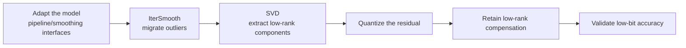

# SVDQuant Parameter Configuration Workflow Guide

## 1. Scope

The SVDQuant low-rank residual quantization solution. SVDQuant performs low-bit quantization for scenarios such as diffusion models through the three-stage `iter_smooth → svd_res → linear_quant` pipeline.

## 2. Inputs and Deliverables

| Type | Name | Source or Storage Location | Format or Constraints | Acceptance Criteria |
| --- | --- | --- | --- | --- |
| Input | Target model and quantization objective | The model to quantize and the deployment/evaluation plan | Clarifies the target numerical format or bit width, the target modules, the accuracy/performance goals, and the deployment constraints | Explains why this algorithm is chosen and where it fits in the overall quantization plan |
| Input | Model adapter | User adaptation code, invoked via `--model_type` | Implements the `PipelineInterface` and `IterSmoothInterface` interfaces | Properly driven by the runner and processor |
| Input | Configuration constraints and practical baseline | This algorithm's configuration description, the target model's existing `lab_practice` recipe (if any) | Field names, supported combinations, scope, and model adaptation are consistent with the current version | The recommended starting point is traceable to the current configuration definition or a verified practice |
| Input | Calibration data (when required by the algorithm) | Task `dataset`, a calibration set, or a model practice recipe | The data should represent the real input distribution; for multi-stage algorithms, keep the data distribution consistent across stages | Readable by the current quantization workflow and covering the main input forms |
| Deliverable | SVDQuant parameter configuration plan | The user's quantization YAML or task configuration | Parameter values are valid and the scope is explicit; key parameters state the rationale for the choice | Can serve as the algorithm configuration input for the subsequent quantization workflow and can reproduce the baseline choices in this guide |

## 3. Process Overview



## 4. Procedure

### Step 1: Adapt the Model Pipeline and Smoothing Interfaces

**Goal**: The first stage of SVDQuant performs outlier migration via the `iter_smooth` processor. In addition to the basic pipeline interface, the model adapter must also implement the iterative smoothing dedicated interface that describes the model's smoothing subgraph topology. Model adaptation must be completed first before the three-stage SVDQuant pipeline can run.

**Action**: The model adaptation code must implement the following interfaces, all of which are aggregated and provided by `msmodelslim.model.interface_hub`:

1. **`PipelineInterface`** (`ModelSlimPipelineInterfaceV1`): the basic pipeline interface, responsible for model loading (`init_model`), data preprocessing (`handle_dataset`), layer-wise traversal (`generate_model_visit`), layer-wise forward pass (`generate_model_forward`), and so on.
2. **`IterSmoothInterface`**: the iterative smoothing dedicated interface, which provides the model's smoothing subgraph topology configuration describing the connections between Norm and subsequent Linear, OV, up/down and other structures, so that the smoothing processor can locate the modules to be smoothed.

For the compositional-inheritance construction method and a code example for the adapter, see Step 1 of the [Iterative Smooth Iterative Smoothing Algorithm Usage Guide](../iterative_smooth/usage_iterative_smooth.md). The subsequent `svd_res` and `linear_quant` stages are driven by standard pipeline methods and require no additional dedicated interfaces. The adapter is then referenced in the quantization command via `--model_type`.

To develop new model adaptation code, see the [LLM Model Quantization Integration Guide](../../ptq/llm/integration_guide_large_language_model_quantization.md). Note that model adaptation must be completed first before the subsequent quantization workflow can run.

**Output**: A usable model adapter registered in the framework (invoked via `--model_type`).

### Step 2: Establish the Recommended Configuration

**Action**:

The following configuration establishes the **first comparable baseline**. If the target model already has a `lab_practice` recipe, prefer the verified recipe, then use this section to understand why each parameter is chosen this way.

```yaml
spec:
  process:
    # Stage 1: outlier migration
    - type: "iter_smooth"
      alpha: 0.25
      include: ["*"]
      exclude: ["*blocks.0.*"]

    # Stage 2: low-rank residual decomposition
    - type: "svd_res"
      rank: 32
      include: ["*"]
      exclude: ["*blocks.0.*"]

    # Stage 3: residual quantization (W4A4 MXFP4)
    - type: "linear_quant"
      qconfig:
        act:
          scope: "per_block"
          dtype: "mxfp4"
          symmetric: True
          method: "minmax"
        weight:
          scope: "per_block"
          dtype: "mxfp4"
          symmetric: True
          method: "minmax"
      include: ["*"]
      exclude: ["*blocks.0.*"]
```

**Output**: A reproducible recommended configuration that serves as the comparison baseline for all subsequent parameter adjustments.

### Step 3: Select and Tune Parameters

**Action**:

| Configuration Item | Meaning (Rationale) | Recommended Configuration | Selection and Tuning Advice |
| --- | --- | --- | --- |
| `iter_smooth.alpha` | The first stage migrates outliers first, reducing the numerical pressure on the subsequent low-rank residual and the low-bit backbone. The diffusion-model example in this document uses `0.25`, which is more conservative than the generic IterSmooth default of 0.9, avoiding over-migrating activation difficulty onto the weights. | Start with the model example value `0.25`; for other models, prefer their verified recipes. | Tune smoothing again only when the residual is still dominated by a few outliers; if the low-rank branch has to carry too much information or the weight-side error rises, reduce smoothing. Do not change alpha and rank at the same time, or the source of the gain becomes hard to attribute. |
| `svd_res.type` | The stage-2 processor identifier, fixed to `svd_res`. | Fixed. | Not a tuning parameter. |
| `svd_res.rank` | The rank of the low-rank residual branch, default `32`. A larger rank lets the low-rank branch retain more hard-to-quantize structure, but adds extra parameters/computation; too small a rank pushes more information back into the low-bit residual. | Start from `32`. | Increase it when residual quantization is already fixed but task accuracy is insufficient and the analysis shows that the low-rank decomposition can still explain the main error; decrease it when resource constraints matter more and 32 has margin. Compare discrete candidates such as 32 → higher/lower rather than tuning continuously in small steps. |
| `svd_res.include/exclude` | Determines which layers generate the low-rank residual branch. It should be coordinated with the layer scope of the stage-1 smoothing and the stage-3 residual quant, otherwise some layers pass through only part of the pipeline. | Use a consistent main scope and exception layers across the three stages where possible; the example excludes the first block in all of them. | If a layer is unsuitable for low-rank compensation, exclude it consistently in the relevant stages. Inconsistent scopes make accuracy changes hard to explain and may create unexpected data paths. |
| `linear_quant` | The third stage quantizes the backbone/residual into the target low-bit format. The example uses MXFP4 per-block MinMax; it determines the final bit width and deployment format. | Fix the target deployment qconfig first, then tune rank. | If accuracy is insufficient, first increase rank or adjust the layer scope to determine whether it is a low-rank capacity problem; raise the residual bit width only as a last step. Raising the bit width first would mask whether the SVD decomposition is effective. |

#### Parameter Combinations and Selection Order

SVDQuant recommends strictly following the order: **scope consistency → fix the final residual qconfig → tune rank → fine-tune the smoothing alpha last**. Changing the three stages at the same time makes the error source unattributable. Change only one variable per round and keep the same calibration set and evaluation set; if an adjustment yields no stable gain, revert to the previous baseline.

**Output**: An algorithm parameter plan that completes single-variable tuning, with a clear selection rationale and tuning direction for each key field.

### Step 4: Write the Quantization Configuration and Run the Command

**Goal**: Integrate the above steps into a complete YAML quantization configuration file and start the quantization workflow via the CLI.

#### Complete Example: SVDQuant W4A4 MXFP4 Quantization (Recommended Starting Point)

##### Configuration File: `svdquant_w4a4_mxfp4.yaml`

```yaml
apiversion: multimodal_sd_modelslim_v1
spec:
  process:
    - type: iter_smooth             # Stage 1: outlier migration
      alpha: 0.25
      include: ["*"]
      exclude: ["*blocks.0.*"]
    - type: svd_res                 # Stage 2: low-rank residual decomposition
      rank: 32
      include: ["*"]
      exclude: ["*blocks.0.*"]
    - type: linear_quant            # Stage 3: residual quantization (W4A4 MXFP4)
      qconfig:
        act:
          dtype: mxfp4
          scope: per_block
          symmetric: true
          method: minmax
        weight:
          dtype: mxfp4
          scope: per_block
          symmetric: true
          method: minmax
      include: ["*"]
      exclude: ["*blocks.0.*"]
  dataset: <diffusion_model_calibration_set>   # Text or image prompts matching the training/inference distribution
  save:
    - type: mindie_format_saver     # MindIE SD diffusion model save format
      part_file_size: 0
```

##### Run the command (single-card quantization)

```bash
msmodelslim quant \
  --model_path <float_model_dir> \
  --save_path <quantized_weight_output_dir> \
  --model_type <model_adapter_name> \
  --config ./svdquant_w4a4_mxfp4.yaml \
  --device npu \
  --device_id 0
```

**Output**: Complete quantized weight files and description files are generated in the directory specified by `--save_path`.

## 5. Terminology

| Term | Brief Description | Link |
| --- | --- | --- |
| SVDQuant Low-Rank Residual Quantization Algorithm | Explains the definition, core principle, key properties, applicable scenarios, and limitations of the algorithm. | [SVDQuant Low-Rank Residual Quantization Algorithm Terminology Entry](./term_svdquant.md) |

## 6. Related Documents

| API or Document | Brief Description | Link |
| --- | --- | --- |
| `PipelineInterface` / `IterSmoothInterface` | Model pipeline and SVDQuant algorithm adaptation interfaces, both exported together from `msmodelslim.model.interface_hub`. | [Interface hub module](../../../../../msmodelslim/model/interface_hub.py) |
| svd_res Configuration Description | Field types, default values, valid values, and complete configuration constraints. | [svd_res Configuration Description](../../../api_reference/config/processor/svd_res.md) |
| iter_smooth Configuration Description | Parameters of the other processors in the three-stage pipeline. | [iter_smooth Configuration Description](../../../api_reference/config/processor/iter_smooth.md) |
| modelslim_v1 Configuration Description | Consult this when you need to explore task-level advanced configurations such as runner, prior, save, and dataset. | [modelslim_v1 Configuration Description](../../../api_reference/config/quant/modelslim_v1.md) |
| Weight Quantization Usage Guide | User guide: quantization command parameters and complete usage instructions. | [Weight Quantization Usage Guide](../../../user_guide/usage_weight_quantization.md) |
