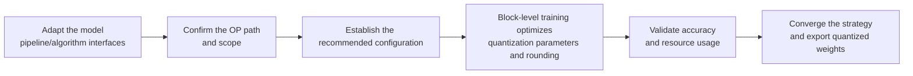

# Trainable Linear Quantization Algorithm Usage Guide

## 1. Scope

This guide is intended for users who need to use the [Trainable Linear Quantization Algorithm](./term_trainable_linear_quant.md). Trainable Linear Quant (TLQ, `trainable_linear_quant`), as a linear-layer quantization processor, is usually written in `spec.process` of the quantization YAML and optimizes quantization parameters and rounding through block-level training; it is mainly used for accuracy enhancement in extremely low-bit scenarios such as W4A4.

Applicable scenarios:

- The target is low-bit linear quantization such as W4A4, a single calibration pass is not accurate enough, and you can accept higher quantization time and memory usage in exchange for better reconstruction accuracy;
- You need learnable quantization parameter tuning (`minmax_tune`) and rounding optimization (`round_tune`), or trainable outlier suppression (`trainable_smooth`).

Inapplicable scenarios:

- You only need a relatively high bit width such as W8 and a single calibration pass is sufficient;
- The target dtype/scope/method has no corresponding TLQ kernel;
- The device memory/duration cannot support block-level training.

> **Resource note**: TLQ includes block-level training, so quantization time and memory usage are significantly higher than single-calibration algorithms such as MinMax / Linear Quant; before formal runs, reserve a sufficient NPU memory and time budget.

To check whether the model is on the officially pre-validated list, see the [Foundation Model Support Matrix](../../model/README.md); for a quick introduction to basic CLI usage, see the [One-Click Quantization Usage Guide](../../../user_guide/usage_one_click_quantization.md).

## 2. Inputs and Deliverables

| Type | Name | Source or Storage Location | Format or Constraints | Acceptance Criteria |
| --- | --- | --- | --- | --- |
| Input | Floating-point model weight directory | Model download or a local path | HuggingFace format containing `config.json` and `*.safetensors` shards | Loadable by the target Transformers version |
| Input | Model adapter | User adaptation code, invoked via `--model_type` | Implements `PipelineInterface` and the dedicated `TLQBlockDataInterface` interface (as needed) | Properly driven by the runner and processor |
| Input | Calibration dataset | Built-in `lab_calib/` or a user-defined path | Text prompts in JSONL or JSON format; 50 samples recommended | Successfully encoded into forward tensors by the adapter's `handle_dataset` |
| Input | Quantization configuration file | Local YAML file | Complies with the `modelslim_v1` protocol specification | Passes schema validation |
| Deliverable | Quantized weight directory | Path specified by `--save_path` | Contains `quant_model_description.json` and `*.safetensors` shards | Export is complete and the inference smoke test passes |

## 3. Process Overview

The overall workflow of TLQ is as follows:



Key details of each stage are as follows:

- **Adapt the model pipeline/algorithm interfaces**: the adapter must implement the basic `PipelineInterface`; for complex block structures where the default block data handling is insufficient, implement `TLQBlockDataInterface` to fill in the block I/O customization.
- **Confirm the OP path and scope**: configure `operations` according to the target (`minmax_tune`, `round_tune`, and `trainable_smooth` can each be used independently), and determine the low-bit target of `strategies` together with `include`/`exclude`.
- **Establish the recommended configuration**: write the recommended W4A4 starting configuration into `spec.process` as the comparison starting point for subsequent tuning.
- **Block-level training optimizes quantization parameters and rounding**: train decoder block by decoder block, optimizing the learnable quantization parameters (`minmax_tune`) and the rounding direction (`round_tune`); memory usage and time cost are significantly higher than for single-calibration algorithms.
- **Validate accuracy and resource usage**: compare the end-to-end accuracy without TLQ (single calibration) and with TLQ, and confirm that the device memory and duration can support it.
- **Converge the strategy and export quantized weights**: when accuracy is insufficient, narrow the low-bit strategy scope or fall back on sensitive layers, and finally export the quantized weight directory.

## 4. Procedure

### Step 1: Adapt the Model Pipeline and Algorithm Interfaces

**Goal**: The quantization tool cannot operate directly on models of arbitrary structure; it requires each model to be wrapped in an "adapter" first that translates the model's various operations into standard methods the framework can call uniformly. This step confirms and completes that adapter layer together with the TLQ dedicated interface. **Model adaptation must be completed first before the TLQ algorithm can run.**

**Action**: The model adaptation code must implement the following interfaces, all of which are aggregated and exported by `msmodelslim.model.interface_hub`:

1. **`PipelineInterface`** (`ModelSlimPipelineInterfaceV1`): the basic pipeline interface, responsible for model loading (`init_model`), data preprocessing (`handle_dataset`), layer-wise traversal (`generate_model_visit`), layer-wise forward pass (`generate_model_forward`), and so on.
2. **`TLQBlockDataInterface`** (located at `msmodelslim.processor.trainable_linear_quant.interface`): the TLQ block I/O customization interface (optional).

```python
from abc import ABC, abstractmethod

import torch

class TLQBlockDataInterface(ABC):
    @abstractmethod
    def extract_block_input_hidden_states(self, value) -> torch.Tensor:
        """Extract from the block input data the input hidden states required for the training forward pass."""
        ...

    @abstractmethod
    def extract_block_output_hidden_states(self, value) -> torch.Tensor:
        """Extract from the block output data the target hidden states required for the training loss."""
        ...
```

- **`TLQBlockDataInterface`**: used for TLQ block I/O (hidden extract/inject/loss mask); when it is not implemented, default block data handling is used, and complex or non-standard block structures must be completed in the adapter.
- When only `minmax_tune` and/or `round_tune` is used, no extra interface is generally needed; when `trainable_smooth` is used, `get_adapter_config_for_subgraph()` must also be provided (the same-named method from IterSmooth / OASQ can be reused; for the interface convention see `TLQSubgraphAdapter` in `msmodelslim.processor.trainable_linear_quant.interface`).
- If the adapter code is modified, re-run `bash install.sh` in the repository root for the adaptation to take effect.

For a standard open-source LLM implemented with HuggingFace Transformers, it is recommended to build the adapter quickly through compositional inheritance:

```python
from msmodelslim.model.interface_hub import (
    IModel,
    ModelInfoInterface,
    ModelSlimPipelineInterfaceV1 as PipelineInterface,
    # ---- TLQ algorithm adaptation interfaces (focus of this step) ----
    TLQBlockDataInterface,  # Algorithm adaptation: extract/inject block hidden states and provide the loss mask (get_loss_mask)
)

class MyModelAdapter(TransformersModel, ModelInfoInterface, PipelineInterface,
                     TLQBlockDataInterface):
    def extract_block_input_hidden_states(self, value):
        # Extract the hidden states required for the training forward pass from the block input
        ...

    def extract_block_output_hidden_states(self, value):
        # Extract the target hidden states required for the training loss from the block output
        ...
```

The adapter is then referenced in the quantization command via `--model_type MyModelAdapter`.

To develop new model adaptation code, see the [LLM Model Quantization Integration Guide](../../ptq/llm/integration_guide_large_language_model_quantization.md).

**Output**: A usable model adapter registered in the framework (invoked via `--model_type`).

### Step 2: Establish the Recommended Configuration

**Action**:

The following configuration establishes the **first comparable baseline**. If the target model already has a `lab_practice` recipe containing TLQ, reuse that snippet first. Otherwise use the **recommended W4A4 starting configuration** below (a commonly used extremely low-bit target; both weights and activations are INT4):

```yaml
spec:
  process:
    - type: "trainable_linear_quant"
      operations:
        - type: "minmax_tune"
        - type: "round_tune"
      strategies:
        - qconfig:
            act:
              dtype: "int4"
              scope: "per_token"
              symmetric: true
              method: "minmax"
            weight:
              dtype: "int4"
              scope: "per_channel"
              symmetric: true
              method: "minmax"
          include: ["*"]
          exclude: []
      train_with_act_quant: true
      enable_quanted_input: false
      train_config:
        iters: 50
        gradient_accumulate_steps: 8
        lr: 0.01
        select_best:
          mode: "ema"
          ema_beta: 0.7
          ema_window_size: 5
          early_stop_patience: -1
        loss_type: "l1"
        train_seed: 42
```

Notes:

- `strategies[].qconfig` should be consistent with the final deployed W4A4 format; use `minmax` for the weight `method`, on top of which the TLQ OP continues tuning.
- For W4A4 scenarios, `train_with_act_quant: true` is recommended so that the training forward pass sees the activation pseudo-quantization error.

**Output**: A reproducible recommended configuration that serves as the comparison baseline for all subsequent parameter adjustments.

### Step 3: Select and Tune Parameters

**Action**:

Change only one variable per round and keep the same calibration set and model version.

| Configuration Item | Meaning (Rationale) | Recommended Configuration | Selection and Tuning Advice |
| --- | --- | --- | --- |
| `type` | Processor identifier, fixed to `trainable_linear_quant`. | Fixed. | Not a tuning parameter. |
| `operations` | The trainable OP pipeline; `minmax_tune`, `round_tune`, and `trainable_smooth` can each be used independently. Combining `minmax_tune` + `round_tune` is roughly equivalent to AutoRound; `trainable_smooth` focuses on outlier suppression and cannot be combined with the former two. | Start with `minmax_tune` + `round_tune`. | Configure `trainable_smooth` separately when learnable outlier suppression is needed (confirm the adapter's subgraph capability first). |
| `strategies` | Mixed quantization strategies; contains `qconfig` and `include`/`exclude`. | Start with a single W4A4 strategy. | When accuracy is insufficient, move sensitive modules to a higher-precision strategy; after changing the bit width, retraining is mandatory. |
| `strategies[].qconfig.weight` | The weight quantization target; the dtype/scope/method must have a TLQ kernel. | W4A4: `int4` + `per_channel` + `symmetric` + `minmax`. | When switching to MXFP or another format, confirm the kernel is registered and re-evaluate `iters`. |
| `strategies[].qconfig.act` | The activation quantization configuration. | W4A4: `int4` + `per_token` + `symmetric` + `minmax`. | For weight-only quantization, change it to `float + none` and usually set `train_with_act_quant` to `false`. |
| `train_with_act_quant` | Whether the training forward pass pseudo-quantizes activations. | `true` is recommended for W4A4. | It can be set to `false` for weight-only, or when investigating the contribution of activation error. |
| `enable_quanted_input` | Whether this layer's quantized output is used as the next layer's bypass input. | `false`. | Enable it only when you need to simulate cross-layer quantization error propagation; enabling it further increases training cost. |
| `train_config.iters` | Number of block-level training iterations; 0 skips optimization. | `50`. | First make sure the strategy and OP are correct, then adjust; increasing the iterations markedly lengthens quantization time. |
| `train_config.lr` | The global learning rate; each OP's `lr` can override it. | `0.01`. | Lower it slightly if the loss oscillates; raise it slightly if almost no updates occur. Change only `lr` or only `iters` at a time. |
| `train_config.gradient_accumulate_steps` | Number of gradient accumulation steps. | `8`. | Increase it when memory is tight; it is a resource knob and changes the effective update frequency. |
| `train_config.select_best` | The best snapshot: `ema` / `min_loss` / `last`. | `ema`. | Change it to `min_loss` when you want to select the point by the minimum loss of the round. |
| `train_config.loss_type` | `l1` or `custom_outlier`. | `l1`. | Try `custom_outlier` only when outliers dominate and L1 is insufficient. |
| `train_config.train_seed` | The training random seed. | `42`. | You can change the seed for stability comparisons. |

Recommended tuning order: lock the bit width and module scope of `strategies` first, then confirm `operations`, and touch `iters` / `lr` last. Change only one item at a time.

**Output**: An algorithm parameter plan that completes single-variable tuning, with a clear selection rationale and tuning direction for each key field.

### Step 4: Write the Quantization Configuration and Run the Command

**Goal**: Integrate the above steps into a complete YAML quantization configuration file and start the quantization workflow via the CLI.

#### Complete Example: TLQ + W4A4 Extremely Low-Bit Quantization

##### Configuration File: `tlq_w4a4.yaml`

```yaml
apiversion: modelslim_v1
spec:
  runner: auto                    # layer_wise for single-card, dp_layer_wise for multi-card
  process:
    - type: trainable_linear_quant  # TLQ block-level training quantization
      operations:
        - type: "minmax_tune"       # Learnable quantization parameter tuning
        - type: "round_tune"        # Learnable rounding optimization
      strategies:
        - qconfig:
            act:
              dtype: "int4"
              scope: "per_token"
              symmetric: true
              method: "minmax"
            weight:
              dtype: "int4"
              scope: "per_channel"
              symmetric: true
              method: "minmax"
          include: ["*"]
          exclude: []
      train_with_act_quant: true    # The training forward pass sees the activation pseudo-quantization error
      enable_quanted_input: false
      train_config:
        iters: 50
        gradient_accumulate_steps: 8
        lr: 0.01
        select_best:
          mode: "ema"
          ema_beta: 0.7
          ema_window_size: 5
          early_stop_patience: -1
        loss_type: "l1"
        train_seed: 42
  save:
    - type: ascendv1_saver          # Ascend inference standard save format
  dataset: mix_calib.jsonl          # built-in mixed calibration set
```

##### Run the command (single-card quantization)

```bash
msmodelslim quant \
  --model_path <float_model_dir> \
  --save_path <quantized_weight_output_dir> \
  --model_type <model_adapter_name> \
  --config ./tlq_w4a4.yaml \
  --device npu \
  --device_id 0
```

**Output**: Complete quantized weight files and description files are generated in the directory specified by `--save_path`.

## 5. Terminology

| Term | Brief Description | Link |
| --- | --- | --- |
| Trainable Linear Quantization Algorithm | Explains the definition, core principle, key properties, applicable scenarios, and limitations of the algorithm. | [Trainable Linear Quantization Algorithm Terminology Entry](./term_trainable_linear_quant.md) |

## 6. Related Documents

| API or Document | Brief Description | Link |
| --- | --- | --- |
| `PipelineInterface` | Model pipeline adaptation interface (data preprocessing, model loading, module traversal). | [LLM Quantization Usage Guide, Step 1](../../ptq/llm/usage_large_language_model_quantization.md) |
| `TLQBlockDataInterface` | TLQ block I/O model adaptation interface, exported together from `msmodelslim.model.interface_hub`. | [Interface hub module](../../../../../msmodelslim/model/interface_hub.py) |
| trainable_linear_quant Configuration Description | Field types, default values, valid values, and complete configuration constraints. | [trainable_linear_quant Configuration Description](../../../api_reference/config/processor/trainable_linear_quant.md) |
| modelslim_v1 Configuration Description | Consult this when you need to explore task-level advanced configurations such as runner, prior, save, and dataset. | [modelslim_v1 Configuration Description](../../../api_reference/config/quant/modelslim_v1.md) |
| Weight Quantization Usage Guide | User guide: quantization command parameters and complete usage instructions. | [Weight Quantization Usage Guide](../../../user_guide/usage_weight_quantization.md) |
