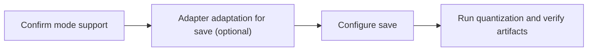

# AscendV1 Usage Guide

This guide explains how to select the **AscendV1** quantization format in msModelSlim, complete the write-to-disk step in the order **confirm mode support -> (optional) adapter adaptation for save -> configure -> run**, and deploy the artifacts to vLLM Ascend, SGLang, and MindIE. For format fields and enumerations see *[AscendV1](term_ascendv1.md)*; for an overview of the one-click quantization commands see the *[One-Click Quantization Usage Guide](../../../user_guide/usage_one_click_quantization.md)*.

## 1. Scope

This workflow applies to users who have already chosen **AscendV1** as the write-to-disk format, need to complete the configuration and run one-click quantization in msModelSlim, and will deploy the artifacts to an Ascend inference stack such as **vLLM Ascend**, **SGLang**, or **MindIE**.

Not applicable: exporting only generic HuggingFace / vLLM `compressed-tensors` weights (use the *[compressed-tensors Usage Guide](../compressed_tensors/compressed_tensors_usage.md)* instead); multimodal generation MindIE SD scenarios (use the *[MindIE SD Usage Guide](../mindie_sd/mindie_sd_usage.md)* instead).

## 2. Process Relationships and Prerequisites

**Parent process**: *[One-Click Quantization Usage Guide](../../../user_guide/usage_one_click_quantization.md)*

**Prerequisites**:

- A compatible version of msModelSlim is installed, and the target model is quantizable according to the *[Foundation Model Support Matrix](../../model/README.md)*
- The target inference framework has been confirmed as vLLM Ascend, SGLang, or MindIE

**Follow-up operations**: load the `save_path` artifacts according to the inference framework documentation; if the accuracy is insufficient, enter the tuning workflow.

## 3. Inputs and Deliverables

| Type | Name | Source or Location | Format or Constraint | Acceptance Method |
| --- | --- | --- | --- | --- |
| Input | Floating-point model directory | Local or ModelScope/HF | Can be loaded by the target Transformers version | `from_pretrained` smoke test passes |
| Input | Quantization YAML / best practice | The best-practice library or a custom `config` | Contains `spec.save` with `type` set to `ascendv1_saver` | Fields pass configuration protocol validation |
| Deliverable | AscendV1 quantized weight directory | `${SAVE_PATH}` | Contains `quant_model_description.json` and weight safetensors | See the *[AscendV1](term_ascendv1.md#export-artifacts)* export artifacts |

## 4. Process Overview



## 5. Procedure

### Step 1: Confirm the Target Inference Framework Supports the Chosen Quantization Mode

**Objective**: Referring to the support tables, confirm that the target inference framework (vLLM Ascend, SGLang, or MindIE) can load the chosen quantization mode and the AscendV1 conventions.

**Action**:

1. Referring to *[AscendV1](term_ascendv1.md#engine-support)* Inference Engine Support, *[AscendV1](term_ascendv1.md#mode-support)* Quantization Mode Support, and the target framework version notes, confirm that the chosen quantization mode can be loaded by that stack.
2. Confirm that the inference side identifies the quantization type of each tensor through `quant_model_description.json`, and loads parameters from `quant_model_weights*.safetensors` (or sharded weights plus an index).
3. If QuaRot is enabled and the rotation matrix must be exported, confirm that the inference framework can consume `optional/quarot.safetensors` (see *[AscendV1](term_ascendv1.md#optional-quarot)* Optional Export: QuaRot-Related Files).

**Output**: A decision record of the target framework, the quantization mode, and whether to export the optional artifacts.

**Pass conditions**: vLLM Ascend, SGLang, or MindIE has been chosen as the deployment target; loading through the AscendV1 conventions (`quant_model_description.json` plus weight safetensors) has been confirmed; if the QuaRot optional export is enabled, the inference side has confirmed that it can load `optional/`.

### Step 2 (Optional): Implement AscendV1SaveInterface in the Model Adapter

**Objective**: Only when the write-to-disk step needs model-side preprocessing / postprocessing, implement `AscendV1SaveInterface` in the model adapter; most models can skip this step and go directly to step 3.

**When It Is Needed**: There is no need to implement it when the default `ascendv1_saver` can already traverse and export correctly. Adapt it only when one of the following applies:

- The module prefix must be rewritten or the module to be exported must be replaced before saving (such as structural mapping or expert submodule redirection)
- The artifact directory must be post-processed after export (such as rewriting `config.json` or adding auxiliary files)

**Action**:

1. Make the model adapter inherit from [`AscendV1SaveInterface`](../../../../../msmodelslim/core/quant_service/modelslim_v1/save/interface.py) and implement as needed:
   - `ascendv1_save_module_preprocess(prefix, module, model)`: return a new `(prefix, module)` before saving the module
   - `ascendv1_save_postprocess(model, save_directory)`: directory postprocessing after all exported files have been written
2. The saver calls the above hooks only when `isinstance(adapter, AscendV1SaveInterface)` holds; if the interface is not implemented, the default write-to-disk path is used.
3. Referring to the source of an adapter that already implements this interface, check whether the behavior is consistent with the target inference stack, for example:
   - [`msmodelslim/model/deepseek_v3/`](../../../../../msmodelslim/model/deepseek_v3/)
   - [`msmodelslim/model/qwen3_next/`](../../../../../msmodelslim/model/qwen3_next/)
   - [`msmodelslim/model/minimax_m2/`](../../../../../msmodelslim/model/minimax_m2/)

**Output**: An adapter with the hooks implemented, or the conclusion that "no implementation is needed and this step is skipped".

**Pass conditions**: It can be skipped if no special hooks are needed; if the interface is implemented, the preprocessing / postprocessing is consistent with the target AscendV1 artifact conventions.

### Step 3: Configure the AscendV1 Saver

**Objective**: Enable `ascendv1_saver` in the one-click quantization YAML.

**Action**: Configure the following in `spec.save`:

```yaml
spec:
  save:
    - type: "ascendv1_saver"
      part_file_size: 4
```

| Parameter | Type | Default | Description |
| --- | --- | --- | --- |
| `type` | string | `"ascendv1_saver"` | Saver type identifier; a fixed value |
| `part_file_size` | int | `4` | Weight shard size (GB); `0` means no sharding |
| `ext` | object | `{}` | Optional extension configuration; the current `AscendV1Saver` does not read this field, so it can be omitted for regular exports |

Alternatively, use the official `quant_type` best practice directly (most LLM best practices already include `ascendv1_saver` by default). For the complete protocol see the `ascendv1_saver` field description in the *[ascendv1_saver Configuration Description](../../../api_reference/config/format/ascendv1_saver.md)*.

**Output**: A usable YAML configuration file path, or confirmation that the official `quant_type` one-click path is used.

**Pass conditions**: `type` is `ascendv1_saver`; the chosen quantization mode falls within the support table of *[AscendV1](term_ascendv1.md#mode-support)*.

### Step 4: Run Quantization and Verify the Artifacts

**Objective**: Generate AscendV1 weights and complete the loading and inference validation.

**Action**:

1. Prepare a minimal runnable YAML (save it as `${CONFIG_PATH}`). The following takes global W8A8 dynamic quantization plus `ascendv1_saver` as an example; `process` can be replaced according to the chosen quantization mode, while `save` must keep `ascendv1_saver`:

   ```yaml
   apiversion: modelslim_v1
   spec:
     process:
       - type: "linear_quant"
         qconfig:
           act:
             scope: "per_token"
             dtype: "int8"
             symmetric: True
             method: "minmax"
           weight:
             scope: "per_channel"
             dtype: "int8"
             symmetric: True
             method: "minmax"
         include: ["*"]
         exclude: ["*down_proj*"]
     save:
       - type: "ascendv1_saver"
         part_file_size: 4
   ```

2. Run quantization as described in the *[One-Click Quantization Usage Guide](../../../user_guide/usage_one_click_quantization.md)*:

   ```bash
   msmodelslim quant \
     --model_path ${MODEL_PATH} \
     --save_path ${SAVE_PATH} \
     --device npu \
     --model_type ${MODEL_TYPE} \
     --config ${CONFIG_PATH} \
     --trust_remote_code true
   ```

3. Verify that the following exist under `${SAVE_PATH}`:
   - `quant_model_description.json` (containing `model_quant_type` and the type of each tensor)
   - `quant_model_weights.safetensors`, or sharded weights plus an index
   - Auxiliary files copied from the source model, such as `config.json` and tokenizer files
   For the directory tree and field details see *[AscendV1](term_ascendv1.md#export-artifacts)* Export Artifacts and Deliverable Formats of Each Quantization Mode.
4. Load this directory with the target inference framework and complete at least one generate or API request to confirm that the quantized weights load correctly and inference returns normally. This step is a quick pre-deployment validation and does not require a full accuracy evaluation.

**Output**: A deployable `${SAVE_PATH}` directory and a validation log.

**Pass conditions**: The description file and weights are complete; inference loading works correctly; at least one request returns normally.

## 6. Acceptance Conditions

- Do not claim deployability before confirming that the target inference stack supports the AscendV1 loading conventions.
- Do not proceed to inference evaluation when `quant_model_description.json` or the weight files are missing.
- The quantization mode field must be consistent with the enumerations in *[AscendV1](term_ascendv1.md)*.

## 7. Terminology

| Term | Brief Description | Link |
| --- | --- | --- |
| AscendV1 | The quantization write-to-disk format on the Ascend side | *[AscendV1](term_ascendv1.md)* |
| Quantization Format | The write-to-disk protocol between the quantization tool and the inference framework | *[Quantization Format](../README.md)* |
