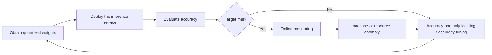

# Mainstream Model Quantization Deployment Process Guide

## 1. Scope

This process is intended for users who need **inference acceleration** for mainstream models. It strings **quantization -> deployment -> accuracy evaluation -> online monitoring** into a complete business flow: after obtaining the quantized weights, deploy them on an Ascend inference engine, complete the accuracy evaluation, and establish online monitoring to achieve inference acceleration.

It applies to the following scenarios:

- The target model is already included in the [Large Model Support Matrix](../knowledge_base/model/README.md);
- The target inference framework is vLLM or SGLang, and the target hardware is an Ascend NPU;
- The target model is supported by the selected inference framework: for the vLLM-Ascend support scope, see the [vLLM-Ascend Supported Model List](https://docs.vllm.ai/projects/ascend/en/latest/user_guide/support_matrix/supported_models.html), and for the SGLang support scope, see the [SGLang Supported Models](https://docs.sglang.io/docs/supported-models).

This process is **not applicable** in the following cases:

- The model is not included in the support matrix or has not been verified: refer to the [New Model Quantization Tuning Process](./process_new_model_quantization_tuning.md).

## 2. Process Relationships and Prerequisites

**Parent process**: none. This process is the direct entry point for quantization, deployment, evaluation, online monitoring, and other features, and strings them together into a complete business flow.

**Prerequisites**:

- The target inference framework environment (vLLM / SGLang / MindIE Motor) is ready, and NPU devices are available (`npu-smi info` shows a normal and idle status);

**Follow-up operations**: when the evaluation reveals an accuracy anomaly, follow the [Quantization Inference Accuracy Anomaly Locating Process Guide](process_quantization_accuracy_anomaly_locating.md) to locate the anomaly point; when the accuracy target is not met, follow the [Quantization Accuracy Tuning Guide](process_quantization_precision_tuning.md) to tune, and then re-quantize and deploy again.

## 3. Inputs and Deliverables

| Type | Name | Source or Location | Format or Constraint | Acceptance Method |
| --- | --- | --- | --- | --- |
| Input | Quantized weight directory | The artifact of the [One-Click Quantization Usage Guide](usage_one_click_quantization.md) or the weights released by Eco-Tech | Model configuration, weight shards, and auxiliary files required by the category (such as tokenizer and config) | The files are complete; if the official source provides a checksum or version number, the corresponding local value must match the official one. |
| Input | Evaluation dataset | An AISBench dataset or a business evaluation set | The dataset and sampling configuration used for the floating-point baseline evaluation | The floating-point model can reproduce the baseline accuracy |
| Deliverable | Online inference service | Deployment environment | The service address (host:port) and model name are externally available and can respond to inference requests | Health checks and inference requests return normally |
| Deliverable | Evaluation report | Evaluation artifact save directory | Contains accuracy metrics (compared with the floating-point baseline) | The accuracy target threshold is met and the report can be archived |

## 4. Process Overview

This end-to-end process consists of four stages: obtaining quantized weights, deploying the inference service, evaluating accuracy, and performing online monitoring.

## 5. Procedure

### Step 1: Obtain and Verify the Quantized Weights

**Objective**: obtain a complete and trustworthy quantized weight directory that is compatible with the inference engine.

**Action**:

1. **Obtain the weights**, choose one of the two options:
   - **Quantize by yourself**: quantize the floating-point model following the [One-Click Quantization Usage Guide](usage_one_click_quantization.md) (use its `${SAVE_PATH}` directly);
   - **Obtain released weights**: obtain the officially released quantized weights from the [Eco-Tech organization](https://www.modelscope.cn/organization/Eco-Tech).
2. **Verify the weights**: confirm that the files are complete (including the description file and all weight shards required by the selected export format, such as `quant_model_description.json` for AscendV1 and `config.json` (containing the `quantization_config` field) for compressed-tensors); if the official page provides file checksums (such as MD5/SHA256) or an explicit version/commit ID, compare them with the local download and ensure that they match. Do not deploy when key files are missing.
3. **Confirm version compatibility**: verify that the quantized weights (including the format version recorded in the metadata of the selected export format) are compatible with the target inference engine version; for the format description, see [Quantization Formats](../knowledge_base/quantization_format/README.md).

**Output**: a quantized weight directory that passes verification.

**Audit Record**: the weight directory path, the weight source, and the release version number.

### Step 2: Deploy the Inference Service

**Objective**: deploy the quantized weights as a service on the Ascend NPU and provide an external inference interface.

**Action**:

1. **Prepare the runtime environment**: enter the runtime environment of the target inference framework (such as the official image container) and confirm that the NPU is visible. The version requirements for transformers may differ between the quantization stage and the inference stage, so before deployment, adjust the transformers version in the inference environment to the version required by the inference engine (it may be an upgrade or a downgrade).
2. **Start the inference framework service**: use the target inference framework to start the inference service, load the quantized weights, and provide an external inference interface. For the deployment method of each framework, see the official documentation:
   - [vLLM-Ascend Document](https://docs.vllm.ai/projects/ascend/en/latest/getting_started/quick_start.html)
   - [SGLang Document](https://docs.sglang.io/docs/get-started/quickstart)
   - [MindIE Motor Official Documentation](https://mindie-motor.readthedocs.io/en/latest/user_guide/quick_start/#image-preparation)
3. **Health check**: confirm that the service log shows a successful deployment.
4. **Warm-up request verification**: send a warm-up request to verify that the service responds. The first request may be slower or return garbled text, which is normal; discard the result after the warm-up.

**Output**: the inference service is started and can respond to inference requests, the service address `http://<host>:<port>`, and the model name.

**Pass conditions**: the service log shows a successful deployment, and the warm-up request returns a normal HTTP response.

### Step 3: Accuracy Evaluation

**Objective**: complete the accuracy evaluation before the quantized model is deployed in production and confirm that the business metrics are met.

**Action**:

1. **Install AISBench and prepare the dataset**: for installation and overall usage, see the [AISBench Documentation](https://github.com/AISBench/benchmark/blob/master/docs/source_en/get_started/install.md), and for how to prepare each dataset task, see the [AISBench Dataset Preparation Guide](https://github.com/AISBench/benchmark/blob/master/docs/source_en/get_started/datasets.md).
2. **Start an accuracy evaluation task**: use AISBench to start an accuracy evaluation against the deployed service; for the corresponding configuration and description, see the [AISBench Quick Start Documentation](https://github.com/AISBench/benchmark/blob/master/docs/source_en/get_started/quick_start.md).
3. **Compare with the floating-point baseline**: under the same dataset and the same sampling configuration, compare the quantized model evaluation results with the floating-point model baseline:

   - The accuracy gap is within the business threshold (for example, the drop in task-related accuracy is <= 1-2%, subject to the business agreement) -> passed;
   - The accuracy gap exceeds the threshold, or there are more bad cases or abnormal output -> follow the [Quantization Inference Accuracy Anomaly Locating Process Guide](process_quantization_accuracy_anomaly_locating.md) and the [Quantization Accuracy Tuning Guide](process_quantization_precision_tuning.md).
4. **Archive the report**: save the evaluation configuration, results, and conclusion to form an evaluation report.

**Output**: the evaluation report (including the accuracy comparison conclusion).

**Pass conditions**: the accuracy meets the business target; do not claim an accuracy gain when no floating-point baseline has been established.

**Audit Record**: the evaluation dataset and sampling configuration, the service startup parameters, and the evaluation report version number and result file path.

### Step 4: Online Monitoring

**Objective**: continuously observe service performance and resource usage after the service goes online, and detect anomalies in time. This step is optional and is performed only when continuous monitoring of service performance is needed.

**Action**:

1. **Online monitoring and performance collection**: use [msServiceProfiler](https://gitcode.com/Ascend/msserviceprofiler) (MindStudio Service Profiler, an Ascend AI service tuning tool) for online monitoring and performance analysis of the service.

**Output**: online monitoring and performance collection records.

**Pass conditions**: online monitoring and performance collection can be performed successfully.

**Audit Record**: the monitoring configuration snapshot and the archived online monitoring and performance collection records.

## 6. Acceptance Conditions

- The inference service starts successfully and passes the health check, and the external interface can respond to inference requests;
- The accuracy evaluation reaches the business threshold relative to the floating-point baseline, with no unresolved bad cases or abnormal output;
- The evaluation report can be archived and is traceable.

## 7. Troubleshooting

- **Port already in use**: change the service port;
- **Insufficient NPU memory (OOM)**: release the NPU device, adjust the degree of parallelism, or check whether the device is idle;
- **The service cannot start**: locate the cause from the service log; if it still cannot be resolved, contact technical support for the corresponding inference framework and attach the service log;
- **Accuracy target not met**: after confirming with Step 3 that the accuracy issue is genuine by comparing against the floating-point baseline, follow the [Quantization Inference Accuracy Anomaly Locating Process Guide](process_quantization_accuracy_anomaly_locating.md) to locate the anomaly point, tune following the [Quantization Accuracy Tuning Guide](process_quantization_precision_tuning.md) and re-quantize, and then return to Step 1 to deploy and evaluate again.

## 8. Terminology

| Term | Brief Description | Link |
| --- | --- | --- |
| Quantization (PTQ) | Post-Training Quantization: after model training is complete, directly quantize the weights and activations without retraining | [PTQ Knowledge](../knowledge_base/ptq) |
