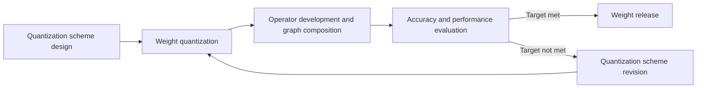

# New Model Quantization Tuning Process

## 1. Scope

This guide is intended for developers and algorithm engineers who need to advance a **new model** (not included in the support matrix, or with an unverified target quantization mode) from quantization scheme design to releasable quantized weights. The main path is **quantization scheme design -> weight quantization -> operator development and graph composition -> accuracy and performance evaluation -> weight release**; if the evaluation does not meet the target, revise the **quantization scheme** first and then return to weight quantization to continue the loop until the target is met and the weights are released, or exit.

**Applicable scenarios**:

- A new model or a target quantization mode that has not been verified, requiring the whole path from quantization scheme design all the way to evaluation and release.
- One or more quantization rounds have been completed, but the accuracy and performance targets are not met, requiring the quantization scheme to be revised and the loop to continue.

> [!NOTE]
>
> - The support matrix has marked the model as supporting **one-click quantization** and the target `quant_type` has been verified: just follow the [One-Click Quantization Usage Guide](usage_one_click_quantization.md).
> - The tuning chain is already working and only the tuning approaches and algorithm suggestions are needed: read the [Quantization Accuracy Tuning Guide](process_quantization_precision_tuning.md).
> - Fully automatic configuration search is desired: refer to the [Auto Tuning Usage Guide](usage_auto_precision_tuning.md).

## 2. Process Relationships and Prerequisites

**Prerequisites**:

- The [Large Model Support Matrix](../knowledge_base/model/README.md) has been checked, confirming that the target model is not included, or that the target quantization mode (`quant_type`) has not been verified.
- The accuracy and performance targets have been clarified (the acceptable drop relative to floating point, business thresholds, or performance constraints).
- The floating-point model directory is ready.
- The target inference engine and export format have been determined (see [Quantization Formats](../knowledge_base/quantization_format/README.md), such as AscendV1 and MindIE SD); the floating-point and quantized evaluations must use the same evaluation dataset, metrics, and inference engine configuration (engine version, parallelism, and sampling kept consistent).
- If the scheme depends on new operators or graph composition capabilities, the prerequisites for corresponding development and integration on the inference engine and CANN sides are in place.

**Follow-up operations**:

- After the target is met and the weights are released: proceed to production deployment and business acceptance; the experience can be consolidated into a practice configuration and the support matrix can be updated.
- When the target still cannot be met within the acceptable fallback range and the compression/performance gain constraints: increase the bit width, relax the target, or put the scheme on hold. Simply increasing the amount of fallback can approach floating-point accuracy but may eliminate the quantization gains, so it is not the default solution.

## 3. Inputs and Deliverables

The floating-point weights must be available before this process starts, and the reproducible final quantization configuration and final quantized weights must be delivered after it ends. The evaluation conclusions must also be delivered as part of the process. The weights may be used locally only and are not required to be released.

| Type | Name | Source or Location | Format or Constraint | Acceptance Method |
| --- | --- | --- | --- | --- |
| Input | Floating-point model directory | Local user path; usually obtained from [ModelScope](https://www.modelscope.cn/), [Hugging Face](https://huggingface.co/), or the team's internal model storage location | Configuration, weight shards, and auxiliary files required by the category | The path is valid, the files are complete, and the model can be loaded by the target `model_type` |
| Deliverable | Final quantization configuration | The converged configuration path saved by the user | Complies with the corresponding configuration protocol | Can be loaded by `msmodelslim quant --config` and reproduces the delivered weights |
| Deliverable | Final quantized weight directory | The output directory specified by the user | Complies with the selected export format | The files are complete and comply with the conventions of the selected export format |
| Deliverable | Accuracy and performance comparison conclusion | Evaluation records | Contains the floating-point baseline, the final quantization result, and whether the target is met | Verifiable under the same criteria |

## 4. Process Overview

The main path advances in the order of "quantization scheme design -> weight quantization -> operator development and graph composition -> accuracy and performance evaluation -> weight release". After the accuracy and performance evaluation: if the target is met, proceed to weight release; if not, enter quantization scheme revision and then return to weight quantization to continue the loop. The order of the stages is as follows:

## 5. Procedure

### Step 1: Quantization Scheme Design

**Objective**: define the accuracy and performance targets and the evaluation criteria; establish the floating-point baseline; and provide the **first** executable preliminary quantization scheme.

**Action**:

1. **Determine the targets and the floating-point baseline**:
   - Record the target thresholds, the evaluation dataset, the metrics, and the target inference engine version and key configuration;
   - Complete the floating-point evaluation on the target inference engine to confirm that the expected baseline is reproducible; if there is no baseline yet, run the evaluation first.
2. **Determine the first recommended quantization scheme**:

   | Model Category | Configuration Protocol | Quantization Mode | Initial Quantization Scope |
   | --- | --- | --- | --- |
   | Large language model | `modelslim_v1` | `w8a8` dynamic quantization | Global quantization of linear layers, excluding a few sensitive layers when necessary; for MoE, the initial version can quantize only the shared experts |
   | Multimodal understanding | `multimodal_vlm_modelslim_v1` | `w8a8` dynamic quantization | Quantize only the LLM component; do not quantize the vision encoder, projection, and merger for now |
   | Multimodal generation | `multimodal_sd_modelslim_v1` | `w8a8` dynamic quantization | Quantize the DiT backbone |

   - **Newly integrated models**: for the initial version, prioritize getting the pipeline working and safeguarding accuracy. Use only linear quantization (`linear_quant`) in the first version and leave out outlier suppression for now; select the quantization scope according to the table above. To pursue lower bit widths later, integrate algorithms such as outlier suppression.
   - **Models already integrated but with an unverified target quantization mode**: the existing adapter can be reused directly. It is recommended to first confirm that the pipeline works using `w8a8` dynamic quantization and `linear_quant` as shown in the table above, and then adjust the scheme incrementally for the target mode.
3. Analyze the feasible path: whether weight quantization is feasible, whether the target inference engine supports the required operators, and whether graph composition needs to be added or modified. Draw conclusions about the weight quantization, operators, and graph composition, and record the operator and graph composition dependencies.

**Output**: the accuracy and performance targets and the floating-point baseline records; the description of the first quantization scheme (configuration protocol, quantization mode, quantization scope, and algorithm selection); the list of operator and graph composition dependencies.

**Pass conditions**: the target is assessable; the floating-point baseline is reliable; the evaluation criteria are fixed; the scheme conclusion is actionable; the key dependencies are identified.

### Step 2: Weight Quantization

**Objective**: produce quantized weights according to this round's scheme, implementing the selected mode, algorithm, model adaptation, and format.

**Action**:

1. Confirm this round's quantization mode, algorithm, target model adaptation status, and export format.
2. Complete adaptation, configuration, and quantization following the [Weight Quantization Usage Guide](usage_weight_quantization.md) to obtain this round's quantized weight artifacts.

**Output**: this round's quantized weight directory `${SAVE_PATH}`.

**Pass conditions**: the artifacts comply with the conventions of the selected export format.

### Step 3: Operator Development and Graph Composition

**Objective**: implement any missing operator and graph structure capabilities needed to deploy this round's quantization scheme on the target inference engine. If the existing operators and graph composition already support the scheme, this step can be skipped.

**Action**:

1. Review the operator dependencies in the scheme to determine the requirements for single-operator development and fused-operator development.
2. Complete the necessary operator decomposition, fusion, and mapping so that the quantization graph can be executed on the target inference engine. Operators and deployment implementations usually live on the target inference engine side; refer to:
   - [vLLM Ascend Quantization Adaptation Guide](https://docs.vllm.ai/projects/ascend/en/v0.23.0/developer_guide/Design_Documents/quantization.html)
   - [Introduction to the CANN Operator Library](https://www.hiascend.com/document/detail/en/CANNCommunityEdition/latest/API/aolapi/operatorlist_00001.html)
3. Complete the structural graph composition and confirm that it is consistent with the export format and the engine's graph optimization path.
4. Confirm that the inference service can be started normally with this round's quantized weights; record the version number of the inference engine used.

**Output**: the inference service startup result and the version used; or a record confirming that nothing needs to be added and the step can be skipped.

**Pass conditions**: the target inference engine can start an inference service with this round's quantized weights.

### Step 4: Accuracy and Performance Evaluation

**Objective**: perform an evaluation using a dataset and the same evaluation criteria, and decide whether to finalize and release, revise the quantization scheme, or exit the loop.

**Action**:

1. Evaluate this round's quantized weights on the target inference engine; keep the evaluation dataset, metrics, and inference engine configuration consistent with the floating-point baseline in Step 1. Compare accuracy first, and record performance as well when there is a performance target. Commonly used evaluation tools include [AISBench](https://github.com/AISBench/benchmark).
2. Compare the results with the target thresholds:
   - **Target met**: fix this round's quantization configuration, weight directory, and evaluation records, and proceed to Step 6.
   - **Target not met but further iterations are feasible**: take the gap as feedback and proceed to Step 5 to revise the quantization scheme.
3. **No obvious improvement within the constraints**: increase the bit width, relax the target, or put the scheme on hold, and exit this tuning loop.

**Output**: this round's evaluation records and one of the subsequent decisions (finalize and release, continue revising the scheme, or exit the loop).

**Pass conditions**: each round of evaluation uses the same criteria as the floating-point baseline and yields a clear decision; proceed to the weight release process, the quantization scheme revision process, or exit this tuning loop.

**Audit Record**: the scheme summary of each round, the quantization configuration, the quantization command, the inference engine version, the evaluation scores, and the final configuration and weight directory.

### Step 5: Quantization Scheme Revision

**Objective**: when the evaluation target is not met, revise the quantization scheme based on the gap to form an executable configuration for the next round.

**Action**:

1. Complete the scheme and configuration revision following the [Quantization Accuracy Tuning Guide](process_quantization_precision_tuning.md).
2. Prefer changing only one type of measure at a time to avoid changing multiple variables at once.
3. If the new measure requires additional adapter interfaces, first read the adaptation chapter in the corresponding quantization algorithm guide, implement the required interfaces, and then run `bash install.sh`.
4. Record the conclusion of this round's revision and whether the operator and graph composition dependencies are added or changed.

**Output**: the description of the revised quantization scheme and the quantization configuration to be executed; if there are adaptation or operator/graph composition changes, confirm that the dependencies are identified.

**Pass conditions**: the revised scheme is executable; the key dependencies are identified; weight quantization must be run again.

### Step 6: Weight Release

**Objective**: release the quantized weights that meet the target to the open source community or an internal repository as required by the business, and provide an externally referenceable link.

**Action**:

1. Confirm that the final quantization configuration, quantized weights, and evaluation conclusion are fixed and that the version is traceable.
2. Choose the release channel as required by the business, for example ModelScope, Hugging Face, or the team's internal artifact repository; for an example of a weight release, see [Eco-Tech](https://www.modelscope.cn/organization/Eco-Tech).
3. Record the actual release page link and the version description for subsequent reference and reproduction.

**Output**: the release link and version description; if only delivered locally, just record the final weight directory.

**Pass conditions**: if released, the link can be opened and the weights can be downloaded, and they are consistent with the final deliverable weights from this process; if not released, it suffices that the local deliverables are complete and reproducible.

## 6. Acceptance Conditions

- The final quantization configuration and the final quantized weights are complete, and the quantization result can be reproduced with the same command and configuration.
- If the scheme involves operator development and graph composition, the corresponding capabilities on the inference engine side have been merged and can support the accuracy and performance evaluation.
- The conclusion that the target is met is based on a comparison under the same criteria as the floating-point baseline, and the corresponding evaluation records are retained.
- If released externally, the release link is accessible and the weights can be downloaded, and they are consistent with the local final quantized weights.

## 7. Troubleshooting

| Symptom | Direction of Action |
| --- | --- |
| Abnormal or non-reproducible floating-point baseline | First fix the inference engine, dependencies, or evaluation configuration, and then begin this tuning loop |
| Weight quantization failed | Troubleshoot the adaptation, configuration, and environment following the [Weight Quantization Usage Guide](usage_weight_quantization.md) |
| Missing operators or graph composition failure | Return to Step 1 (quantization scheme design) or Step 5 (quantization scheme revision) to re-assess the feasible path; complete the operators and graph composition before evaluating again |
| No improvement after multiple rounds of scheme revision | First review whether the quantization scheme and the improvement measures are chosen correctly and take effect under the same criteria; once confirmed, try the next tuning measure, or relax the target or increase the bit width |
| Accuracy and gain still cannot both be satisfied within the constraints | Increase the bit width, relax the target, or put the scheme on hold |

## 8. Terminology

| Term | Brief Description | Link |
| --- | --- | --- |
| Model adaptation (LLM) | Implement and register an adapter for a specific model so that the CLI can select it through `--model_type` and load and quantize the model | [LLM Model Integration Quantization Workflow Guide](../knowledge_base/ptq/llm/integration_guide_large_language_model_quantization.md) |
| Model adaptation (multimodal understanding) | Implement and register an adapter for a specific model so that the CLI can select it through `--model_type` and load and quantize the model | [VLM Model Integration Quantization Workflow Guide](../knowledge_base/ptq/vlm/integration_guide_vision_transformer_quantization.md) |
| Model adaptation (multimodal generation) | Implement and register an adapter for a specific model so that the CLI can select it through `--model_type` and load and quantize the model | [DiT Model Integration Quantization Workflow Guide](../knowledge_base/ptq/dit/integration_guide_diffusion_transformer_quantization.md) |
| Quantization algorithm | Descriptions of algorithms such as outlier suppression, linear quantization, and sensitive layer analysis | [Quantization Algorithm Overview](../knowledge_base/quantization_algorithms/README.md) |
| Quantization mode | Naming and conventions of bit-combination strategies such as w8a8 and w4a8 | [Quantization Mode Naming Convention](../knowledge_base/model/README.md#quantization-mode-naming-convention) |
| Quantization format | Export formats of quantized weights and their correspondence with inference frameworks | [Quantization Formats](../knowledge_base/quantization_format/README.md) |

## 9. Security Notes

- `trust_remote_code` remains `false` by default; enable it only when the floating-point repository must execute custom code and the source is trustworthy and auditable.
- Floating-point weights, calibration data, evaluation logs, quantization artifacts, and externally released content should be controlled according to business permissions; do not submit calibration datasets or logs that contain business data to public channels.
