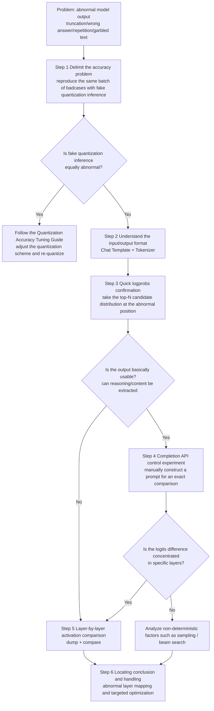

# Quantization Inference Accuracy Anomaly Locating Process Guide

## 1. Scope

This process is intended for cases in which abnormal inference output must be located after deployment evaluation of a quantized model. It applies when:

- The model output is abnormal: truncated content, wrong answers, repeated generation, incorrect formatting, garbled text, and so on;
- The output of the quantized model cannot be aligned with that of the floating-point model, and the source of the deviation (quantization, inference framework, operators, or compilation optimization) needs to be confirmed;
- The deviation needs to be traced to a specific layer/operator as input for targeted optimization or dedicated troubleshooting.

**Possible sources of the problem**:

- Quantization (INT8/INT4 accuracy loss leads to a shifted logits distribution);
- The inference framework (version differences, parameter configuration, scheduling strategy);
- Operators (custom operator implementations, Ascend C operator accuracy).

**Difficulties in locating**:

- The accuracy problem may result from a combination of multiple factors;
- Normal floating-point output and abnormal quantized output do not necessarily indicate a quantization problem (quantization may trigger a different execution path in the framework or operators);
- Inconsistent output across multiple runs for the same input may indicate non-determinism.

This process is **not applicable** in the following cases:

- The unquantized floating-point model itself has an accuracy problem, or a false positive is caused by an abnormal evaluation dataset or sampling configuration (the baseline confirmation in Step 3 of the [Mainstream Model Quantization Deployment Process Guide](process_mainstream_model_deployment.md#step-3-accuracy-evaluation) should be completed first);
- The overall accuracy of the quantized model drops only slightly and is within the acceptable business range, so there is no need to locate layer by layer; just tune according to the [Quantization Accuracy Tuning Guide](process_quantization_precision_tuning.md).

## 2. Process Relationships and Prerequisites

**Parent process**: follow this process when the deployment evaluation of a quantized model (Step 3 of the [Mainstream Model Quantization Deployment Process Guide](process_mainstream_model_deployment.md#step-3-accuracy-evaluation)) reveals that the accuracy target is not met, that bad cases have increased, or that the output is abnormal.

**Prerequisites**:

- Inputs that can reliably reproduce the anomaly (bad case samples or requests);
- Two comparable environments (baseline and target), for example, a floating-point model vs. a quantized model, framework version X vs. version Y, or operator implementation 1 vs. implementation 2. Both environments must be accessible through APIs;
- The model path and tokenizer (used to understand the input/output format and construct prompts);
- The quantization deliverables consistent with those used in deployment, for determining the source of the problem in Step 1;
- Sufficient disk space (the volume of activation dump data is relatively large).

**Follow-up operations**: use the localization results as input for corrective action—adjust the quantization method or configuration for the anomalous layers and then re-quantize and deploy, or proceed to dedicated troubleshooting of the framework, operators, or compilation.

## 3. Inputs and Deliverables

| Type | Name | Source or Location | Format or Constraint | Acceptance Method |
| --- | --- | --- | --- | --- |
| Input | Bad case reproduction input | Evaluation report / business feedback | Contains the input text (and context such as the conversation history), the expected output, and the actual output | The anomaly can be reliably reproduced in the target environment |
| Input | Two comparison environments | Deployment environment (baseline and target services) | The service APIs are accessible, and the two environments have identical configurations except for the comparison variable | Inference requests can be sent to each environment separately |
| Input | Model path and tokenizer | Model weight directory | Can be loaded by the target transformers version | Enables the construction of an input/output format description |
| Input | Quantization deliverables | Quantized weight save directory | The deliverables are complete | Can be loaded by the fake quantization inference feature |
| Deliverable | Anomaly localization report | Localization report archive directory | Contains the conclusion from fake quantization inference, the candidate distribution comparison at the anomalous position, the first generated token comparison, the layer-by-layer cosine similarity comparison, the anomalous layer conclusion, and handling suggestions | The report is reviewable: the results can be reproduced with the same data, and the conclusions are supported by data |

## 4. Process Overview

First, use fake quantization inference to determine the source of the problem. Then locate the anomaly by following the progressive principle of **from macro to micro and from the periphery to the core**. Each method can be used to compare any two environments (such as floating point vs. quantization, or framework version X vs. Y).



> **Description**: Step 1 first rules out the quantized weights themselves to avoid wasted troubleshooting effort on the deployment side. Steps 3-5 do not all have to be performed: when the output is basically usable, perform Steps 3, 4, and 5 in order; when the output has severe repetition or a large amount of garbled text, skip Step 4 and go directly to Step 5. Step 5 is the primary localization method in all scenarios, especially those involving garbled text.

## 5. Procedure

### Step 1: Determine the Source of the Accuracy Problem

**Objective**: reproduce the same batch of bad cases in a fake quantization inference environment independent of the deployment framework, and determine the source of the deviation—whether it is introduced by the quantized weights themselves or triggered by the inference framework, operators, or compilation optimization.

**Action**:

1. **Prepare bad case samples**: extract bad case samples from the evaluation report or business feedback.
2. **Run fake quantization inference**: refer to the [Fake Quantization Inference Usage Guide](usage_fake_quant_evaluation.md) and use the quantization deliverables to run fake quantization inference.
3. **Align the outputs of the two environments for each sample and determine the source**:
   - **Fake quantization inference result is normal**: the accuracy problem originates on the deployment side; continue with Step 2 to locate it;
   - **Fake quantization inference result is equally abnormal**: the accuracy problem is introduced by the quantized weights; adjust the quantization scheme following the [Quantization Accuracy Tuning Guide](process_quantization_precision_tuning.md) and re-quantize, then return to this process for verification.

**Output**: the fake quantization inference results for the same batch of bad cases and the conclusion about the source of the deviation (quantization side / deployment side).

**Pass conditions**: the bad cases yield interpretable per-sample results in fake quantization inference, and the source of the deviation is clear.

**Audit Record**: the execution command of the fake quantization inference, the fake quantization inference results, and the comparison records against the deployment-side output.

### Step 2: Understand the Input and Output Format of the Model

**Objective**: understand the actual prompt after Chat Template processing and the model output structure (special tokens and the reasoning/content boundary), providing a correct basis for constructing subsequent comparison experiments.

**Action**:

1. **View the Chat Template and special tokens**: after the same API request is processed by the Chat Template, the text actually seen by the model may be completely different from what is expected:

   ```python
   from transformers import AutoTokenizer

   tokenizer = AutoTokenizer.from_pretrained('/path/to/model', trust_remote_code=True)  # Replace /path/to/model with the actual model path

   # 1. View the Chat Template (if present)
   print("Chat Template:\n", tokenizer.chat_template)
   # 2. View the special tokens
   print("bos_token:", repr(tokenizer.bos_token))
   print("eos_token:", repr(tokenizer.eos_token))
   print("pad_token:", repr(tokenizer.pad_token))
   # 3. View the complete prompt after Chat Template processing
   messages = [{'role': 'user', 'content': 'test question'}]
   print("Full prompt:\n", tokenizer.apply_chat_template(
       messages, tokenize=False, add_generation_prompt=True))
   ```

2. **Record the key information**: whether the Chat Template is built in (which determines whether the Chat API automatically adds the system message), the bos/eos/pad tokens, the special role markers, the reasoning markers (such as `<think>`), and the fixed prefix of the generation prompt.
3. **Analyze the output format**: use a simple test request (such as `"hi"`) to observe the structure of the fields returned by the API: whether there is a `reasoning` field, the boundary rule between content and reasoning, and whether the model outputs special markers.

**Output**: a description of the model input/output format (special token table, the prompt structure after Chat Template processing, and the output boundary rules).

**Pass conditions**: the correspondence between the abnormal output and the format can be explained (for example, whether the output is truncated at a boundary).

**Audit Record**: the tokenizer path and version, the test request and response samples, and the number of prompt tokens.

### Step 3: API-Level Quick Confirmation (logprobs)

**Objective**: at the position where the model output is abnormal (a truncation point, a repetition point, and so on), use `logprobs` to obtain the probability distribution of the top-N candidate tokens and quickly confirm the output difference between the two environments.

**Action**:

1. **Send a request with logprobs**, taking the Chat API as an example:

   ```bash
   curl http://localhost:8000/v1/chat/completions \
     -H "Content-Type: application/json" \
     -d '{
       "model": "model name",
       "messages": [{"role": "user", "content": "question"}],
       "temperature": 0,
       "max_tokens": 1024,
       "logprobs": true,
       "top_logprobs": 5
     }'
   ```

   API differences: for `/v1/chat/completions`, `logprobs` is a boolean and `top_logprobs` is the number of candidates; for `/v1/completions`, `logprobs` is an integer (returns the number of candidates, equivalent to `top_logprobs`).
2. **Analyze the candidate distribution**: in the obtained result, `logprobs.content` contains all generated tokens (including the reasoning part); locate the abnormal position (usually the last few tokens) and compare the logprobs of the top-5 candidates at that position. A logprob is the natural logarithm of the probability (`logprob = ln(probability)`), so a difference of 2.4 means the probabilities differ by a factor of `exp(2.4) ~= 11`.
3. **Compare the two environments**: under the same request, observe whether the candidate distribution at the abnormal position changes (for example, the correct answer token has the highest probability in the floating-point model, while the eos marker probability overtakes it in the quantized model).

**Output**: the conclusion of the candidate token distribution comparison at the abnormal position.

**Pass conditions**: confirm or rule out a deviation at the output logits level.

### Step 4: Completion API Control Experiment

**Objective**: manually construct an exact prompt with the Completion API so that the model's **first generated token** is exactly the target token to be analyzed, and compare the logits of the two environments position by position.

**Applicable conditions**: the model output is **basically usable** (reasoning and content can be extracted from it to construct a prompt). If the output has severe repetition or a large amount of garbled text (local fragments are meaningful but the whole cannot be used to construct a prompt), skip this step and go directly to Step 5.

**Action**:

1. **Extract the existing output**: extract the reasoning and answer content already generated by the model from the Chat API response, and save them in separate text files for concatenation in the next step. The structure of the returned fields may differ between inference frameworks, so extract them according to the actual response structure.
2. **Construct the complete prompt**: concatenate the three parts so that the prompt ends exactly at the anomalous boundary and the model's **first generated token** is the target token to be analyzed:

   ```text
   prompt = Chat Template part (system + developer + user, without the generation prompt)
          + generation prompt prefix
          + existing reasoning + content (ends at the abnormal boundary)
   ```

   The Chat Template part and the generation prompt prefix can be generated through the tokenizer's template interface.

   > **Optional example** (using transformers AutoTokenizer as an example):
   >
   > ```python
   > from transformers import AutoTokenizer
   >
   > tokenizer = AutoTokenizer.from_pretrained('/path/to/model', trust_remote_code=True)  # Replace /path/to/model with the actual model path
   >
   > with open('prompt.txt') as f: question = f.read()
   > with open('reasoning.txt') as f: reasoning = f.read()
   > with open('content.txt') as f: content = f.read()
   >
   > # Chat Template part (without the generation prompt)
   > base = tokenizer.apply_chat_template(
   >     [{'role': 'user', 'content': question}],
   >     tokenize=False, add_generation_prompt=False)
   > # Existing assistant output (the format must be adjusted per model; common: [bos_token]ai\n[reasoning][content])
   > assistant_prefix = f"{tokenizer.bos_token}ai\n{reasoning}{content}"
   > print(base + assistant_prefix, end='')
   > ```
   >
   > Verify that the end of the prompt stops at the abnormal boundary.

3. **Send the request**: set `max_tokens` to a small value (such as 10), `temperature=0`, and `logprobs=5` (the `logprobs` parameter of the Completion API is an integer).
4. **Compare the two environments**: compare the first generated token and the logprob distribution.

**Output**: the comparison of the first generated token distribution and the confirmation of the logits deviation.

**Pass conditions**: the form of the output deviation is clear (for example, the logprob of the eos marker in the quantized model is abnormally high and the answer token probability is suppressed).

> **Tip**: after the prompt stops at the target boundary, setting `max_tokens=1` limits the dump data to only 1 step, reducing it by **more than 99%** compared with full generation (hundreds of steps). This is especially important for repeated iterative comparisons.

### Step 5: Layer-by-Layer Activation Comparison (dump + compare)

**Objective**: locate the layer where the deviation arises through activation dump and layer-by-layer comparison.

**Action**:

1. **Install and check msprobe**: install msprobe (an Ascend operator/tensor dump and comparison analysis tool; for details, see the [msprobe Installation Documentation](https://gitcode.com/Ascend/msprobe/blob/26.2.0/docs/en/install_guide/msprobe_install_guide.md)), and after installation run `msprobe --help` to confirm that the command is available.
2. **Create the msprobe dump configuration file**:

   ```json
   {
     "task": "tensor",
     "dump_path": "/path/to/dump/output",
     "rank": [0],
     "step": [],
     "level": "L0",
     "async_dump": false,
     "tensor": {
       "scope": [],
       "list": [],
       "tensor_list": [],
       "data_mode": ["all"],
       "summary_mode": "statistics"
     }
   }
   ```

   Key parameters: `level` (collection precision level), `data_mode` (input/output/all), and `dump_path` (**the two environments must use different paths**; replace with the actual output path). For detailed descriptions of the key parameters, see the [vLLM-Ascend msprobe Guide](https://docs.vllm.ai/projects/ascend/en/v0.18.0/developer_guide/performance_and_debug/msprobe_guide.html).
3. **Collect in the two environments separately**: start the service with dump enabled (vLLM-Ascend example), send the same request, and stop the service after the dump is complete:

   ```bash
   vllm serve /path/to/model \               # Replace /path/to/model with the actual model path
       --host 0.0.0.0 \
       --port 8000 \
       --served-model-name model-name \       # Replace model-name with the service's external model name
       --trust-remote-code \
       --enforce-eager \
       --additional-config '{"dump_config_path": "/path/to/probe.json"}'   # Replace /path/to/probe.json with the actual path of probe.json
   ```

   Collect the baseline side first (such as the floating-point model), then modify `dump_path` to collect the target side (such as the quantized model).
4. **Inverse transformation of rotation-based quantization and outlier suppression**: both rotation-based quantization and outlier suppression algorithms change the space in which the activations reside, so the target-side activations dumped by msprobe must first be restored to the original space before being compared with the baseline side:
   - **Rotation-based quantization** (such as QuaRot): the activations involved in the rotation reside in the rotated space. Based on the rotation matrix R of the quantization scheme and where it is applied, perform the inverse rotation (`tensor @ R^T`) only on the activation tensors that actually participate in the rotation; tensors that do not participate in the rotation need no processing;
   - **Outlier suppression** (such as SmoothQuant and Iterative Smooth): the smoothed activations are scaled by the smoothing factor, so the corresponding tensors must undergo inverse smoothing (divided by the smoothing factor). The smoothing factor can be obtained from `save_path/debug_info` by enabling `--debug` mode during quantization - debug mode saves the context information of each processor, including the smoothing factor of the outlier suppression processor; for details, see the [Debug Mode User Guide](usage_debug_mode.md).
5. **Build the comparison graph and view it**:

   ```bash
   msprobe graph_visualize \
       -tp /path/to/target_dump/step0/rank0 \   # Dump path on the side to be debugged; replace with the actual path
       -gp /path/to/golden_dump/step0/rank0 \   # Dump path on the baseline side; replace with the actual path
       -o /path/to/compare_output               # Output directory; replace with the actual path
   tensorboard --logdir /path/to/compare_output --bind_all   # The same actual output directory as -o
   ```

   `-tp` is the side to be debugged (such as the quantized model), and `-gp` is the baseline side (such as the floating-point model; required for the two-graph comparison). The command outputs `compare_{timestamp}.vis.db`. For details about the comparison and visualization, see the [msprobe Accuracy Comparison Visualization Guide](https://gitcode.com/Ascend/msprobe/blob/26.2.0/docs/en/user_guide/accuracy_compare/pytorch_visualization_instruct.md).
6. **Locate and analyze the anomaly**: observe the cosine similarity of each layer in TensorBoard (a darker node color indicates a larger deviation):
   - A large input deviation -> the problem is in the previous layers; a large output deviation -> the problem is in the current layer;
   - When the overall cosine is low in a garbled text scenario, pay attention to the **relative ranking** (find the top-10 deviation layers), **pattern recognition** (whether the deviations are concentrated in a specific module type, such as all MLP modules), and the **turning-point layer** (the point in the layer-by-layer deviation curve where the cosine suddenly drops; the problem may come from quantization having the greatest impact on the weights of that layer, or from the output deviation of the previous layer being amplified in that layer).

**Output**: the layer-by-layer cosine similarity comparison and the anomalous layer localization result.

**Pass conditions**: the layer/module with the largest deviation is located (such as the MLP or Attention projection of a certain layer).

### Step 6: Locating Conclusion and Handling

**Objective**: map the anomalous layer to the model structure, provide targeted corrective actions, and verify them iteratively.

**Action**:

1. **Map the model structure**: map the abnormal layer located in Step 5 to specific modules - the Q/K/V projections of Self-Attention, the Gate/Up/Down projections of MLP, RMS Norm, and others.
2. **Targeted optimization and iterative verification**: follow the loop of locating the deviation layer -> analyzing the implementation of that layer -> adjusting the quantization method or configuration (such as applying fallback to that layer or changing the quantization algorithm/bit width) -> re-quantizing and deploying -> re-verifying, until the improvement is confirmed.
3. **Troubleshoot non-quantization factors**: if the deviation does not match the characteristics of quantization impact, check non-quantization factors such as the framework version/parameter configuration and operator implementations.
4. **Control the variables**: throughout the comparison experiments, follow these rules—the prompts are identical in both environments; the `logprobs` settings match; `temperature` is 0 in both; `max_tokens` is identical; the same code is used to construct the prompt; the dump configurations differ only in `dump_path`; and requests are sent as close in time as possible while avoiding interference from warmup.

**Output**: the abnormal layer conclusion, the handling suggestions, and the retest results.

**Pass conditions**: the retest passes after corrective action (the bad cases are resolved or the business threshold is reached), or an actionable next troubleshooting step has been provided.

**Audit Record**: the candidate distribution comparison at the abnormal position, the constructed prompt files, the JSON returned by the two environments, probe.json and the dump path, the layer-by-layer cosine comparison data, and the handling and retest records.

## 6. Troubleshooting

- **The dump data is empty**: check the write permission of dump_path, and add `--enforce-eager` when starting the service;
- **Insufficient disk space**: change `level` from L0 to L1, or set `data_mode` to collect only `input`;
- **logprobs triggers a different execution path**: on some frameworks, enabling `logprobs` may change the output behavior - in comparison experiments, make sure that the baseline and target sides use the same logprobs setting (control the variables);
- **The anomaly cannot be reproduced**: add trigger conditions (sequence length, context, input batch), and if necessary use deterministic greedy decoding (temperature=0) to rule out sampling randomness;
- **Long-sequence accumulation problem**: single-step logprobs/Completion experiments cannot reflect accumulation effects; give priority to the layer-by-layer activation comparison in Step 5, and pay attention to cross-layer accumulation, the impact of positional encoding, and the Attention module.

## 7. Terminology

| Term | Brief Description | Link |
| --- | --- | --- |
| Rotation-based quantization | A quantization technique that changes the distribution of activations through a rotation matrix (such as QuaRot); before the dump comparison, the activations involved in the rotation must undergo inverse rotation | [Quantization Algorithm Overview](../knowledge_base/quantization_algorithms/README.md) |
| Outlier suppression | A quantization technique that scales activations through a smoothing factor to suppress outliers (such as SmoothQuant and Iterative Smooth); before the dump comparison, the corresponding activations must undergo inverse smoothing | [Quantization Algorithm Overview](../knowledge_base/quantization_algorithms/README.md) |

## 8. Interface Documentation List

| API or Capability | Brief Description | Link |
| --- | --- | --- |
| `msmodelslim eval` | Command-line entry point for fake quantization inference verification, used to delimit where the deviation belongs and verify the quantized weights | [Fake Quantization Inference Usage Guide](usage_fake_quant_evaluation.md) |
| `msmodelslim quant --debug` | Debug mode of one-click quantization, which saves the layer-by-layer quantization parameters and activation statistics | [Debug Mode User Guide](usage_debug_mode.md) |
