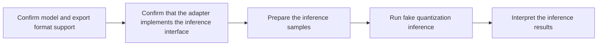

# Fake Quantization Inference Usage Guide

## 1. Scope

This guide is intended for developers and algorithm engineers who have already produced quantized weights through msModelSlim and need to **perform accuracy verification on small-sample scenarios such as bad cases**.

**Applicable scenarios**:

- A quantization export has been generated through `msmodelslim quant`, and small-sample accuracy verification independent of the inference engine is needed.
- Large language models (LLMs) and multimodal understanding models (VLMs) are supported.
- Currently only quantized weights in the AscendV1 format are supported.

**Not applicable scenarios**:

- Fake quantization inference currently does not support multimodal generation models (DiT).
- Accuracy testing on large-scale samples is required, such as dataset accuracy verification. Because fake quantization inference uses small torch operators for forward inference and loads weights layer by layer, its inference performance is not suitable for accuracy testing on large-scale samples.

## 2. Process Relationships and Prerequisites

**Parent process**: [Quantization Inference Accuracy Anomaly Locating](process_quantization_accuracy_anomaly_locating.md).

**Prerequisites**:

- One-click quantization has been used to generate the quantization export.
- The runtime dependencies have been prepared according to the model release page and the corresponding integration guide: different models often require specific versions of `transformers` and other packages (consistent with the requirements of the one-click quantization feature).
- The input samples to be verified have been determined (such as bad cases from dataset testing).

**Follow-up operations**:

- Verification passed: the quantized weights can proceed to the deployment and evaluation stage.
- Verification failed: adjust the quantization scheme following the [Quantization Accuracy Tuning Guide](process_quantization_precision_tuning.md) and re-quantize, then return to this process for verification.

## 3. Inputs and Deliverables

| Type | Name | Source or Location | Format or Constraint | Acceptance Method |
| --- | --- | --- | --- | --- |
| Input | Quantization export | Quantized weight save directory | The directory is readable | The quantization export is complete |
| Input | Inference sample file | Local user path | The extension is `.json` or `.jsonl` | Parsable by `msmodelslim eval`, non-empty, and compliant with the conventions of the corresponding model |
| Deliverable | Fake quantization inference results | Standard output (log) | Inference results are displayed per sample | The number of samples matches the input, and the output order corresponds to the input order |

## 4. Process Overview

First confirm that the model and the export format are within the supported scope, implement the inference interface of the adapter as needed, then prepare the inference samples, then run fake quantization inference, and finally interpret the inference results.



## 5. Procedure

### Step 1: Confirm Model and Export Format Support

**Objective**: confirm that the model to be verified is within the supported scope and that the weights are in a supported quantization format.

**Action**:

1. Confirm the model type: the model has been integrated into msmodelslim and `model_type` has been registered.
2. Confirm the quantization format: currently only the **AscendV1** quantization format is supported (exported by `ascendv1_saver`).
3. Confirm that the quantization type is supported: fake quantization inference currently supports the following quantization types.

| Quantization Type | Support Status | Description |
|----------|----------|---------|
| w8a8 | ✅ Supported | Supports INT8 and MXFP8 |
| c8 | ✅ Supported | Supports FA quantization and KVCache quantization |

**Output**: the selected `${MODEL_TYPE}` and the confirmed available quantization export directory `${MODEL_PATH}`.

**Pass conditions**: when fake quantization inference is started with `--model_type ${MODEL_TYPE}`, the log shows that the expected model adapter is hit, with no errors about an unknown model or an unhit adapter.

### Step 2: Confirm That the Adapter Implements the Inference Interface

**Objective**: ensure that the model adapter corresponding to `${MODEL_TYPE}` implements [`FakeQuantInferenceInterface`](../../../msmodelslim/core/infer_engine/interface.py).

**Action**:

- Check whether the adapter already implements this interface: find the corresponding model adapter under `msmodelslim/model/` and view its class definition.
- If it is not implemented, implement the interface as described below, and after completion run `bash install.sh` again in the repository root to make the code changes take effect

  Interface methods:

  | Method | Responsibility |
  | --- | --- |
  | `handle_dataset` | Converts inference samples into model inputs |
  | `build_meta_model` | Builds the floating-point model structure (without reading weights) |

  Implementation notes:

  - `handle_dataset` is defined consistently with the method of the same name in [`PipelineInterface`](../../../msmodelslim/core/runner/pipeline_interface.py) used by one-click quantization, so implementing it once is enough to reuse it.
  - `build_meta_model` builds the floating-point model structure, and the internal engine later automatically rebuilds the quantized structure based on it. Because the input does not provide floating-point weights, the implementation of this method must avoid model construction methods that load weights. Take [`qwen3/model_adapter.py`](../../../msmodelslim/model/qwen3/model_adapter.py) as an example:

  ```python
  class Qwen3ModelAdapter(DefaultModelAdapter, FakeQuantInferenceInterface, ...):
      def build_meta_model(self) -> nn.Module:
          try:
            from transformers import AutoModelForCausalLM
          except ImportError as exc:
            raise InvalidModelError(
                "Failed to import AutoModelForCausalLM for fake-quant inference shell",
                action="Please install a transformers version that provides AutoModelForCausalLM.",
            ) from exc
          origin_layers = int(self.config.num_hidden_layers)
          if hasattr(self.config, "use_cache"):
              self.config.use_cache = False
          from accelerate import init_empty_weights

          with init_empty_weights(include_buffers=False):
              model = AutoModelForCausalLM.from_config(
                  self.config,
                  trust_remote_code=self.trust_remote_code,
              )

          get_logger().info(
              "Built Qwen3 fake-quant inference shell: %d decoder layers (meta params, CPU non-persistent buffers)",
              origin_layers,
          )
          return model
  ```

  When creating a model based on the `init_empty_weights` of the `accelerate` library, only the model structure is built without loading weights; note to specify `include_buffers=False`. When `include_buffers=True`, buffer-type parameters (such as the `inv_freq` of RoPE) are created on meta, which makes runtime buffers such as RoPE invalid and shows up as silently abnormal inference results. Because fake quantization inference internally simulates decode through multiple rounds of prefill and does not actually maintain a KVCache, `self.config.use_cache = False` must be specified.

**Output**: an adapter that is registered and implements `FakeQuantInferenceInterface`.

**Pass conditions**: starting with that `--model_type` correctly hits the adapter, with no errors about an unsupported interface.

### Step 3: Prepare the Inference Samples

**Objective**: prepare the sample file to be verified by inference.

**Action**:

- **LLM**: the extension is `.json` or `.jsonl`.

  ```json
  [
    "Where is the capital of China?",
    "I want to learn about Deep Learning. Please tell me more about it."
  ]
  ```

- **VLM**: the file must be named `index.json` or `index.jsonl`.

  Example of index.json:

  ```json
  [
    {"image": "COCO_train2014_000000577589.jpg", "text": "How many people in the picture? "},
    {"image": "COCO_train2014_000000577592.jpg", "text": "Describe the picture. "}
  ]
  ```

**Output**: the inference sample file `${PROMPT_FILE}`.

**Pass conditions**: the file is non-empty, the format matches the model type, and the extension is `.json` or `.jsonl`.

### Step 4: Run Fake Quantization Inference

**Objective**: run inference on the target device and obtain the per-sample generation results.

**Pre-Execution Checks**:

- The format, export, sample, and adaptation confirmations in Steps 1-3 are completed.
- Multi-device parallelism is enabled only through `--device_id` with multiple device indices under `--device npu`.

**Action**:

Replace the variables with actual values as described in the [msmodelslim eval Command-Line API Document](../api_reference/cli/msmodelslim_eval.md) and then run the command. For multiple devices, append multiple device indices, for example:

```bash
msmodelslim eval \
  --model_type ${MODEL_TYPE} \
  --model_path ${MODEL_PATH} \
  --prompt_file ${PROMPT_FILE} \
  --device npu \
  --device_id 0 1 2 3 \
  --max_new_tokens 5
```

**Output**: the per-sample `token_ids` and `generated_text` in the standard output; for multiple devices, each result carries its rank and device affiliation.

**Pass conditions**: the command ends normally, the number of samples matches the input, and the result order corresponds one-to-one with the input order.

**Audit Record**: the actual command line, `${MODEL_TYPE}`, the quantization export path and quantization configuration, the sample file path, and the key logs (including the generation results of each sample).

### Step 5: Interpret the Inference Results

**Objective**: understand the per-sample inference results in the log output and judge whether the generation content of the fake quantization model meets expectations.

**Action**:

1. Read the log output and confirm the sample scale and the parallel mode. The result formats for single-device and multi-device runs are as follows:

   ```text
   Fake-quant inference results (1 sample(s), 8 device(s)):
   Fake-quant sample[0] (rank=0, device=0) token_ids=[29660, 344, 270, 6102, 294] generated_text=' Beijing is the capital of'
   ```

2. Judge whether the results meet expectations:

   - **Count and order**: the number of result entries matches the number of samples in `${PROMPT_FILE}`, the `sample` index increases consecutively, and the content corresponds one-to-one with the input samples.
   - **Semantics**: the generated text should be fluent and consistent with the input semantics. In the example, the question is `Where is the capital of China?` and the output `' Beijing is the capital of'` has already answered `Beijing`; the truncation in the sentence is expected behavior controlled by `--max_new_tokens`. When a more complete answer is needed, increase that parameter and rerun.

**Output**: the per-sample `token_ids` and `generated_text`.

**Pass conditions**: the number and order of the results are consistent with the input samples.

## 6. Acceptance Conditions

- The quantization export completes inference on the target device, and the per-sample inference results are interpretable.

## 7. Troubleshooting

| Symptom | Direction of Action |
| --- | --- |
| Adapter is reported as not implementing the required interface | Implement `FakeQuantInferenceInterface` as described in Step 2 and rerun `bash install.sh`, then retry |
| The export cannot be loaded | Check whether `--model_path` is a complete quantization export directory; currently only the AscendV1 format is supported |
| First token decoding error | Check the transformers version and keep it consistent with the version required by quantization |

## 8. Terminology

| Term | Brief Description | Link |
| --- | --- | --- |
| AscendV1 quantization format | The currently supported quantization export format | [AscendV1 Quantization Format Terminology Entry](../knowledge_base/quantization_format/ascendv1/term_ascendv1.md) |
| Data parallelism (DP) | The method of splitting samples across devices for parallel inference in a multi-device setup | [Data Parallelism](../knowledge_base/parallel/data_parallelism/term_data_parallelism.md) |

## 9. Interface Documentation List

| API or Capability | Brief Description | Link |
| --- | --- | --- |
| `msmodelslim eval` | Command-line entry point for fake quantization inference verification | [msmodelslim eval Command-Line API Document](../api_reference/cli/msmodelslim_eval.md) |
