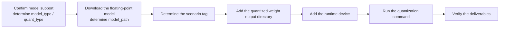

# One-Click Quantization Usage Guide

## 1. Scope

**One-click quantization** is a quantization capability built into msModelSlim: for mainstream models already included in the support matrix, users only need to specify the model name and the quantization type, and the tool automatically matches the officially verified best practice configuration to complete the quantization.

This guide is intended for developers who want to quickly obtain deployable quantized weights on an Ascend NPU or CPU (usable with no prior experience); it applies to the following scenarios:

- The target model is already included in the [Foundation Model Support Matrix](../knowledge_base/model/README.md) and is marked as supporting "one-click quantization", so no custom quantization strategy is needed;
- A standard quantization mode already verified and built into the tool (such as W8A8 or W4A8) is used, with no special accuracy or algorithm customization requirement.

This guide is **not applicable** in the following cases; use another path instead:

- The model is not included in the support matrix or has not been verified: refer to the [New Model Quantization Tuning Process](process_new_model_quantization_tuning.md);
- In-depth customization of the quantization algorithm combination, the calibration dataset, or other strategies is required: refer to the [New Model Quantization Tuning Process](process_new_model_quantization_tuning.md) to formulate a scheme.

## 2. Process Relationships and Prerequisites

**Parent process**: when the user performs deployment following the [Mainstream Model Quantization Deployment Process Guide](process_mainstream_model_deployment.md), weight quantization must be completed first; enter this guide from the "obtain quantized weights" stage of the deployment guide.

**Prerequisites**:

- msModelSlim is installed with a compatible version; see the [msModelSlim Installation Guide](../install_guide/install_guide.md);
- An Ascend NPU environment is recommended (run `npu-smi info` to confirm that the device status is normal), or a CPU environment may be used (lower execution efficiency; not recommended), with sufficient disk space;
- The floating-point weight directory of the target model has been obtained or can be downloaded (supporting files such as the tokenizer are provided together with the weight directory).

**Follow-up operations**: after the quantized weights are delivered for deployment, proceed to the "deploy the inference service" section of the [Mainstream Model Quantization Deployment Process Guide](process_mainstream_model_deployment.md#step-2-deploy-the-inference-service); if the deployment evaluation reveals abnormal accuracy, enter the [Quantization Inference Accuracy Anomaly Locating Process Guide](process_quantization_accuracy_anomaly_locating.md).

## 3. Inputs and Deliverables

| Type | Name | Source or Location | Format or Constraint | Acceptance Method |
| --- | --- | --- | --- | --- |
| Input | Floating-point model weight directory `${MODEL_PATH}` | Downloaded from ModelScope/HuggingFace or proprietary weights | Model configuration, weight shards, and auxiliary files required by the category (such as tokenizer and config) | The files are complete; if the official source provides a checksum or version number, the corresponding local value must match the official one. |
| Deliverable | Quantized weight directory `${SAVE_PATH}` | User-specified save path | The description file and weight shards required by the selected export format (such as `quant_model_description.json` for AscendV1) | The log outputs SUCCESS; the files are complete; the conventions of the selected export format are met |

## 4. Process Overview

This process is divided end to end into seven stages: confirm model support, download the floating-point model, determine the scenario tags, add the quantized weight output directory, add the runtime device, run the quantization command, and verify the deliverables.



## 5. Procedure

### Command-Line Preview

```bash
msmodelslim quant \
  --model_path ${MODEL_PATH} \          # Floating-point weight directory
  --save_path ${SAVE_PATH} \            # Quantized weight output directory
  --device npu \                        # Quantization device type, such as npu, cpu; for multiple devices, add --device_id 0 1 2 3
  --model_type ${MODEL_TYPE} \          # Model name registered or in the support matrix; case-sensitive
  --quant_type ${QUANT_TYPE} \          # Quantization type, such as w8a8
  --tags ${TAG} \                        # Scenario tag, such as vLLM-Ascend Atlas_A2_Inference
  --trust_remote_code false             # Set to true only for trustworthy models when necessary
```

### Pre-Execution Checklist

Before downloading and quantizing, check each item in the following checklist; if any item fails, resolve it before continuing with the subsequent steps. Running this pre-check once more before one-click quantization is recommended.

| No. | Check Item | Recommended Command | Pass Criteria |
| --- | --- | --- | --- |
| 1 | The original weights have not been changed unexpectedly | `ls -lt <floating-point model directory> \| head` or `stat <key weight file>`; record and compare the last modification time | The modification times after download and before quantization are consistent, with no unexpected changes |
| 2 | Sufficient hard disk space | `df -h` | The free space on the partitions holding the floating-point directory and the quantization output directory covers the model size, the quantization artifacts, and a margin |
| 3 | The NPU is not occupied | `npu-smi info` | The target device status is normal, with no unexpected long-running tasks occupying it |

### Step 1: Confirm Model Support

**Objective**: confirm that the target model is included in the support matrix and that the selected quantization mode has been verified - this is the prerequisite for all subsequent steps.

**Action**:

1. **Confirm that the model is included**: look up the target model in the [Foundation Model Support Matrix](../knowledge_base/model/README.md). The support matrix is the officially verified list of "model x quantization mode" combinations for msModelSlim; the model name (`model_type`, case-sensitive, and it must exactly match the support matrix) and the dependency library requirements (such as the transformers version) are the direct inputs of the subsequent commands, so record them first.
2. **Confirm the verification status of the quantization mode**: confirm that the selected quantization mode (such as `w8a8`) has been marked as verified for that model. A model marked as supporting "one-click quantization" can be quantized directly according to this guide.

> **Optional: learn about quantization algorithms and format selection**
>
> By default there is no need to care about algorithm and format details; the tool automatically matches the best practice configuration. To understand the differences between algorithms such as outlier suppression and linear quantization, see the [Quantization Algorithm Overview](../knowledge_base/quantization_algorithms/README.md); to select an export format (AscendV1, compressed-tensors, and so on), see the [Quantization Format Terminology Entry](../knowledge_base/quantization_format/README.md).

**Output**: the confirmed `${MODEL_TYPE}` and `${QUANT_TYPE}` (that is, the values of the `--model_type` and `--quant_type` parameters).

**Pass conditions**: the combination of that model and quantization mode is marked as verified in the support matrix.

### Step 2: Download the Floating-Point Model

**Objective**: obtain a floating-point weight directory consistent with the `model_type` in the support matrix.

**Action**:

1. Obtain the complete weights from [ModelScope](https://www.modelscope.cn/), [Hugging Face](https://huggingface.co/), or the team's internal model storage location to a local directory; for the specific download method, refer to the documentation of the corresponding community or repository.
2. Verify that the directory contains the configuration, weight shards, tokenizer, and other auxiliary files. If the official page provides file checksums (such as MD5/SHA256) or an explicit version/commit ID, just confirm that it matches the local download result.

**Output**: the floating-point weight directory `${MODEL_PATH}` (that is, the value of the `--model_path` parameter).

**Pass conditions**: the model can be loaded normally by the target transformers version.

### Step 3: Determine the Scenario Tags

**Objective**: determine the target inference scenario (`--tags`) so that the tool can match the verified best practice configuration for that scenario.

**Action**:

The scenario tag (`--tags`) tells the tool "in which environment the quantized model will run". Two categories of scenario tags are supported; one scenario can be specified for each category, and multiple tags are separated by spaces. The values are described below:

| Tag Category | Value | Description |
| --- | --- | --- |
| Inference engine | `MindIE` | The quantized model runs on the MindIE inference engine |
| Inference engine | `vLLM-Ascend` | The quantized model runs on the vLLM-Ascend inference engine |
| Inference engine | `SGLang` | The quantized model runs on the SGLang inference engine |
| Hardware form | `Atlas_A2_Inference` | The quantized model runs on Atlas A2 inference cards |
| Hardware form | `Atlas_A3_Inference` | The quantized model runs on Atlas A3 inference cards |
| Hardware form | `Atlas_A2_Training` | The quantized model runs on Atlas A2 training cards |
| Hardware form | `Atlas_A3_Training` | The quantized model runs on Atlas A3 training cards |
| Hardware form | `Atlas_300I_Duo` | The quantized model runs on Atlas 300I Duo inference cards |
| Hardware form | `Ascend_950` | The quantized model runs on Ascend 950PR&950DT products |

> For the official documentation corresponding to each inference engine value, see the [MindIE Documentation](https://mindie-motor.readthedocs.io/en/latest/), the [vLLM-Ascend Documentation](https://docs.vllm.ai/projects/ascend/en/latest/index.html), and the [SGLang Documentation](https://docs.sglang.io/); for the product form description corresponding to each hardware form value, see the [Ascend Hardware Form Description](https://www.hiascend.com/document/detail/en/AscendFAQ/ProduTech/productform/hardwaredesc_0001.html).

**Note**:

- Tags are case-insensitive;
- When no verified scenario is hit, the tool asks whether to adopt a configuration that ignores scenario tags.

**Output**: the determined `${TAG}`.

**Pass conditions**: the `--tags` value is consistent with the target inference environment.

### Step 4: Add the Quantized Weight Output Directory

**Objective**: specify the output directory of the quantized weights.

**Action**:

Add the `--save_path` parameter to the command:

- **Fill in**: `${SAVE_PATH}` is a custom output path; creating a separate directory is recommended, for example `~/qwen36_27b_w8a8`.
- **Note**: make sure there is sufficient disk space.

**Output**: the quantization command with the input and output paths specified.

**Pass conditions**: the `--save_path` value is confirmed and points to the quantized weight output directory.

### Step 5: Add the Runtime Device

**Objective**: specify on which device the quantization runs.

**Action**:

`--device` is an optional parameter; when it is not specified, a single NPU device is used by default. To specify it explicitly, refer to the following values:

- **Fill in**: `--device` specifies the device type: `npu` (default) or `cpu`; for multiple devices, additionally use `--device_id` to specify the device indices, such as `--device_id 0 1 2 3`.
- **Note**: when multiple devices are specified, distributed layer-wise quantization is automatically enabled; see "Optional: multi-device distributed quantization" below.

**Output**: the quantization command already contains the device parameter (or uses the default value).

**Pass conditions**: confirm that the device value meets the requirement (default single device, or explicitly specified multiple devices/CPU).

> **Optional: multi-device distributed quantization**
>
> In scenarios with limited on-chip memory, multiple NPU devices can be specified to automatically enable distributed layer-wise quantization; just change `--device` to multiple devices, for example `--device npu --device_id 0 1 2 3`.
>
>
> **Note**: whether multi-device quantization is supported depends on the specific algorithm; the algorithms in some best practices may not yet be adapted for multiple devices, so confirm that the corresponding algorithm supports multiple devices before use. For the list of currently supported multi-device algorithms, see the [Parallel Mechanism Support List](../knowledge_base/parallel/README.md#3-parallel-mechanism-support-list).
> For descriptions of multi-device quantization and layer-wise quantization, see the [Multi-Device Quantization Parallel](../knowledge_base/parallel/README.md).

### Step 6: Run the Quantization Command

**Objective**: run the quantization command to complete the quantization.

**Pre-Execution Checks**:

- The target NPU device is idle and available; do not share computing resources with other training/inference tasks before quantization.
- `trust_remote_code` defaults to `false`; set it to `true` only when the model must execute custom code in the repository and the source is trustworthy.

**Action**:

Replace the variables with actual values as described in the [Command-Line Preview](#command-line-preview) and then run the command.

> **Optional: best practice matching logic (for reference)**
>
> After `--quant_type` is specified, the tool first matches, in the best practice library, the configuration where both the model-specified quantization method and the scenario tag are hit; if the model has no verified configuration in the target scenario (the best practice library only includes combinations of verified scenarios), the tool asks in turn whether to adopt a configuration that ignores scenario tags and then a configuration using the model-recommended quantization method; enter `y` as prompted to continue. For the complete search priority, see "Best Practice Matching Search Priority" in [Parameter Relationships](../api_reference/cli/msmodelslim_quant.md#4-parameter-relationships).

**Output**: the log outputs `===========SUCCESS===========` and the quantized weight directory `${SAVE_PATH}` is generated.

**Pass conditions**: the SUCCESS marker appears in the quantization run log, with no unhandled ERROR.

### Step 7: Verify the Deliverables

**Objective**: confirm that the newly added quantization deliverable files are complete and usable, and leave a reproducible configuration record.

**Action**:

1. **Check the newly added files**: in addition to the configuration files copied from the floating-point model (such as `config.json` and `tokenizer_config.json`), the `${SAVE_PATH}` directory contains the following newly added quantization files after quantization (deliverable list, taking the AscendV1 format as an example):

   ```text
   ${SAVE_PATH}/
   ├── quant_model_description.json      # Quantized weight description file (AscendV1 format; an important basis for the inference framework to load the quantized model)
   ├── quant_model_weights-00001-of-*.safetensors   # Quantized weight shards
   └── ${MODEL_TYPE}_best_practice.yaml  # The complete configuration record of this quantization (can be used to reproduce the scheme)
   ```

   For the meaning of the output files, see the [AscendV1 Usage Guide](../knowledge_base/quantization_format/ascendv1/ascendv1_usage.md).

   > **Note**: the deliverable files differ between export formats. For example, the compressed-tensors format has no `quant_model_description.json`, and its quantization metadata is written into the `quantization_config` field of `config.json`; for the file structure of each format, see the [Quantization Format Terminology Entry](../knowledge_base/quantization_format/README.md).
2. **Save the configuration record**: retain the `*_best_practice.yaml` generated under `${SAVE_PATH}` as the reproduction basis and audit record of this quantization.

**Output**: the `${SAVE_PATH}` quantized weight directory that passes verification and the quantization configuration record.

**Pass conditions**: the description file required by the selected export format and all weight shards exist (such as `quant_model_description.json` for AscendV1); if any key file is missing, the quantized weights must not proceed to the deployment stage.

**Audit Record**: the quantized weight directory path, the content of the `*_best_practice.yaml` file, and the quantization log (including the SUCCESS marker).

## 6. Acceptance Conditions

Once the quantized weight directory passes the verification in Step 7 (the description file required by the selected export format and all weight shards are complete, and the SUCCESS marker appears in the quantization log), the delivery is complete and the deployment process can begin; verifying before deployment that the quantized weights can be loaded by the inference framework according to the deployment guide is recommended.

## 7. Troubleshooting

- **Interactive query scenario**: when `--tags` or `--quant_type` hits no verified configuration, the tool asks whether to adopt the recommended configuration; after confirming that the scenario matches the recommended configuration, execute as prompted;
- **Quantization failure or OOM**: first check the NPU status (`npu-smi info`) and whether the environment variable `ASCEND_RT_VISIBLE_DEVICES` points to a valid idle device; when memory is insufficient (OOM), switch to an idle device, or enable layer-wise quantization or distributed layer-wise quantization;
- **Model loading error**: confirm that the versions of dependency libraries such as transformers are consistent with the support matrix requirements, and add `--trust_remote_code true` if necessary (trustworthy models only);
- **Abnormal accuracy after deployment evaluation**: when the quantized weights have been delivered but the deployment evaluation shows badcases or abnormal output, enter the [Quantization Inference Accuracy Anomaly Locating Process Guide](process_quantization_accuracy_anomaly_locating.md) to locate the anomaly point, and re-quantize after tuning according to the [Quantization Accuracy Tuning Guide](process_quantization_precision_tuning.md).

## 8. Case List

| Case | Brief Description | Link |
| --- | --- | --- |
| DeepSeek-V4-Flash W8A8 one-click quantization | A complete closed loop from environment preparation to one-click quantization, quantized weight check, and inference deployment and evaluation | [DeepSeek-V4-Flash W8A8 One-Click Quantization Case](../best_practices/deepseek_v4_flash_w8a8_quick_quantization_case.md) |

## 9. Terminology

| Term | Brief Description | Link |
| --- | --- | --- |
| Foundation Model Support Matrix | The officially verified "model x quantization mode" support list, including dependency library requirements | [Foundation Model Support Matrix](../knowledge_base/model/README.md) |
| Quantization mode | The naming convention `W{weight bits}A{activation bits}[C{KV Cache bits}][S]`, for example W8A8 means both the weights and the activations are quantized to 8 bit | [Quantization Modes](../knowledge_base/quantization_mode/README.md) |
| Quantization format | The export format of quantized weights, such as AscendV1 and compressed-tensors | [Quantization Format Terminology Entry](../knowledge_base/quantization_format/README.md) |

## 10. Interface Documentation List

| API or Capability | Brief Description | Link |
| --- | --- | --- |
| `msmodelslim quant` | The one-click quantization command, including the full parameter description and usage examples | [msmodelslim quant Command-Line API Document](../api_reference/cli/msmodelslim_quant.md) |

## 11. Security Notes

- `trust_remote_code` remains `false` by default; enable it only for trustworthy models when necessary.
- Evaluation logs, calibration data, quantization artifacts, and ModelScope publication content should be controlled according to business permissions.

## 12. Appendix

### 12.1 Protocol Version Maintenance Policy

The one-click quantization configuration selects the version of the backend quantization service through the `apiversion` field. The maintenance policy of each protocol version is as follows:

| Protocol Version | Maintenance Policy | Status |
| --- | --- | --- |
| modelslim_v0 | To be deprecated | Not recommended |
| modelslim_v1 | Being improved gradually | Recommended |
| multimodal_vlm_modelslim_v1 | Being improved gradually | Recommended |
| multimodal_sd_modelslim_v1 | Being improved gradually | Recommended |

**Description**:

- The `modelslim_v0` protocol version will be deprecated soon and is not recommended; use `modelslim_v1` or a newer protocol version;
- `modelslim_v1`, `multimodal_vlm_modelslim_v1`, and `multimodal_sd_modelslim_v1` are being improved gradually and are the currently recommended versions;
- For the values, mandatory status, and `spec` structure description of the `apiversion` field, refer to the [modelslim_v1 Configuration Reference](../api_reference/config/quant/modelslim_v1.md), the [multimodal_vlm_modelslim_v1 Configuration Reference](../api_reference/config/quant/multimodal_vlm_modelslim_v1.md), and the [multimodal_sd_modelslim_v1 Configuration Reference](../api_reference/config/quant/multimodal_sd_modelslim_v1.md).
