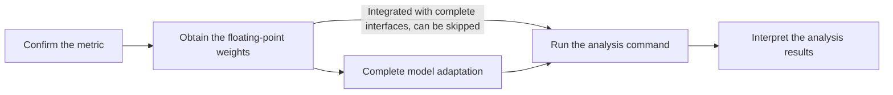

# Attention Head Screening and Analysis Usage Guide

## 1. Scope

This guide is intended for developers and algorithm engineers who need to identify key attention heads (induction heads and echo heads) at the **Attention Head** granularity through the `msmodelslim analyze attn_head` command line, and generate a `head.pt` file from the results for delivery to the MindIE inference framework (for long-sequence KV Cache compression).

**Applicable scenarios**:

- **LLM model**: `attn_head` analysis currently supports only large language models.
- RA Compress compression scheme design: identify the KV Cache heads with prefix matching (induction heads) and copying matching (echo heads) capabilities, and form the list of key heads that must be retained for long-sequence KV Cache compression in MindIE.
- When the accuracy target is not met, adjust `induction_head_ratio` / `echo_head_ratio` to re-screen the head list, or adjust the KV Cache compression strategy of MindIE.

> **Purpose of the artifact**: the `head.pt` produced by this guide is the key head list delivered for use by the **MindIE inference framework**: configure the path of this file into the parameters related to long-sequence KV Cache compression in MindIE to complete long-sequence compression, and the compressed model can then be used for subsequent inference deployment; for the specific list of already-adapted quantized models, see the "MindIE Supported Model List" section of [What Is MindIE](https://www.hiascend.com/document/detail/en/mindie/10RC3/whatismindie/mindie_what_0001.html). This artifact is not written into the quantization configuration (it does not participate in fields such as `exclude` / `include` of the quantization YAML).

**Not applicable scenarios**:

- **Multimodal understanding models (VLM)**: not supported.
- **Multimodal generation models** (text-to-image, text-to-video, etc.): not supported.
- Need to fall back or increase the bit width by single linear layer: see the [Sensitive Linear Layer Analysis Usage Guide](usage_sensitive_linear_analysis.md).
- Need to fall back by Decoder block or by whole Attention, MLP, or MoE blocks: see the [Layer-wise Sensitive Layer Analysis Usage Guide](usage_sensitive_layer_analysis.md).
- Identify the Attention modules that need to fall back when FA quantization is applied: see the [Attention Sensitive Layer Analysis Usage Guide](usage_sensitive_attn_analysis.md).

## 2. Process Relationships and Prerequisites

**Parent process**: [New Model Quantization Tuning Process](process_new_model_quantization_tuning.md).

**Prerequisites**:

- msModelSlim is installed (see the [msModelSlim Installation Guide](../install_guide/install_guide.md)).
- The target model is an LLM, and a usable `--model_type` has been determined (consistent with the support matrix or the adapter registration name, case-sensitive; adaptation is usually completed in the parent process or the weight quantization process).
- A usable Ascend NPU is available (single-device: `--device npu`; multi-device: `--device npu --device_id 0 1 ...`; `--device cpu` is only for small-scale debugging).
- The target adapter already implements `RaCompressAnalysisInterface` (`get_proj_names` provides the Q, K, and QKV projection layer name fragments, and `get_tokenizer` returns the model's own tokenizer; both are required methods), or the default mode (`q_proj`, `k_proj`, `qkv_proj`) and the fallback first token are used.

**Follow-up operations**:

- Provide the generated `head.pt` file to the MindIE inference framework (configure the path of this file into the parameters related to long-sequence KV Cache compression in MindIE). Users can complete long-sequence compression accordingly, and the compressed model can then be used for subsequent inference deployment; for the specific list of already-adapted quantized models, see the "MindIE Supported Model List" section of [What Is MindIE](https://www.hiascend.com/document/detail/en/mindie/10RC3/whatismindie/mindie_what_0001.html). This artifact is not written into the quantization configuration.

## 3. Inputs and Deliverables

| Type | Name | Source or Location | Format or Constraint | Acceptance Method |
| --- | --- | --- | --- | --- |
| Input | Floating-point model directory | Local user path; usually obtained from ModelScope / Hugging Face | Model configuration, weight shards, tokenizer, and other auxiliary files | The path is valid and the model can be loaded by the target `model_type` |
| Input | Calibration input (built into the algorithm) | Controlled input constructed by the algorithm itself at runtime; no user input required | First token + 2500 random tokens x 4 repeated segments, total length `1 + 2500 x 4` | No verification required; not affected by `--calibration_dataset` |
| Deliverable | Head screening results | Standard output (induction and echo head lists) and an optional `head.pt` file | `head.pt` is a `.pt` file serialized from a Python dict, delivered to the MindIE inference framework for long-sequence KV Cache compression | The expected layer and head ranges can be identified, and `head.pt` can be loaded by the long-sequence KV Cache compression capability of MindIE |

## 4. Process Overview

After confirming the `attn_head` scenario and the `ra_compress` metric, prepare the floating-point weights, complete model adaptation (including the RA Compress interface) as needed, and then run the analysis command and interpret the results to generate the key head list `head.pt` delivered for use by the MindIE inference framework. The calibration input (first token + randomly repeated segments) is automatically constructed by the algorithm at runtime, so no separate calibration dataset needs to be prepared.



## 5. Procedure

### Command-Line Preview

```bash
msmodelslim analyze attn_head \
  --model_type ${MODEL_TYPE} \          # Model name registered or in the support matrix; case-sensitive
  --model_path ${MODEL_PATH} \          # Floating-point weight directory
  --metrics ${METRICS} \               # Analysis metric; fixed to ra_compress
  --device npu \                        # Analysis device: npu, cpu; for multiple devices, add --device_id 0 1 2 3
  --trust_remote_code false \           # Defaults to false; set to true only for trustworthy models when necessary
  --save_path ${SAVE_PATH}              # Optional; if specified, head.pt is saved; otherwise it is only printed to the console
```

### Step 1: Confirm the Recommended Metric

**Objective**: select `${METRICS}` in the command-line preview.

**Action**:

Set `${METRICS}` to one of the values in the following table:

| Optional Metric | Applicable Description | Algorithm Description | Recommendation |
| --- | --- | --- | --- |
| `ra_compress` | Identifies attention heads with prefix matching and copying matching capabilities, for KV Cache compression | RA Compress algorithm: take the mean of the Q@K^T attention scores at specific segment-offset positions, and select the top heads proportionally (`induction_head_ratio` defaults to 0.14 and `echo_head_ratio` defaults to 0.01; they can be adjusted in the `metric_params` of the `unary_analysis` configuration) | The only optional metric at present; just select it |

**Output**: the selected `${METRICS}`.

**Pass conditions**: `${METRICS}` is one of the optional values in the table above.

### Step 2: Obtain the Floating-Point Weights

**Objective**: prepare a loadable floating-point model directory.

**Action**:

1. Obtain the complete weights from [ModelScope](https://www.modelscope.cn/), [Hugging Face](https://huggingface.co/), or the team's internal model storage location to a local directory; for the specific download method, refer to the documentation of the corresponding community or repository.
2. Verify that the directory contains the configuration, weight shards, tokenizer, and other auxiliary files. If the official page provides file checksums (such as MD5/SHA256) or an explicit version/commit ID, just confirm that it matches the local download result.

> `ra_compress` does not require users to provide a calibration dataset: the calibration input is a controlled input built into the algorithm and is automatically constructed at runtime (first token + 2500 random tokens x 4 repeated segments, total length `1 + 2500 x 4`). The `--calibration_dataset` and `--top_k` command-line options are not provided under `attn_head` (passing them reports `unrecognized arguments`); the tokenizer in the model directory is used to parse the first token, and if it is missing, the fallback token ID is used and a warning is issued.

**Output**: a loadable floating-point model directory.

**Pass conditions**: the model directory can be loaded and contains auxiliary files such as the tokenizer.

### Step 3: Complete Model Adaptation

**Objective**: ensure that a model adapter that can be hit by `msmodelslim analyze --model_type <model name>` exists; the adapter already implements the required methods of the `RaCompressAnalysisInterface` interface or uses the default projection layer name mode.

**Action**:

- **Not yet integrated models**: complete adapter development and registration first, and then proceed to Step 4. For general adaptation requirements, see the [LLM Model Integration Quantization Workflow Guide](../knowledge_base/ptq/llm/integration_guide_large_language_model_quantization.md).
- **Models already integrated in the support matrix**: general adaptation can be skipped; just confirm the `--model_type` name in use.
- **Additional algorithm-side interfaces**: `RaCompressAnalysisInterface` is integrated based on type determination - the adapter is recognized by the metric side only if it implements this interface. `get_proj_names()` returns the name fragments of the Q, K, and QKV projection layers (such as `q_proj`, `k_proj`, `qkv_proj`); an empty string means that the projection does not exist and is not treated as "matching all Linear". `get_tokenizer()` returns the tokenizer actually used by the model (usually `AutoTokenizer.from_pretrained(model_path)`). Both are required methods, and the adapter cannot be instantiated if either is missing; when the tokenizer is not provided (returns `None` or raises an exception), the metric side takes the first token of the calibration input following the built-in fallback path and issues a warning. If the adapter does not implement this interface, the default mode (`q_proj`, `k_proj`, `qkv_proj`) is used. For the interface definition, see [ra_compress/interface.py](../../../msmodelslim/processor/analysis/unary_operator/metrics/ra_compress/interface.py).

After completing or modifying the adapter, run `bash install.sh` again in the repository root so that the registration takes effect.

**Output**: a model adapter that is registered and can be hit by the CLI (corresponding to `--model_type`); the adapter already provides the `RaCompressAnalysisInterface` capability (implements `get_proj_names` and `get_tokenizer`) or can correctly match projection layers using the default mode.

**Pass conditions**: starting the analysis with that `model_type` correctly hits the adapter; the Q, K, and QKV projection layers are correctly identified and their outputs are collected.

### Step 4: Run the Analysis Command

**Objective**: run `msmodelslim analyze attn_head` to obtain the induction head and echo head screening results, and optionally save `head.pt`.
**Pre-Execution Checks**:

- The metric, weights, and model adaptation confirmations in Steps 1-3 are completed.
- `trust_remote_code` defaults to `false`; set it to `true` only when the model must execute custom code in the repository and the source is trustworthy.
- `--calibration_dataset` and `--top_k` are not provided: the calibration input of `ra_compress` is constructed by the algorithm itself at runtime (see Step 2), and these two parameters are not accepted under `attn_head`.

**Action**:

Replace the variables with actual values as described in the [Command-Line Preview](#command-line-preview) and then run the command. Example:

```bash
msmodelslim analyze attn_head \
  --model_type Qwen2.5-7B-Instruct \
  --model_path /data/models/Qwen/Qwen2.5-7B-Instruct/ \
  --metrics ra_compress \
  --device npu \
  --trust_remote_code true \
  --save_path ./head_result
```

**Output**: the induction and echo head screening results in the standard output. If `--save_path` is specified, the `head.pt` file is saved at the same time.

**Pass conditions**: the command ends normally; the output contains the induction heads and echo heads lists; if `--save_path` is specified, the `head.pt` file is generated successfully.

**Audit Record**: the actual command line, `${MODEL_TYPE}`, `${METRICS}`, a summary of the standard output results (or the path of the saved log), and the `head.pt` file path (if specified).

### Step 5: Interpret the Analysis Results and Deliver Them to the MindIE Inference Framework

**Objective**: understand the induction and echo head screening results in the standard output, and deliver `head.pt` to the MindIE inference framework for long-sequence KV Cache compression: users can complete long-sequence compression accordingly, and the compressed model can then be used for subsequent inference deployment.

**Action**:

1. Read the analysis result output. The `attn_head` output lists the selected KV head indices by layer, as shown below:

   ```text
   ================================================================================
   === RA Compress Analysis Results ===
   Method: ra_compress
   --------------------------------------------------------------------------------
   === Induction Heads (prefix matching) ===
   Selected 5 layers with induction heads:
     Layer   0: KV heads [0, 2]
     Layer   5: KV heads [1, 3]
     Layer  12: KV heads [0]
     Layer  18: KV heads [2, 3]
     Layer  23: KV heads [1]
   --------------------------------------------------------------------------------
   === Echo Heads (copying matching) ===
   Selected 2 layers with echo heads:
     Layer   0: KV heads [3]
     Layer  12: KV heads [2]
   --------------------------------------------------------------------------------
   RA compress heads saved to: ./head_result/head.pt
   ================================================================================
   ```

2. Check whether the screening results cover the expected range:
   - **Induction heads (prefix matching)**: KV heads with induction head capabilities, which have higher attention scores at inter-segment prefix positions. These heads are good at capturing cross-segment repetition patterns and are the key heads that must be retained in KV Cache compression.
   - **Echo heads (copying matching)**: KV heads with echo head capabilities, which have higher attention scores at inter-segment copying positions. These heads tend to copy the information at the corresponding position of the previous segment.
3. If `--save_path` was specified, the `head.pt` file is a `.pt` file serialized from a Python dict with the following structure:

   ```python
   {
       "prefix_matching": {0: [0, 2], 5: [1, 3], 12: [0], 18: [2, 3], 23: [1]},
       "copying": {0: [3], 12: [2]},
   }
   ```

   - The key of `prefix_matching` is the layer index (int), and the value is the list of selected KV head indices for that layer.
   - The key of `copying` is the layer index (int), and the value is the list of selected KV head indices for that layer.

4. Deliver the `head.pt` file to the MindIE inference framework for long-sequence KV Cache compression configuration: configure the path of this file into the parameters related to long-sequence KV Cache compression in MindIE. Users can complete long-sequence compression accordingly, and the compressed model can then be used for subsequent inference deployment; for the specific list of already-adapted quantized models, see the "MindIE Supported Model List" section of [What Is MindIE](https://www.hiascend.com/document/detail/en/mindie/10RC3/whatismindie/mindie_what_0001.html). This artifact is not written into the quantization configuration (it does not participate in fields such as `exclude` / `include` of the quantization YAML).

**Output**: the `head.pt` file path (if `--save_path` is specified) and the head list printed to the console.

**Pass conditions**: the layer and head indices in the screening results are within the actual structure range of the model; `head.pt` can be loaded correctly by the KV Cache compression capability of MindIE.

## 6. Acceptance Conditions

- The `attn_head` scope and the `ra_compress` metric have been selected.
- The adapter meets the requirements of the `RaCompressAnalysisInterface` interface (implements `get_proj_names` and `get_tokenizer`) or can correctly match projection layers using the default mode.
- The analysis command successfully produces the induction and echo head lists; if `--save_path` is specified, the `head.pt` file is generated successfully.
- The head indices have been manually checked to be within the actual structure range of the model.

## 7. Troubleshooting

| Symptom | Direction of Action |
| --- | --- |
| Calibration input tokenizer missing or first token parsing failed | Confirm that the tokenizer in the model directory is complete; when `get_tokenizer()` returns `None` or raises an exception, the metric side falls back to the fallback token and issues a warning, and returning the model's own tokenizer normally eliminates the warning |
| RoPE value unavailable (dimension mismatch / sequence too short) | This value is obtained through the built-in fallback on the metric side, which falls back in turn to the forward kwargs (`position_embeddings`), the attention module, and the `rope_theta` derivation; if the warning persists, check `rope_theta` and head_dim in the model `config.json` |
| `model_type` not hit, or a warning indicates the default model is used | Complete the model adaptation and `--model_type` registration as described in Step 3, run `bash install.sh` again to make the registration take effect, and then run the analysis command |
| Analysis reports a missing interface or unsupported capability | Complete `RaCompressAnalysisInterface` (`get_proj_names` and `get_tokenizer`) as described in Step 3 and the interface documentation, or switch to a `model_type` that already supports that metric, and then run the analysis command |
| No induction or echo heads identified | Check whether the model projection layer names are consistent with the name fragments returned by `get_proj_names()`; confirm that its return value is not empty (an empty string means that the projection does not exist and no layer will be matched), and then correct it and rerun the analysis command |
| Insufficient memory or run failure | Switch to a device with more memory, or reduce the number of devices specified by `--device_id`, and then run the analysis command |
| `head.pt` fails to load | Confirm the permissions of the save path and make sure it is loaded with `torch.load()` |

## 8. Terminology

| Term | Brief Description | Link |
| --- | --- | --- |
| Model adaptation | Integration and registration of a new model | [LLM Model Integration Quantization Workflow Guide](../knowledge_base/ptq/llm/integration_guide_large_language_model_quantization.md) |
| RA Compress | KV Cache compression algorithm based on attention head screening | This guide [Step 1](#step-1-confirm-the-recommended-metric) |
| Induction Head | Attention head with prefix matching capability, good at capturing cross-segment repetition patterns | This guide [Step 5](#step-5-interpret-the-analysis-results-and-deliver-them-to-the-mindie-inference-framework) |
| Echo Head | Attention head with copying matching capability, tending to copy the information at the corresponding position of the previous segment | This guide [Step 5](#step-5-interpret-the-analysis-results-and-deliver-them-to-the-mindie-inference-framework) |
| `RaCompressAnalysisInterface` | Interface that a model adapter can optionally implement: both `get_proj_names` and `get_tokenizer` must be implemented | [Interface definition](../../../msmodelslim/processor/analysis/unary_operator/metrics/ra_compress/interface.py) |

## 9. Interface Documentation List

| API or Capability | Brief Description | Link |
| --- | --- | --- |
| `msmodelslim analyze attn_head` | Command-line entry point for Attention Head analysis | [msmodelslim analyze Command-Line API Document](../api_reference/cli/msmodelslim_analyze.md); this guide [Command-Line Preview](#command-line-preview) |
| `RaCompressAnalysisInterface` | RA Compress interface of the model adapter (`get_proj_names` / `get_tokenizer`) | [Interface definition](../../../msmodelslim/processor/analysis/unary_operator/metrics/ra_compress/interface.py) |

## 10. Security Notes

- `trust_remote_code` remains `false` by default; enable it only when the floating-point model must execute custom code and the source is trustworthy and auditable.
- Floating-point weights and calibration data should be controlled according to business permissions; do not submit calibration datasets or analysis logs that contain business data to public channels.
- The `head.pt` file contains model structure information (layer indices and head indices) and should be controlled according to business permissions.
