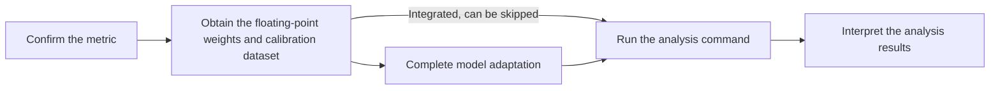

# Layer-wise Sensitive Layer Analysis Usage Guide

## 1. Scope

This guide is intended for developers and algorithm engineers who need to identify quantization-sensitive layers at the **Decoder layer** granularity (or by whole Attention, MLP, or MoE blocks) through the `msmodelslim analyze layer` command line, and adjust the quantization YAML (fallback or bit-width increase) accordingly.

**Applicable scenarios**:

- **LLM model**: use a text calibration dataset (`.json` or `.jsonl`).
- **VLM model** (multimodal understanding, such as Kimi-K3): use an image-text calibration dataset (such as `calibImages`), and the adapter must implement `PipelineInterface` and the multimodal `handle_dataset`.
- **Whole-block fallback** in linear layer quantization scheme design: fall back by Decoder block, or by whole Attention, MLP, or MoE blocks; the results are still mostly used for the `linear_quant` configuration.
- Fallback decisions when expert structures such as MoE are numerous and it is not suitable to analyze everything layer by layer.

**Not applicable scenarios**:

- **Multimodal generation models** (text-to-image, text-to-video, etc.): currently not supported by sensitive layer analysis.
- Need to fall back or increase the bit width by single linear layer: use the [Sensitive Linear Layer Analysis Usage Guide](usage_sensitive_linear_analysis.md).
- Identify attention modules that must fall back together with FA quantization: use the [Attention Sensitive Layer Analysis Usage Guide](usage_sensitive_attn_analysis.md).

## 2. Process Relationships and Prerequisites

**Parent process**: [New Model Quantization Tuning Process](process_new_model_quantization_tuning.md).

**Prerequisites**:

- msModelSlim is installed (see the [msModelSlim Installation Guide](../install_guide/install_guide.md)).
- The target model is an LLM or an already-integrated VLM, and a usable `--model_type` has been determined (consistent with the support matrix or the adapter registration name, case-sensitive; adaptation is usually completed in the parent process or the weight quantization process).
- A usable Ascend NPU is available (single-device: `--device npu`; multi-device: `--device npu --device_id 0 1 ...`; `--device cpu` is only for small-scale debugging).

**Follow-up operations**:

- Write the layer names from the analysis results into the `include` or `exclude` of the quantization configuration (or a local bit-width increase configuration), and then run model quantization through the `msmodelslim quant` command line.

## 3. Inputs and Deliverables

| Type | Name | Source or Location | Format or Constraint | Acceptance Method |
| --- | --- | --- | --- | --- |
| Input | Floating-point model directory | Local user path; usually obtained from ModelScope / Hugging Face | Model configuration, weight shards, tokenizer, and other auxiliary files | The path is valid and the model can be loaded by the target `model_type` |
| Input | Calibration dataset | Local user path, or the short name of the tool example [`lab_calib`](../../../lab_calib/) | LLM: `.json` / `.jsonl`; VLM: image-text directory name (such as `calibImages`) | Parsable by `msmodelslim analyze` with a compliant format |
| Deliverable | Sensitive layer analysis results | Standard output (ranking list + paste-ready configuration snippet) | Score from high to low; contains the topK layer name / wildcard list | The expected layer name wildcard range can be identified, and the snippet can be pasted into the quantization configuration |

## 4. Process Overview

After confirming the `layer` scenario and the recommended metric, prepare the floating-point weights and calibration dataset, complete model adaptation as needed, and then run the analysis command and interpret the results to rewrite the quantization configuration.



## 5. Procedure

### Command-Line Preview

```bash
msmodelslim analyze layer \
  --model_type ${MODEL_TYPE} \          # Model name registered or in the support matrix; case-sensitive
  --model_path ${MODEL_PATH} \          # Floating-point weight directory
  --metrics ${METRICS} \                # Analysis metric
  --quant_modules "*" \                 # Wildcards for the submodules involved in the comparison; multiple values are allowed; default "*"
  --calibration_dataset ${CALIB_DATASET} \    # LLM: .json/.jsonl; VLM: image-text directory such as calibImages
  --top_k ${TOPK} \                      # Number of top-K entries; default 15
  --device npu \                        # Analysis device: npu, cpu; for multiple devices, add --device_id 0 1 2 3
  --trust_remote_code false             # Defaults to false; set to true only for trustworthy models when necessary
```

### Step 1: Confirm the Recommended Metric

**Objective**: select `${METRICS}` in the command-line preview.

**Action**:

Set `${METRICS}` to one of the values in the following table:

| Optional Metric | Applicable Description | Algorithm Description | Recommendation |
| --- | --- | --- | --- |
| `mse_layer_wise` | Evaluates layer sensitivity by the MSE of submodule outputs within a Decoder block, which is more memory-friendly | [Layer-Wise MSE](../knowledge_base/quantization_algorithms/mse_layer_wise/term_mse_layer_wise.md) | Default first choice |
| `mse_model_wise` | Evaluates layer sensitivity by the MSE of the model's final output, which uses more memory | [Model-wise MSE](../knowledge_base/quantization_algorithms/mse_model_wise/term_mse_model_wise.md) | Switch to it when the final-output perspective is needed |

**Output**: the selected `${METRICS}`.

**Pass conditions**: `${METRICS}` is one of the optional values in the table above.

### Step 2: Obtain the Floating-Point Weights and Calibration Data

**Objective**: prepare a loadable floating-point model directory and a valid calibration dataset.

**Action**:

1. Obtain the complete weights from [ModelScope](https://www.modelscope.cn/), [Hugging Face](https://huggingface.co/), or the team's internal model storage location to a local directory; for the specific download method, refer to the documentation of the corresponding community or repository.
2. Verify that the directory contains the configuration, weight shards, tokenizer, and other auxiliary files. If the official page provides file checksums (such as MD5/SHA256) or an explicit version/commit ID, just confirm that it matches the local download result.
3. Prepare the calibration dataset: the calibration dataset used for sensitive layer analysis is usually kept consistent with the one used for subsequent quantization. For an LLM it must be `.json` or `.jsonl`: JSON is a list of strings (each item is one calibration text), and JSONL has one JSON object per line. A VLM must use an image-text calibration dataset (such as `lab_calib/calibImages`); do not use the plain-text `mix_calib.jsonl`. You can use your own files or the [`lab_calib`](../../../lab_calib/) example provided by the tool. Relative path resolution order: first look in the command's startup directory; if not found, match by the same name in the `lab_calib` example directory; if still not found, an error is reported.

**Output**: the floating-point model directory and the calibration dataset path (or the tool's built-in calibration dataset short name).

**Pass conditions**: the model directory can be loaded; the calibration dataset path can be parsed by the command and its format meets the requirements.

### Step 3: Complete Model Adaptation

**Objective**: ensure that a model adapter that can be hit by `msmodelslim analyze --model_type <model name>` exists; if the selected metric requires additional analysis interfaces, complete them as described in the algorithm documentation.

**Action**:

- **Not yet integrated models**: complete adapter development and registration first, and then proceed to Step 4. For general adaptation requirements, see the [LLM Model Integration Quantization Workflow Guide](../knowledge_base/ptq/llm/integration_guide_large_language_model_quantization.md).
- **Models already integrated in the support matrix**: general adaptation can be skipped; just confirm the `--model_type` name in use.
- **Additional algorithm-side interfaces**: if the selected metric requires additional analysis interfaces, complete them as described in the algorithm documentation (see [Quantization Algorithm Overview - Sensitive Layer Analysis Algorithms](../knowledge_base/quantization_algorithms/README.md#3-sensitive-layer-analysis-algorithms) for the entry point).

After completing or modifying the adapter, run `bash install.sh` again in the repository root so that the registration takes effect.

**Output**: a model adapter that is registered and can be hit by the CLI (corresponding to `--model_type`); if the selected metric requires additional interfaces, the adapter already provides the corresponding capabilities.

**Pass conditions**: starting the analysis with that `model_type` correctly hits the adapter; it no longer fails due to a missing analysis interface required by the selected metric.

### Step 4: Run the Analysis Command

**Objective**: run `msmodelslim analyze layer` to obtain the layer-wise sensitivity ranking and the YAML snippet.

**Pre-Execution Checks**:

- The metric, weights, and model adaptation confirmations in Steps 1-3 are completed.
- `trust_remote_code` defaults to `false`; set it to `true` only when the model must execute custom code in the repository and the source is trustworthy.

**Action**:

Replace the variables with actual values as described in the [Command-Line Preview](#command-line-preview) and then run the command.

**Output**: the sensitive layer ranking and the YAML format snippet in the standard output.

**Pass conditions**: the command ends normally; the output contains the Score ranking and the `=== YAML Format for quantization ===` snippet.

**Audit Record**: the actual command line, `${MODEL_TYPE}`, `${METRICS}`, the calibration dataset path, and a summary of the standard output results (or the path of the saved log).

### Step 5: Interpret the Analysis Results and Apply Them to the Configuration

**Objective**: understand the ranking and the YAML snippet in the standard output, and apply them to the quantization configuration.

**Action**:

1. Read the sensitive layer ranking list: a **higher** Score indicates that the layer is more sensitive to quantization, so fallback or bit-width increase should be prioritized. The `layer` output is ranked by Decoder block granularity, and the fallback layer names in the YAML contain wildcards by default (such as `model.layers.2.*`), indicating that all submodules in that block are reverted. See the example below:

   ```text
   === Layer Analysis Results (mse_layer_wise method) ===
   Patterns analyzed: ['*']
   Total layers analyzed: 36
   Layer Sensitivity Scores (higher score = more sensitive to quantization):
   --------------------------------------------------------------------------------
     1. model.layers.2                                     | Score:   2.4396e+03
     2. model.layers.35                                    | Score:   1.3626e+02
     3. model.layers.34                                    | Score:   1.2008e+02
     ...
   --------------------------------------------------------------------------------
   Top 36 most sensitive layers selected for disable_names

   === YAML Format for quantization ===

   top 36:
     - 'model.layers.2.*'
     - 'model.layers.35.*'
     - 'model.layers.34.*'
     ...

   === End of YAML Format ===
   ```

2. Check whether the layer names or wildcards in the YAML snippet cover the expected range. If submodules were specified during analysis through `--quant_modules` (such as `"*mlp*"`), the `Patterns analyzed` field in the log changes to the corresponding list, but **the ranking and the YAML snippet are still printed for the whole Decoder layer** and are not automatically narrowed to the selected substructure; when writing the quantization configuration, complete the layer names as actual structure names (such as `model.layers.N.mlp.*`) yourself, or use `include` and `exclude` to define a quantization scope consistent with `--quant_modules`.
3. Write the adjusted layer names into the quantization configuration (usually written into the `exclude` of `linear_quant`, or narrowing `include`); for low-bit schemes, only the highly sensitive blocks or modules can have their bit width increased individually.
4. Use the updated YAML to run model quantization through the `msmodelslim quant` command line, and then evaluate it against the business criteria; if it does not meet the target, expand the fallback or change `${METRICS}` and rerun this process.

**Output**: the quantization configuration updated according to the sensitive layer results and its file path.

**Pass conditions**: the fallback or bit-width-increase layer names in the YAML are consistent with the analysis results and the actual quantization scope, and can be loaded by the quantization configuration.

## 6. Acceptance Conditions

- The `layer` scope and the recommended analysis metric have been selected.
- The analysis command successfully produces the ranking and a paste-ready YAML snippet, and the layer name wildcards have been manually checked.

## 7. Troubleshooting

| Symptom | Direction of Action |
| --- | --- |
| Invalid or unreadable calibration dataset format | Verify the `.json` or `.jsonl` format, path, permissions, and parsing rules as described in Step 2, and then run the analysis command |
| `model_type` not hit, or a warning indicates the default model is used | Complete the model adaptation and `--model_type` registration as described in Step 3, run `bash install.sh` again to make the registration take effect, and then run the analysis command |
| Insufficient memory or run failure | Reduce the calibration dataset, prefer `mse_layer_wise`, or switch to a device with more memory, and then run the analysis command; `mse_model_wise` puts more pressure on memory, so use it with caution |
| Still unable to deploy or abnormal accuracy after fallback | Check whether the wildcards are too broad or too narrow, and check the limits of the inference engine on the number of fallback layers; correct the configuration, and then re-quantize and evaluate |

## 8. Terminology

| Term | Brief Description | Link |
| --- | --- | --- |
| Model adaptation | Integration and registration of a new model | [LLM Model Integration Quantization Workflow Guide](../knowledge_base/ptq/llm/integration_guide_large_language_model_quantization.md) |
| Sensitive layer analysis algorithm | Various sensitivity metrics used by `msmodelslim analyze` (such as layer-wise MSE) | [Quantization Algorithm Overview - Sensitive Layer Analysis Algorithms](../knowledge_base/quantization_algorithms/README.md#3-sensitive-layer-analysis-algorithms) |

## 9. Interface Documentation List

| API or Capability | Brief Description | Link |
| --- | --- | --- |
| `msmodelslim analyze layer` | Command-line entry point for Decoder layer-wise sensitive layer analysis | [msmodelslim analyze Command-Line API Document](../api_reference/cli/msmodelslim_analyze.md); this guide [Command-Line Preview](#command-line-preview) |

## 10. Security Notes

- `trust_remote_code` remains `false` by default; enable it only when the floating-point model must execute custom code and the source is trustworthy and auditable.
- Floating-point weights and calibration data should be controlled according to business permissions; do not submit calibration datasets or analysis logs that contain business data to public channels.
