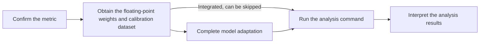

# Sensitive Linear Layer Analysis Usage Guide

## 1. Scope

This guide is intended for developers and algorithm engineers who need to identify quantization-sensitive layers at the **single linear layer** granularity through the `msmodelslim analyze linear` command line, and adjust the quantization YAML (fallback or bit-width increase) accordingly.

**Applicable scenarios**:

- **LLM model**: use a text calibration dataset (`.json` or `.jsonl`).
- **VLM model** (multimodal understanding, such as Kimi-K3): use an image-text calibration dataset (such as `calibImages`), and the adapter must implement `PipelineInterface` and the multimodal `handle_dataset`.
- Linear layer quantization scheme design: decide which linear layers fall back to floating-point or receive a local bit-width increase; the results are written into the `exclude` or `include` of `linear_quant`.
- When the accuracy target is not met, iterate the quantization configuration based on the linear layer sensitivity ranking.

**Not applicable scenarios**:

- **Multimodal generation models** (text-to-image, text-to-video, etc.): currently not supported by sensitive layer analysis.
- Need to fall back by Decoder block or by whole Attention, MLP, or MoE blocks: use the [Layer-wise Sensitive Layer Analysis Usage Guide](usage_sensitive_layer_analysis.md).
- Identify the attention modules that need to fall back when FA quantization is applied: use the [Attention Sensitive Layer Analysis Usage Guide](usage_sensitive_attn_analysis.md).
- **MoE structure analysis**: the number of linear layers on the expert side is large and not all of them participate in activation, so using this guide to analyze experts is generally not recommended; when a fallback is needed, prefer layer-wise analysis.

## 2. Process Relationships and Prerequisites

**Parent process**: [New Model Quantization Tuning Process](process_new_model_quantization_tuning.md).

**Prerequisites**:

- msModelSlim is installed (see the [msModelSlim Installation Guide](../install_guide/install_guide.md)).
- The target model is an LLM or an already-integrated VLM, and a usable `--model_type` has been determined (consistent with the support matrix or the adapter registration name, case-sensitive; adaptation is usually completed in the parent process or the weight quantization process).
- A usable Ascend NPU is available (single-device: `--device npu`; multi-device: `--device npu --device_id 0 1 ...`; `--device cpu` is only for small-scale debugging).

**Follow-up operations**:

- Write the layer names from the analysis results into the `include` or `exclude` of the quantization configuration (or a local bit-width increase configuration), and then run model quantization through the `msmodelslim quant` command line.

## 3. Inputs and Deliverables

| Type | Name | Source or Location | Format or Constraint | Acceptance Method |
| --- | --- | --- | --- | --- |
| Input | Floating-point model directory | Local user path; usually obtained from ModelScope / Hugging Face | Model configuration, weight shards, tokenizer, and other auxiliary files | The path is valid and the model can be loaded by the target `model_type` |
| Input | Calibration dataset | Local user path, or the short name of the tool example [`lab_calib`](../../../lab_calib/) | LLM: `.json` / `.jsonl`; VLM: image-text directory name (such as `calibImages`) | Parsable by `msmodelslim analyze` with a compliant format |
| Deliverable | Sensitive layer analysis results | Standard output (ranking list + paste-ready configuration snippet) | Score from high to low; contains the topK linear layer name list | The expected layer name wildcard range can be identified, and the snippet can be pasted into the quantization configuration |

## 4. Process Overview

After confirming the `linear` scenario and the recommended metric, prepare the floating-point weights and calibration dataset, complete model adaptation as needed, and then run the analysis command and interpret the results to rewrite the quantization configuration.



## 5. Procedure

### Command-Line Preview

```bash
msmodelslim analyze linear \
  --model_type ${MODEL_TYPE} \          # Model name registered or in the support matrix; case-sensitive
  --model_path ${MODEL_PATH} \          # Floating-point weight directory
  --metrics ${METRICS} \                # Analysis metric
  --patterns "*" \                       # Layer name wildcards to analyze; multiple values are allowed, separated by spaces; default "*"
  --calibration_dataset ${CALIB_DATASET} \    # LLM: .json/.jsonl; VLM: image-text directory such as calibImages
  --top_k ${TOPK} \                      # Number of top-K entries; default 15; when grouped modules are output together, the actual count may be >= top_k
  --device npu \                        # Analysis device: npu, cpu; for multiple devices, add --device_id 0 1 2 3
  --trust_remote_code false             # Defaults to false; set to true only for trustworthy models when necessary
```

### Step 1: Confirm the Recommended Metric

**Objective**: select `${METRICS}` in the command-line preview.

**Action**:

Set `${METRICS}` to one of the values in the following table:

| Optional Metric | Applicable Description | Algorithm Description | Recommendation |
| --- | --- | --- | --- |
| `kurtosis` | Focuses on activation spikes and tails, assisting fallback or mixed precision | [Kurtosis](../knowledge_base/quantization_algorithms/kurtosis/term_kurtosis.md) | Default first choice: use this metric first when the activation pattern is uncertain |
| `quantile` | Many activation outliers; aims to reduce the dominance of outliers | [Quantile](../knowledge_base/quantization_algorithms/quantile/term_quantile.md) | Switch to it, or compare it with `kurtosis`, when there are many activation outliers |
| `std` | Focuses on the ratio of dynamic range to dispersion, for coarse linear layer screening | [Std](../knowledge_base/quantization_algorithms/std/term_std.md) | Switch to it, or compare it with `kurtosis`, when coarse screening by dynamic range is needed |

**Output**: the selected `${METRICS}`.

**Pass conditions**: `${METRICS}` is one of the optional values in the table above.

### Step 2: Obtain the Floating-Point Weights and Calibration Data

**Objective**: prepare a loadable floating-point model directory and a valid calibration dataset.

**Action**:

1. Obtain the complete weights from [ModelScope](https://www.modelscope.cn/), [Hugging Face](https://huggingface.co/), or the team's internal model storage location to a local directory; for the specific download method, refer to the documentation of the corresponding community or repository.
2. Verify that the directory contains the configuration, weight shards, tokenizer, and other auxiliary files. If the official page provides file checksums (such as MD5/SHA256) or an explicit version/commit ID, just confirm that it matches the local download result.
3. Prepare the calibration dataset: the calibration dataset used for sensitive layer analysis is usually kept consistent with the one used for subsequent quantization. For an LLM it must be `.json` or `.jsonl`: JSON is a list of strings (each item is one calibration text), and JSONL has one JSON object per line. A VLM must use an image-text calibration dataset (such as `lab_calib/calibImages`); do not use the plain-text `mix_calib.jsonl`. You can use your own files or the [`lab_calib`](../../../lab_calib/) example provided by the tool. Relative path resolution order: first look in the command's startup directory; if not found, match by the same name in the `lab_calib` example directory; if still not found, an error is reported.

**Output**: the floating-point model directory and the calibration dataset path (or the tool's built-in calibration dataset short name).

**Pass conditions**: the model directory can be loaded; the calibration dataset path can be parsed by the command and its format meets the requirements.

### Step 3: Complete Model Adaptation

**Objective**: ensure that a model adapter that can be hit by `msmodelslim analyze --model_type <model name>` exists; if the selected metric requires additional analysis interfaces, complete them as described in the algorithm documentation.

**Action**:

- **Not yet integrated models**: complete adapter development and registration first, and then proceed to Step 4. For general adaptation requirements, see the [LLM Model Integration Quantization Workflow Guide](../knowledge_base/ptq/llm/integration_guide_large_language_model_quantization.md).
- **Models already integrated in the support matrix**: general adaptation can be skipped; just confirm the `--model_type` name in use.
- **Additional algorithm-side interfaces**: if the selected metric requires additional analysis interfaces, complete them as described in the algorithm documentation (see [Quantization Algorithm Overview - Sensitive Layer Analysis Algorithms](../knowledge_base/quantization_algorithms/README.md#3-sensitive-layer-analysis-algorithms) for the entry point).

After completing or modifying the adapter, run `bash install.sh` again in the repository root so that the registration takes effect.

**Output**: a model adapter that is registered and can be hit by the CLI (corresponding to `--model_type`); if the selected metric requires additional interfaces, the adapter already provides the corresponding capabilities.

**Pass conditions**: starting the analysis with that `model_type` correctly hits the adapter; it no longer fails due to a missing analysis interface required by the selected metric.

### Step 4: Run the Analysis Command

**Objective**: run `msmodelslim analyze linear` to obtain the linear layer sensitivity ranking and the YAML snippet.

**Pre-Execution Checks**:

- The metric, weights, and model adaptation confirmations in Steps 1-3 are completed.
- `trust_remote_code` defaults to `false`; set it to `true` only when the model must execute custom code in the repository and the source is trustworthy.

**Action**:

Replace the variables with actual values as described in the [Command-Line Preview](#command-line-preview) and then run the command.

**Output**: the sensitive layer ranking and the YAML format snippet in the standard output.

**Pass conditions**: the command ends normally; the output contains the Score ranking and the `=== YAML Format for quantization ===` snippet.

**Audit Record**: the actual command line, `${MODEL_TYPE}`, `${METRICS}`, the calibration dataset path, and a summary of the standard output results (or the path of the saved log).

### Step 5: Interpret the Analysis Results and Apply Them to the Configuration

**Objective**: understand the ranking and the YAML snippet in the standard output, and apply them to the quantization configuration.

**Action**:

1. Read the sensitive layer ranking list: a **higher** Score indicates that the layer is more sensitive to quantization, so fallback or bit-width increase should be prioritized. The `linear` output is ranked by layer granularity, as shown below:

   ```text
   === Layer Analysis Results (kurtosis method) ===
   Patterns analyzed: ['*']
   Total layers analyzed: 252
   Layer Sensitivity Scores (higher score = more sensitive to quantization):
   --------------------------------------------------------------------------------
     1. model.layers.6.mlp.down_proj                       | Score:   2.1326e+02
     2. model.layers.14.mlp.down_proj                      | Score:   1.6952e+02
     3. model.layers.3.mlp.gate_proj                       | Score:   1.5288e+02
     ...
   --------------------------------------------------------------------------------
   Top 80 most sensitive layers selected for disable_names

   === YAML Format for quantization ===

   top 80:
     - 'model.layers.6.mlp.down_proj'
     - 'model.layers.14.mlp.down_proj'
     - 'model.layers.3.mlp.gate_proj'
     ...

   === End of YAML Format ===
   ```

2. Check whether the layer names in the YAML snippet cover the expected range, and note that grouped modules must be handled together:
   - **QKV**: `q_proj`, `k_proj`, and `v_proj` are projection layers of the same group; their sensitivity scores are usually close and they appear together in the results. When falling back or increasing the bit width, the same strategy must be applied to all three; do not handle only one of them.
   - **`up_proj` and `gate_proj`**: in MLP, the two must be excluded or retained together; handling only one of them may make the model unable to be deployed or cause service startup failures.
   - Other grouped or paired structures can follow the rules above and be handled consistently as a whole according to the requirements of the inference engine and the model structure.
3. Copy the layer names in the YAML snippet into the quantization configuration (usually written into the `exclude` of `linear_quant`, or narrowing `include`); for low-bit schemes, only the highly sensitive layers can have their bit width increased individually.
4. Use the updated YAML to run model quantization through the `msmodelslim quant` command line, and then evaluate it against the business criteria; if it does not meet the target, expand the fallback or change `${METRICS}` and rerun this process.

**Output**: the quantization configuration updated according to the sensitive layer results and its file path.

**Pass conditions**: the fallback or bit-width-increase layer names in the YAML are consistent with the analysis results and can be loaded by the quantization configuration; the grouped module strategy is consistent.

## 6. Acceptance Conditions

- The `linear` scope and the recommended analysis metric have been selected.
- The analysis command successfully produces the ranking and a paste-ready YAML snippet, and the layer name wildcards have been manually checked; the grouped module strategy is consistent.

## 7. Troubleshooting

| Symptom | Direction of Action |
| --- | --- |
| Invalid or unreadable calibration dataset format | Verify the `.json` or `.jsonl` format, path, permissions, and parsing rules as described in Step 2, and then run the analysis command |
| `model_type` not hit, or a warning indicates the default model is used | Complete the model adaptation and `--model_type` registration as described in Step 3, run `bash install.sh` again to make the registration take effect, and then run the analysis command |
| Insufficient memory or run failure | Reduce the calibration dataset, or switch to a device with more memory, and then run the analysis command |
| Still unable to deploy or abnormal accuracy after fallback | Check whether only half of a grouped module fell back, and check the limits of the inference engine on the number of fallback layers; correct the configuration, and then re-quantize and evaluate |

## 8. Terminology

| Term | Brief Description | Link |
| --- | --- | --- |
| Model adaptation | Integration and registration of a new model | [LLM Model Integration Quantization Workflow Guide](../knowledge_base/ptq/llm/integration_guide_large_language_model_quantization.md) |
| Sensitive layer analysis algorithm | Various sensitivity metrics used by `msmodelslim analyze` (such as Kurtosis) | [Quantization Algorithm Overview - Sensitive Layer Analysis Algorithms](../knowledge_base/quantization_algorithms/README.md#3-sensitive-layer-analysis-algorithms) |

## 9. Interface Documentation List

| API or Capability | Brief Description | Link |
| --- | --- | --- |
| `msmodelslim analyze linear` | Command-line entry point for linear layer sensitive layer analysis | [msmodelslim analyze Command-Line API Document](../api_reference/cli/msmodelslim_analyze.md); this guide [Command-Line Preview](#command-line-preview) |

## 10. Security Notes

- `trust_remote_code` remains `false` by default; enable it only when the floating-point model must execute custom code and the source is trustworthy and auditable.
- Floating-point weights and calibration data should be controlled according to business permissions; do not submit calibration datasets or analysis logs that contain business data to public channels.
