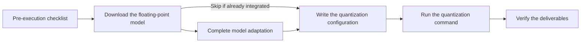

# Weight Quantization Usage Guide

## 1. Scope

This guide is intended for developers and algorithm engineers who need to integrate models that are **not yet included in the support matrix, or are included but whose target quantization mode has not been verified** into msModelSlim and produce deployable quantized weights. It covers the following model categories:

- **Large language models (LLMs)**: dense and MoE text models, among others
- **Multimodal understanding models**: vision-language understanding (VLM) models, among others
- **Multimodal generation models**: text-to-video and image-to-video models, among others

This guide describes the business path shared by the three model categories: download the floating-point model → complete model adaptation → write the quantization configuration → run quantization → verify the deliverables.

**Applicable scenarios**:

- The target model is **not present in the support matrix**, or is included but its **target quantization mode (`quant_type`) has not been verified**, and it must be adapted and configured to produce deployable quantized weights through `msmodelslim quant`.

**Not applicable scenarios**:

- For models already marked as supporting **one-click quantization** in the support matrix whose target `quant_type` has been verified: follow the [One-Click Quantization Usage Guide](usage_one_click_quantization.md) directly; there is no need to go through the adaptation and development steps in this guide.

## 2. Process Relationships and Prerequisites

**Parent process**: [New Model Quantization Tuning Process](process_new_model_quantization_tuning.md).

**Prerequisites**:

- The [Foundation Model Support Matrix](../knowledge_base/model/README.md) has been checked, confirming that the target model is not included or that the target quantization mode (`quant_type`) has not been verified.
- The category of the target model (large language model, multimodal understanding, or multimodal generation) has been confirmed.
- Runtime dependencies have been prepared according to the model release page and the corresponding integration guide: different models often require specific versions of `transformers` and similar libraries; multimodal generation additionally requires the original inference repository and the dependencies needed for bridging. For specific versions, refer to the model card and the integration guide; they are not enumerated here.
- msModelSlim has been **installed from source** (adapting a new model requires modifying code and registering an entry point; see the [msModelSlim Installation Guide](../install_guide/install_guide.md) for details).
- The quantization device has been confirmed: both Ascend NPU and CPU are supported; NPU is recommended for regular quantization, while CPU is suitable only for small-scale debugging.
- The target inference framework has been determined, and an export format supported by msModelSlim has been selected (see the [Quantization Format Terminology Entry](../knowledge_base/quantization_format/README.md), such as AscendV1 or MindIE SD).

**Follow-up operations**:

- After the deliverables pass verification, return to the [New Model Quantization Tuning Process](process_new_model_quantization_tuning.md) to continue with steps such as operator development and graph composition, and accuracy and performance evaluation.

## 3. Inputs and Deliverables

| Type | Name | Source or Location | Format or Constraint | Acceptance Method |
| --- | --- | --- | --- | --- |
| Input | Floating-point model directory | A local user path; generally obtained from [ModelScope](https://www.modelscope.cn/), [Hugging Face](https://huggingface.co/), or the team's internal model storage location | Contains the model configuration, weight shards, and the auxiliary files required by the category (such as tokenizer and config) | The files are complete; if the official source provides a checksum or version number, the corresponding local value matches |
| Input | Quantization configuration YAML | The path of the configuration file written in the steps of this guide | Complies with the corresponding configuration protocol (`modelslim_v1`, `multimodal_vlm_modelslim_v1`, `multimodal_sd_modelslim_v1`) | At the new model integration stage, the criterion is that it can be loaded when the configuration file path is specified explicitly |
| Deliverable | Quantized weight directory | The user-specified quantization output directory `${SAVE_PATH}` | Contains the description file and weight shards required by the selected export format (such as `quant_model_description.json` for AscendV1) | The files are complete; the conventions of the selected export format are met |

## 4. Process Overview

This process handles weight quantization and delivers the weights; inference is performed by the target engine (such as MindIE, vLLM Ascend, or MindIE SD). Complete the environment and resource pre-check first, then download the floating-point model; when the **model has not yet been integrated**, complete model adaptation, and when it is **already integrated**, adaptation can be skipped; then write the quantization configuration, run quantization, and finally verify that the quantized weight deliverables are complete and usable. The stages are ordered as follows:



## 5. Procedure

### Command-Line Preview

```bash
msmodelslim quant \
  --model_path ${MODEL_PATH} \          # Floating-point weight directory
  --save_path ${SAVE_PATH} \            # Quantized weight output directory
  --device npu \                        # Quantization device: npu, cpu
  --device_id 0 \                       # Device index; multi-device example: --device_id 0 1 2 3
  --model_type ${MODEL_TYPE} \          # Model name registered or in the support matrix; case-sensitive
  --config ${CONFIG_PATH} \             # The quantization configuration YAML written in Step 3 of this guide
  --trust_remote_code false             # Set to true only for trustworthy models when necessary
```

### Pre-Execution Checklist

Before downloading and quantizing, check each item in the following checklist one by one; if any item is not passed, resolve it first before continuing with the subsequent steps. Running this pre-check once more before one-click quantization is recommended.

| No. | Check Item | Recommended Command | Pass Criteria |
| --- | --- | --- | --- |
| 1 | The original weights have not been changed unexpectedly | `ls -lt <floating-point model directory> \| head` or `stat <key weight file>`; record and compare the last modification time | The modification times after download and before quantization are consistent, with no unexpected changes |
| 2 | Sufficient hard disk space | `df -h` | The free space on the partitions holding the floating-point directory and the quantization output directory covers the model size, the quantization artifacts, and a margin |
| 3 | The NPU is not occupied | `npu-smi info` | The target device status is normal, with no unexpected long-running tasks occupying it |

### Step 1: Download the Floating-Point Model

**Objective**: Obtain a complete, traceable local floating-point model directory.

**Pre-Execution Checks**: The hard disk space item in the [pre-execution checklist](#pre-execution-checklist) has been completed.

**Action**:

1. Obtain the complete weights from [ModelScope](https://www.modelscope.cn/), [Hugging Face](https://huggingface.co/), or the team's internal model storage location to a local directory; for the specific download method, refer to the documentation of the corresponding community or repository.
2. Check that the directory contains the configuration, the weight shards, and the auxiliary files required by the category. If the official page provides file checksums (such as MD5 or SHA256) or an explicit version or commit ID, just compare them with the local download result and confirm they match. After the download is complete, record the last modification time for comparison during the pre-quantization check.

**Output**: The floating-point model directory `${MODEL_PATH}`.

**Pass conditions**: The files are complete; when an official checksum or version number is available, the local value matches it.

### Step 2: Complete Model Adaptation

**Objective**: Ensure that a model adapter that can be hit by `msmodelslim quant --model_type ${MODEL_TYPE}` exists.

**Action**:

- **Models not yet integrated**: you usually need to integrate the model yourself first, completing adapter development and registration, before proceeding to Step 3. Exception: for large language models based on transformers, using `--model_type transformers` matches the generic foundation model adapter, so no custom adaptation is required.
- **Models already integrated in the support matrix**: you can skip this step and proceed directly to Step 3 to write the quantization configuration; you only need to confirm the name of the `--model_type` in use (that is, `${MODEL_TYPE}`).

Usage restrictions of `--model_type transformers`:

- This model adapter only has basic quantization capabilities and implements no algorithm.
- If `--quant_type` is used, currently only `w8a16` and `w8a8(MXFP8)` are supported; if `--config` is used, only the large language model quantization configuration is supported (`apiversion: modelslim_v1`).
- It is recommended only for one-click quantization; if it is used for other features such as sensitive layer analysis or auto tuning, users must ensure on their own that the relevant interface behavior meets expectations.
- Only `runner: model_wise` is supported, so the memory requirement must be sufficient to hold the complete model.

When integrating a model yourself, perform the following operations:

1. Read the corresponding integration guide for the model category, and complete the adapter implementation and registration as required (for details, refer to the integration guide):

   | Model Category | Integration Guide |
   | --- | --- |
   | large language model | [LLM Model Integration Quantization Workflow Guide](../knowledge_base/ptq/llm/integration_guide_large_language_model_quantization.md) |
   | multimodal understanding | [VLM Model Integration Quantization Workflow Guide](../knowledge_base/ptq/vlm/integration_guide_vision_transformer_quantization.md) |
   | multimodal generation | [DiT Model Integration Quantization Workflow Guide](../knowledge_base/ptq/dit/integration_guide_diffusion_transformer_quantization.md) |

2. After the adapter development and registration are complete, re-run `bash install.sh` in the repository root to install the adapter entry point into the current environment, so that the CLI can hit that model adapter by `${MODEL_TYPE}`.

**Output**: A registered model adapter that can be hit by the CLI (corresponding to `--model_type` / `${MODEL_TYPE}`); when the model is already integrated and this step is skipped, the output is the existing `${MODEL_TYPE}`.

**Pass conditions**: When quantization is started with `--model_type ${MODEL_TYPE}`, the log shows that the expected model adapter is hit, with no errors related to an unknown model or an unmatched adapter.

### Step 3: Write the Quantization Configuration

**Objective**: Write the quantization configuration YAML according to the scheme already determined in [Step 1: Quantization Scheme Design](process_new_model_quantization_tuning.md#step-1-quantization-scheme-design) of the parent process.

**Action**:

1. Confirm the quantization mode, algorithm, and quantization scope for this round (from the scheme conclusions of the parent process).
2. **Write the quantization configuration** and save it as the local file `${CONFIG_PATH}`. The following is a first-version skeleton available for **large language models and multimodal understanding** (dynamic `w8a8` with `linear_quant` only); modify `apiversion`, `dataset`, `include`, and `exclude` according to the model category. **Do not apply this skeleton directly to multimodal generation**: `save` usually uses `mindie_format_saver`, and `multimodal_sd_config` (such as `dump_config` and `inference_config`) must be added; for the fields, see the protocol links below.

   ```yaml
   apiversion: modelslim_v1
   # For multimodal understanding, change it to multimodal_vlm_modelslim_v1
   # For multimodal generation, change it to multimodal_sd_modelslim_v1
   spec:
     process:
       - type: "linear_quant"
         qconfig:
           act:
             scope: "per_token"
             dtype: "int8"
             symmetric: true
             method: "minmax"
           weight:
             scope: "per_channel"
             dtype: "int8"
             symmetric: true
             method: "minmax"
         # For the first version of multimodal understanding, changing it to match only the language part is recommended
         include: ["*"]
         exclude: []
     dataset: "mix_calib.jsonl"
     # For multimodal understanding, "calibImages" is commonly used; for multimodal generation, configure a short name or path as appropriate for the scenario
     save:
       - type: "ascendv1_saver"
         part_file_size: 4
     # For multimodal generation, fields such as multimodal_sd_config must additionally be added according to the protocol
   ```

   For the complete configuration fields of each category, refer to the corresponding protocol:

   | Model Category | Configuration Protocol | Authoritative Description |
   | --- | --- | --- |
   | large language model | `modelslim_v1` | [modelslim_v1 Configuration Reference](../api_reference/config/quant/modelslim_v1.md) |
   | multimodal understanding | `multimodal_vlm_modelslim_v1` | [multimodal_vlm_modelslim_v1 Configuration Reference](../api_reference/config/quant/multimodal_vlm_modelslim_v1.md) |
   | multimodal generation | `multimodal_sd_modelslim_v1` | [multimodal_sd_modelslim_v1 Configuration Reference](../api_reference/config/quant/multimodal_sd_modelslim_v1.md) |

**Output**: The quantization configuration YAML file `${CONFIG_PATH}`.

**Pass conditions**: The configuration fields meet the requirements of the complete configuration protocol for the selected model category.

### Step 4: Run the One-Click Quantization Command

**Objective**: Generate the quantized weight directory through `msmodelslim quant`.

**Pre-Execution Checks**:

- Complete the [pre-execution checklist](#pre-execution-checklist) again.
- Confirm that the current environment dependencies still meet the needs of quantization loading: the versions of `transformers` and similar libraries are consistent with the model release page; multimodal generation additionally requires that the original inference repository and related dependencies can be imported or called normally.
- Run the quantization command outside the source directory.
- Confirm that `${SAVE_PATH}` is writable and is not mixed with the floating-point model directory `${MODEL_PATH}`.

**Action**:

At the new model integration stage, use `--config` to explicitly specify the configuration from Step 3; when a custom configuration is used, the quantization result is guaranteed by the configuration and the adaptation itself, and msModelSlim is not responsible for the effect of unverified custom configurations.

```bash
msmodelslim quant \
  --model_path ${MODEL_PATH} \
  --save_path ${SAVE_PATH} \
  --device npu \
  --device_id 0 \
  --model_type ${MODEL_TYPE} \
  --config ${CONFIG_PATH} \
  --trust_remote_code false
```

Parameter description:

- `--model_path`: The floating-point weight directory `${MODEL_PATH}`.
- `--save_path`: The quantization artifact output directory `${SAVE_PATH}`.
- `--device`: The quantization device type, such as `npu` or `cpu`.
- `--device_id`: The device index; a single device such as `0`, or multiple devices such as `0 1 2 3`.
- `--model_type`: The model name `${MODEL_TYPE}` registered in Step 2, or an existing name in the support matrix; case-sensitive.
- `--config`: The YAML `${CONFIG_PATH}` written in Step 3.
- `--trust_remote_code`: Set to `true` only when the model must execute custom code inside the repository and the source is trustworthy.

**Output**: The quantized weight directory `${SAVE_PATH}`.

**Pass conditions**: The command ends normally, and the quantized weight related files have been written to `${SAVE_PATH}`.

**Audit Record**: The command line actually executed, the path of the configuration file used, and the path of the quantization log.

### Step 5: Verify the Deliverables

**Objective**: Confirm that the quantization artifacts are complete and locatable and meet the conventions of the selected export format.

**Action**:

1. Check the artifact structure and key files according to the selected export format. The deliverable conventions of each format are listed in the table below; for format selection and comparison, see the [Quantization Format Terminology Entry](../knowledge_base/quantization_format/README.md).

   | Export Format | Description |
   | --- | --- |
   | AscendV1 | [AscendV1](../knowledge_base/quantization_format/ascendv1/term_ascendv1.md) |
   | MindIE SD | [MindIE SD](../knowledge_base/quantization_format/mindie_sd/term_mindie_sd.md) |
   | compressed-tensors | [compressed-tensors](../knowledge_base/quantization_format/compressed_tensors/term_compressed_tensors.md) |

2. Compare the size of the floating-point model directory and the quantized weight directory (for example, `du -sh ${MODEL_PATH} ${SAVE_PATH}`) to confirm that the quantized artifacts are reasonably smaller than the floating-point weights; the specific degree varies with the bit width and export format, and no fixed compression ratio is required.

**Output**: The quantized weight directory `${SAVE_PATH}` that passes verification.

**Pass conditions**: The artifacts meet the conventions of the selected export format; the size of the quantized directory is reasonably smaller than that of the floating-point directory.

**Audit Record**: The path of the quantized weight directory; the size comparison result of the floating-point and quantized directories; the runtime environment information (such as NPU, driver, and CANN); and the versions of msModelSlim and related dependencies.

## 6. Acceptance Conditions

- The floating-point model directory is complete and traceable.
- The adapter can be hit by `--model_type ${MODEL_TYPE}`.
- The quantization configuration complies with the selected protocol.
- The quantized weight directory is complete and meets the conventions of the selected export format.
- The size of the quantized directory is reasonably smaller than that of the floating-point directory.

## 7. Troubleshooting

This table covers only the common blockers within the steps of this guide; for accuracy and performance that do not meet the target, or that still cannot be met after multiple iterations, see the [Quantization Accuracy Tuning Guide](process_quantization_precision_tuning.md) and the subsequent deployment evaluation.

| Symptom | Direction of Action |
| --- | --- |
| Pre-check not passed | Handle it according to the [pre-execution checklist](#pre-execution-checklist): restore or re-download the weights, expand the capacity or switch disks, or release or select an idle NPU, and then continue |
| Model loading, `trust_remote_code`, or dependency version failure | Check the dependencies on the model release page and in the prerequisites; enable remote code only for trustworthy models when necessary |
| `--model_type` not hit | Confirm that the adapter is registered in `config.ini`, and re-run `bash install.sh` to make `${MODEL_TYPE}` take effect |
| Configuration parsing failure or missing protocol fields | Return to Step 3, complete or correct the YAML according to the corresponding configuration protocol, and then re-run Step 4 |
| Errors in interfaces, subgraphs, calibration dumps, or expert orchestration during quantization | Return to Step 2, and complete the implementation according to the corresponding integration guide and a similar adapter of the same series |
| Incomplete artifacts or a description file that does not meet expectations | Check the saver type and the export format, and compare them with the [Quantization Format Terminology Entry](../knowledge_base/quantization_format/README.md) and the corresponding format terminology entry; after confirming the description file, re-run Step 4 and then perform Step 5 |
| Insufficient memory during quantization | Switch to multi-device quantization, reduce the calibration scale, or switch to a device with more memory, and then re-run |

## 8. Case List

| Case | Brief Description | Link |
| --- | --- | --- |
| DeepSeek-V4-Pro W4A8 new integration | New integration of a large language model: adaptation, W4A8 configuration, one-click quantization, and deployment evaluation | [DeepSeek-V4-Pro New Model W4A8 Quantization Case](../best_practices/deepseek_v4_pro_w4a8_new_llm_quantization_case.md) |
| Kimi-K3 W4A8 new integration | New integration of multimodal understanding: adaptation, W4A8 quantization, and accuracy evaluation | [Kimi-K3 New Model W4A8 Quantization Case](../best_practices/kimi_k3_adaptation_case.md) |
| Wan2.2 W4A4F4 new integration | New integration of multimodal generation: adaptation, layer-wise quantization, weight export, and accuracy evaluation | [Wan2.2 New Model W4A4F4 Quantization Case](../best_practices/wan2_2_w4a4f4_new_dit_quantization_case.md) |

## 9. Terminology

| Term | Brief Description | Link |
| --- | --- | --- |
| Model adaptation (LLM) | Implement and register an adapter for a specific model so that the CLI can hit its loading and quantization capabilities through `--model_type` | [LLM Model Integration Quantization Workflow Guide](../knowledge_base/ptq/llm/integration_guide_large_language_model_quantization.md) |
| Model adaptation (multimodal understanding) | Implement and register an adapter for a specific model so that the CLI can hit its loading and quantization capabilities through `--model_type` | [VLM Model Integration Quantization Workflow Guide](../knowledge_base/ptq/vlm/integration_guide_vision_transformer_quantization.md) |
| Model adaptation (multimodal generation) | Implement and register an adapter for a specific model so that the CLI can hit its loading and quantization capabilities through `--model_type` | [DiT Model Integration Quantization Workflow Guide](../knowledge_base/ptq/dit/integration_guide_diffusion_transformer_quantization.md) |
| Quantization algorithm | Descriptions of algorithms such as outlier suppression, linear quantization, and sensitive layer analysis | [Quantization Algorithm Overview](../knowledge_base/quantization_algorithms/README.md) |
| Quantization mode | Naming and conventions of bit-combination strategies such as w8a8 and w4a8 | [Quantization Mode Naming Convention](../knowledge_base/model/README.md#quantization-mode-naming-convention) |
| Quantization format | Export formats of quantized weights and their correspondence with inference frameworks | [Quantization Format Terminology Entry](../knowledge_base/quantization_format/README.md) |

## 10. Interface Documentation List

| API or Capability | Brief Description | Link |
| --- | --- | --- |
| `msmodelslim quant` | The unified command-line entry point for weight quantization | [msmodelslim quant Command-Line API Document](../api_reference/cli/msmodelslim_quant.md) |
| `modelslim_v1`  | The quantization configuration protocol for large language models | [modelslim_v1 Configuration Reference](../api_reference/config/quant/modelslim_v1.md) |
| `multimodal_vlm_modelslim_v1` | The quantization configuration protocol for multimodal understanding models | [multimodal_vlm_modelslim_v1 Configuration Reference](../api_reference/config/quant/multimodal_vlm_modelslim_v1.md) |
| `multimodal_sd_modelslim_v1` | The quantization configuration protocol for multimodal generation models | [multimodal_sd_modelslim_v1 Configuration Reference](../api_reference/config/quant/multimodal_sd_modelslim_v1.md) |

## 11. Security Notes

- `trust_remote_code` remains `false` by default; enable it only when the floating-point model must execute custom code and the source is trustworthy and auditable.
- Floating-point weights, calibration data (including the content pointed to by image and video paths), and quantization artifacts should be controlled according to business permissions; do not submit calibration sets or logs containing business data to public channels.
- Debug mode may write intermediate tensors and statistics to disk; clean up `${SAVE_PATH}/debug_info` as needed after use.
