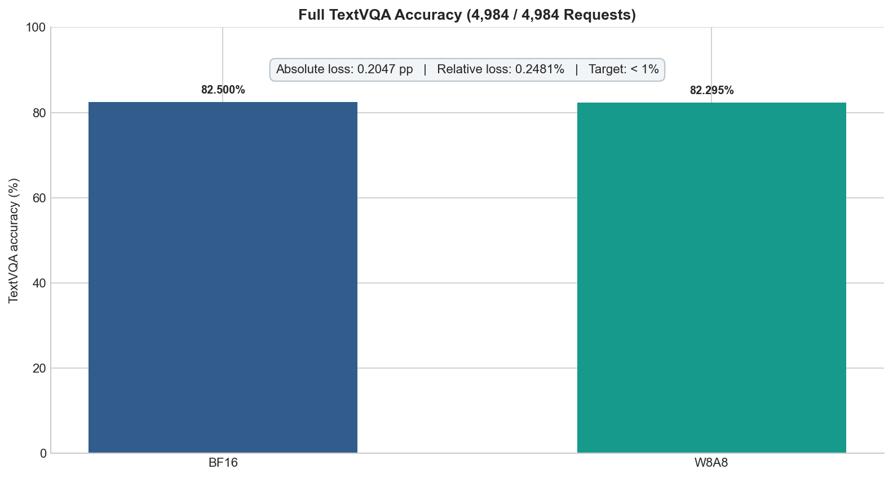
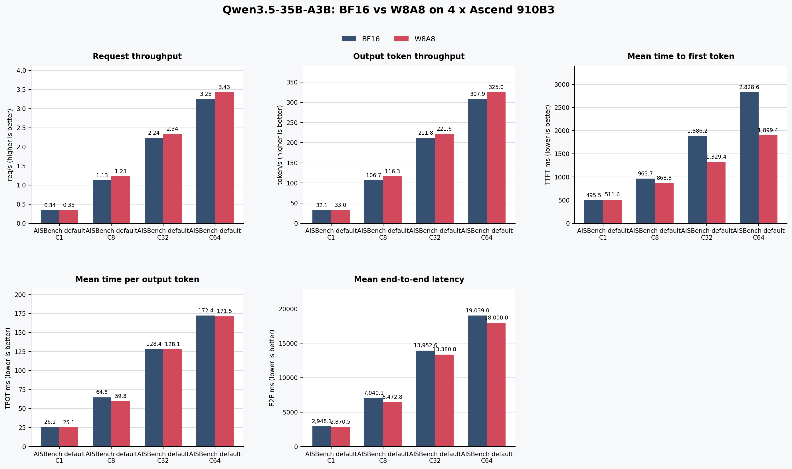

# Qwen3.5-35B-A3B-W8A8 多模态量化案例

## 1. 案例背景

本案例在4张 Ascend 910B3 上使用 msModelSlim V1 对 Qwen3.5-35B-A3B 进行动态 W8A8 量化，并通过 vLLM-Ascend 部署，验证权重压缩对视觉问答精度、推理性能和显存容量的影响。

**覆盖流程**：环境准备 → 模型与数据准备 → 一键量化与产物验收 → 服务部署与对话验证 → TextVQA 精度测试 → AISBench 性能与容量测试。

**精度验收口径**：在同一 TextVQA 公开转换集和相同推理参数下，以实测 BF16 为基线，W8A8 的相对精度降幅小于1%。

**关联流程**：《[一键量化完整指南](../user_guide/usage_quick_quantization.md)》

### 模型与量化方案

[Qwen3.5-35B-A3B](https://modelscope.cn/models/Qwen/Qwen3.5-35B-A3B) 是包含视觉编码器、Gated DeltaNet、门控注意力和混合专家（Mixture of Experts，MoE）的多模态模型，总参数35B，每个 Token 激活约3B。本文使用的 CLI 参数为 `--model_type Qwen3.5-35B-A3B --quant_type w8a8`。

一键量化匹配 `lab_practice/qwen3_5_moe/qwen3_5_moe_w8a8.yaml`：权重采用按通道对称 INT8 MinMax，激活采用按 Token 对称动态 INT8 MinMax，导出格式为 AscendV1。配置选中的注意力线性层和路由专家采用 W8A8；视觉编码器、注意力输出投影 `o_proj`、多 Token 预测（Multi-Token Prediction，MTP）分支、共享专家及其余层保留浮点。本案例评估这一动态激活混合精度方案。

### 验证范围

- **精度**：单图 TextVQA 输入、文本输出，BF16/W8A8 均使用张量并行 TP4。
- **性能与容量**：双方均使用数据并行 DP2×TP2 和专家并行（EP），记录 AISBench 纯文本合成负载下的吞吐、时延，以及权重显存和 KV Cache 容量。
- **量化开销**：权重目录体积、耗时、NPU 高带宽内存（HBM）及主机常驻内存（RSS）。

结论适用于本文软硬件版本下的单图短答案精度与纯文本合成负载性能；扩展任务和部署组合应按相同流程单独评测。

## 2. 环境与版本

### 硬件与软件

| 项目             | 本案例配置                                                            |
| ---------------- | --------------------------------------------------------------------- |
| 产品形态         | Kunpeng 920 服务器，4×Ascend 910B3；本案例结论限定于该实测形态        |
| 主机内存         | 2TiB                                                                   |
| NPU              | 4×Ascend 910B3，每卡65,536MB HBM                                      |
| 操作系统         | Ubuntu 22.04.5 LTS，aarch64                                           |
| 驱动             | 25.2.0                                                                |
| CANN（实测）     | 9.0.0，实测安装目录 `/usr/local/Ascend/cann-9.0.0`                    |
| ATB（实测）      | 9.0.0.B160，aarch64                                                    |
| Python           | 3.12.13                                                               |
| msModelSlim      | 26.1.0，源码提交 `befee1356cfe56c07a71950b473d9c1485ac3d1a`           |
| 量化环境         | PyTorch 2.10.0+cpu、torch-npu 2.10.0、Transformers 5.2.0              |
| 推理环境         | vLLM 0.21.0、vLLM-Ascend 0.21.0rc1、Transformers 5.5.4                |
| 模型下载         | ModelScope 1.37.1                                                     |
| 评测工具（实测） | AISBench Benchmark，commit `7dc0ce231c63b596bdb1a2e8b987a887bb756f72` |
| 数据集           | AISBench TextVQA 公开转换集，4,984题、引用3,157张图片                 |

下文以 `${WORK_ROOT}` 为本地工作根目录，通过环境变量定位模型、数据和结果。建议预留180GB 磁盘和128GB 主机内存；这是复现资源预算，并非实测最低配置，量化峰值 RSS 见步骤 4。

**本案例前置条件**：

- 4张 Ascend 910B3 均可识别且状态为 `OK`；
- 已具备 CANN、ATB、容器运行环境及模型和评测数据的下载权限；
- 本地高 IO 工作目录具备至少180GB 可用空间。

## 3. 输入和交付件

| 类型   | 名称           | 来源或保存位置                                        | 格式或约束                                        | 验收方式                                                                                 |
| ------ | -------------- | ----------------------------------------------------- | ------------------------------------------------- | ---------------------------------------------------------------------------------------- |
| 输入   | 浮点权重       | `${MODEL_PATH}`；ModelScope `Qwen/Qwen3.5-35B-A3B`    | 固定模型 revision，含配置、Tokenizer 和完整分片   | 校验索引 SHA256，并保存逐分片 SHA256 清单                                                |
| 输入   | 量化配置       | `lab_practice/qwen3_5_moe/qwen3_5_moe_w8a8.yaml`      | `model_type=Qwen3.5-35B-A3B`，动态 W8A8，AscendV1 | CLI 自动匹配配置并正常输出量化结束标记                                                   |
| 输入   | 精度评测数据   | `${BENCHMARK_PATH}/data/textvqa`                      | TextVQA 公开转换集，4,984题、引用3,157张图片      | 数据文件 SHA256 一致，完成请求为4,984/4,984                                              |
| 输入   | 性能评测数据   | `${BENCHMARK_PATH}/data/qwen35_perf`                  | 按 AISBench 默认参数和固定 seed 生成的256条 JSONL | SHA256 为 `a6a7f015...880b0`，AISBench 重复加载内容一致                                  |
| 输入   | 服务配置       | 本文步骤 5 与步骤 8 的服务启动命令                   | 精度对比使用 TP4；性能对比均使用 DP2×TP2 同参配置 | 保存实际启动命令和服务日志，并与正文配置逐项核对                                         |
| 交付件 | W8A8 量化权重  | `${QUANT_PATH}`                                       | AscendV1，含描述文件和完整 safetensors 分片       | 步骤 4 的本地核心产物逐文件 MD5 一致，完整清单 MD5 为 `0350fd064d38b02becde09aa0835bd96` |
| 交付件 | 量化过程记录   | `${RESULT_ROOT}/quantization`                         | 包含完整标准输出、墙钟/RSS 和每2秒 HBM 采样       | 日志正常结束，统计口径与量化结果表一致                                                   |
| 交付件 | 精度报告       | `${RESULT_ROOT}/accuracy/qwen35_{bf16,w8a8}_accuracy` | BF16 与 W8A8 使用相同数据、提示词和生成参数       | 请求全部成功，结果与精度表及验收阈值一致                                                   |
| 交付件 | 性能与显存报告 | `${RESULT_ROOT}/performance_full/`                    | 4个并发场景各含3轮 AISBench 汇总、请求明细和服务日志 | 各轮请求全部成功；正文指标与 `averages.csv` 一致，容量指标与 BF16/W8A8 服务日志一致     |

## 4. 操作步骤

### 步骤 1：加载 CANN 环境

**目标**：确认驱动、CANN 和4张 NPU 可用。

**输入**：已安装的 CANN/ATB 与驱动。

**操作**：加载实测 CANN 9.0.0 与 ATB 环境，并检查 NPU 状态。

按实际安装路径加载环境：

```bash
source /usr/local/Ascend/cann-9.0.0/set_env.sh
source /usr/local/Ascend/nnal/atb/set_env.sh
export LD_LIBRARY_PATH=/usr/local/Ascend/driver/lib64:\
/usr/local/Ascend/driver/lib64/common:\
/usr/local/Ascend/driver/lib64/driver:${LD_LIBRARY_PATH}
cat /usr/local/Ascend/cann-9.0.0/opp/version.info
npu-smi info
```

**输出**：CANN/ATB 环境生效，4张 NPU 状态正常。

**记录**：保存实测 CANN 版本号 `9.0.0`、驱动版本和 NPU 状态。

### 步骤 2：创建隔离环境

**目标**：隔离量化与推理依赖。

**输入**：Python 3.12.13、msModelSlim 固定提交和 vLLM-Ascend 推理镜像。

**操作**：启动推理容器，在容器内创建量化虚拟环境，并核对两套环境的实际包版本。

推理环境使用 vLLM 0.21.0 与 vLLM-Ascend 0.21.0rc1。可按该版本的《[Installation](https://github.com/vllm-project/vllm-ascend/blob/v0.21.0rc1/docs/source/installation.md)》拉取 Ascend 910B 对应镜像：

```bash
export IMAGE=quay.io/ascend/vllm-ascend:v0.21.0rc1
docker pull ${IMAGE}
docker run --rm -it \
  --name qwen35-vllm \
  --net=host --shm-size=4g \
  --device /dev/davinci0 --device /dev/davinci1 \
  --device /dev/davinci2 --device /dev/davinci3 \
  --device /dev/davinci_manager \
  --device /dev/devmm_svm \
  --device /dev/hisi_hdc \
  -v /usr/local/dcmi:/usr/local/dcmi \
  -v /usr/local/Ascend/driver/tools/hccn_tool:/usr/local/Ascend/driver/tools/hccn_tool \
  -v /usr/local/bin/npu-smi:/usr/local/bin/npu-smi \
  -v /usr/local/Ascend/driver/lib64:/usr/local/Ascend/driver/lib64 \
  -v /usr/local/Ascend/driver/version.info:/usr/local/Ascend/driver/version.info \
  -v /etc/ascend_install.info:/etc/ascend_install.info \
  -v /workspace:/workspace \
  ${IMAGE} bash
```

进入容器后核对实际包版本：

```bash
python - <<'PY'
from importlib.metadata import version

for package in ("vllm", "vllm-ascend", "transformers", "torch", "torch-npu"):
    print(package, version(package))
PY
```

量化要求 `transformers==5.2.0`，因此在推理容器内创建独立虚拟环境：

```bash
# 量化环境
export WORK_ROOT=/workspace
python3 -m venv --system-site-packages ${WORK_ROOT}/venvs/qwen35-quant
source ${WORK_ROOT}/venvs/qwen35-quant/bin/activate
git clone https://gitcode.com/Ascend/msmodelslim.git ${WORK_ROOT}/msmodelslim
cd ${WORK_ROOT}/msmodelslim
git checkout befee1356cfe56c07a71950b473d9c1485ac3d1a
git rev-parse HEAD
pip install -r requirements.txt
pip install modelscope==1.37.1 transformers==5.2.0 typer-slim
pip install --no-build-isolation .

# 检查量化入口与关键版本
source /usr/local/Ascend/cann-9.0.0/set_env.sh
source /usr/local/Ascend/nnal/atb/set_env.sh
TORCH_DEVICE_BACKEND_AUTOLOAD=0 python - <<'PY'
import torch
import torch_npu
import transformers
print("torch:", torch.__version__)
print("torch_npu:", torch_npu.__version__)
print("transformers:", transformers.__version__)
print("NPU count:", torch.npu.device_count())
PY
```

**说明**：源码目录已存在时直接复用，先妥善保存本地修改并确认工作区干净，再检出上述实测提交。`--system-site-packages` 复用镜像中的 PyTorch 和 torch-npu；量化完成后退出虚拟环境，推理继续使用镜像环境。

**输出**：可调用的 `msmodelslim` 量化环境与 vLLM-Ascend 推理环境。

**记录**：保存关键 Python 包版本和 NPU 可见数量。

### 步骤 3：准备模型与 TextVQA

**目标**：准备来源和内容均可核对的模型与精度数据。

**输入**：ModelScope 模型仓和 TextVQA 公开转换集。

**操作**：下载固定 revision 的浮点权重与 TextVQA 转换集，检出实测 AISBench commit，并校验文件完整性。

#### 下载模型

从 ModelScope 下载 `Qwen3.5-35B-A3B`。

```bash
export WORK_ROOT=${WORK_ROOT:-/workspace}
export MODEL_PATH=${WORK_ROOT}/models/Qwen3.5-35B-A3B
export RESULT_ROOT=${WORK_ROOT}/results
TORCH_DEVICE_BACKEND_AUTOLOAD=0 modelscope download \
  --model Qwen/Qwen3.5-35B-A3B \
  --revision 325f0eec2a7e4b4c79f83177c4576bae89e29996 \
  --local_dir ${MODEL_PATH} \
  --max-workers 20
```

下载后核对本地索引的 revision 和 SHA256，并生成权重分片校验清单：

```bash
strings ${MODEL_PATH}/.msc \
  | grep -A2 -F 'model.safetensors.index.json' \
  | tail -n 1 | tr -d '('
sha256sum ${MODEL_PATH}/model.safetensors.index.json
find ${MODEL_PATH} -maxdepth 1 -name '*.safetensors' -print0 \
  | sort -z | xargs -0 sha256sum > model_sha256.txt
```

实测 revision 与索引 SHA256 如下：

```text
model.safetensors.index.json revision: 325f0eec2a7e4b4c79f83177c4576bae89e29996
model.safetensors.index.json sha256: d8d0b7ca4e61ae107e3e87a3ff21136b3ac7c789e64bb24267227ca804e04205
```

#### 准备 TextVQA 公开转换集

AISBench 固定到本案例验证过的提交：

```bash
export BENCHMARK_PATH=${WORK_ROOT}/benchmark
git clone https://github.com/AISBench/benchmark.git ${BENCHMARK_PATH}
cd ${BENCHMARK_PATH}
git checkout 7dc0ce231c63b596bdb1a2e8b987a887bb756f72
git rev-parse HEAD
python3 -m venv --system-site-packages ${WORK_ROOT}/venvs/aisbench
source ${WORK_ROOT}/venvs/aisbench/bin/activate
pip install -r requirements/runtime.txt
pip install huggingface_hub==1.19.0
export PYTHONPATH=${PWD}
export TORCH_DEVICE_BACKEND_AUTOLOAD=0  # 评测客户端通过 API 访问推理服务
```

下载本案例使用的 TextVQA 转换集，并放入 benchmark 根目录下的 `data/textvqa`：

```bash
hf download maoxx241/textvqa_subset \
  --repo-type dataset \
  --revision 04f98eaf1bcdffdaba22d9a5d3b7c978a297a67e \
  --local_dir data/textvqa
```

该数据对应 AISBench 的《[TextVQA](https://github.com/AISBench/benchmark/tree/7dc0ce231c63b596bdb1a2e8b987a887bb756f72/ais_bench/benchmark/configs/datasets/textvqa)》配置。下载后将评测 JSON 链接至配置目录：

```bash
mkdir -p ais_bench/datasets/textvqa/textvqa_json
ln -sfn "${PWD}/data/textvqa/textvqa_val.jsonl" \
  ais_bench/datasets/textvqa/textvqa_json/textvqa_val.jsonl
ln -sfn "${PWD}/data/textvqa/textvqa_val_annotations.json" \
  ais_bench/datasets/textvqa/textvqa_json/textvqa_val_annotations.json
```

检查题目数、引用图片数和文件完整性：

```bash
python - <<'PY'
import json
from pathlib import Path

root = Path("data/textvqa")
rows = [json.loads(line) for line in
        (root / "textvqa_val.jsonl").read_text().splitlines()]
image_paths = {Path(row["image"]) for row in rows}
missing = [path for path in image_paths if not path.is_file()]
print("questions:", len(rows))
print("referenced images:", len(image_paths))
print("missing images:", len(missing))
PY
sha256sum data/textvqa/textvqa_val.jsonl \
  data/textvqa/textvqa_val_annotations.json
```

期望输出为：

```text
questions: 4984
referenced images: 3157
missing images: 0
05689c2519aaf0ec430a981ec83a6c9675728db886a71f3ee8c6ebf29bae3e7f  textvqa_val.jsonl
f27f694a3f2469abfd3af093b7da1ab9c176625c1a8cb50542bc3b9f7706946f  textvqa_val_annotations.json
```

本案例保留原始 `textvqa_val.jsonl`，精度分母固定为其中的4,984题。图片路径应指向当前机器上的 `train_images` 目录。

**输出**：完整浮点权重、4,984题评测文件及3,157张引用图片。

**记录**：保存模型 revision、索引/分片 SHA256、数据文件 SHA256、题目完整性统计，以及 `git rev-parse HEAD` 输出的 AISBench commit `7dc0ce231c63b596bdb1a2e8b987a887bb756f72`。

### 步骤 4：一键 W8A8 量化

**目标**：生成可由 vLLM-Ascend 加载的 AscendV1 W8A8 权重。

**输入**：浮点权重和仓库内置 W8A8 最佳实践。

**操作**：配置量化环境并执行 V1 一键 W8A8 量化。

本案例直接使用仓库最佳实践中配置的 `lab_calib/calibImages`，其中包含2张 COCO 图片，默认提示词为 `Describe this image in detail.`。动态激活量化在推理时按 Token 计算量化参数；校准图片用于驱动多模态模型前向和量化流程。复现时保持目录内容一致，调整时归档图片清单与变更记录。

#### 配置量化环境

退出 msModelSlim 源码目录，加载量化虚拟环境和 CANN 环境，并设置模型输入、量化输出及使用的 NPU：

```bash
source ${WORK_ROOT}/venvs/qwen35-quant/bin/activate
source /usr/local/Ascend/cann-9.0.0/set_env.sh

export MODEL_PATH=${WORK_ROOT}/models/Qwen3.5-35B-A3B
export QUANT_PATH=${WORK_ROOT}/models/Qwen3.5-35B-A3B-W8A8
export QUANT_RECORD_DIR=${RESULT_ROOT}/quantization
export ASCEND_RT_VISIBLE_DEVICES=0
# npu-smi 使用物理 Card ID；本案例中逻辑设备0对应物理 Card 1。
export NPU_CARD_ID=1
mkdir -p ${QUANT_RECORD_DIR}
cd ${WORK_ROOT}
```

#### 启动量化记录

执行一键量化前，先启动 HBM 采样，并记录量化开始时间。量化日志通过当前 Shell 的输出重定向保存，因此后续 `msmodelslim` 命令可以单独执行：

```bash
exec > >(tee -a ${QUANT_RECORD_DIR}/qwen35_quant.log) 2>&1
QUANT_START_TIME=$(date +%s)

(
  echo 'timestamp,hbm_mb'
  while true; do
    printf '%s,' "$(date --iso-8601=seconds)"
    npu-smi info | awk -v card=${NPU_CARD_ID} '
      $2 == card {matched = 1; next}
      matched && /\/ 65536/ {
        for (field = 1; field <= NF; field++) {
          if ($field ~ /^[0-9]+\/$/ && $(field + 1) == 65536) {
            sub(/\/$/, "", $field); print $field; exit
          }
        }
      }
    '
    sleep 2
  done
) > ${QUANT_RECORD_DIR}/qwen35_quant_hbm.csv &
HBM_PID=$!
trap 'kill ${HBM_PID} 2>/dev/null || true' EXIT
```

#### 运行一键量化

```bash
/usr/bin/time -v -o ${QUANT_RECORD_DIR}/qwen35_quant_resource.txt \
  msmodelslim quant \
  --model_path ${MODEL_PATH} \
  --save_path ${QUANT_PATH} \
  --device npu \
  --model_type Qwen3.5-35B-A3B \
  --quant_type w8a8 \
  --trust_remote_code True
```

量化命令结束后，停止 HBM 采样并记录退出状态和总耗时：

```bash
QUANT_STATUS=$?
kill ${HBM_PID} 2>/dev/null || true
wait ${HBM_PID} 2>/dev/null || true
trap - EXIT
QUANT_END_TIME=$(date +%s)
printf 'elapsed_seconds=%s\nexit_status=%s\n' \
  "$((QUANT_END_TIME - QUANT_START_TIME))" "${QUANT_STATUS}" \
  > ${QUANT_RECORD_DIR}/qwen35_quant_time.txt
test ${QUANT_STATUS} -eq 0
```

**注意**：`--trust_remote_code True` 可能执行模型目录中的自定义代码，只应对来源和校验值均可信的模型权重启用。

量化完成后检查 AscendV1 描述文件、分片数量和目录大小：

```bash
test -f ${QUANT_PATH}/quant_model_description.json
python - <<'PY'
import json
import os
from collections import Counter
from pathlib import Path

description = json.loads(
    (Path(os.environ["QUANT_PATH"]) /
     "quant_model_description.json").read_text()
)
layer_types = {"W8A8_DYNAMIC", "FLOAT"}
quant_types = Counter(value for value in description.values()
                      if isinstance(value, str) and value in layer_types)
metadata = {key: value for key, value in description.items()
            if not (isinstance(value, str) and value in layer_types)}
print("description entries:", len(description))
print("quant types:", quant_types)
print("metadata entries:", len(metadata))
for name, pattern in {
    "visual": "model.visual",
    "o_proj": ".self_attn.o_proj.",
    "mtp": "mtp",
}.items():
    values = [value for key, value in description.items()
              if pattern in key.lower() and isinstance(value, str)]
    print(name, Counter(values))
PY
du -sh ${MODEL_PATH} ${QUANT_PATH}
(
  cd ${QUANT_PATH}
  find . -maxdepth 1 -type f -printf '%P\0' \
    | sort -z | xargs -0 md5sum
) > quant_files_md5.txt
mv quant_files_md5.txt ${QUANT_RECORD_DIR}/quant_files_md5.txt
md5sum ${QUANT_RECORD_DIR}/quant_files_md5.txt \
  | tee ${QUANT_RECORD_DIR}/quant_manifest_md5.txt
```

描述文件共93,956个条目，层类型计数见下方量化结果表。视觉编码器、`o_proj` 与 MTP 分支均保持浮点，与配置的量化范围一致。

`quant_files_md5.txt` 与量化目录的23个顶层文件一一对应。核心产物 MD5 如下：

| 文件                                             | MD5                                |
| ------------------------------------------------ | ---------------------------------- |
| `quant_model_description.json`                   | `7960ee04b074fbe962556b3a223b0526` |
| `quant_model_weights-00001-of-00010.safetensors` | `de566c51294076cf3732118053da7526` |
| `quant_model_weights-00002-of-00010.safetensors` | `3fe8039741f373da5211657c5ecdb645` |
| `quant_model_weights-00003-of-00010.safetensors` | `28701c44fef9370984e47623400ae1f4` |
| `quant_model_weights-00004-of-00010.safetensors` | `669eb4f75f9fba9bb552640034616cc9` |
| `quant_model_weights-00005-of-00010.safetensors` | `ab0002ac0be53fe5441ecebbeadf1fc3` |
| `quant_model_weights-00006-of-00010.safetensors` | `d8113cc3f16a23cc34aed3da35d54909` |
| `quant_model_weights-00007-of-00010.safetensors` | `ebd22fd5d6db74497bc72c790bfd6b9b` |
| `quant_model_weights-00008-of-00010.safetensors` | `52393b33a888891190ca735049f9f178` |
| `quant_model_weights-00009-of-00010.safetensors` | `3a620acea9b65a97bef182e3a0790ce5` |
| `quant_model_weights-00010-of-00010.safetensors` | `b96e5f8615d488b52ab5c99347ec6dc1` |
| `quant_model_weights.safetensors.index.json`     | `415a9e88f1e9ec4b1a663f5f74780c7e` |

以下为本案例量化记录。

| 指标                       |                           实测结果 | 口径                                     |
| -------------------------- | ---------------------------------: | ---------------------------------------- |
| 量化耗时                   |                            1,321秒 | 从量化命令开始到正常退出的墙钟时间       |
| 主机峰值 RSS               |                           62.21GiB | `/usr/bin/time -v` 的最大常驻集          |
| NPU HBM 基线 / 峰值 / 增量 |              3.32 / 6.49 / 3.17GiB | NPU 0，每2秒采样                         |
| BF16 / W8A8 权重目录       |                   66.99 / 37.08GiB | W8A8 减少44.65%                          |
| W8A8 safetensors 分片      |                               10个 | 量化目录顶层文件                         |
| 层量化条目                 |                           93,952个 | 92,251个 `W8A8_DYNAMIC`，1,701个 `FLOAT` |
| 描述文件元数据             |                                4个 | 1个字符串、2个字典、1个整数              |
| 有序逐文件 MD5 清单        | `0350fd064d38b02becde09aa0835bd96` | `quant_files_md5.txt` 的 MD5             |

**输出**：`${QUANT_PATH}` 下的量化描述文件与完整权重分片。

**记录**：`${QUANT_RECORD_DIR}` 下保存量化日志、时间与资源记录、逐文件 MD5 和清单 MD5。

### 步骤 5：使用 vLLM-Ascend 部署

**目标**：在相同精度配置下提供 BF16 与 W8A8 OpenAI 兼容服务。

**输入**：已验收的两种权重和 vLLM-Ascend 环境。

**操作**：使用相同 TP4 和服务参数依次启动 BF16、W8A8 服务并执行健康检查。

退出量化虚拟环境，在 vLLM-Ascend 环境中设置运行路径：

```bash
if [[ -n ${VIRTUAL_ENV:-} ]]; then deactivate; fi
source /usr/local/Ascend/cann-9.0.0/set_env.sh
source /usr/local/Ascend/nnal/atb/set_env.sh
export WORK_ROOT=${WORK_ROOT:-/workspace}
export MODEL_PATH=${WORK_ROOT}/models/Qwen3.5-35B-A3B
export QUANT_PATH=${WORK_ROOT}/models/Qwen3.5-35B-A3B-W8A8
export BENCHMARK_PATH=${WORK_ROOT}/benchmark
export RESULT_ROOT=${WORK_ROOT}/results
export ASCEND_RT_VISIBLE_DEVICES=0,1,2,3
```

#### 启动 BF16 精度/功能服务

TP4 配置仅用于精度与功能验证。先启动 BF16，在另一个容器内终端执行步骤 6、7，再停止服务并释放 NPU，切换 W8A8 重复步骤 6、7；完成两组测试后再进入步骤 8。客户端终端需沿用步骤 5 的路径变量。

TextVQA 图片经视觉分词后的输入可能超过8K Token，因此精度服务配置262,144Token 上限并固定每卡8GB KV Cache。精度结论对应本次 TextVQA 样本的实际输入长度，服务日志按权重类型分别保存。

```bash
mkdir -p ${RESULT_ROOT}/accuracy/services
set -o pipefail
ACCURACY_ARGS=(
  --served-model-name qwen3.5-35b \
  --host 127.0.0.1 --port 8000 \
  --dtype bfloat16 \
  --tensor-parallel-size 4 \
  --max-model-len 262144 --max-num-seqs 16 \
  --kv-cache-memory-bytes 8G \
  --limit-mm-per-prompt '{"image": 1}' \
  --reasoning-parser qwen3 \
  --default-chat-template-kwargs '{"enable_thinking": false}' \
  --trust-remote-code
)

vllm serve ${MODEL_PATH} "${ACCURACY_ARGS[@]}" 2>&1 \
  | tee ${RESULT_ROOT}/accuracy/services/bf16_tp4.log
```

#### 启动 W8A8 精度/功能服务

停止 BF16 服务并释放8000端口。W8A8 除模型路径和量化参数外均与 BF16 同参：

```bash
vllm serve ${QUANT_PATH} "${ACCURACY_ARGS[@]}" \
  --quantization ascend 2>&1 \
  | tee ${RESULT_ROOT}/accuracy/services/w8a8_tp4.log
```

#### 检查服务状态

```bash
curl -f http://127.0.0.1:8000/health
curl -f http://127.0.0.1:8000/v1/models
```

**输出**：当前权重对应的 `/v1/chat/completions` 服务。

**记录**：`${RESULT_ROOT}/accuracy/services/{bf16,w8a8}_tp4.log`，以及启动命令、健康检查和模型列表。

### 步骤 6：验证服务对话

**目标**：确认当前权重服务的 OpenAI 兼容文本对话接口可用。

**输入**：步骤 5 启动的 BF16 或 W8A8 TP4 服务和一条固定文本提示词。

**操作**：使用 vLLM CLI 调用 `/v1/chat/completions` 并检查响应。

```bash
vllm chat \
  --url http://127.0.0.1:8000/v1 \
  --model-name qwen3.5-35b \
  --quick "请用一句话介绍稀疏 MoE 模型。"
```

本案例 W8A8 响应记录如下；该检查只验证文本接口，单图能力由步骤 7 的 TextVQA 验证。

```text
Assistant: 稀疏 MoE 模型通过路由器为每个 Token 选择少量专家参与计算，从而在控制计算量的同时扩展模型容量。
```

**输出**：完整文本响应。

**记录**：保存 CLI 命令、服务响应和同期服务日志。

### 步骤 7：TextVQA 精度测试

**目标**：比较 BF16 与 W8A8 在完整 TextVQA 公开转换集上的精度，并按既定阈值验收。

**输入**：健康的 BF16/W8A8 TP4 服务、4,984题 TextVQA 数据和固定 AISBench 配置。

**操作**：对两种权重执行相同的 AISBench 推理与评分，核对请求完整性并计算相对精度降幅。

#### 精度测试设计

| 项目            | 本案例设计                                                                                         |
| --------------- | -------------------------------------------------------------------------------------------------- |
| 评测工具        | AISBench Benchmark，commit `7dc0ce231c63b596bdb1a2e8b987a887bb756f72`                              |
| 对比对象        | BF16 服务与 W8A8 服务；均使用 TP4 和相同服务、评测参数                                             |
| 数据集与任务    | TextVQA 公开转换集，单图视觉问答                                                                   |
| 样本数/子集策略 | 4,984题                                                                                |
| 指标与方向      | TextVQA accuracy，越高越好；同时报告绝对百分点差值和相对降幅                                       |
| 验收阈值        | 相对 BF16 的精度降幅小于1%，即 `(BF16 - W8A8) / BF16 × 100% < 1%`                                  |
| 随机性控制      | 固定数据 revision 与 SHA256、`temperature=0`、`max_tokens=32`、`enable_thinking=false`、同一提示词 |

固定提示词如下：

```text
{question} Answer the question using a single word or phrase.
```

AISBench `TEXTEvaluator` 按 VQA consensus 规则归一化大小写、标点、冠词和数字，并基于每题10个人工答案计算一致性准确率。

#### 精度测试过程

**数据准备**：按步骤 3 下载并校验 TextVQA 公开转换集，确保4,984题引用的3,157张图片均存在，且评测 JSON 与标注文件 SHA256 和步骤 3 一致。

```bash
cd ${BENCHMARK_PATH}
test "$(wc -l < data/textvqa/textvqa_val.jsonl)" -eq 4984
sha256sum data/textvqa/textvqa_val.jsonl \
  data/textvqa/textvqa_val_annotations.json
```

新建 `ais_bench/benchmark/configs/models/vllm_api/qwen35_vllm_accuracy.py`，固定本案例参数：

```python
from ais_bench.benchmark.models import VLLMCustomAPIChat
from ais_bench.benchmark.utils.postprocess.model_postprocessors import (
    extract_non_reasoning_content,
)

models = [
    dict(
        attr="service",
        type=VLLMCustomAPIChat,
        abbr="qwen35-vllm-accuracy",
        path="",
        model="qwen3.5-35b",
        stream=False,
        request_rate=0,
        use_timestamp=False,
        retry=2,
        api_key="EMPTY",
        host_ip="localhost",
        host_port=8000,
        url="",
        max_out_len=32,
        batch_size=8,
        trust_remote_code=False,
        generation_kwargs=dict(temperature=0.0, ignore_eos=False),
        pred_postprocessor=dict(type=extract_non_reasoning_content),
    )
]
```

**执行命令**（对 BF16 和 W8A8 各执行一次，命令一致，仅隔离结果目录）：

```bash
source ${WORK_ROOT}/venvs/aisbench/bin/activate
cd ${BENCHMARK_PATH}
export PYTHONPATH=${PWD}
export TORCH_DEVICE_BACKEND_AUTOLOAD=0
python -m ais_bench.benchmark.cli.main \
  --models qwen35_vllm_accuracy \
  --datasets textvqa_gen_base64 \
  --mode all \
  -w ${RESULT_ROOT}/accuracy/qwen35_bf16_accuracy
```

评测 W8A8 时仅替换输出目录为 `${RESULT_ROOT}/accuracy/qwen35_w8a8_accuracy`。

两组评测完成后，检查请求数、失败数和最终结果：

```bash
set -euo pipefail
for WEIGHT in bf16 w8a8; do
  ROOT=${RESULT_ROOT}/accuracy/qwen35_${WEIGHT}_accuracy
  RUN_DIR=$(find "${ROOT}" -mindepth 1 -maxdepth 1 -type d | sort | tail -n 1)
  PREDICTION=$(find "${RUN_DIR}/predictions" -type f -name textvqa.jsonl)
  RESULT=$(find "${RUN_DIR}/results" -type f -name textvqa.json)
  SUMMARY=$(find "${RUN_DIR}/summary" -type f -name '*.csv')

  echo "===== ${WEIGHT^^} ====="
  printf 'completed_requests: '
  wc -l < "${PREDICTION}"
  if grep -RE 'FAIL[^0-9]*[1-9][0-9]*' "${RUN_DIR}/logs/infer"; then
    echo 'nonzero failure count found'
    exit 1
  else
    echo 'failed_requests: 0'
  fi
  cat "${RESULT}"
  cat "${SUMMARY}"
done
```

关键输出如下：

```text
===== BF16 =====
completed_requests: 4984
failed_requests: 0
{"accuracy": 82.50000000000044}
===== W8A8 =====
completed_requests: 4984
failed_requests: 0
{"accuracy": 82.29534510433432}
```

#### 精度结果

精度结果如下（相对降幅 = `(BF16 精度 - W8A8 精度) / BF16 精度 * 100%`）：

| 任务/数据集 |          BF16 精度 |          W8A8 精度 | 请求完成情况（BF16/W8A8）  | 相对降幅 | 判定阈值 | 结论 |
| ----------- | -----------------: | -----------------: | -------------------------- | -------: | -------- | ---- |
| TextVQA     | 82.50000000000044% | 82.29534510433432% | 均为4,984/4,984，失败均为0 |  0.2481% | 小于1%   | 通过 |

W8A8 精度绝对下降约0.2047个百分点，相对下降0.2481%，满足本案例阈值，沿用原量化回退范围。该结果衡量 TextVQA 单图短答案视觉问答准确率。



**输出**：BF16/W8A8 精度结果和对比图。

**记录**：`${RESULT_ROOT}/accuracy/qwen35_{bf16,w8a8}_accuracy/{timestamp}/` 中的评测配置、推理日志、逐题 prediction、结果 JSON 和 summary CSV。

### 步骤 8：性能与容量测试

**目标**：在 AISBench 默认合成负载的多个并发级别下公平比较 BF16 与 W8A8 服务性能。

**输入**：健康的 BF16/W8A8 DP2×TP2 服务、固定 JSONL 请求快照和 AISBench 配置。

**操作**：对 C1/C8/C32/C64 四个并发场景各独立执行3轮，保留全部原始结果，并对每个场景的3轮 AISBench 原生汇总字段取算术平均。

#### 性能测试设计

| 项目         | 本案例设计                                                                                                      |
| ------------ | --------------------------------------------------------------------------------------------------------------- |
| 评测工具     | AISBench Benchmark，commit `7dc0ce231c63b596bdb1a2e8b987a887bb756f72`                                           |
| 被测对象     | BF16 DP2×TP2 与 W8A8 DP2×TP2；除模型路径和 `--quantization ascend` 外，服务参数一致                              |
| 默认负载     | 256个固定请求；输入长度均匀分布1–200；输出长度高斯分布，均值100、方差200、截断范围1–100                         |
| 并发与轮次   | C1/C8/C32/C64；`request_rate=0`；每个并发场景独立执行3轮                                                       |
| 随机性控制   | NumPy `RandomState(1024)` 一次性生成 JSONL；两种权重、所有并发和三轮均读取相同快照；服务 seed 为1024             |
| 指标与方向   | TTFT、TPOT、E2E 越低越好；请求吞吐和输出 Token 吞吐越高越好；同时核对成功率和实际输入/输出 Token 数             |
| 容量类指标   | 权重目录体积、每卡权重显存、每卡可用 KV Cache、每个 DP 实例的 KV Cache Token 容量                              |
| 验收关注点   | 以全部请求成功为完成条件，报告指定负载与并发下的 TTFT、TPOT、E2E 和吞吐观测值                     |
| 汇总口径     | 每场景对3轮 AISBench 原生汇总字段取算术平均；正文只展示平均结果，3轮原始汇总和请求明细保留在交付目录供审计      |

AISBench `synthetic_gen_string` 每次加载均重新采样。为保证对比输入一致，本案例保留默认分布参数，并将 seed 1024 的256条采样固化为 `CustomDataset` JSONL。SHA256 如下：

```text
a6a7f01503f1c9713c962baaeb339e8abf64a869b574e60858050a427b9880b0  qwen35_default_fixed.jsonl
```

将以下脚本保存为 `generate_fixed_requests.py`，生成并校验固定快照：

```python
import argparse
import hashlib
import json
from pathlib import Path

import numpy as np


parser = argparse.ArgumentParser()
parser.add_argument("--output-dir", type=Path, required=True)
args = parser.parse_args()
args.output_dir.mkdir(parents=True, exist_ok=True)

random_state = np.random.RandomState(1024)
rows = []
for _ in range(256):
  input_tokens = int(random_state.uniform(1, 200))
  output_tokens = int(np.clip(
    random_state.normal(100, np.sqrt(200)), 1, 100
  ))
  rows.append({
    "question": " ".join(["A"] * input_tokens),
    "answer": "aaa",
    "max_out_len": output_tokens,
  })
content = "".join(json.dumps(row) + "\n" for row in rows).encode()
path = args.output_dir / "qwen35_default_fixed.jsonl"
path.write_bytes(content)
print(path, len(rows), hashlib.sha256(content).hexdigest())
```

任务设置 `temperature=0`、`ignore_eos=true`、`enable_thinking=false`，确保输出达到快照指定长度。输入沿用 AISBench 重复 Token 构造方式，Token 统计以模型 Tokenizer 的实际记录为准。

#### 性能服务配置

BF16/W8A8 均使用 vLLM-Ascend 0.21.0rc1、DP2×TP2、EP、异步调度、MTP、完整解码图、CPU 绑核及相同容量参数。切换权重时调整模型路径，并为 W8A8 添加 `--quantization ascend`；KV Cache 均按默认 `gpu-memory-utilization=0.92` 自动规划。

先停止 TP4 服务。以下两种服务依次运行：每种服务启动后，在客户端终端完成本步骤的12轮测试，再停止服务并切换另一种权重；使用步骤 5 的健康检查命令确认就绪。

```bash
source /usr/local/Ascend/cann-9.0.0/set_env.sh
source /usr/local/Ascend/nnal/atb/set_env.sh
export ASCEND_RT_VISIBLE_DEVICES=0,1,2,3

mkdir -p ${RESULT_ROOT}/performance_full/services
set -o pipefail
COMMON_ARGS=(
  --served-model-name qwen3.5-35b \
  --host 127.0.0.1 --port 8000 \
  --disable-uvicorn-access-log --no-enable-log-requests \
  --dtype bfloat16 --safetensors-load-strategy prefetch \
  --seed 1024 \
  --max-model-len 16384 --max-num-batched-tokens 16384 \
  --max-num-seqs 64 \
  --no-enable-prefix-caching \
  --reasoning-parser qwen3 \
  --default-chat-template-kwargs '{"enable_thinking": false}' \
  --async-scheduling \
  --speculative-config \
    '{"method":"qwen3_5_mtp","num_speculative_tokens":3,"enforce_eager":true}' \
  --trust-remote-code
)

PARALLEL_ARGS=(
  --data-parallel-size 2 --tensor-parallel-size 2 \
  --enable-expert-parallel \
  --compilation-config \
    '{"cudagraph_mode":"FULL_DECODE_ONLY","cudagraph_capture_sizes":[2,4,8,16,32,64,128]}' \
  --additional-config \
    '{"enable_cpu_binding":true,"enable_flashcomm1":true,"multistream_overlap_shared_expert":true}'
)

# BF16 DP2×TP2
vllm serve ${MODEL_PATH} "${COMMON_ARGS[@]}" "${PARALLEL_ARGS[@]}" 2>&1 \
  | tee ${RESULT_ROOT}/performance_full/services/bf16_dp2_tp2.log

# W8A8 DP2×TP2
vllm serve ${QUANT_PATH} "${COMMON_ARGS[@]}" "${PARALLEL_ARGS[@]}" \
  --quantization ascend 2>&1 \
  | tee ${RESULT_ROOT}/performance_full/services/w8a8_dp2_tp2.log
```

#### 性能测试过程

**数据与配置准备**：将本步骤的 `generate_fixed_requests.py` 保存到 `${BENCHMARK_PATH}`，执行以下命令生成256条固定请求快照，核对 SHA256 为 `a6a7f01503f1c9713c962baaeb339e8abf64a869b574e60858050a427b9880b0`，再准备下述模型和数据集配置。

```bash
source ${WORK_ROOT}/venvs/aisbench/bin/activate
cd ${BENCHMARK_PATH}
python generate_fixed_requests.py --output-dir data/qwen35_perf
sha256sum data/qwen35_perf/qwen35_default_fixed.jsonl
```

新建模型配置模板 `ais_bench/benchmark/configs/models/vllm_api/qwen35_vllm_perf_matrix.py`；执行时仅替换 `batch_size` 生成 C1/C8/C32/C64 配置：

```python
import os

from ais_bench.benchmark.models import VLLMCustomAPIChat
from ais_bench.benchmark.utils.postprocess.model_postprocessors import (
    extract_non_reasoning_content,
)


models = [dict(
    attr="service",
    type=VLLMCustomAPIChat,
    abbr="qwen35-vllm-perf-matrix",
    path=os.environ["MODEL_PATH"],
    model="qwen3.5-35b",
    stream=True,
    request_rate=0,
    use_timestamp=False,
    retry=2,
    api_key="EMPTY",
    host_ip="localhost",
    host_port=8000,
    max_out_len=512,
    batch_size=32,
    trust_remote_code=False,
    generation_kwargs=dict(
        temperature=0.0,
        ignore_eos=True,
        extra_body={
            "chat_template_kwargs": {"enable_thinking": False},
        },
    ),
    pred_postprocessor=dict(type=extract_non_reasoning_content),
)]
```

创建 `ais_bench/benchmark/configs/datasets/custom/qwen35_fixed_default_256.py`，使用 AISBench 原生 `CustomDataset` 读取固定 JSONL：

```python
from ais_bench.benchmark.datasets import CustomDataset
from ais_bench.benchmark.openicl.icl_inferencer import GenInferencer
from ais_bench.benchmark.openicl.icl_prompt_template import PromptTemplate
from ais_bench.benchmark.openicl.icl_retriever import ZeroRetriever

fixed_reader_cfg = dict(
  input_columns=["question", "max_out_len"],
  output_column="answer",
)
fixed_infer_cfg = dict(
  prompt_template=dict(type=PromptTemplate, template="{question}"),
  retriever=dict(type=ZeroRetriever),
  inferencer=dict(type=GenInferencer),
)
fixed_datasets = [dict(
  abbr="fixed-default-256",
  type=CustomDataset,
  path="data/qwen35_perf/qwen35_default_fixed.jsonl",
  reader_cfg=fixed_reader_cfg,
  infer_cfg=fixed_infer_cfg,
  eval_cfg=dict(),
)]
```

**执行命令**（对 BF16 和 W8A8 各执行一次测试矩阵）：

```bash
set -euo pipefail
source ${WORK_ROOT}/venvs/aisbench/bin/activate
cd ${BENCHMARK_PATH}
export PYTHONPATH=${PWD}
export TORCH_DEVICE_BACKEND_AUTOLOAD=0

WEIGHT=bf16  # 量化服务改为 w8a8

run_case() {
  local CONCURRENCY=$1 ROUND=$2
  local MODEL_NAME=qwen35_vllm_perf_c${CONCURRENCY}
  local MODEL_CONFIG=ais_bench/benchmark/configs/models/vllm_api/${MODEL_NAME}.py
  local OUT=${RESULT_ROOT}/performance_full/outputs/${WEIGHT}/default_c${CONCURRENCY}/run${ROUND}
  test ! -e "${OUT}" || { echo "Refusing to overwrite ${OUT}" >&2; exit 1; }
  sed "s/batch_size=32/batch_size=${CONCURRENCY}/" \
    ais_bench/benchmark/configs/models/vllm_api/qwen35_vllm_perf_matrix.py \
    > "${MODEL_CONFIG}"
  python -m ais_bench.benchmark.cli.main \
    --models "${MODEL_NAME}" --datasets qwen35_fixed_default_256 \
    --mode perf --num-warmups 1 -w "${OUT}"
}

for CONCURRENCY in 1 8 32 64; do
  for ROUND in 1 2 3; do
    run_case "${CONCURRENCY}" "${ROUND}"
  done
done
```

每轮结果位于 `${OUT}` 的 `performances/qwen35-vllm-perf-matrix/`。

**归档与汇总**：

- 结果目录：`${RESULT_ROOT}/performance_full/outputs/{bf16,w8a8}/default_c{concurrency}/run{1,2,3}/`；
- 容量指标来源：BF16/W8A8 权重目录体积取步骤 4 的 `du -sh` 输出；每卡权重显存、KV Cache 与 Token 容量取 `${RESULT_ROOT}/performance_full/services/{bf16,w8a8}_dp2_tp2.log` 的 vLLM-Ascend 内存分析结果；
- 须保留：每个场景3轮汇总 JSON/CSV、请求明细、固定 JSONL、模型与数据集配置、服务启动命令和日志；
- 验收记录：逐轮核对成功率、实际输入/输出 Token 数及服务日志。

#### 性能与容量结果

BF16/W8A8 在相同 DP2×TP2 拓扑下各执行12轮；每轮均完成256/256个请求，实际输入和输出分别为28,755与24,261 Token。下表为各场景三轮算术平均。

时延指标分别为首 Token 时延（TTFT）、每输出 Token 耗时（TPOT）和端到端时延（E2E）。表中数值保留有限小数位，变化率复核应以归档的原始汇总 CSV 为准。

| 并发 | BF16 请求吞吐（req/s） | W8A8 请求吞吐（req/s） | 变化 | BF16 输出吞吐（token/s） | W8A8 输出吞吐（token/s） | 变化 |
| ---: | ---------------------: | ---------------------: | ---: | -----------------------: | -----------------------: | ---: |
| C1   |                 0.3392 |                 0.3484 | +2.71% |                  32.1421 |                  33.0140 | +2.71% |
| C8   |                 1.1261 |                 1.2275 | +9.01% |                 106.7182 |                 116.3286 | +9.01% |
| C32  |                 2.2353 |                 2.3386 | +4.62% |                 211.8342 |                 221.6246 | +4.62% |
| C64  |                 3.2485 |                 3.4288 | +5.55% |                 307.8550 |                 324.9509 | +5.55% |

| 并发 | BF16 TTFT（ms） | W8A8 TTFT（ms） | 变化 | BF16 TPOT（ms） | W8A8 TPOT（ms） | 变化 | BF16 E2E（ms） | W8A8 E2E（ms） | 变化 |
| ---: | ---------------: | ---------------: | ---: | ---------------: | ---------------: | ---: | --------------: | --------------: | ---: |
| C1   |            495.5 |            511.6 | +3.24% |             26.1 |             25.1 | -3.83% |          2,948.1 |          2,870.5 | -2.63% |
| C8   |            963.7 |            868.8 | -9.85% |             64.8 |             59.8 | -7.76% |          7,040.1 |          6,472.8 | -8.06% |
| C32  |          1,886.2 |          1,329.4 | -29.52% |           128.4 |            128.1 | -0.18% |         13,952.6 |         13,380.8 | -4.10% |
| C64  |          2,828.6 |          1,899.4 | -32.85% |           172.4 |            171.5 | -0.56% |         19,039.0 |         18,000.0 | -5.46% |

| 容量指标                           | BF16      | W8A8      | 相对变化 | 备注                                                      |
| ---------------------------------- | --------- | --------- | -------: | --------------------------------------------------------- |
| 权重目录体积                       | 66.99GiB  | 37.08GiB  |  -44.65% | 步骤 4 的 `du -sh` 实测结果                               |
| 每卡权重显存                       | 18.85GiB  | 11.3GiB   |  -40.05% | 服务日志 `Actual usage`；两侧均为 DP2×TP2 + EP            |
| 每卡可用 KV Cache                  | 32.43GiB  | 39.98GiB  |  +23.28% | 服务日志；按默认 `gpu-memory-utilization=0.92` 自动规划    |
| 每个 DP 实例的 KV Cache Token 容量 | 1,207,500 | 1,489,305 |  +23.34% | 服务日志 `GPU KV cache size`；最大模型长度均为16,384Token  |
| 16,384Token 请求的理论最大并发     | 73.70×    | 90.90×    |  +23.34% | 服务日志基于 KV Cache 容量估算的并发值         |

三轮平均结果中，W8A8 在四个并发场景的吞吐提高、E2E 降低，C1 TTFT 上升3.24%。



**输出**：BF16/W8A8 共24轮 AISBench 汇总、请求明细及性能、容量对比表。

**记录**：`${RESULT_ROOT}/performance_full/outputs/{bf16,w8a8}/`、固定快照 SHA256、服务日志及 `${RESULT_ROOT}/performance_full/averages.{csv,md}`。

## 5. 结果与经验

### 5.1 关键结果汇总

| 关键步骤     | 操作                                      | 指标                      | 变化或验收结果                          | 备注                                  |
| ------------ | ----------------------------------------- | ------------------------- | --------------------------------------- | ------------------------------------- |
| W8A8 量化    | msModelSlim V1 一键量化                   | 权重体积                  | 66.99GiB 降至37.08GiB，减少44.65%       | 量化耗时1,321秒，清单 MD5 已归档      |
| TextVQA 精度 | 完整执行4,984题                           | W8A8 相对 BF16 精度损失   | 绝对下降0.2047个百分点，相对下降0.2481% | 两种权重均4,984/4,984成功，满足小于1% |
| 默认性能负载 | 同 DP2×TP2，AISBench 默认合成负载 C1/C8/C32/C64 | 请求与输出 Token 吞吐 | W8A8 分别提升2.71%/9.01%/4.62%/5.55% | 24轮均256/256成功 |
| 服务容量     | 同 DP2×TP2，默认显存利用率0.92            | 每卡权重显存 / KV Cache  | 18.85GiB/32.43GiB 变为11.3GiB/39.98GiB | 取自两侧服务日志的内存分析结果        |

### 5.2 经验总结与部署建议

以下判断限定于本文数据、负载、软件版本和4×Ascend 910B3 环境：

- **精度与压缩**：当前混合精度方案保留视觉编码器等模块为浮点，权重目录减少44.65%，TextVQA 相对精度下降0.2481%。
- **容量与吞吐分别评估**：同一显存预算下，每卡权重显存释放约7.55GiB，自动规划的 KV Cache 增加约7.55GiB，节省空间主要转化为缓存容量。KV Token 容量增加23.34%；吞吐收益依据 AISBench 实测结果评估。
- **按业务负载选配置**：纯文本短序列的三轮平均吞吐增益为2.71%至9.01%，C1 首 Token 时延略升。上线前应以真实图文比例、输入长度和并发，覆盖图像预处理、视觉编码及文本生成的端到端性能。
- **保持可比较性**：TextVQA 使用关闭思考的短答案配置，精度结论对应这一任务设置。复杂视觉推理应单独评测；更换模型 revision、量化范围、推理栈或显存配额后，应复核精度与性能，并归档同口径结果。

## 6. 异常处理

### AISBench TextVQA 进程以 135 退出

**现象**：服务健康，但 `textvqa_gen_base64` 加载全量 TextVQA 时以状态码135退出，且 `/dev/shm` 仅为64MiB 或1GiB。

**排查与处理**：在 Linux Shell 中，状态码135通常对应 `SIGBUS`，具体原因应结合错误日志与 `df -h /dev/shm` 定位。本案例通过 `--shm-size=4g` 重建容器后完成全量评测；复测保持相同数据、配置和请求数，验证处理效果。

## 7. 附录

### 参考资料

- Hugging Face 模型卡：《[Qwen3.5-35B-A3B](https://huggingface.co/Qwen/Qwen3.5-35B-A3B)》
- vLLM 通用参考：《[Qwen3.5 & Qwen3.6 Usage Guide](https://docs.vllm.ai/projects/recipes/en/latest/Qwen/Qwen3.5.html)》。用于了解通用部署方式；本案例 Ascend 部署参数以实测命令与日志为准。
- 《[一键量化完整指南](../user_guide/usage_quick_quantization.md)》
- AISBench 数据集与配置：《[TextVQA](https://github.com/AISBench/benchmark/tree/7dc0ce231c63b596bdb1a2e8b987a887bb756f72/ais_bench/benchmark/configs/datasets/textvqa)》（固定提交）。
- vLLM-Ascend v0.21.0rc1：《[Installation](https://github.com/vllm-project/vllm-ascend/blob/v0.21.0rc1/docs/source/installation.md)》。
- vLLM-Ascend v0.21.0rc1：《[Performance Benchmark](https://github.com/vllm-project/vllm-ascend/blob/v0.21.0rc1/docs/source/developer_guide/performance_and_debug/performance_benchmark.md)》。
