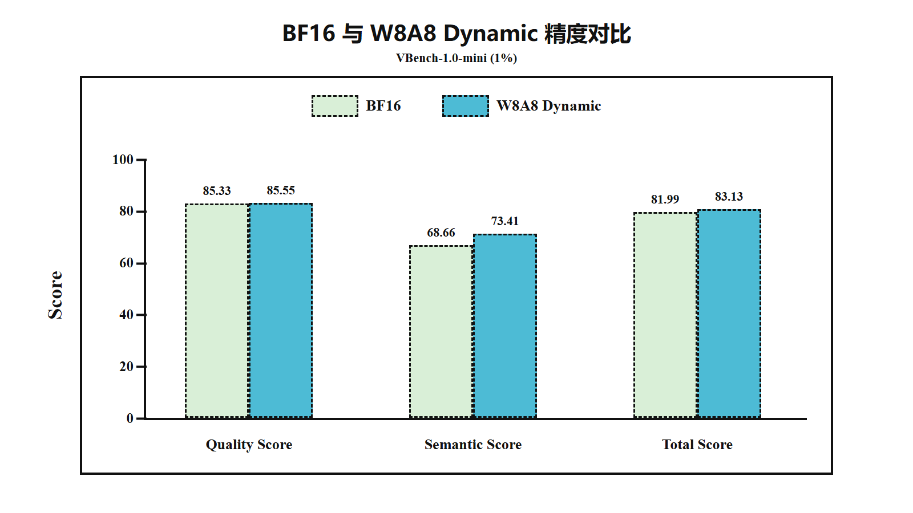

# Wan2.2 模型量化实践

## 概述

### 案例背景

Wan2.2 是面向多模态生成任务的视频生成模型。本案例以 Wan2.2 文生视频 A14B 模型为对象，给出 msModelSlim V1 一键量化配置与复现流程，并使用已有 W8A8 Dynamic 权重在昇腾 NPU 环境中完成推理和 VBench 精度验证。

与大语言模型不同，文生视频模型的精度不能仅通过单一任务准确率衡量。本文使用 VBench 的 Quality Score 和 Semantic Score 作为主要精度指标。

### 案例目标

本案例的目标如下：

1. 使用 msModelSlim V1 一键量化能力完成 Wan2.2 模型量化。
2. 给出从环境准备、模型量化到推理部署的完整可复现流程。
3. 使用 VBench-1.0-mini 的 1% 子集，对浮点权重与量化权重进行精度对比。
4. 分析量化对不同视频质量和语义指标的影响，并记录常见问题。

### 当前实验结论

已完成 VBench 1% 子集的一组可分析对比：

| 聚合指标 | BF16 浮点模型 | 量化模型 | 变化（量化 - 浮点） |
| --- | ---: | ---: | ---: |
| Quality Score | 85.33 | 85.55 | +0.22 % |
| Semantic Score | 68.66 | 73.41 | +4.75 % |
| Total Score | 81.99 | 83.13 | +1.14 % |

Quality Score 和 Semantic Score 均高于浮点模型，量化后没有出现精度下降，
满足本案例“量化精度不低于浮点精度”的验收要求。Semantic Score 提高
4.75 个百分点，Quality Score提高0.22个百分点，总体Total Score提高1.14个百分点。

## 模型与量化方案

### 模型结构

本案例使用的配置为 Wan2.2 T2V-A14B。关键参数如下：

| 参数 | 配置 |
| --- | --- |
| 任务 | 文生视频（T2V） |
| DiT 结构 | 高噪声、低噪声双专家 |
| 参数精度 | BF16 |
| Hidden Size | 5120 |
| FFN Hidden Size | 13824 |
| Attention Heads | 40 |
| Transformer Layers | 40 |
| 采样步数 | 40 |
| 高低噪声切换边界 | 0.875 |
| Guidance Scale | 低噪声 3.0，高噪声 4.0 |
| 文本编码器 | UMT5-XXL |
| VAE | Wan2.1 VAE |

### 输入与输出

输入为英文或中文文本提示词，输出为 MP4 视频。本次下载的精度测试视频规格如下：

| 参数 | 实际值 |
| --- | --- |
| 分辨率 | 1280 × 720 |
| 帧率 | 16 FPS |
| 帧数 | 81 帧 |
| 时长 | 约 5 秒 |
| 随机种子次数 | 每条提示词 1 次 |

浮点和量化视频的相对文件名、分辨率、帧率和时长一致，可以用于同口径精度对比。

### 量化方法选择

本案例最终采用 **W8A8 Dynamic**，对 Wan2.2 T2V-A14B 的高噪声和低噪声
两个 DiT 专家进行量化：

| 量化对象 | 配置 |
| --- | --- |
| Linear 权重 | INT8、per-channel、对称 MinMax |
| Linear 激活 | INT8、per-token、对称 MinMax，采用运行时动态量化 |
| Attention | Q/K/V/O Linear 随通用 Linear 规则进行 W8A8 Dynamic 量化，未配置独立的 Attention/FA 算子量化策略 |
| 描述文件 | 共 1896 项参数映射，其中 1201 项标记为 `W8A8_DYNAMIC`，695 项保留为 `FLOAT` |

## 前期准备

### 环境要求

请先参考 [msModelSlim 工具安装指南](https://msmodelslim.readthedocs.io/zh-cn/latest/zh/install_guide/install_guide/) 安装 msModelSlim，并完成 CANN、PyTorch 和 torch_npu 环境配置。

| 组件 | 版本 |
| --- | --- |
| 硬件 | 1 个昇腾 910C NPU、40 核 CPU、240 GB 主机内存、300 GB 存储 |
| 环境镜像 | `mindiesd:v3.0.0-A3-ubuntu22.04-py3.11-arm64` |
| Python | 3.11.14 |
| CANN | 8.5.1 |
| PyTorch / torch_npu | 2.9.0+cpu / 2.9.0 |
| MindIE SD | 3.0.0 |
| msModelSlim | 本地源码安装 |
| 评测工具 | AISBench、VBench-1.0-mini |

执行以下命令验证 msModelSlim 是否安装成功：

```bash
msmodelslim --help
```

### 目录规划

建议使用以下目录变量，避免在命令中写死路径：

```bash
export WORK_DIR=/workspace/work/Wan2.2
export MODEL_PATH=${WORK_DIR}/Wan2.2-T2V-A14B
export QUANT_PATH=${WORK_DIR}/Wan2.2-T2V-A14B-w8a8-int
export QUANT_CONFIG_PATH=${QUANT_PATH}/Wan2.2-T2V-A14B_best_practice.yaml
export VBENCH_PATH=${WORK_DIR}/VBench-1.0-mini
export BASE_RESULT_PATH=${WORK_DIR}/results_vbench_base
export QUANT_RESULT_PATH=${WORK_DIR}/results_vbench_quant
```

其中 `QUANT_PATH` 是本案例最终生成并用于 VBench 测试的 W8A8 Dynamic
权重目录。

### 准备 VBench 数据

本案例使用 VBench-1.0-mini：

- 1% 子集：`VBench_kmeans_info_0.01.json`，共 11 条提示词。

建议分别保留浮点和量化视频目录：

```text
results/
└── vbench_0.01/
    ├── base/
    └── quant/
```

## 量化流程

### 步骤 1：准备浮点权重

确认模型目录至少包含以下组件：

```text
${MODEL_PATH}/
├── low_noise_model/
├── high_noise_model/
├── models_t5_umt5-xxl-enc-bf16.pth
├── google/
│   └── umt5-xxl/
└── Wan2.1_VAE.pth
```

### 步骤 2：准备一键量化配置

本案例使用 `Wan2.2-T2V-A14B_best_practice.yaml`，配置协议为
`multimodal_sd_modelslim_v1`。将该文件放置在 `${QUANT_CONFIG_PATH}`；如果使用其他位置，应同步修改变量。完整配置如下：

```yaml
apiversion: multimodal_sd_modelslim_v1
spec:
  process:
    - type: linear_quant
      qconfig:
        act:
          scope: per_token
          dtype: int8
          symmetric: true
          method: minmax
        weight:
          scope: per_channel
          dtype: int8
          symmetric: true
          method: minmax
      include:
        - "*"
  dataset: wan2_2_t2v
  save:
    - type: mindie_format_saver
      part_file_size: 0
  multimodal_sd_config:
    dump_config:
      enable_dump: false
      capture_mode: args
      dump_data_dir: ""
    inference_config:
      size: 1280*720
      frame_num: 81
      sample_steps: 40
      convert_model_dtype: true
      task: t2v-A14B
metadata:
  config_id: Unknown
  score: 100.0
  label: {}
  verified_model_types: []
  verified_tags: {}
```

该配置对所有匹配 Linear 执行量化：激活采用 per-token、对称 INT8 MinMax，
权重采用 per-channel、对称 INT8 MinMax，没有配置显式回退层。

### 步骤 3：执行一键量化

可使用以下命令复现 W8A8 Dynamic 量化：

```bash
cd "${WORK_DIR}"
export PYTHONPATH="${WORK_DIR}:${PYTHONPATH:-}"

msmodelslim quant \
    --model_path "${MODEL_PATH}" \
    --save_path "${QUANT_PATH}" \
    --device npu \
    --model_type Wan2.2-T2V-A14B \
    --config_path "${QUANT_CONFIG_PATH}" \
    --trust_remote_code True
```

#### 一键量化部署 Tips

执行量化前，建议先完成以下检查：

```bash
test -n "${MODEL_PATH}" && test -d "${MODEL_PATH}"
test -n "${QUANT_CONFIG_PATH}" && test -f "${QUANT_CONFIG_PATH}"
python -c "import wan; print(wan.__file__)"
```

### 步骤 4：检查量化产物

Wan2.2 T2V-A14B 包含高噪声和低噪声两个 DiT 专家。量化产物应同时包含两个专家的量化权重和描述文件：

```text
${QUANT_PATH}/
├── low_noise_model/
│   ├── quant_model_description_w8a8_dynamic.json
│   └── quant_model_weight_w8a8_dynamic.safetensors
└── high_noise_model/
    ├── quant_model_description_w8a8_dynamic.json
    └── quant_model_weight_w8a8_dynamic.safetensors
```

本次下载的高、低噪声 W8A8 JSON 的 SHA256 均为
`eeb47c529c08ad1718c43308d4d03b3d9c344bd61c828766f72db1230b852838`。
可通过以下命令复核：

```bash
sha256sum \
    ${QUANT_PATH}/low_noise_model/quant_model_description_*.json \
    ${QUANT_PATH}/high_noise_model/quant_model_description_*.json
```

## 推理部署

### 浮点模型推理

浮点与量化模型应使用相同的生成参数。可在量化脚本基础上移除
`--quant_dit_path`，得到以下浮点 VBench 批量生成命令：

```bash
export ALGO=3
export PYTORCH_NPU_ALLOC_CONF='expandable_segments:True'
export TASK_QUEUE_ENABLE=2
export CPU_AFFINITY_CONF=1
export TOKENIZERS_PARALLELISM=false
export FAST_LAYERNORM=1

torchrun --nproc_per_node=2 --master_port=23459 vbench.py \
    --task t2v-A14B \
    --ckpt_dir ${MODEL_PATH} \
    --size "1280*720" \
    --frame_num 81 \
    --sample_steps 40 \
    --cfg_size 1 \
    --ulysses_size 2 \
    --vae_parallel \
    --base_seed 0 \
    --vbench_mini \
    --vbench_mini_root ${VBENCH_PATH} \
    --save_path ${BASE_RESULT_PATH} \
    --num_samples 1 \
    --temporal_flickering_samples 1 \
    --skip_existing
```

### 量化模型推理

`quant_run.sh` 中记录的量化 VBench 批量生成命令如下：

```bash
export ALGO=3
export PYTORCH_NPU_ALLOC_CONF='expandable_segments:True'
export TASK_QUEUE_ENABLE=2
export CPU_AFFINITY_CONF=1
export TOKENIZERS_PARALLELISM=false
export FAST_LAYERNORM=1

torchrun --nproc_per_node=2 --master_port=23459 vbench.py \
    --task t2v-A14B \
    --ckpt_dir ${MODEL_PATH} \
    --quant_dit_path ${QUANT_PATH} \
    --size "1280*720" \
    --frame_num 81 \
    --sample_steps 40 \
    --cfg_size 1 \
    --ulysses_size 2 \
    --vae_parallel \
    --base_seed 0 \
    --vbench_mini \
    --vbench_mini_root ${VBENCH_PATH} \
    --save_path ${QUANT_RESULT_PATH} \
    --num_samples 1 \
    --temporal_flickering_samples 1 \
    --skip_existing
```

`vbench.py` 的源码已下载为本地 `generate_vbench.py`。每条提示词只生成一个
样本，`job.index` 均为 0，因此量化脚本中每条视频实际使用 seed 0。

### 推理加载逻辑

当指定 `--quant_dit_path` 时，推理代码会分别加载高噪声和低噪声专家，并调用 MindIE SD 的 `quantize` 接口加载量化描述。

推理侧优先查找 `quant_model_description_w8a8_dynamic.json`。本次
`${QUANT_PATH}` 的高、低噪声目录都包含该文件，因此加载的是 W8A8 Dynamic。

## 精度验证

### 评测方法

本案例使用 AISBench 调用 VBench，对浮点模型和量化模型生成的视频进行评测。

主要指标包括：

- Quality Score：主体一致性、背景一致性、时序闪烁、运动平滑度、美学质量、成像质量和动态程度的归一化聚合。
- Semantic Score：对象类别、多对象、人物动作、颜色、空间关系、场景、外观风格、时序风格和整体一致性的归一化聚合。
- Total Score：`Quality Score × 4/5 + Semantic Score × 1/5`。

实验应满足以下可比性要求：

1. 浮点和量化模型使用相同提示词。
2. 使用相同随机种子和生成参数。
3. 使用相同分辨率、帧数、帧率和编码方式。
4. 每条提示词生成 1 个视频。

### 批量生成视频

浮点与量化批量生成命令见[推理部署](#推理部署)。服务器上的 `vbench.py`
已下载为 `generate_vbench.py`，量化侧启动参数保存在 `quant_run.sh`。
浮点和量化任务应分别设置输出目录，避免 `--skip_existing` 复用其他批次的视频。

### 执行 VBench 评测

浮点模型：

```bash
cd ${WORK_DIR}/benchmark
ais_bench ais_bench/configs/vbench_examples/eval_vbench_wan22_base.py -m eval
```

量化模型：

```bash
cd ${WORK_DIR}/benchmark
ais_bench ais_bench/configs/vbench_examples/eval_vbench_wan22_quant.py -m eval
```

执行前应在配置文件中显式设置当前子集 JSON：

```python
vbench_eval_cfg = dict(
    load_ckpt_from_local=True,
    full_json_dir="/workspace/work/Wan2.2/VBench-1.0-mini/VBench_kmeans_info_0.01.json",
)
```

### 1% 子集结果

本次有效结果来自以下两个评测批次：

- BF16：`outputs/vbench_wan22_base/20260722_104741`
- 量化：`outputs/vbench_wan22_quant/20260722_111302`

| VBench 指标 | BF16 | 量化 | 变化（量化 - BF16） |
| --- | ---: | ---: | ---: |
| Subject Consistency | 97.79 | 97.57 | -0.22 |
| Background Consistency | 96.69 | 96.75 | +0.06 |
| Aesthetic Quality | 59.93 | 60.07 | +0.14 |
| Imaging Quality | 68.02 | 68.08 | +0.06 |
| Object Class | 37.50 | 81.25 | +43.75 |
| Multiple Objects | 87.50 | 87.50 | 0.00 |
| Color | 100.00 | 100.00 | 0.00 |
| Spatial Relationship | 100.00 | 100.00 | 0.00 |
| Scene | 0.00 | 0.00 | 0.00 |
| Temporal Style | 25.98 | 25.79 | -0.19 |
| Overall Consistency | 16.40 | 16.35 | -0.05 |
| Human Action | 100.00 | 100.00 | 0.00 |
| Temporal Flickering | 97.07 | 97.63 | +0.56 |
| Motion Smoothness | 97.31 | 97.30 | -0.01 |
| Dynamic Degree | 100.00 | 100.00 | 0.00 |
| Appearance Style | 21.88 | 21.78 | -0.10 |
| **Quality Score** | **85.33** | **85.55** | **+0.22** |
| **Semantic Score** | **68.66** | **73.41** | **+4.75** |
| **Total Score** | **81.99** | **83.13** | **+1.14** |



### 精度结果分析

Quality Score 从 85.33 上升到 85.55，变化为 +0.22 个百分点。各 Quality 子指标的原始变化均较小：

- Temporal Flickering：+0.56 个百分点。
- Subject Consistency：-0.22 个百分点。
- Aesthetic Quality：+0.14 个百分点。
- 其余 Quality 子指标变化不超过 0.06 个百分点。

因此，现有 1% 数据支持“量化前后视频质量总体稳定”的初步结论。

Semantic Score 从 68.66 上升到 73.41，增加 4.75 个百分点，满足量化精度
不低于浮点精度的验收要求。

该视频在 Object Class 指标中的成功检出帧数如下：

| 模型 | 成功帧数 | 总帧数 | Object Class |
| --- | ---: | ---: | ---: |
| BF16 | 6 | 16 | 37.50 |
| 量化 | 13 | 16 | 81.25 |

Object Class 单项对 Semantic Score 的贡献约为 +4.86 个百分点。排除该项后，其余 Semantic 子指标合计变化约为 -0.11 个百分点。

由于 1% 子集在 Object Class 维度只有一个视频，该样本波动不影响“精度未下降”
的验收结论，更稳妥的表述是：
> 在 VBench 1% 子集、单 seed 条件下，量化模型的 Quality Score 和
> Semantic Score 均未下降，满足精度验收要求；Semantic Score 的明显增幅
> 受单个 Object Class 样本影响，不进一步解释为普遍能力提升。

### 精度验收结论

| 验收项 | 当前结论 |
| --- | --- |
| 1% Quality Score 不低于浮点模型 | 通过，量化模型高 0.22 个百分点 |
| 1% Semantic Score 不低于浮点模型 | 通过，量化模型高 4.75 个百分点 |

## 最终配置总结

### 实验路径回顾

| 步骤 | 操作 | 结果 |
| --- | --- | --- |
| 1 | 使用 BF16 权重生成 VBench 1% 视频 | 完成 11/11 |
| 2 | 准备 msModelSlim V1 W8A8 量化流程 | 配置与复现命令已确认；历史产物的成功日志未保留 |
| 3 | 使用量化权重生成 VBench 1% 视频 | 完成 11/11 |
| 4 | 使用 AISBench/VBench 对两组视频评测 | 完成 |
| 5 | 分析 1% Quality 与 Semantic 差异 | 完成 |

### 最终量化配置

| 配置项 | 最终值 |
| --- | --- |
| 复现量化框架 | msModelSlim V1 |
| 量化对象 | Wan2.2 高噪声、低噪声 DiT |
| 量化路线 | W8A8 Dynamic |
| 配置文件 | `Wan2.2-T2V-A14B_best_practice.yaml` |
| 权重量化 | INT8、per-channel、对称 MinMax |
| 激活量化 | INT8、per-token、对称 MinMax、运行时动态量化 |
| 量化范围 | `include: ["*"]`，未配置显式回退层 |
| 数据集适配器 | `wan2_2_t2v` |
| Attention 量化 | 未单独量化 |
| 推理并行 | 2 进程，CFG 并行度 1，Ulysses 并行度 2，启用 VAE Parallel |
| 量化生成 seed | 0 |
| 保存格式 | MindIE 格式，单个 safetensors 权重文件及一个描述 JSON |

### 实践经验总结

1. 多模态生成模型需要分别验证视频质量和文本语义，不能只看单一总分。
2. 小比例 VBench 子集容易受单个样本影响，解释单样本维度的明显波动时需要保持谨慎。
3. 浮点与量化模型必须使用相同 seed，否则无法把视频差异归因于量化。
4. Wan2.2 T2V-A14B 包含两个 DiT 专家，量化产物和加载验证必须同时覆盖高噪声、低噪声模型。
5. 推理侧自动探测多个量化描述文件时，应在日志中打印最终命中的文件，避免配置歧义。
