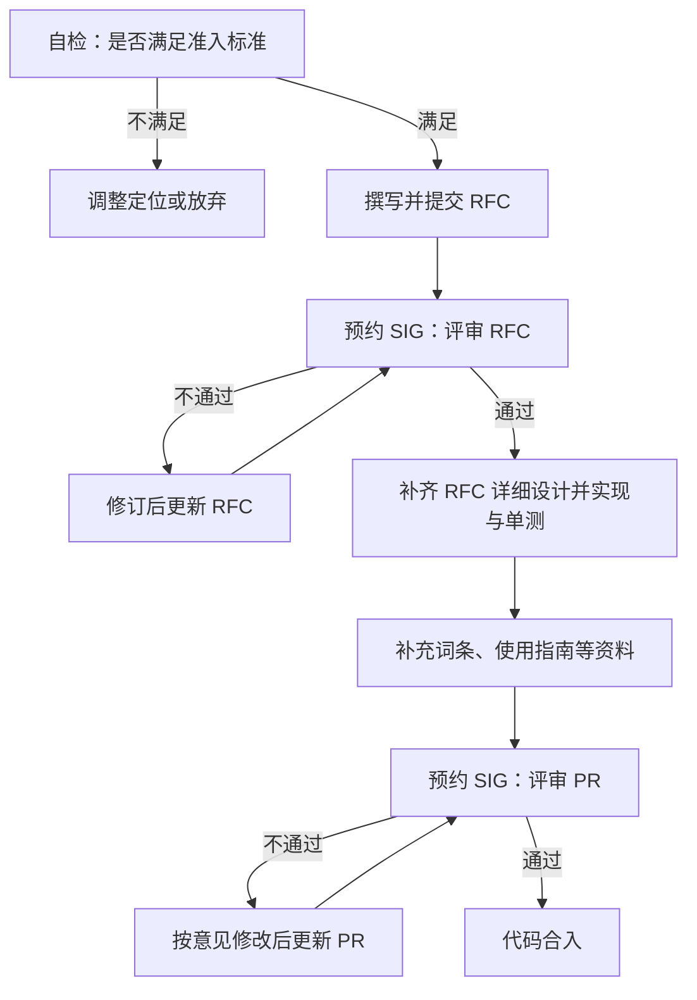

# 算法贡献指南

本文规范量化、压缩与分析算法向 msModelSlim **V1 框架**合入的流程、验收标准与交付物。整体遵循：先准入自检与撰写 RFC，经 SIG 方案评审通过后补齐详细设计并实现与单测，补齐资料后提交 PR，再经 SIG 代码检视合入。

> **核心原则**：不追求算法数量堆叠。合入的算法须在**至少一个明确场景**下，相对现有方案具备可验证优势（精度、性能、资源、易用性或覆盖缺口中的一项或多项）。无场景优势的重复实现一般不予合入。

通用 PR 与 CI 约定见《[Contributing to Mindstudio ModelSlim](contributing_guide.md)》。

## 1. 适用范围

本指南面向向 msModelSlim V1 框架贡献算法组件的开发者与算法工程师，经 SIG 会议完成方案评审与代码检视，并完成代码实现、测试与文档交付后合入主干。

**适用类别**：

| 类别 | 说明 | 示例目录 |
| --- | --- | --- |
| 离群值抑制 | 量化前对激活或权重分布整形 | `processor/anti_outlier/`、`processor/quarot/` |
| 结构量化 | 权重量化、激活量化、KV Cache、FA 等 | `processor/quant/` |
| 敏感层分析 | 为回退、混精、压缩提供敏感度度量 | `processor/analysis/` |

**不适用场景**：

- V0 框架增量算法——优先迁移或在 V1 中重新实现；
- 仅改配置、最佳实践 YAML、文档勘误——走普通 PR；
- 纯模型适配（无新算法）——按模型接入指南；
- 小修复或已有算法的局部增强——可走普通 Issue 或 PR，但仍须说明场景收益。

## 2. 流程关系与前置条件

**前置条件**：

- 已阅读《[Contributing to Mindstudio ModelSlim](contributing_guide.md)》，具备提交 Issue、PR 与签署 CLA 的条件；
- 已对照《[量化算法总览](../knowledge_base/quantization_algorithms/README.md)》，确认拟贡献能力与既有算法的定位关系；
- 已选定至少 1 组对比实验用的模型，以及评测数据或校准数据：模型与数据须可公开获取，或已在本仓库文档、`lab_practice` 中引用；评审与其他贡献者无需私有权重或未公开数据集，即可按同样配置复现；
- 本地开发环境可运行项目单测与 pre-commit（见《[编码规范](development_guide/coding_standards.md)》、《[开发者测试指南](development_guide/testing_guide.md)》）。

**后续操作**：

- 合入后：可登记精度与性能收益，便于社区传播；算法词条与使用指南按资料规范维护；
- RFC 不通过或无法证明场景优势：补充场景与实验后重提，或改为实验室插件、外部仓库孵化后再提案。

## 3. 输入和交付件

本流程开始前须完成准入自检；结束后须交付已通过方案评审的 RFC Issue，以及可合入的算法 PR。

| 类型 | 名称 | 来源或保存位置 | 格式或约束 | 验收方式 |
| --- | --- | --- | --- | --- |
| 输入 | 场景与对比实验材料 | 写入 RFC Issue；必要时附在后续 PR 描述中 | 含目标对象、对比基线、优势维度与结论；≥1 组可公开复现的模型与数据集，以及基线配置、本算法配置、指标表与复现步骤 | 可判断场景优势；他人可按步骤复现关键结论 |
| 输入 | 总体方案材料 | 写入 RFC Issue | 含算法端到端流程、跨模型泛化思路、用户入口与主要配置边界 | 可判断方案是否可落地、能否泛化到不同模型 |
| 交付件 | 算法提案 Issue | 仓库 Issue，标签含 `rfc` | 标题建议 `[RFC][Algorithm] <算法名>：<一句话场景优势>`；新建 Issue 时选用 **Request for comments (RFC)** 模板（自动带 `rfc` 标签） | 经 SIG 会议方案评审通过 |
| 交付件 | 算法合入 PR | 指向目标分支的 PR | 链接 RFC；含实现、单测、词条与使用指南、总览更新；按需含实践配置 | 经 SIG 会议代码检视通过，且合入标签齐全（`ascend-cla/yes`、`ci-pipeline-passed`、`lgtm`、`approved`） |

## 4. 流程总览

主路径如下。正式 SIG 门禁为两道：**RFC 方案评审**与 **PR 代码检视**。准入自检由贡献者在提案前完成，不是单独会议。不得跳过 SIG 会议直接合入。



## 5. 操作步骤

### 步骤 1：自检是否满足准入标准

**目标**：确认拟贡献算法具备可合入的场景优势与开源落地基本条件。

**操作**：对照下列要点完成自检。提交前须给出**场景定义**与**对比结论**，场景至少包含：

1. **目标对象**：模型族或结构类型（如 LLM Decoder、MLA、扩散 UNet）、量化模式（如 W4A8、W4A4 MXFP、C8）或业务约束（长序列、显存受限、校准数据极少等）；
2. **对比基线**：框架内已有、同定位的推荐算法或组合（见《[量化算法总览](../knowledge_base/quantization_algorithms/README.md)》）；
3. **优势维度**（至少一项可量化或可复现），并给出数据集范围与对应指标（含基线与本算法）；模型与数据须可公开复现：

   | 维度 | 可接受的优势形态（示例） |
   | --- | --- |
   | 精度 | 同量化模式下端到端指标优于基线，或在基线不可用的结构上首次达标 |
   | 性能 | 在精度可接受前提下，量化耗时、推理吞吐或时延、显存占用明显更优 |
   | 覆盖 | 填补框架空白（新量化模式、新子图类型、新分析粒度等） |
   | 资源与易用 | 在相近精度下显著降低校准数据量、算力、调参成本 |

   > **精度评测要求：** 宣称精度优势时，评测集须选用社区常用基准，**不建议**仅用过简、过小或自建抽样集作为唯一证据。常用参考：GPQA Diamond、DeepSWE、MMMU Pro；多模态生成类可用 VBench。按目标对象选取与任务匹配的集合，并在自检结论中写明评测集名称与指标。

4. **开源落地**：许可、依赖是否可在开源路径落地。

**不视为场景优势**：

- 与现有算法原理高度重合，仅换实现或换参数名；
- 仅在单一随机种子、未公开数据集或不可复现脚本上略优；
- 精度对比仅依赖过简 / 非主流评测集，或未给出社区常用基准上的结果；
- 只给出论文结论、无本仓库可跑通的配置与对比实验；
- 优势依赖未开源算子或私有运行时，且无法说明如何在开源路径落地。

**输出**：准入自检结论（含场景定义、数据集范围与指标摘要）；不满足则调整定位、改为扩展现有算法，或放弃提案。

### 步骤 2：撰写并提交 RFC

**目标**：按仓库 Issue 的 **Request for comments (RFC)** 模板提交算法提案，供 SIG **初次方案评审**。初次提交**必填**第 1 章概述、第 2 章用例分析与 **3.1 总体方案**；模板其余内容可在初审通过后再补齐。

**操作**：

1. 新建仓库 Issue，在模板列表中选用 **Request for comments (RFC)**（自动带标签 `rfc`）；标题建议：`[RFC][Algorithm] <算法名>：<一句话场景优势>`。
2. **初次必填**（写总体方案，不展开实现级细节）：

   | RFC 正文章节 | 须写清的内容 |
   | --- | --- |
   | 1. 概述 | 简介、动机、目标与非目标（边界）；嵌入步骤 1 的场景与优势摘要 |
   | 2. 用例分析 | 适用 / 不适用场景；功能点与关键指标；对比实验摘要（模型、基线、指标、复现要点）；使用限制与约束 |
   | 3.1 总体方案 | 从算法角度写清三块：① **算法流程**（做了哪些步骤、依赖什么输入、产生什么结果、与前后算法如何配合）；② **可调参数**（有哪些关键旋钮、含义、推荐默认与取值范围）；③ **模型侧信息诉求**（算法需要模型提供哪些结构或分布信息；对不同模型族如何泛化）。可用文字或流程图辅助 |

   对比实验建议写入“2. 用例分析”（可附图表）；初次评审前至少给出初步结果：

   ```text
   场景：<模型> + <量化模式> + <约束>
   基线：<已有方案与关键参数>
   本算法：<入口与关键参数>
   环境：软件版本、硬件、校准数据
   评测集：<如 GPQA Diamond / DeepSWE / MMMU Pro / VBench …>
   指标：精度 / 资源 / 推理（按宣称优势填写）
   结论：优势体现在 <维度>；不适用 <场景>
   ```

   3.1 总体方案建议按下列提纲写清（可附流程图）：

   ```text
   算法流程：
     输入：<浮点权重 / 激活；是否需要校准样本及样本形态>
     步骤：<步骤 1 → … → 步骤 N>（如收集统计量、计算平滑系数、回写权重等）
     输出：<处理后的权重或结构；对后续量化 / 压缩步骤的影响>
     与前后算法关系：<通常接在什么算法之后、什么算法之前>
   可调参数：
     关键参数：<名称；含义；推荐默认值；合理取值范围>
     调参建议：<优先调哪些、对精度 / 性能的大致影响>
   模型侧信息诉求：
     需要模型提供：<如哪些层 / 子结构的权重与激活、特殊连接关系等；无则写「无模型特有诉求」>
     跨模型泛化：<同一套思路如何覆盖不同模型族或结构变体；边界是什么>
   ```

3. **可初审后补齐**：除上述必填内容外，模板其余章节均可初审通过后再写。

**输出**：标签含 `rfc`、第 1～2 章与 3.1 齐全的算法提案 Issue 。

**通过条件**：第 1～2 章与 3.1 足以支撑初次 SIG 方案评审，可进入步骤 3。

### 步骤 3：预约 SIG 会议评审 RFC

**目标**：预约并完成 SIG 对 RFC 的方案评审；初次评审通过后，补齐 RFC 其余内容，确认可编码后再进入实现。

**输入**：步骤 2 已提交的 RFC Issue（第 1～2 章与 3.1 齐全）。

**操作**：

1. **如何预约**：在 RFC Issue 中评论申请上会（说明希望进行“算法 RFC 方案评审”），并 @ [仓库管理和维护成员](https://gitcode.com/Ascend/msmodelslim/member)（也可对照仓库根目录 `OWNERS`）；将 Issue 注明为可评审（如 Ready for SIG / Reviewing）。一般技术交流还可参见仓库 README 中的社区渠道（微信群、昇腾论坛等）；SIG 例会时段以维护者在 Issue 中的安排为准。
2. **初次评审须准备的材料**：
   - RFC 第 1～2 章与 3.1 总体方案；
   - 对比实验摘要（可复现的模型、数据、基线与指标）；
3. **SIG 初次评审关注的重点**：
   - 场景优势是否成立，对比是否公平、可复现；
   - 总体方案是否可落地：端到端流程是否清楚，跨模型泛化与适配边界是否合理；
   - 是否与现有能力重复建设，能否合并或扩展；
   - 新增模型侧信息诉求 / 适配接口是否必要、是否最小化。
4. 按会议意见修订必填章节；**初次评审通过后**补齐模板其余内容，并视需要再走一轮确认。若给出的实验场景不充分，评审可要求补充验证场景。复杂变更预期可能多轮评审。

**输出**：SIG 方案评审结论。

**通过条件**：SIG 确认场景优势成立且总体方案可落地。

### 步骤 4：补齐 RFC 详细设计，并完成代码实现与单元测试

**目标**：在初次方案评审通过后，先补齐 RFC 详细设计，再按方案落地实现；开发过程用单元测试维护质量，本次变更相关代码行覆盖率应大于 80%。

**输入**：方案评审通过的 RFC。

**操作**：

1. **补齐 RFC 其余章节（详细设计）**：将初审通过后约定补齐的内容写全（如 3.2～3.5、测试设计、风险、现有技术、未解决问题、附录等），把总体方案细化到可编码粒度：主要模块职责、配置字段与约束、校准 / 运行时诉求、与前后算法关系、测试计划。细节仍避免堆砌与评审无关的实现噪声；以“开发者按 RFC 能开工”为准。

2. **代码实现**：落点以 RFC 为准，可涉及算法组件、应用流程、领域或模型适配等。遵循《[编码规范](development_guide/coding_standards.md)》与 pre-commit；不引入与场景无关的大依赖。下面以 **Processor 接入**为例介绍接入过程（对照 `msmodelslim/processor/anti_outlier/smooth_quant/`）；其它落点可按 RFC 与仓库既有约定类比落地。

   > **RFC → Processor 代码落点：**
   >
   > | RFC 内容 | 落到代码 |
   > | --- | --- |
   > | **算法端到端流程** | Processor 前处理 / 处理 / 后处理（`preprocess` / `process` / `postprocess`） |
   > | **可调参数** | Config 与 YAML（`spec.process[].type` 及字段） |
   > | **模型泛化机制** | 按需 Interface / ModelAdapter |

   推荐目录：

   ```text
   msmodelslim/processor/<category>/<algo_name>/
   ├── __init__.py          # 导出 Config、Processor
   ├── processor.py         # Config 与 Processor 主体与注册
   ├── interface.py         # [按需] 模型适配接口；依赖模型特有结构时定义，否则可省略
   └── ...
   ```

   - **算法配置代码（对应可调参数）**：在 `processor.py` 中定义 Config，继承 `AutoProcessorConfig`；用 `type: Literal["your_type"]` 声明全局唯一入口名（小写加下划线），与 YAML `spec.process[].type` 一致。每个用户可调字段用 Pydantic `Field` 写清默认值与 `description`；取值范围、归一化等用校验器（如 `AfterValidator`）约束，非法配置须在加载期失败。作用范围优先复用 `include` / `exclude` 等既有模式；与其它算法的互斥或依赖在 RFC 与字段说明中写清。
   - **注册 Processor 并接入会话**：继承或组合 `AutoSessionProcessor`（或同类既有基类）；用 `@QABCRegistry.register(dispatch_key=YourConfig, abc_class=AutoSessionProcessor)` 注册。按需重写并与 RFC 一致：`is_data_free()`、`need_kv_cache()`、`support_distributed()` 等。在包 `__init__.py` 导出 Config、Processor，保证配置加载时可发现。
   - **核心逻辑组织**：将数值 / 变换等与会话解耦的逻辑抽成可独立调用的函数或方法，Processor 负责取统计、组上下文并调用；便于单测覆盖公式与边界。多实现或版本可用注册表分发，避免在 Processor 内堆叠分支。
   - **处理器前处理 / 后处理（对应算法端到端流程）**：按 RFC 流程在会话生命周期中落地——常见钩子为 `preprocess` / `process` / `postprocess`。需要校准数据时完成“挂接统计 → 跑校准数据 → 用统计结果改写结构或写回参数”；`is_data_free()` 为真时可跳过依赖数据的路径。明确统计对象、作用范围，以及无统计 / 未命中时的跳过或告警策略；与前后 `spec.process` 步骤的数据与结构假设保持兼容。
   - **模型适配接口（对应模型泛化机制）**：算法若需模型侧提供特有结构或信息，将 RFC 中写明的信息诉求定义为 Interface，由 ModelAdapter 实现，并至少提供一个参考适配；未实现接口时应有可诊断的回退或明确失败。不依赖模型特有信息时可省略。

3. **单元测试（与实现同步）**：开发过程中同步补测，而不是实现结束后一次性补。路径与源码目录对应（示例：`msmodelslim/processor/.../xxx.py` → `test/cases/processor/.../test_xxx.py`）；其它模块按仓库既有 `test/cases/` 约定。至少覆盖 Config 校验、核心计算与边界、Processor 在 mock 或小规模假数据下的关键路径、典型失败分支；需要校准的算法可用 mock 或假数据，避免 CI 依赖大模型权重。按《[开发者测试指南](development_guide/testing_guide.md)》执行，确认本次变更相关行覆盖率大于 80%。

**输出**：已补齐详细设计的 RFC；与 RFC 一致的可合入代码；通过的单元测试（覆盖率达标）。

**通过条件**：RFC 详细设计可支撑实现与检视；本地相关单测通过，且本次变更相关代码行覆盖率大于 80%。

### 步骤 5：补充词条、使用指南等资料

**目标**：使读者能从总览选到算法，并按指南起步使用。

**输入**：步骤 4 已稳定的用户入口、配置字段与适用边界。

**操作**：按下列交付物补齐资料：

| 交付物 | 要求 |
| --- | --- |
| 术语词条 | 适用与不适用场景写清；遵循《[术语词条模板](development_guide/docs_standards/01_term_glossary_template.md)》 |
| 使用指南 | 推荐起步配置与调参优先级，避免只罗列字段；遵循《[流程指南模板](development_guide/docs_standards/02_process_guide_template.md)》 |
| 算法总览登记 | 更新《[量化算法总览](../knowledge_base/quantization_algorithms/README.md)》对应表格与选择建议 |
| 最佳实践 | `lab_practice/` 至少一条可复现配置（如适用） |

推荐文档目录：

```text
docs/zh/knowledge_base/quantization_algorithms/<algo_name>/
├── term_<name>.md
└── usage_<name>.md
```

**输出**：词条、使用指南、总览更新；以及按需的实践配置。

### 步骤 6：预约 SIG 会议评审 PR

**目标**：提交 PR，预约并完成 SIG 代码检视，在标签齐全后合入主干。

**输入**：步骤 3～5 的产出；RFC Issue 链接。

**操作**：

1. **提交 PR**：
   - 标题建议：`[Feature][Algorithm] <算法名>：<场景一句话>`；
   - PR 须关联 RFC Issue；描述按仓库《[PR 模板](../../../.gitcode/PULL_REQUEST_TEMPLATE.md)》填写，内容详尽齐全；
   - 一个 PR 聚焦一个算法（或紧密耦合的一组变更）；
   - 按《[Contributing to Mindstudio ModelSlim](contributing_guide.md)》完成 pre-commit、单测说明，并评论 `compile` 触发 CI。
2. **如何预约 SIG 代码检视**：在 PR 中评论申请上会（说明希望进行“算法合入代码检视”），并 @ [仓库管理和维护成员](https://gitcode.com/Ascend/msmodelslim/member)；附上 PR 与 RFC 链接，确认 CI 已通过或说明剩余项。SIG 例会时段以维护者在 PR 中的安排为准。
3. **须准备的材料**：
   - **完整 RFC**：初次评审允许空缺的章节此时均已补全（含详细设计等）；附 RFC Issue 链接；
   - **PR**：含代码实现、单元测试与资料（词条、使用指南、总览登记等），交付齐全；附 PR 链接，并说明 CI / 单测与覆盖率情况；
   - **自验证报告**：说明算法接入框架后如何使用、精度等关键指标结果，以及是否与 RFC / 对比实验预期一致；已知遗留问题与风险一并写明。
4. **SIG 评审 PR 时关注的重点**：
   - 实现是否与已通过的 RFC（含详细设计）一致，有无未评审的接口或行为漂移；
   - 接入框架后的验证是否充分（关键路径可跑通、与现有流程或其他算法可合理组合）；
   - RFC / 对比实验中的关键数据与结论是否可按公开配置复现；
   - 代码与单测质量、覆盖率是否达标，关键路径是否可维护；
   - 资料是否齐全（词条、使用指南、总览登记）；
   - 框架契合与接口是否仍保持最小化；
   - 合入标签与 CI 门禁是否满足。
5. CI 通过后，由 Reviewer 评论 `/lgtm`、Committer 评论 `/approved`；集齐 `ascend-cla/yes`、`ci-pipeline-passed`、`lgtm`、`approved` 后合入。
6. 合入后可登记精度与性能收益，便于社区传播。

**输出**：已合入主干的算法能力及相关文档。

**通过条件**：SIG 会议代码检视通过，且四个合入标签齐全；场景优势与最低验收门槛均已满足。

**异常处置**：检视不通过时，按会议与检视意见修改代码、测试或文档后更新 PR，再次预约上会；未获检视通过不得合入。

## 6. 验收条件

合入前须同时满足场景优势论证与最低门槛，评审可要求补充实验。

| 门槛 | 要求 |
| --- | --- |
| 场景陈述 | RFC Issue 中写清适用场景、不适用场景与推荐搭配算法 |
| 总体方案与详细设计 | RFC 中写清算法端到端流程、跨模型泛化与适配边界、用户入口与主要配置；初审通过后补齐的详细设计足以支撑实现与检视 |
| 对比实验 | ≥1 个公开可获取的模型与数据集；给出基线配置、本算法配置、指标表与复现步骤 |
| 可接入 | 能按 RFC 约定的入口接入框架，并与现有流程或其他算法合理组合使用 |
| 可维护 | 通过单元测试（本次变更相关行覆盖率大于 80%）与 pre-commit；配置或接口有类型与校验；关键路径有日志 |
| 资料齐全 | 词条与使用指南齐全；并在《[量化算法总览](../knowledge_base/quantization_algorithms/README.md)》登记 |

## 7. 术语

| 术语 | 简述 | 链接 |
| --- | --- | --- |
| 量化算法 | 离群值抑制、线性量化、敏感层分析等算法说明 | 《[量化算法总览](../knowledge_base/quantization_algorithms/README.md)》 |
| 量化模式 | 如 w8a8、w4a8 等比特组合策略的命名与约定 | 《[量化模式命名规范](../knowledge_base/model/README.md#量化模式命名规范)》 |

## 8. 安全说明

- 贡献代码须符合仓库 Mulan PSL v2；移植论文或第三方实现时注明来源、许可与差异。
- 不得提交密钥、令牌、内网路径、未授权数据集或其他敏感信息。
- 对比实验与实践配置中的路径、账号信息须可公开复现，避免写入私有环境细节。
