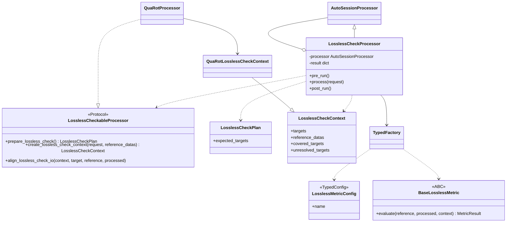
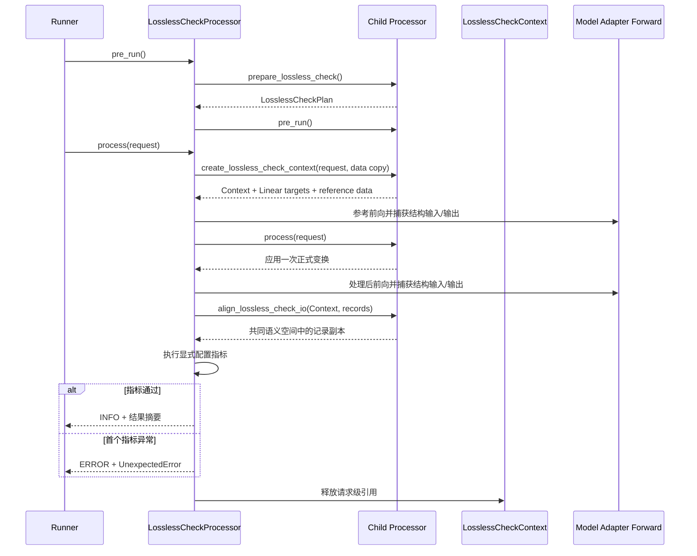

# msModelSlim无损自检容器特性设计说明书

## 1. 特性概述

模型旋转、平滑或等价变换类Processor会改变权重、模块或运行时数据的表示空间。
仅检查“流程未报错”不能证明变换前后语义一致，也无法定位错误配置落在哪个结构。

本特性提供通用`LosslessCheckProcessor`容器。容器包装一个子Processor，在真实Adapter
请求中执行处理前后两次前向，将双方恢复到共同语义空间，并在Linear等目标结构粒度执行
可扩展指标比较。首个指标异常会立即终止并输出Processor、Decoder、结构和指标信息。

本设计优先覆盖单容器、单子Processor场景。多子Processor组合不在当前范围内，
避免多个变换的恢复顺序、失败归因和生命周期相互耦合。

## 2. 设计目标

1. 为无损变换类Processor提供通用自检容器，而不是在QuaRot内固化一套专用流程。
2. 使用模型Adapter提供的真实数据与前向方式，不在容器内猜测模型输入。
3. 使用与仓内其他Processor一致的`include/exclude`语法限制Linear检查范围。
4. 指标由用户显式配置，不在代码中静默选择会形成兼容承诺的默认指标。
5. Processor未实现自检能力时只告警并继续执行原Processor。
6. 能力完整时严格执行，异常立即报错，避免错误产物继续交付。
7. 保证Python 3.8及以上可导入协议定义。
8. 处理后不遗留Hook、请求级Context或训练状态变化。

## 3. 模块结构与职责

```text
msmodelslim/processor/lossless/
├── __init__.py
├── processor.py
├── protocol.py
├── result.py
├── runtime.py
└── metrics/
    ├── __init__.py
    ├── base.py
    ├── builtins.py
    └── factory.py
```

| 模块 | 职责 |
| --- | --- |
| `processor.py` | 配置校验、双前向调度、Hook捕获、指标执行、异常分类和Context结果写入 |
| `protocol.py` | 三方法Processor协议，以及计划、请求上下文、目标和结构记录数据类型 |
| `result.py` | 创建稳定、可序列化的结果结构 |
| `runtime.py` | 目标解析、结构捕获、前向执行状态和树形Tensor遍历等运行时基础能力 |
| `metrics/base.py` | 指标插件配置、抽象基类和结果数据类型 |
| `metrics/factory.py` | 复用仓库插件框架发现、创建和校验指标组件 |
| `metrics/builtins.py` | 用户可显式选择的通用数值等价指标 |
| `quarot_lossless.py` | 离线QuaRot请求上下文构造和反旋转语义对齐 |

各模块边界如下：

- 容器负责“何时运行、捕获什么、如何比较和如何报告”，不理解具体算法。
- 子Processor负责“处理什么、如何恢复到共同语义空间”，不重复实现比较引擎。
- Adapter负责“真实输入如何构造、模型或分层请求如何前向”，不承担自检状态管理。
- 指标负责“两个Tensor是否满足准则”，不修改模型、输入或容器流程。
- `LosslessCheckPlan`保存整轮理论目标；无行为的`LosslessCheckContext`保存单次请求所需的
  参考数据、Linear目标和算法快照，请求结束后立即释放。

关键类关系如下：



## 4. 核心协议

### 4.1 协议选型

协议使用`typing_extensions.Protocol`与`runtime_checkable`，原因如下：

- 第三方Processor可以采用结构化子类型，只需实现约定方法，无需修改继承树。
- 现有Processor已经继承`AutoSessionProcessor`，若再要求继承ABC，会形成不必要的
  多继承约束并扩大接入改动。
- 容器需要在运行时识别可选能力，`runtime_checkable`可完成能力检查。
- `typing_extensions.Protocol`支持Python 3.8，避免依赖较新标准库实现。

ABC适合强制统一对象族的基类实现，但当前场景是给既有、第三方Processor增加可选能力，
Protocol的侵入性和兼容性更合适。

### 4.2 Processor协议

`LosslessCheckableProcessor`定义三个方法：

| 方法 | 输入 | 输出 | 职责 |
| --- | --- | --- | --- |
| `prepare_lossless_check` | 无 | `LosslessCheckPlan` | 在执行变换前冻结理论目标；不得被后续实际执行修改 |
| `create_lossless_check_context` | 当前请求、参考数据副本 | `LosslessCheckContext` | 声明当前请求的Linear候选、恢复后的参考输入、已覆盖和未解析目标 |
| `align_lossless_check_io` | Context、目标、处理前后记录 | 两份`StructureIORecord` | 只对捕获副本做算法语义恢复 |

Processor一个方法都未实现或只实现部分方法时，容器均输出WARNING并跳过比较，
随后按原流程执行子Processor。这样可保持容器通用性，不会因第三方Processor暂未接入而
阻断原有功能。

### 4.3 Plan与Context数据契约

本设计不再要求算法实现一个带五个方法的Session。正式变换直接复用子Processor原有的
`process(request)`，算法只需通过两个无行为数据对象向容器交付事实：

| 数据对象 | 字段 | 含义 |
| --- | --- | --- |
| `LosslessCheckPlan` | `expected_targets` | 完整配置理论上应覆盖的算法目标，用于整轮覆盖收口 |
| `LosslessCheckContext` | `targets` | 当前request模块范围内可挂Hook的Linear候选 |
| `LosslessCheckContext` | `reference_datas` | 已恢复到处理前坐标的请求数据副本 |
| `LosslessCheckContext` | `covered_targets` | 本request将实际消费的算法目标，不等同于已执行Linear |
| `LosslessCheckContext` | `unresolved_targets` | 本request选中但无法从模型解析的算法目标 |

`covered_targets`与`targets`必须分开：某些旋转动作直接作用于embedding参数，能够随request
执行，但不是可挂Hook的Linear；反过来，Linear候选也可能因样本路由未被实际调用。

Context不得持有Processor、Module、Hook、回调或其他行为，只允许保存请求级纯数据和必要的
Tensor快照。容器只在一次`process()`的局部作用域中持有Context，并在`finally`中清理捕获记录
和引用。当前验收只比较Linear输入输出，不再要求请求最终输出对齐接口。

### 4.4 指标插件

指标不是第二组Processor能力协议，而是一族由工厂创建的独立组件。配置复用仓库
`TypedConfig`，实现继承`BaseLosslessMetric`，只需要提供一个Tensor比较方法：

```python
class BaseLosslessMetric(ABC):
    @abstractmethod
    def evaluate(
        self,
        reference: torch.Tensor,
        processed: torch.Tensor,
        context: MetricContext,
    ) -> MetricResult:
        ...
```

第三方包通过`msmodelslim.lossless_metric.plugins`入口点同时提供自己的配置类和组件类。
配置类负责阈值及专用选项校验，仓库`TypedFactory`按用户配置顺序创建组件；容器不需要为
新增指标修改调度代码。ABC适合这里的原因是指标本身就是统一创建和执行的对象族，而
Processor是向既有继承树增加可选能力，仍使用低侵入的Protocol。

`MetricContext`提供Processor、Decoder、结构类型、输入或输出侧、调用序号和Tensor路径，
指标结果只允许返回可序列化观测值。组件类必须继承`BaseLosslessMetric`，错误配置、未知插件
或错误组件类型均在模型执行前失败。配置文件不允许指定任意Python文件路径。

`MetricResult.violations`用于声明本次失败中具体未满足的阈值条件。每个
`MetricViolation`包含子指标名、实测值、阈值和期望比较关系；该字段有空元组默认值，
已有第三方指标无需修改即可继续运行。第三方指标未提供违例明细时，容器使用
`MetricResult`的总指标值和阈值生成兼容性明细。

容器还会校验指标返回合同：`MetricResult.name`必须与配置中的指标名一致，`passed`必须是
真正的`bool`，`observations`必须是字典且不得覆盖容器保留的定位、判定和日志字段，
`violations`必须是由`MetricViolation`组成的元组。合同不合法时按`metric_execution_error`
立即终止，不允许错误插件污染检查结果或失败日志。

## 5. 执行流程



容器在每次请求中执行以下步骤：

1. 根据Context声明的Linear目标及`include/exclude`选择本次检查范围。
2. 克隆请求Tensor叶子，由子Processor构造参考坐标数据，注册临时pre-hook和forward-hook。
3. 使用Adapter已生成的请求数据执行参考前向并保存结构记录。
4. 回放Python、CPU和已初始化加速器的随机状态。
5. 通过标准`processor.process(request)`执行一次正式变换，再执行处理后前向并保存结构记录。
6. 验证调用顺序、调用次数、结构、shape、dtype、device和有限值。
7. 由子Processor对齐接口反旋转或恢复仿射语义，再执行用户显式配置的指标。
8. 首个指标失败时先写结果、输出ERROR日志，再抛出异常。
9. 无论成功或失败，都移除Hook、释放Context和捕获记录，并恢复训练状态。

## 6. 语义对齐设计

### 6.1 离线QuaRot

离线QuaRot在`prepare_lossless_check`阶段冻结两份彼此独立的计划：

- 理论计划用于确定应检查的结构和恢复语义。
- 执行计划用于实际修改模型，缺失或错误命令不能反向污染理论计划。

设线性层参考输入为`x`，右旋矩阵为`R`。权重变换后实际输入处于旋转坐标，
QuaRot的对齐接口对处理后输入按`x_processed @ R.T`恢复。左旋影响输出坐标，
对齐接口对处理后输出执行对应逆变换。同一目标有多条命令时必须按严格逆序恢复，
否则组合矩阵不可正确抵消。

Norm融合会在Context中保存原`gamma`和`beta`快照，将处理后Linear输入恢复到融合前语义。
bake mean使用专用对齐函数恢复共同均值空间。全局旋转影响进入分层request的hidden state，
由`create_lossless_check_context`生成参考数据时恢复。当前只验收Linear输入输出，不比较request最终输出。

逐层Runner可能在`pre_run`时尚未装载后续层。因此离线QuaRot的实际pre-run变换在
首个正式`processor.process`调用时延迟应用，理论计划则提前冻结。未进入逐层请求的剩余目标在
`post_run`阶段按原算法完成处理，避免为了自检改变最终模型产物。

## 7. 指标与判定

### 7.1 内置数值等价指标

`numerical_equivalence`同时计算：

- dtype和数值尺度自适应的`atol`、`rtol`；
- `max_abs_diff`和`max_relative_diff`；
- `mean_abs_diff`、`rmse`和`normalized_rmse`；
- 逐元素接近性与分布误差判定。

逐元素判定通过，或最大绝对误差与归一化RMSE同时满足分布容差，即视为该指标通过。
阈值由实现根据dtype推导，不允许用户覆盖。`numerical_equivalence`是一个可显式选择的
内置推荐指标，不是强制项，也不会在用户省略`metrics`时自动启用。

### 7.2 显式指标策略

`metrics`是必填且非空的列表。容器按配置顺序执行指标，每一个都是判定项；首个指标失败时
立即终止，后续指标不再运行。当前配置中没有`default_metric_policy`和`gating`字段，也没有Processor
推荐指标接口。这样可以避免在使用习惯尚未稳定时固化默认选择。

配置项可以是指标名字符串，也可以是带插件专用参数的对象。配置解析阶段拒绝缺失或空指标
列表、未知指标、重复指标、插件参数错误以及旧版`default_metric_policy`、`gating`等字段。

### 7.3 日志与异常

指标通过使用INFO日志输出Processor、Decoder、结构、位置、指标值和阈值。
指标异常使用四条连续ERROR日志，内容按以下顺序组织：

1. 结论：失败分类和总指标名。
2. 位置：Processor、Decoder、结构、输入或输出侧、调用序号及Tensor路径。
3. 未达标指标：逐项输出子指标实测值、期望比较关系和阈值。
4. 关键指标：输出指标实现返回的可序列化观测值。

`numerical_equivalence`会分别指出`max_abs_diff`、`normalized_rmse`中实际越界的项目，
不会再用含义不明确的单一`value`代替失败原因。非指标异常采用“结论、位置、差异详情”
结构输出。每段都是独立日志记录，不绕过仓库日志器的特殊字符过滤。异常先写入
`lossless_check.state.result`再抛出，便于上层捕获后读取首个失败现场。

能力不足与执行异常严格区分：

- Processor或Adapter能力不足：WARNING，子Processor继续运行，`passed: null`。
- 目标未被样本触发：WARNING，列入`skipped_targets`，`passed: null`。
- 协议、结构、对齐或指标错误：ERROR并立即终止，`passed: false`。

## 8. 配置与扩展

容器配置必须只有一个子Processor，不允许嵌套`lossless_check`或`group`。
`include`和`exclude`使用仓内`ConfigSet`规则匹配完整结构名，支持`*`、`?`和brace语法；
`exclude`优先。它们只影响Linear比较范围，不改变子Processor的实际处理范围。`metrics`
必须由用户显式提供，所有未知旧字段都会在运行前被拒绝。

第三方Processor接入步骤：

1. 在Processor中实现`prepare_lossless_check`，返回不受实际执行修改的`LosslessCheckPlan`。
2. 实现`create_lossless_check_context`，返回当前request的Linear目标、参考数据副本、覆盖目标
   和未解析目标。Context只保存数据，不保存行为或模型引用。
3. 实现`align_lossless_check_io`，返回共同语义空间中的两份`StructureIORecord`副本。
4. 让Processor原有`process(request)`完成正式变换；不要为自检复制第二套算法处理实现。
5. 如需专用指标，提供`LosslessMetricConfig`子类、`BaseLosslessMetric`实现和插件入口点，
   并要求用户在`metrics`中显式选择。
6. 覆盖正向等价、缺失/错误变换、重复调用、未观察结构、Context释放和异常清理测试。

对齐实现不得修改参考记录，不得把对齐结果写回正式处理流。只有当某个已支持算法的模型
存在无法由真实Adapter请求、Linear Hook和Processor对齐接口表达的差异时，才考虑增加最小
模型接口；当前实现不预设额外模型自检接口。

## 9. 兼容性与限制

- 协议定义兼容Python 3.8及以上。
- 子Processor未接入协议时保持原行为，不形成破坏性升级。
- 自检启用后需要真实前向数据，因此`is_data_free`为`False`。
- 当前不支持分布式自检，也不支持需要KV Cache的子Processor。
- Adapter生成的请求决定可观察边界；未观察目标不会被声明为通过。
- 当前只检查实际执行的Linear输入输出，不检查request最终输出。
- 容器本身不硬编码模型类型；可运行前提是模型已有Adapter能生成真实前向请求，并且子Processor
  已具备该模型的算法计划。不能把“容器模型无关”理解为所有模型自动支持。
- NPU上的功能、峰值显存和多卡效率必须在具备设备映射与对应CANN环境中验证。

## 10. 测试与性能设计

非NPU测试覆盖：

- 容器配置、能力降级、三方法契约、Plan/Context数据契约和结果状态；
- shape、dtype、device、非有限值、调用次数和调用顺序异常；
- 指标必填、旧字段拒绝、显式内置指标和第三方注册指标；
- 离线QuaRot右旋、左旋、多命令、Norm融合、bake mean和延迟pre-run；
- Qwen3、Qwen3-VL真实Transformers结构正向验证；
- Qwen3-VL删除实际旋转命令后的首个Linear异常定位；
- Hook移除、Context释放、训练状态恢复和随机状态回放。

Session移除和Linear-only收口改变了检查次数与运行路径，因此旧revision的CPU/NPU耗时、
显存和检查数量不能直接代表当前实现。当前revision先完成本地功能与静态回归；真实Qwen3、
Qwen3-VL正负向、NPU耗时和峰值显存将在目标910B3环境重新采集后补充。未完成新revision
服务器实测前，不形成性能合格结论。

## 11. 验收标准

1. 支持单子Processor通用容器，未接入协议时仅告警且原处理流程可继续。
2. 离线QuaRot正向用例通过。
3. 错误旋转能定位首个异常Linear，并输出完整ERROR上下文。
4. `metrics`必填，只有用户显式配置的指标会执行，旧默认策略字段被明确拒绝。
5. Qwen3和Qwen3-VL场景有可复验正负向证据。
6. 所有Hook、请求级Context和训练状态在结束后正确恢复。
7. 用户指南与第三方Processor接入规范完整。
8. 非NPU测试、静态检查和文档检查通过。
9. NPU服务器完成真实功能、性能、显存和多卡验证后，才形成最终验收结论。
